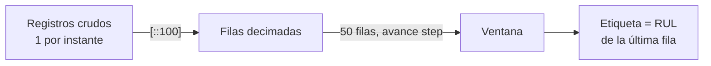

# Ventanas, stride y horizonte real

> [!abstract] En una frase
> La ventana son 50 filas decimadas de un solo motor, y con stride 100 esa ventana cubre 0,44 ciclos de vuelo, no 50.

## El problema que resuelve

El HDF5 guarda un registro por instante de operación, con 18 canales por fila. Ese flujo es largo, redundante y está ordenado en el tiempo: dos filas consecutivas dicen casi lo mismo.

Un árbol de decisión no puede leer una secuencia. Una red recurrente sí, pero necesita un largo fijo. La ventana resuelve las dos cosas: corta el flujo en bloques de tamaño conocido, y cada bloque se puede resumir en un vector para la rama tabular.

Hay dos decisiones distintas metidas en la palabra «ventana», y confundirlas es el error clásico:

| Parámetro | Qué decide | Dónde se aplica |
|---|---|---|
| `stride` | Cuántos registros crudos se conservan | Al cargar el HDF5 (`src/ds02_rul/data.py:55`) |
| `step` | Cuántas filas avanza la ventana dentro del motor | Al cortar las ventanas (`src/ds02_rul/features.py:130`) |

## Cómo funciona

El primer recorte es global y ocurre una sola vez: `fh[k][::stride]` conserva una fila de cada 100 y mantiene alineados unidad, ciclo, `W`, `Xs` y RUL (`src/ds02_rul/data.py:55`). El segundo recorte es por motor: el bucle recorre las unidades y avanza de a `step` (`src/ds02_rul/features.py:118` y `:130`). Una ventana nunca cruza dos motores, y un motor con menos de 50 filas se descarta (`src/ds02_rul/features.py:127`).

Los valores vigentes son ventana de 50, stride 100 y step 3 en ajuste, 2 en test (`src/ds02_rul/pipeline.py:88`). El step menor en test produce más ventanas por motor, que es lo que se quiere al evaluar.

De ahí sale el dato que hay que saber decir: **50 filas con stride 100 no son 50 ciclos**. Cada fila decimada representa 100 registros, así que la ventana abarca unos 5 000 registros, y eso equivale a **0,44 ciclos de vuelo**. La ventana ve menos de medio ciclo de historia. El nombre «ventana de 50» cuenta filas, no tiempo.

El solapamiento es la otra mitad de la historia. Con ventana 50 y step 3, dos ventanas consecutivas comparten 47 de sus 50 filas: un 94 %. Con step 2 comparten 48, un 96 %. Las etiquetas se solapan en la misma proporción, y por eso la validación no puede ser por fila ([[c10-oof-y-validacion-agrupada]]).

## Dónde aparece en este proyecto

- Decimación y alineación de arrays: `src/ds02_rul/data.py:49` (firma) y `:55` (el `[::stride]`).
- Corte de ventanas, salto por motor y resumen tabular: `src/ds02_rul/features.py:79`, `:118`, `:130`.
- Steps de ajuste y de test: `src/ds02_rul/pipeline.py:88`.
- Canales y conteos: 18 canales crudos, 19 en la secuencia por `cyc_norm`, 93 features tabulares ([[s04-ventanas-y-features]]).
- Conteos por split: 17 450 ventanas de desarrollo y 6 196 de test, sobre 52 635 y 12 538 filas ([[e00-cifras-autoritativas]]).

## Qué alternativa se rechazó

| Alternativa | Por qué no |
|---|---|
| Stride 1, sin decimar | Multiplica por 100 las filas y el costo de ajuste, sin agregar información: los registros consecutivos están casi duplicados. |
| Step 1 | Genera ventanas casi idénticas; la validación se vuelve optimista y el costo se triplica. |
| Ventana más corta | Menos contexto temporal para la rama recurrente, con más solapamiento relativo entre ventanas. |
| Ventana que cruce motores | La etiqueta RUL dejaría de tener sentido: mezclaría el final de un motor con el comienzo de otro. |

> [!warning] La trampa
> Decir «ventana de 50 ciclos» es la frase que hunde la defensa. Son 50 filas decimadas, y el horizonte real es de 0,44 ciclos. El propio README del repositorio lo admite: el nombre del código sobreestima el horizonte.

## Di esto en el tribunal

> [!quote]
> «La ventana son 50 filas de un solo motor, decimadas con stride 100. Eso cubre 0,44 ciclos de vuelo, no 50: es menos de medio ciclo de historia. Son dos perillas distintas —el stride decide cuántos registros entran, el step decide cada cuántas filas corto la ventana siguiente— y con step 3 dos ventanas consecutivas comparten el 94 % de sus filas.»

## Flashcards

> [!question]- ¿Cuánto tiempo real cubre una ventana de 50 filas?
> 0,44 ciclos de vuelo, porque cada fila conservada representa 100 registros crudos. Es menos de medio ciclo.

> [!question]- ¿Qué pasa si bajo el step de 3 a 1?
> Salen tres veces más ventanas, casi idénticas entre sí. El modelo ve menos diversidad por unidad de costo y la validación se vuelve optimista por el solapamiento.

> [!question]- ¿Por qué el step de test es menor que el de ajuste?
> Para obtener más ventanas por motor al evaluar. El ajuste prioriza cobertura y costo; el test prioriza resolución de la curva (`src/ds02_rul/pipeline.py:88`).

> [!question]- ¿Una ventana puede mezclar dos motores?
> No. El corte itera por unidad (`src/ds02_rul/features.py:118`) y descarta los motores con menos de 50 filas, así que cada ventana pertenece a un solo motor.

## Conexiones

Antes: [[c01-que-es-rul]] · Después: [[c03-fuga-de-informacion]] · Detalle del corte: [[s04-ventanas-y-features]]
