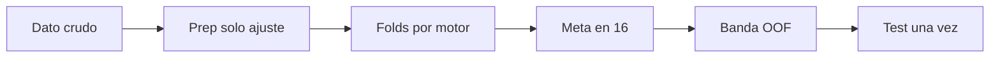

# Fuga de información y las cuatro defensas

> [!abstract] En una frase
> Hay fuga cuando el modelo aprende con información que en producción no tendrá, y este pipeline la bloquea en cuatro lugares distintos: transformaciones, folds, meta y banda.

## El problema que resuelve

Un número de validación solo vale si el modelo que lo produjo no vio esas filas. La fuga es cualquier camino por el que esas filas entran al entrenamiento sin que se note: una media del escalador, un fold mal armado, un meta que se puntúa a sí mismo, una banda calibrada con los mismos residuales que después se presentan como cobertura.

En este proyecto la fuga es especialmente fácil por tres razones:

- Las ventanas se solapan un 94 %, así que dos filas vecinas son casi la misma fila.
- Hay seis motores de desarrollo y tres de test: agrupar mal es trivial.
- El proceso tiene dos etapas (bases y meta), y cada una puede filtrar por su cuenta.

Una fuga no rompe el código: mejora los números. Por eso se defiende con estructura, no con cuidado.

## Cómo funciona

Las cuatro defensas, en el orden en que actúan:

| # | Defensa | Qué impide | Dónde |
|---|---|---|---|
| 1 | Transformaciones ajustadas solo con motores de ajuste | Que las medias del holdout entren al `scaler`, al polinomio y a los 14 ridges | `src/ds02_rul/features.py:25`, `src/ds02_rul/pipeline.py:103` |
| 2 | Folds agrupados por motor | Que dos ventanas del mismo motor caigan en lados distintos del corte | `src/ds02_rul/stacking.py:146` |
| 3 | Meta ajustado en la unidad 16 y `beta` puntuado fuera | Que el meta se evalúe sobre las filas que lo ajustaron | `src/ds02_rul/stacking.py:192` |
| 4 | Banda calibrada sobre residuales fuera de fold | Que la cobertura se mida con los residuales del propio ajuste | `src/ds02_rul/conformal.py:28` |

La defensa 1 tiene un efecto medible y medido. Antes, el `scaler`, el polinomio y los ridges se ajustaban con las seis unidades de desarrollo, holdout incluido: 52 635 filas. Ahora se ajustan con 44 982 filas, solo los motores de ajuste. El holdout queda limpio de punta a punta, no solo para los pesos del modelo.

La defensa 2 no confía en el orden: lo verifica. Antes de puntuar un fold, el código levanta una excepción si encuentra una unidad compartida entre ajuste y puntuación (`src/ds02_rul/stacking.py:275`). Además, cada fold reajusta escaladores y ridges con sus propios motores de entrenamiento, porque si no la transformación seguiría viendo las filas puntuadas.

La defensa 3 separa dos preguntas. El meta se ajusta en la unidad 16, que es holdout puro; `beta` se elige con folds agrupados sobre los motores de ajuste, y las unidades 11, 14 y 15 se leen una sola vez, al final.

La defensa 4 usa esos mismos residuales fuera de fold para calibrar los cuantiles por tramo: 17 450 ventanas de desarrollo. Es la razón por la que la cobertura se puede informar en vez de suponer ([[c12-conformal-prediction]]).

## Dónde aparece en este proyecto

- Transformaciones sin fuga: `src/ds02_rul/features.py:25` y su docstring, que exige «ONE split only».
- Reajuste por fold: `src/ds02_rul/pipeline.py:157` y el docstring de `:162`.
- Folds agrupados y su guarda: `src/ds02_rul/stacking.py:146` y `:275`.
- Selección de `beta` fuera de fold: `src/ds02_rul/stacking.py:234`; reparto completo en [[s01-protocolo-honesto]].
- Banda fuera de fold: `src/ds02_rul/conformal.py:8` y [[s11-banda-conformal]].

Fuente: [[visuals/c03-fuga-4-defensas.mmd]]

## Qué pasaría si se hiciera mal

| Error | Qué se ve | Por qué engaña |
|---|---|---|
| Escalar con las seis unidades de desarrollo | Validación algo mejor y test peor | La media del holdout ya está dentro de la transformación; el holdout deja de ser out-of-sample |
| Partir por filas en vez de por motores | Validación espectacular | Dos ventanas del mismo motor, separadas por tres filas, caen en lados distintos: el modelo reconoce al motor, no la falla |
| Ajustar el meta y puntuar `beta` en la unidad 16 | RMSE de validación absurdo y `beta` en el máximo del grid | Es exactamente el fallo del cuaderno original, documentado en `src/ds02_rul/stacking.py:3` |
| Elegir `beta` o `alpha` contra el test | El mejor test posible | Es ajustar el conjunto de despliegue; ADR-007 lo rechaza explícitamente |

El caso del cuaderno original es el más didáctico: el meta se ajustaba y se puntuaba en las mismas filas de la unidad 16, el RMSE de validación salía muy por debajo del BiLSTM y `beta` se iba al extremo del grid. Nada de eso era talento; era el meta leyendo su propia respuesta.

> [!warning] La trampa
> Un RMSE de validación mejor que el de test no es talento: es la firma de una fuga. En este proyecto la diferencia legítima entre validación y test es de décimas, no de unidades.

## Di esto en el tribunal

> [!quote]
> «La fuga no se evita con cuidado, se evita con estructura. Acá está bloqueada en cuatro puntos: el escalador y los 14 ridges se ajustan solo con los cinco motores de ajuste, los folds separan motores enteros y el código aborta si una unidad aparece en los dos lados, el meta se ajusta en la unidad 16 y `beta` se puntúa fuera de fold, y la banda se calibra con residuales que el meta no vio. Si cualquiera de las cuatro falla, el número sube y deja de predecir el test.»

## Flashcards

> [!question]- ¿Cuántas filas alimentan el escalador y los ridges?
> 44 982, solo de los motores de ajuste. Antes eran 52 635, con el holdout incluido, y eso era fuga.

> [!question]- ¿Por qué los folds se agrupan por motor?
> Porque las ventanas se solapan un 94 %. Partir por filas pondría ventanas casi idénticas en ajuste y en puntuación, y el modelo reconocería al motor en lugar de la falla.

> [!question]- ¿Qué hace el código si un fold comparte una unidad?
> Levanta una excepción con las unidades repetidas (`src/ds02_rul/stacking.py:275`). La separación se verifica, no se asume.

> [!question]- ¿Sobre qué filas se calibra la banda conformal?
> Sobre 17 450 ventanas de desarrollo con residuales fuera de fold: cada fila fue puntuada por un meta que no la vio (`src/ds02_rul/conformal.py:8`).

## Conexiones

Antes: [[c02-ventanas-y-horizonte]] · Después: [[c04-metricas-y-baseline]] · Protocolo completo: [[s01-protocolo-honesto]]
