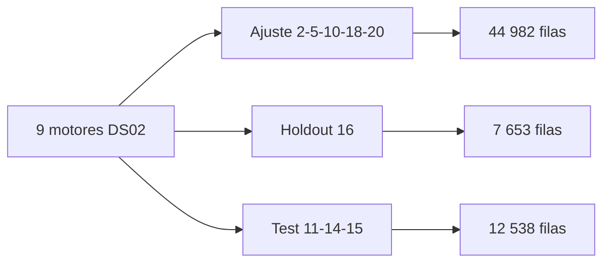

# Protocolo honesto — reparto por motor

> [!abstract] En una frase
> Ninguna fila de test ni de holdout toca el entrenamiento, y el test se lee una sola vez al final.

## Contrato

| Entra | Sale |
|---|---|
| HDF5 DS02 sin partir, 9 motores | Tres conjuntos disjuntos por motor: ajuste, holdout y test |
| Predicciones candidatas | Una sola fila de test publicada, con su manifiesto |

## Cómo está implementado

El reparto vive en `models/ds02_manifest.json` y se aplica en `src/ds02_rul/pipeline.py:88`.

| Conjunto | Unidades | Filas | Ventanas |
|---|---|---|---|
| Ajuste | `[2, 5, 10, 18, 20]` | 44 982 | 14 915 |
| Holdout | `[16]` | 7 653 | 2 535 |
| Test | `[11, 14, 15]` | 12 538 | 6 196 |
| Desarrollo total | 6 motores | 52 635 | 17 450 |

Fuente: [[visuals/s01-reparto-motores.mmd]]

Tres reglas sostienen el protocolo:

1. **Ajuste decide, test confirma.** Todo (preproceso, bases, meta, `beta`, banda) se elige con ajuste y holdout. El test solo se puntúa al final con `src/ds02_rul/pipeline.py:78`.
2. **Holdout es de una sola unidad.** La unidad 16 es holdout puro: ahí se ajusta el meta y nada más. Su rango de RUL llega solo hasta 62 ciclos (`models/ds02_manifest.json`).
3. **La regla del empate protege el test.** Si dos configuraciones empatan en validación, se elige la más simple antes de mirar el test. Así se evita ajustar el despliegue.

El baseline honesto es una constante: la media del objetivo en ajuste (`scripts/ablate_meta_cycle.py:132`). Su RMSE es ≈20.02 ([[e00-cifras-autoritativas]]). Existe para demostrar que el pipeline no está roto y para convertir «4.338» en una frase con sentido.

## La decisión que hay detrás

ADR-007 impone que `beta` y `alpha` nunca se elijan contra el test. El cuaderno original los elegía en la unidad 16 y se puntuaba ahí mismo: el RMSE de validación salía absurdamente bueno y `beta` se iba al extremo del grid. Eso era fuga, no talento.

ADR-001 rechaza el blending lineal por la misma razón estructural: promediar con pesos fijos hereda el sesgo dominante. La alternativa vigente es stacking con shrinkage acotado por `beta`.

## Qué medimos

El bundle vigente (C) da ≈4.3 en RMSE con fila de referencia 4.338 ([[e00-cifras-autoritativas]]). La diferencia entre validación y test es de décimas, no de unidades: esa es la firma de un protocolo sano ([[c03-fuga-de-informacion]]).

El macro-RMSE es 5.02 frente al ponderado de ≈4.3 ([[c04-metricas-y-baseline]]). El test esconde al motor 14 si se pondera por ventana.

## El límite

> [!warning] Lo que este protocolo no cubre
> El holdout tiene una sola unidad (la 16) con RUL máxima de 62. Todo lo que se ajuste ahí hereda ese techo. La banda recalibrada en la 16 colapsa a 3.35 de ancho con 31.4 % de cobertura: se midió y se rechazó. El protocolo es honesto, no omnipotente.

## Di esto en el tribunal

> [!quote]
> «El reparto es por motor, no por fila: cinco motores ajustan, la unidad 16 valida y las unidades 11, 14 y 15 solo se leen una vez al final. El baseline tonto da 20.02 y el híbrido da 4.338 en la fila de disco. Si la validación fuera mucho mejor que el test, sería fuga.»

## Flashcards

> [!question]- ¿Qué unidades forman cada conjunto?
> Ajuste `[2, 5, 10, 18, 20]`, holdout `[16]`, test `[11, 14, 15]`.

> [!question]- ¿Dónde se ajusta el meta y con cuántas filas?
> En la unidad 16, con 2 535 ventanas y 7 653 filas. Es holdout puro.

> [!question]- ¿Qué es la regla del empate?
> Si dos configuraciones empatan en validación, se elige la más simple sin mirar el test.

> [!question]- ¿Cuánto da el baseline y por qué existe?
> RMSE ≈20.02. Demuestra que el pipeline funciona y da escala al 4.338.

> [!question]- ¿Qué afirma esta nota en una frase?
> Ninguna fila de test ni de holdout toca el entrenamiento, y el test se lee una sola vez al final.

> [!question]- ¿Cómo la contarías en el tribunal?
> «El reparto es por motor, no por fila: cinco motores ajustan, la unidad 16 valida y las unidades 11, 14 y 15 solo se leen una vez al final. El baseline tonto da 20.02 y el híbrido da 4.338 en la fila de disco. Si la validación fuera mucho mejor que el test, sería fuga.»

## Conexiones

Antes: [[c03-fuga-de-informacion]] · Después: [[s02-datos-ds02-y-reparto]] · Mecanismo: [[c10-oof-y-validacion-agrupada]]
