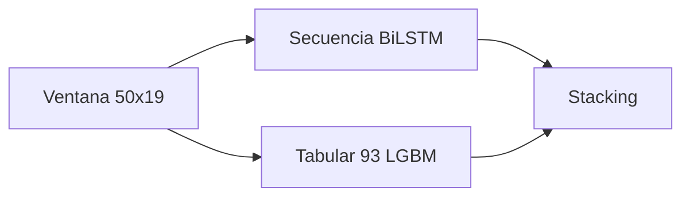

# Ventanas y features — 50 filas, 93 tabulares

> [!abstract] En una frase
> La misma ventana alimenta dos lecturas: secuencia de 19 canales y resumen tabular de 93 columnas.

## Contrato

| Entra | Sale |
|---|---|
| Sensores residualizados y ciclo normalizado | Ventanas `(50, 19)` para el BiLSTM |
| Misma ventana | Vector de 93 features para LightGBM |

## Cómo está implementado

El corte vive en `src/ds02_rul/features.py:79` y el crudo en `src/ds02_rul/inference.py:14`.

| Parámetro | Valor | Dónde |
|---|---|---|
| Tamaño de ventana | 50 filas | `src/ds02_rul/features.py:79` |
| Canales secuencia | 19 (18 + ciclo normalizado) | `models/ds02_manifest.json` |
| Features tabulares | 93 por ventana | `models/ds02_manifest.json` |
| Step train / test | 3 / 2 | `src/ds02_rul/pipeline.py:88` |
| Stride de carga | 100 | `src/ds02_rul/data.py:49` |

La rama secuencia conserva el orden: 50 pasos que el BiLSTM lee como película ([[s06-bilstm-triple-pooling]]). La rama tabular resume la ventana con medias, pendientes y dispersiones por canal, más `cyc_norm` como canal 19 y como feature.

Por motor y por unidad se ordena por ciclo (`src/ds02_rul/inference.py:49`) y se valida la forma antes de predecir (`src/ds02_rul/inference.py:62`). Una ventana corta o desordenada se rechaza, no se rellena.

Fuente: [[visuals/s04-doble-lectura.mmd]]

## La decisión que hay detrás

ADR-004 fija ventana 50 con step 3 en train y 2 en test: suficiente contexto para ver degradación sin multiplicar filas casi idénticas. Un step de 1 generaría solape extremo y validación optimista.

Se rechazó `use_baseline_delta`: restar el baseline por unidad parecía ayudar en dev pero no transfiere a test. La ablación lo mide y lo descarta.

## Qué medimos

Conteos vigentes ([[e00-cifras-autoritativas]]): dev 17 450 ventanas, test 6 196, ajuste 14 915, holdout 2 535. Entrada BiLSTM `(None, 50, 19)` con 154 253 parámetros.

El horizonte real sigue siendo 0,44 ciclos por ventana ([[c02-ventanas-y-horizonte]]). El modelo no ve 50 ciclos: ve medio ciclo con mucho detalle.

## El límite

> [!warning] Lo que la ventana no ve
> Medio ciclo no contiene la historia completa del motor. La tendencia lenta la aporta el ciclo normalizado y la memoria la aporta el BiLSTM, no la ventana por sí sola. Ventanas más largas no mejoraron y solo añadieron cómputo.

## Di esto en el tribunal

> [!quote]
> «Cada ventana son 50 filas que alimentan dos ramas: secuencia de 19 canales para el BiLSTM y resumen de 93 columnas para LightGBM. El step es 3 en train y 2 en test, y una ventana cubre 0,44 ciclos reales.»

## Flashcards

> [!question]- ¿Qué forma recibe el BiLSTM?
> `(None, 50, 19)`: 50 pasos y 19 canales, con el ciclo normalizado incluido.

> [!question]- ¿Cuántas features ve LightGBM?
> 93 columnas tabulares por ventana.

> [!question]- ¿Qué step se usa en train y test?
> 3 en train y 2 en test.

> [!question]- ¿Qué valida inference.py:62?
> Que la ventana tenga forma completa y orden por ciclo antes de predecir.

> [!question]- ¿Qué afirma esta nota en una frase?
> La misma ventana alimenta dos lecturas: secuencia de 19 canales y resumen tabular de 93 columnas.

> [!question]- ¿Cómo la contarías en el tribunal?
> «Cada ventana son 50 filas que alimentan dos ramas: secuencia de 19 canales para el BiLSTM y resumen de 93 columnas para LightGBM. El step es 3 en train y 2 en test, y una ventana cubre 0,44 ciclos reales.»

## Conexiones

Antes: [[s03-preproceso-sin-fuga]] · Después: [[s05-lightgbm-cuantilico]] · Mecanismo: [[c02-ventanas-y-horizonte]]
