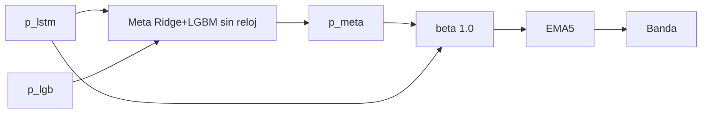

# Stacking híbrido — el ensamble como objeto

> [!abstract] En una frase
> Dos bases distintas, un meta pequeño en holdout y un shrinkage que impide que el meta rompa al campeón.

## Contrato

| Entra | Sale |
|---|---|
| Ventana cruda `(50, 18)` más ciclos | RUL por ventana con `predict` |
| Misma ventana | Intervalo `(lower, upper)` con `predict_interval` |

## Cómo está implementado

El objeto vive en `src/ds02_rul/ensemble.py:23` con `beta` 1.0 y `ema_span` 5.

| Método | Qué hace | Dónde |
|---|---|---|
| `__init__` | Guarda BiLSTM, LGBM, Ridge meta, LGBM meta, scaler y banda | `src/ds02_rul/ensemble.py:49` |
| `predict` | Secuencia + tabular + meta + shrinkage + EMA | `src/ds02_rul/ensemble.py:101` |
| `predict_interval` | Punto más banda calibrada por tramo | `src/ds02_rul/ensemble.py:161` |
| `_sequence` | Añade el canal de ciclo si el grafo lo espera | `src/ds02_rul/ensemble.py:180` |
| `_tabular` | Reconstruye el resumen de 93 igual que en train | `src/ds02_rul/ensemble.py:193` |

El meta combina `[p_lstm, p_lgb]` sin `cyc_norm` con RidgeCV y LGBM somero promediados 50/50, ajustados en la unidad 16. Luego `p_raw = p_lstm + beta · (p_meta − p_lstm)` con `beta` 1.0, EMA causal y clip en cero. Darle el reloj al meta le permitiría aprender un prior de vida en vez de reconciliar ramas (ablación `models/ablation_meta_cycle.json`, [[c19-ablacion-cyc-norm]]).

El orden importa: primero se combina, luego se suaviza, luego se acota con la banda ([[s11-banda-conformal]]). Suavizar antes de combinar mezclaría errores de ramas distintas.

Fuente: [[visuals/s10-stacking-objeto.mmd]]

## La decisión que hay detrás

ADR-001 rechaza el blending lineal: dos promedios fijos dieron 8.091 y 7.180, peores que el BiLSTM solo. El stacking aprendido sí supera al campeón porque modela cuándo fiarse de cada rama.

ADR-006 añade EMA causal después: sin ella el híbrido oscila entre ventanas vecinas aunque acierte en media.

## Qué medimos

Híbrido-C + EMA5: media 4.322 ± 0.064, MAE ≈3.23, R² ≈0.946, NASA ≈2342, fila de disco 4.338 / 3.227 / 0.9461 / 2336.2 ([[e00-cifras-autoritativas]]).

Frente a bases C: LGBM adaptada 7.067 y BiLSTM-C 5.654. El salto de ≈1.3 sobre la mejor rama es el argumento del ensamble ([[c09-ensembles]]).

## El límite

> [!warning] Lo que el ensamble no es
> No es un modelo nuevo: es un protocolo de combinación con dos regresores diminutos. Si las bases se correlacionan en el error, el meta no tiene de dónde recortar. Su fuerza viene de que las bases se equivocan distinto, no de su capacidad.

## Di esto en el tribunal

> [!quote]
> «El híbrido combina BiLSTM y LightGBM con un meta pequeño ajustado en la 16 y un beta de 1.0 que contrae hacia el meta. Da 4.322±0.064 de media y 4.338 en disco, más de un punto mejor que el campeón solo.»

## Flashcards

> [!question]- ¿Qué métodos expone el ensamble?
> `predict` para el punto y `predict_interval` para punto más banda.

> [!question]- ¿Qué entra al meta?
> `[p_lstm, p_lgb]` sin `cyc_norm` con RidgeCV y LGBM somero promediados.

> [!question]- ¿Qué hace beta 1.0 en la fórmula?
> `p = p_lstm + 1.0 · (p_meta − p_lstm)`: se queda con el meta completo.

> [!question]- ¿Por qué se rechazó el blending?
> Dos intentos dieron 8.09 y 7.18, peores que el BiLSTM. Promediar no basta.

> [!question]- ¿Qué afirma esta nota en una frase?
> Dos bases distintas, un meta pequeño en holdout y un shrinkage que impide que el meta rompa al campeón.

> [!question]- ¿Cómo la contarías en el tribunal?
> «El híbrido combina BiLSTM y LightGBM con un meta pequeño ajustado en la 16 y un beta de 1.0 que contrae hacia el meta. Da 4.322±0.064 de media y 4.338 en disco, más de un punto mejor que el campeón solo.»

## Conexiones

Antes: [[s09-oof-y-beta]] · Después: [[s11-banda-conformal]] · Mecanismo: [[c09-ensembles]]
