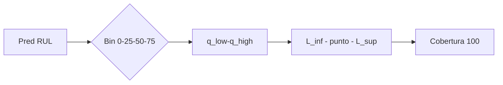

# Banda conformal — cota calibrada por tramo

> [!abstract] En una frase
> El punto predice y la banda acota: 90 % pedido, 100 % medido, 26.41 ciclos de ancho.

## Contrato

| Entra | Sale |
|---|---|
| Predicción puntual por ventana | Borde inferior `L_inf` y superior por tramo |
| Residuales OOF de 17 450 ventanas | Cuantiles `q_low` y `q_high` por bin |

## Cómo está implementado

El ajuste vive en `src/ds02_rul/conformal.py:28` y la aplicación en `src/ds02_rul/conformal.py:90`.

| Pieza | Valor | Dónde |
|---|---|---|
| Método | Split-conformal asimétrico por tramo | `src/ds02_rul/conformal.py:28` |
| Objetivo | 90 % (5 % por lado) | `models/ds02_manifest.json` |
| Calibración | 17 450 ventanas dev con residual OOF | `src/ds02_rul/conformal.py:28` |
| Cobertura test | 100 % | [[e00-cifras-autoritativas]] |
| Ancho medio | 26.41 (11: 26.92, 14: 26.03, 15: 25.75) | [[e00-cifras-autoritativas]] |

Los bins son `[0, 25, 50, 75, ∞]` sobre RUL predicha, con `q_low` y `q_high` propios por tramo (`models/ds02_manifest.json`). La asimetría importa: el error no se distribuye igual arriba que abajo ([[c12-conformal-prediction]]).

No confundir con la banda de reglas: 17 450 calibra esta banda; 14 915 calibra la de `mia/` ([[s13-capa-de-reglas-y-decision]]). Son dos bandas para dos usos.

Fuente: [[visuals/s11-banda-tramos.mmd]]

## La decisión que hay detrás

ADR-009 elige split-conformal por tramos frente a cuantil global y frente a banda simétrica. El cuantil global subcubre colas largas; la simétrica miente donde el error es asimétrico.

Se midió recalibrar en la unidad 16 y se rechazó: colapsa a 3.35 de ancho con 31.4 % de cobertura. Estrecha y falsa: lo contrario de lo que se pide a una cota.

## Qué medimos

Objetivo 90 %, cobertura realizada 100 %, ancho medio 26.41, cero filas fuera por arriba o por abajo ([[e00-cifras-autoritativas]]). Es cota conservadora, no intervalo de decisión: se calibró con modelos de fold más débiles que el desplegado.

La cobertura se mide con `empirical_coverage` (`src/ds02_rul/conformal.py:116`), no se supone.

## El límite

> [!warning] Lo que la banda no dice
> 100 % de cobertura con 26 ciclos de ancho no es precisión: es prudencia. La banda cubre porque es ancha donde el error es grande. No la presentes como «el modelo acierta en ±3 ciclos».

## Di esto en el tribunal

> [!quote]
> «Calibro split-conformal por tramo con 17 450 residuales fuera de fold. Pido 90 y mido 100 con 26.4 de ancho medio. Es cota, no promesa: cubre porque es ancha donde debe serlo.»

## Flashcards

> [!question]- ¿Con qué se calibra la banda?
> Con 17 450 residuales OOF de desarrollo, nunca con el test.

> [!question]- ¿Qué cobertura y ancho se miden en test?
> 100 % de cobertura con 26.41 ciclos de ancho medio.

> [!question]- ¿Por qué por tramos y asimétrica?
> Porque el error crece con la RUL y no es simétrico arriba y abajo.

> [!question]- ¿Qué pasó al recalibrar en la 16?
> Colapsó a 3.35 con 31.4 %: estrecha y falsa, se rechazó.

> [!question]- ¿Qué afirma esta nota en una frase?
> El punto predice y la banda acota: 90 % pedido, 100 % medido, 26.41 ciclos de ancho.

> [!question]- ¿Cómo la contarías en el tribunal?
> «Calibro split-conformal por tramo con 17 450 residuales fuera de fold. Pido 90 y mido 100 con 26.4 de ancho medio. Es cota, no promesa: cubre porque es ancha donde debe serlo.»

## Conexiones

Antes: [[s10-stacking-hibrido]] · Después: [[s12-persistencia-y-contrato]] · Mecanismo: [[c12-conformal-prediction]]
