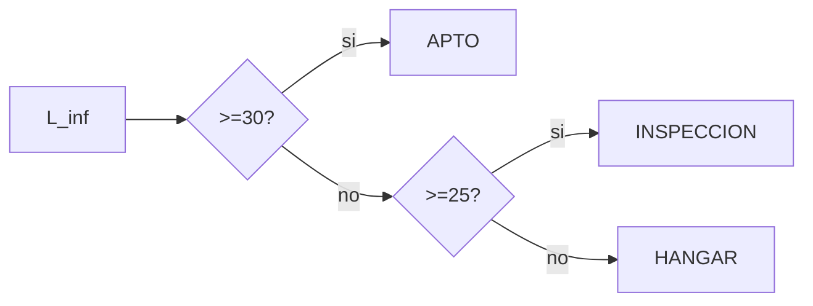

# Capa de reglas y decisión — de RUL a estado

> [!abstract] En una frase
> La RUL no decide nada: el borde inferior de la banda decide APTO, INSPECCIÓN o HANGAR.

## Contrato

| Entra | Sale |
|---|---|
| `L_inf` por ventana y motor | Estado por motor: APTO, INSPECCIÓN o HANGAR |
| Banda de reglas calibrada en 14 915 filas | Lead time en ciclos antes del fallo |

## Cómo está implementado

La capa vive en `mia/` con calibración propia en `mia/calibracion_banda.json`.

| Pieza | Valor | Dónde |
|---|---|---|
| Calibración reglas | 14 915 filas OOF puras | `mia/calibracion_banda.json` |
| Cobertura OOF / test | 0.9012 / 1.0000 | [[e00-cifras-autoritativas]] |
| R2b isotónica causal | 9.623 RMSE / 18 713.9 NASA | [[e00-cifras-autoritativas]] |
| R2 monótona estricta | 10.737 / 21 053.0 | [[e00-cifras-autoritativas]] |
| Subida máxima R2b | +1.328848 ciclos | [[e00-cifras-autoritativas]] |
| Umbrales | `L_inf ≥ 30` APTO, `25–30` INSPECCIÓN, `< 25` HANGAR | `docs/defensa_ds02_explicacion_logica_negocio.md` |

R2b es corrección isotónica causal: solo puede subir la predicción y como máximo 1.33 ciclos. R2 monótona estricta es más rígida y mide peor, por eso se queda R2b.

Lead time vigente: 9 / 23 / 17 por corte de media y 13 / 23 / 18 por peor ventana. Saturación en ≈60.6 y `L_inf` máximo en ≈36: la decisión vive abajo, no en colas largas.

Fuente: [[visuals/s13-decision-linf.mmd]]

## La decisión que hay detrás

La lógica de negocio fija decidir sobre `L_inf`, no sobre el punto: el punto estima y el borde garantiza. Un motor con punto alto pero banda ancha no es APTO.

Se rechazó decidir sobre el punto: un 4.25 medio esconde al motor 14, y el NASA ya avisa que sobreestimar cuesta más. La banda lo convierte en regla operativa.

## Qué medimos

Cobertura de reglas 0.9012 en OOF y 1.0000 en test, con R2b mejor que R2 en ambas métricas ([[e00-cifras-autoritativas]]). El detalle de negocio está en `docs/defensa_ds02_explicacion_logica_negocio.md`.

No es la banda conformal del modelo: aquella calibra con 17 450 y acota la predicción; esta calibra con 14 915 y sostiene la decisión ([[s11-banda-conformal]]).

## El límite

> [!warning] Lo que las reglas no hacen
> Las reglas no mejoran la RUL: la visten para decidir. R2b apenas sube 1.33 como máximo. Si la predicción es mala, la regla no la salva; solo evita que un optimismo caro llegue a pista.

## Di esto en el tribunal

> [!quote]
> «Decido sobre el borde inferior, no sobre el punto: 30 o más APTO, 25 a 30 inspección, menos de 25 hangar. La corrección isotónica solo puede subir 1.33 ciclos y la banda de reglas cubre 0.90 en OOF.»

## Flashcards

> [!question]- ¿Sobre qué se decide?
> Sobre `L_inf`, el borde inferior de la banda, no el punto.

> [!question]- ¿Qué umbrales separan los estados?
> 30 APTO, 25 a 30 inspección, menos de 25 hangar.

> [!question]- ¿Qué diferencia R2b de R2?
> R2b isotónica causal 9.623 frente a R2 estricta 10.737: R2b mide mejor.

> [!question]- ¿Cuántas filas calibran cada banda?
> 17 450 la conformal del modelo; 14 915 la de reglas.

> [!question]- ¿Qué afirma esta nota en una frase?
> La RUL no decide nada: el borde inferior de la banda decide APTO, INSPECCIÓN o HANGAR.

> [!question]- ¿Cómo la contarías en el tribunal?
> «Decido sobre el borde inferior, no sobre el punto: 30 o más APTO, 25 a 30 inspección, menos de 25 hangar. La corrección isotónica solo puede subir 1.33 ciclos y la banda de reglas cubre 0.90 en OOF.»

## Conexiones

Antes: [[s12-persistencia-y-contrato]] · Después: [[s14-app-y-despliegue]] · Negocio: [[d02-guion-5min]]
