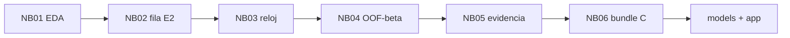

# Cadena de estado — qué guarda cada cuaderno

> [!abstract] En una frase
> Seis cuadernos encadenados por artefactos: NB01 mira, NB02 corona la fila, NB03 decide el reloj, NB04 combina, NB05 evidencia, NB06 congela.

## Contrato

| Entra | Sale |
|---|---|
| HDF5 y semillas al inicio de NB01 | Bundle C en `models/` al final de NB06 |
| Nada suelto entre cuadernos | Todo pasa por artefactos verificados |

## Cómo está implementado

La cadena se prueba con marcas de carga entre cuadernos.

| Eslabón | Marca textual | Qué verifica |
|---|---|---|
| NB01 → NB02 | base mirada + baseline 20.022 | EDA y calidad documentadas |
| NB02 → NB03 | MLP E2 campeón de fila (val 7.34) | elección por validación, test leído una vez |
| NB03 → NB04 | reloj decidido (ON red / OFF meta) | ablación medida |
| NB04 → NB05 | `beta = 1.0`, `p_ens` en memoria | OOF por motor, meta en holdout-16 |
| NB05 → NB06 | multisemilla + LGBM adaptada 7.067 | ruido medido, puente probado |
| NB06 → disco | bundle C en `models/` | `ensemble.joblib` + manifiesto `clase-bundle-C` |
| NB06 → servicio | `load_ensemble` con SHA | recargado == en memoria: True |

NB01 deja base mirada y baseline. NB02 corona la fila (MLP E2). NB03 decide el reloj. NB04 añade OOF, beta, meta y banda. NB05 añade multisemilla y el puente adaptado. NB06 congela el bundle C. Ningún cuaderno recalcula lo anterior: lo recarga y verifica.

Fuente: [[visuals/n04-cadena-estado.mmd]]

## La decisión que hay detrás

Cortar en seis cuadernos en vez de uno gigante facilita defender por partes: EDA, fila, reloj, combinación, evidencia, producción. El costo es la cadena: si un eslabón cambia el formato, los demás rompen.

Se rechazó el cuaderno único: 60+ celdas seguidas no se ensayan ni se depuran. Seis cuadernos con marcas de carga sí.

## Qué medimos

La cadena no tiene métrica: tiene prueba de identidad. El `load_ensemble` con SHA demuestra que servir es recargar ([[s12-persistencia-y-contrato]]).

Las cifras que viajan por la cadena son las de [[e00-cifras-autoritativas]]: la fila de disco 4.338 es la que congela NB06.

## El límite

> [!warning] Lo que la cadena no blinda
> Si reejecutas NB01 con otra semilla y no reejecutas hasta NB06, la cadena miente: beta y banda pertenecerán a otro mundo. La regla es todo o nada: se ejecutan en orden 01 → 06 o no se ejecutan.

## Di esto en el tribunal

> [!quote]
> «Los cuadernos se encadenan por artefactos con marcas de carga: cada uno recarga lo anterior, verifica y deja lo suyo; el último congela el bundle C en models con reload idéntico.»

## Flashcards

> [!question]- ¿Qué deja cada cuaderno en la cadena?
> NB01: base mirada + baseline. NB02: MLP E2. NB03: decisión del reloj. NB04: beta 1.0 + p_ens. NB05: multisemilla + puente. NB06: bundle C en models.

> [!question]- ¿Qué prueba el reload con SHA?
> Que el bundle recargado predice igual que en memoria: servir es recargar, auditado por hash.

> [!question]- ¿Qué afirma esta nota en una frase?
> Seis cuadernos encadenados por artefactos: NB01 mira, NB02 corona la fila, NB03 decide el reloj, NB04 combina, NB05 evidencia, NB06 congela.

> [!question]- ¿Cómo la contarías en el tribunal?
> «Los cuadernos se encadenan por artefactos con marcas de carga: cada uno recarga lo anterior, verifica y deja lo suyo; el último congela el bundle C en models con reload idéntico.»
