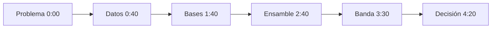

# Guion de 5 minutos — recorrido narrado

> [!abstract] En una frase
> Cinco minutos con tiempos por bloque: entras por el problema y sales por la decisión operativa.

## Mapa del recorrido

Fuente: [[visuals/d02-recorrido-5min.mmd]]

## 0:00–0:40 — Problema y baseline

«Cada motor tiene una vida útil y el costo de equivocarse es asimétrico: creer que dura más de lo que dura es el error caro. Por eso el NASA score castiga sobreestimar con pendiente 1/10 y subestimar con 1/13.» ([[c04-metricas-y-baseline]])

«El suelo es tonto a propósito: la media de train da 20.02. Todo modelo útil tiene que ganarle.»

## 0:40–1:40 — Datos y protocolo honesto

«DS02 en base adaptada parquet-clase con 4 canales de régimen y 14 sensores (nulos MAR T30 + ffill causal). Parto por motor: cinco ajustan, la 16 valida y 11, 14 y 15 confirman. Ventanas de 50 filas que cubren 0,44 ciclos.» ([[s02-datos-ds02-y-reparto]])

«Escalador y 14 ridges solo con ajuste: 44 982 filas. El holdout aporta cero.» ([[s03-preproceso-sin-fuga]])

## 1:40–2:40 — Dos bases distintas

«LightGBM lee 93 resúmenes y predice el cuantil 0,35 sobre la base adaptada: da 7.07 solo.» ([[s18-lgbm-adaptada]])

«BiLSTM lee la película de 50 pasos en dos direcciones con triple pooling: da 5.65 solo.» ([[s06-bilstm-triple-pooling]])

«Ablacioné el contador de ciclos: aporta pero no es un reloj. (Las cifras de ablación tipo 14.33 están retiradas de defensa: medición histórica en [[s08-ablacion-cyc-norm]], no citar.)»

## 2:40–3:30 — Ensamble y beta

«Combino con meta pequeño en la 16 y shrinkage beta 1.0 elegido fuera de fold con mediana 1.0. Dos folds piden 1.0 y uno pide 0: hay disenso y lo enseño.» ([[s09-oof-y-beta]])

«El híbrido-C más EMA5 da 4.338 en disco (oficial, semilla 42; la media 4.322±0.064 impresa en NB06 está NO reconciliada con el CSV — 4.368 pendiente per [[e00-cifras-autoritativas]]). Más de un punto mejor que su mejor rama.» ([[s20-ensemble-adaptado-y-bundle-c]])

## 3:30–4:20 — Banda como cota

«Calibro split-conformal por tramo con 17 450 residuales no vistos. Pido 90 y mido 100 con 26.4 de ancho. Es cota, no promesa.» ([[s11-banda-conformal]])

«Recalibrar en la 16 colapsa a 3.35 con 31 %: estrecha y falsa. Se midió y se rechazó.»

## 4:20–5:00 — Decisión operativa

«Decido sobre el borde inferior: 30 o más APTO, 25 a 30 inspección, menos de 25 hangar. La corrección isotónica solo sube 1.33 como máximo.» ([[s13-capa-de-reglas-y-decision]])

«Cierro con lo que hay en disco: hashes d6c70142 y bf9620a7, reload idéntico.» ([[s12-persistencia-y-contrato]])

## Di esto en el tribunal

> [!quote]
> «En cinco minutos: problema asimétrico, reparto por motor, dos bases distintas, beta honesto, banda como cota y decisión sobre el borde. 4.338 en disco con protocolo que puedes auditar.»

## Flashcards

> [!question]- ¿Qué dices en el primer minuto?
> Problema asimétrico, baseline 20.02 y reparto por motor.

> [!question]- ¿Qué dices en el minuto 2–3?
> Bases 7.07 y 5.65, ablación del ciclo y beta 1.0 fuera de fold.

> [!question]- ¿Qué dices al cerrar?
> Banda como cota y decisión sobre L_inf con 30 y 25.

> [!question]- ¿Dónde está el mapa del recorrido?
> En el mermaid de arriba con fuente en visuals.
