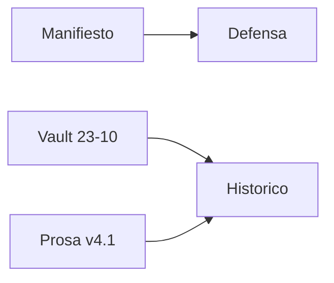

> NO VIGENTE — bundle histórico (A/B). Vigente C 4.338 macro 5.0153 en 50-Evidencia/e00 + models/ds02_manifest.json. No citar cifras de aquí en defensa.

# Cifras autoritativas

## Idea central

Para defender, una sola fuente manda: `models/ds02_manifest.json` + lo que imprime hoy el notebook.

> Si vault, prosa y manifiesto discrepan, gana el manifiesto.

## ¿Qué problema resuelve?

Vault (23-10), prosa v4.1.0 y manifiesto actual traen decimales distintos por no-determinismo CPU de TensorFlow (documentado en NB03 §9b y `EVALUACION_EJECUCION.md`). Memorizar 3 versiones te deja vendido.

## Las piezas del modelo mental

### Fuente que manda

- `models/ds02_manifest.json` (`051e0af4…`): `Hibrido+EMA5 4.352 +- 0.055 / BiLSTM 6.233 +- 0.485 / LightGBM 7.098 +- 0.034`, fila test `RMSE 4.289, MAE 3.179, R2 0.9473, NASA 2310.6`, `macro 4.9026 (11:3.7728, 14:8.175, 15:2.76)`, `alpha 0.35, beta 1.0, ema 5, window 50, coverage 0.9`.
- `app/cache/cache_manifest.json`: `artifact.ensemble_sha256 0acd795b…` coincide con disco.

### Versiones históricas (no defender con estas)

- Prosa NB03 §9b v4.1.0: híbrido 4.344±0.075, artefacto 4.313, macro 4.939, banda 24.8.
- Rerun `/tmp` EVALUACION: híbrido 4.278±0.051, BiLSTM 6.347±0.748.

## El proceso completo, sin centrarnos en las cuentas

## Qué no debemos confundir

| Concepto | Qué significa | Qué no significa |
|---|---|---|
| Manifiesto | Lo que hay en disco | Lo que salió una vez |
| Rerun | Coherente pero distinto | Error |

## Conexión con los notebooks del repositorio

- NB03 §9b + `EVALUACION_EJECUCION.md` explican el ±0.1 entre corridas.

## Resumen para recordar

> Manifiesto manda; resto es histórico.

## Autoevaluación

1. ¿Qué SHAs debes citar?
2. ¿Por qué el rerun difiere sin ser fallo?
3. ¿Qué fila test citas?
