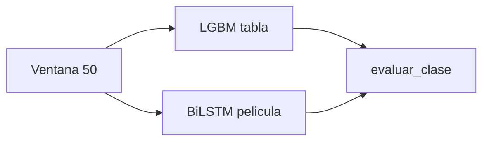

# Bases LightGBM + BiLSTM (B)

> Version B (refactor novato-friendly): src/ds02_rul/viz.py + from ds02_rul.viz import * en 1 linea, glosario WINDOW/STEP/BETA/EMA5/L_inf/OOF/macro y Que entra/sale por celda. Logica identica al bundle A; cifras bundle B: ref RMSE 4.251, R2 0.9482, NASA 2305.1, macro 4.8433, LGBM 7.098, hashes ensemble 7acba335 / bilstm d0c5ed7f.

## Idea central

Dos ojos distintos sobre la misma ventana: LGBM lee la tabla (93 columnas), BiLSTM lee la pelicula (50x19).

## Las piezas

### LightGBM (pipeline.py, semilla 42)

0.27s, determinista: RMSE 7.098 clavado en A y B. Baseline media-train 20.022 para calibrar.

### BiLSTM (model.py)

Triple pooling (last+avg+max), Huber delta 10, early-stop en motor 16. Semilla 42: RMSE aprox 5.84, R2 aprox 0.90. No determinista al decimal por GPU/TF.

### Novedad B

Ninguna en logica. La celda gigante de 12 def ahora es from ds02_rul.viz import * + evaluar_clase/mostrar_clase (alias de evaluate_predictions, sin reentrenar).

## El proceso

## Que no confundir

| Concepto | Que significa | Que no significa |
|---|---|---|
| evaluar_clase | Alias de evaluate_predictions | Otro entrenamiento |
| viz.py | Solo dibuja | Cambia metricas |

## Conexion notebooks

- NB01 celdas 15/17/20 + src-model.codigo.md, src-metrics.codigo.md, src-viz.codigo.md.

## Resumen

> Tabla + pelicula, mismo codigo, celdas pequenas.

## Autoevaluacion

1. Que lee cada base?
2. Por que LGBM clava 7.098 y BiLSTM no?
3. Que hace mostrar_clase?
