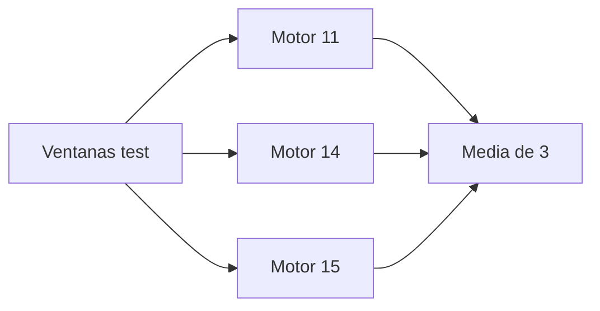

> NO VIGENTE — bundle histórico (A/B). Vigente C 4.338 macro 5.0153 en 50-Evidencia/e00 + models/ds02_manifest.json. No citar cifras de aquí en defensa.

# Macro-RMSE (cada motor pesa un tercio)

## Idea central

El RMSE global pondera por ventanas y el motor grande manda; el macro-RMSE da voz igual a cada motor y cuenta la verdad menos halagadora.

> Global 4.275 (el grande manda) vs macro 4.878 (cada motor vota una vez): publica los dos.

## ¿Qué problema resuelve?

El motor 14 (760 ventanas, RMSE 8.0445) casi no pesa en el global pero es donde el modelo falla. Esconderlo tras el promedio ponderado sería maquillaje.

## Las piezas del modelo mental

### Por motor

11: 3.7850 · 14: 8.0445 · 15: 2.8044 (`src/ds02_rul/metrics.py:macro_rmse`).

### Diferencia +0.603

Positiva = el global es más halagador que la realidad por motor. Se publica la frase, no solo el número.

### Cuatro métricas

RMSE (decide), MAE, R² y NASA_Score (asimétrica de Saxena: pasarse cuesta `exp(d/10)`, quedarse corto `exp(−d/13)`; es SUMA, solo comparable en las mismas filas).

## El proceso completo, sin centrarnos en las cuentas

## Qué no debemos confundir

| Concepto | Qué significa | Qué no significa |
|---|---|---|
| Macro 4.878 | Media de motores | Otra forma del global |
| NASA suma | Solo comparable mismas filas | Promedio por ventana |

## Conexión con el aprendizaje

Es el "no escondas al motor 14": la honestidad métrica del proyecto en una tabla.

## Conexión con los notebooks del repositorio

- `02_decision_ablacion_oof_ensamble.ipynb`, celda 23 (tabla por motor + frase +0.603).
- `src/ds02_rul/metrics.py:macro_rmse/calculate_nasa_score`.

## Resumen para recordar

> El peor motor también vota: macro 4.878 frente a global 4.275.

## Autoevaluación

1. ¿Por qué el global (4.275) es menor que el macro (4.878)?
2. ¿Por qué la NASA es suma y no media?
3. ¿Asimetría de la NASA: qué castiga más, pasarse o quedarse corto?
