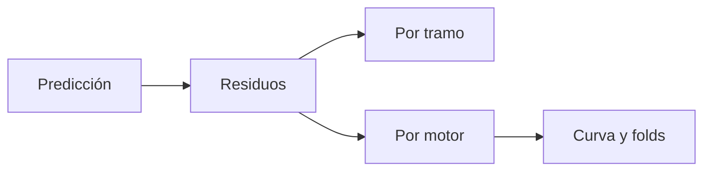

> NO VIGENTE — bundle histórico (A/B). Vigente C 4.338 macro 5.0153 en 50-Evidencia/e00 + models/ds02_manifest.json. No citar cifras de aquí en defensa.

# Diagnóstico (dónde falla el modelo)

## Idea central

Ganar la media no basta: hay que saber dónde falla. El híbrido acierta cerca del fallo y se abre lejos; el motor 14 concentra el error; el sesgo medio es nulo.

> Un campeón sin parte de lesiones no es defendible: publica dónde sangra.

## ¿Qué problema resuelve?

Evita vender un 4.275 ciego. El diagnóstico dice: MAE ×4.4 entre tramo cercano y lejano, motor 14 con 8.0445, curva que para a las 8 épocas, folds de beta [1,1,0].

## Las piezas del modelo mental

### Real vs predicho + residuos

Nube pegada a la diagonal bajo 25 ciclos, abierta arriba; sesgo +0.369 (nulo). Sin sesgo sistemático.

### Tramos y motores

`error_por_tramo`: el MAE se multiplica ×4.4 lejos del fallo. `tabla_por_motor`: el 14 se lleva el error con solo 760 ventanas.

### Curva y folds

`curva_entrenamiento`: 8 épocas, mejor val 8.664 (semilla 123). `beta_por_fold`: dos folds piden 1.00, uno 0.00 — acuerdo parcial publicado.

## El proceso completo, sin centrarnos en las cuentas

## Qué no debemos confundir

| Concepto | Qué significa | Qué no significa |
|---|---|---|
| Sesgo +0.369 | Prácticamente nulo | Problema |
| Motor 14 mal | Pocas ventanas + RUL alto | Modelo roto |

## Conexión con el aprendizaje

Es la honestidad final: después de ganar, enseñar las heridas.

## Conexión con los notebooks del repositorio

- `03_evidencia_multisemilla_diagnostico.ipynb`, celdas 31–47 (4 gráficos + curva + folds).
- Funciones de presentación en la celda de utilidades del NB03.

## Resumen para recordar

> Cerca del fallo clava, lejos se abre, el 14 sangra: todo publicado.

## Autoevaluación

1. ¿Por qué el error crece lejos del fallo?
2. ¿Qué explica que el motor 14 tenga 8.04?
3. ¿Qué significa que un fold pida beta 0?
