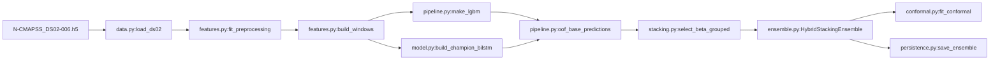

# LEARNING_LOG — MLProyectVault

Vault de estudio del proyecto DS02 (N-CMAPSS): ensamble híbrido de stacking para RUL.
Mapas, teorías y esquemas en español. El quiz interactivo queda pendiente (vault construido a petición directa, sin fase teach).

## Índice

- [[#Cartografía del repo (2026-10-23)]]
- [[#Plan aprobado — vault MLProyectVault (2026-10-23)]]
- B1: [[01-que-predecimos-rul]] · [[02-reparto-por-motor-y-fuga]] · [[03-baseline-media-train]]
- B2: [[04-prepro-solo-fit-motores]] · [[05-sensor-residualizado-regimen]] · [[06-ventanas-y-cyc-norm]]
- B3: [[07-lightgbm-cuantil]] · [[08-bilstm-triple-pooling]] · [[09-ema-causal]]
- B4: [[10-ablacion-cyc-norm]] · [[11-oof-agrupado]] · [[12-beta-mediana-y-diagnostico]]
- B5: [[13-stacking-hibrido]] · [[14-bandas-conformal]] · [[15-macro-rmse]]
- B6: [[16-multisemilla]] · [[17-regla-del-empate]] · [[18-diagnostico]] · [[19-persistencia-reload]]

## Estado actual

- **Modo:** repo · **Tema activo:** proyecto DS02 completo · **Objetivo:** entender conceptos, código y desarrollo de los 3 notebooks para defender el proyecto.
- **Nodos firmes:** ninguno verificado con quiz todavía (pendiente).
- **Siguiente bloque:** B1 — Protocolo honesto.

### Perfil del estudiante

- `preferencia_quiz: cada_nodo` · `formato: adaptativo` · `ritmo: normal` · idioma: español.

### Nivel del estudiante

- nivel: sin calibrar (probe pendiente) · evidencia: 0/0.

## Cartografía del repo (2026-10-23)

> [!quote] Estudiante
> Crear el vault MLProyectVault de los 3 notebooks: conceptos, código y desarrollo.

Mapa real del código (todo verificado en archivos):

Fuente: [[visuals/mlproyect-plan.mmd]]

**Fuentes:** `src/ds02_rul/{data,features,model,pooling,stacking,smoothing,pipeline,conformal,metrics,ensemble,residualizer,persistence,inference}.py` + `notebooks/ds02_ensemble/01`, `02`, `03`.

**Estado tras el bloque:** cartografía completa, 14 módulos leídos. Nodo firme: estructura del repo.

## Plan aprobado — vault MLProyectVault (2026-10-23)

> [!quote] Estudiante
> Plan con bloques y nombres de .md aprobado; crear el vault.

6 bloques, 19 nodos, formato triple (teoría + esquema + quiz pendiente): B1 Protocolo honesto · B2 Prepro y features · B3 Modelos base · B4 Ablación, OOF y beta · B5 Ensamble y conformal · B6 Evidencia y diagnóstico. Visuals: mapa del plan + uno por bloque.
