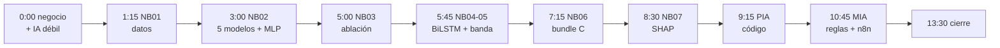

# Esquema — Guion de 15 minutos

> Nota de repaso rápido. Teoría completa: [[00-guion-15-min]]

## La idea en una frase
> El guion sigue el orden de los cuadernos y corta por el final: primero NB03, luego NB07 y NB05.

## Las piezas
| Tramo | Minutos | Qué se dice |
|---|---|---|
| Negocio | 0:00–1:15 | coste + IA débil |
| NB01 | 1:15–3:00 | datos, gráficos, nulos |
| NB02 | 3:00–5:00 | 5 modelos, MLP, elección |
| NB03 | 5:00–5:45 | ablación |
| NB04–05 | 5:45–7:15 | BiLSTM, OOF, banda |
| NB06–07 | 7:15–9:15 | cascada y SHAP |
| PIA | 9:15–10:45 | pipeline, MLflow, app |
| MIA | 10:45–13:30 | reglas y n8n |
| Cierre | 13:30–15:00 | límites |

## El flujo

Fuente: [[visuals/arco-15min]]

## Sí / No
- ✅ MIA y cierre no se cortan nunca.
- ❌ No se abre el portátil antes del minuto 13.

## Flashcards #flashcards
- ¿Qué se corta primero si falta tiempo? :: NB03, luego NB07 y NB05.
- ¿Qué no se corta? :: MIA y el cierre con límites.

## Estado
- [ ] En curso
