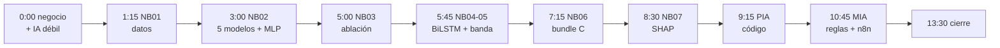

# Guion de 15 minutos

> [!abstract] En una frase
> El guion no cuenta el proyecto: cuenta **por qué cada elección era la única defendible**
> con los datos que había. Los cuadernos son el orden; las decisiones son el contenido.

## Cómo se usa

Se abre esta nota, se pone el cronómetro y se sigue la columna **Nota**. Cada enlace es un
minuto. Si una fila se pasa de tiempo, se corta la frase, no el bloque.

Fuente: [[visuals/arco-15min]]

## El guion, minuto a minuto

| Min | Nota | Qué digo (una frase) | Indicador |
|---|---|---|---|
| 0:00 | 02 | «Un motor que falla sin aviso cuesta más que diez inspecciones» | MIA-1 |
| 0:30 | 02 | «Es IA débil: solo predice RUL de DS02; por eso es auditable» | SAA-1, SAA-2 |
| 1:15 | 10 | «DS02: 9 unidades, telemetría por ciclo, objetivo RUL» | SAA-3 |
| 2:00 | 11 | «Cinco gráficos, y cada uno decide algo del modelo» | SAA-4 |
| 2:40 | 12 | «T30 se cae en crucero alto: es MAR, no al azar» | SAA-5 |
| 3:00 | 20 | «Cinco modelos, mismo pipeline, GroupKFold por motor» | SAA-6 |
| 4:00 | 21 | «MLP base y tres experimentos, cada uno con su hipótesis» | SAA-7 |
| 4:40 | 22 | «RMSE 8,2 ciclos frente a un lead time de 9 a 23» | SAA-8 |
| 5:00 | 23 | «Elijo por validación y desempato al más simple» | SAA-9 |
| 5:15 | 30 | «Ablación: el reloj ayuda a la secuencia, no al resumen» | SAA-6 (10) |
| 5:45 | 40 | «Ventana de 50 filas y split por motor, nunca por fila» | — |
| 6:15 | 41 | «BiLSTM lee la secuencia; LGBM resume la ventana» | — |
| 6:45 | 42 | «OOF puro y beta elegida fuera de fold» | SAA-9 |
| 7:00 | 50 | «El meta aprende a mezclar, no se mezcla a mano» | — |
| 7:20 | 52 | «Banda al 90 % que cubre el 100 %: cota, no intervalo» | SAA-9 |
| 7:30 | 60 | «Cascada 7,07 → 5,65 → 5,62 → 4,34» | SAA-9 (10) |
| 8:00 | 61 | «Fila y ventana son dos ligas: no se mezclan» | — |
| 8:20 | 62 | «Macro 5,02: el motor 14 concentra el 48 % del error» | MIA-1 |
| 8:30 | 70 | «SHAP suma exactamente la predicción, y se calcula en validación» | SAA-9 (10) |
| 9:15 | 81 | «Estructura: src, app, models, n8n, resultados» | PIA-2 |
| 9:40 | 82 | «Un pipeline por modelo; el joblib guardado incluye el pipeline» | PIA-3 |
| 10:05 | 83 | «13 runs en MLflow y la comparativa exportada» | PIA-4 |
| 10:30 | 84 | «La app evalúa con test y predice un caso nuevo con su decisión» | PIA-5 |
| 10:45 | 91 | «Seis reglas con prioridad, porqué y una de seguridad» | MIA-2 |
| 12:00 | 92 | «La rama HANGAR llama a nuestra API, no a un servicio de clase» | MIA-3 |
| 13:00 | 93 | «Demo: tres pestañas, un motor, una decisión» | MIA-3 |
| 13:30 | 96 | «Lo que descartamos y por qué» | — |
| 14:00 | 111 | «Lo que no cubrimos, dicho por nosotros» | — |

## Si te quedas sin tiempo

Corta en este orden: primero NB03, luego NB07, luego NB05. **Nunca** cortes MIA (13:30) ni el
cierre: MIA-3 pesa el 35 % de MIA y el cierre es donde se declaran los límites.

## Reglas en vivo

- **Test una vez**: si dudas entre dos cifras, cita la del manifiesto y sigue.
- **No abras el portátil** hasta el minuto 13:00; el guion se dice mirando al tribunal.
- Si te preguntan algo que no está en el guion: «eso lo tengo medido, lo enseño en el código»
  y [[100-tres-preguntas-individuales|saltas a la pregunta individual]] que corresponda.

## Di esto en el tribunal

> «El sistema predice RUL, pero la decisión no la toma la predicción: la toma el límite
> inferior de una banda calibrada, con seis reglas auditables, y termina en una acción que
> registra nuestra propia API.»

## Flashcards #flashcards

- ¿Cuántos minutos hay y qué se corta primero? :: 15 con corte seco; primero NB03, luego NB07 y NB05.
- ¿Qué no se corta nunca? :: MIA (reglas, n8n, demo) ni el cierre con límites.
- ¿Cuál es el orden de la explicación? :: El de los cuadernos: NB01 → NB07, luego PIA y MIA.
