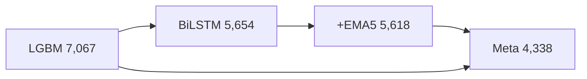

# Esquema — Cascada del bundle C

> Nota de repaso rápido. Teoría completa: [[60-nb06-cascada-bundle-c]]

## La idea en una frase
> Cuatro etapas con una mejora atribuible a cada una: si quitas una, el error sube.

## Las cuatro etapas
| Etapa | Qué añade | RMSE |
|---|---|---|
| LGBM 0,35 | resumen de ventana | 7,067 |
| BiLSTM | orden de la secuencia | 5,654 |
| EMA5 | suaviza el ruido | 5,618 |
| Meta | aprende la mezcla | **4,338** |

## El flujo

Fuente: [[visuals/cascada-bundle-c]]

## Sí / No
- ✅ 4,338 es la fila de la semilla 42 en disco.
- ❌ presentarlo como media (la media es 4,324 ± 0,107).

## Flashcards #flashcards
- ¿Cuáles son las cuatro etapas? :: 7,067 → 5,654 → 5,618 → 4,338.
- ¿Qué hace el meta? :: aprende cuánto pesar cada rama.

## Estado
- [ ] En curso
