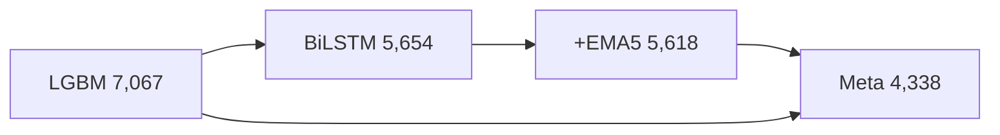

# NB06 · Cascada del bundle C

> [!abstract] En una frase
> Cuatro etapas, cada una con su número, y ninguna sobra: 7,07 → 5,65 → 5,62 → 4,34. Esa
> progresión es el argumento más corto y más difícil de rebatir de todo el proyecto.

## La cascada

| Etapa | Modelo | RMSE test |
|---|---|---|
| 1 | LightGBM cuantílico 0,35 (resumen de ventana) | 7,067 |
| 2 | BiLSTM triple pooling (secuencia) | 5,654 |
| 3 | + EMA causal 5 | 5,618 |
| 4 | **Meta stacking (aprende la mezcla)** | **4,338** |

Fuente: [[visuals/cascada-bundle-c]]

Datos: `resultados/comparativa_bundle_c.csv`.

## Qué digo

«Cada etapa arregla un fallo distinto. El árbol resume la ventana y falla en los picos; la
secuencia lee el orden y falla en el nivel; el EMA suaviza el ruido de la predicción; el meta
mezcla las dos vistas. Si quitas una, el error sube: por eso no es un ensemble decorativo.»

## Por qué se dice así

- La rúbrica pide tabla de modelos y elección; la cascada convierte la tabla en una historia de
  cuatro pasos con una mejora atribuible a cada uno.
- Es el número que se repite en la apertura y en el cierre: 4,34.

## Evidencia

- Escritor: `src/clase/train_ensemble_adaptado.py:183-222` → `save_ensemble` (`persistence.py:202`).
- Artefactos: `models/ensemble.joblib`, `models/bilstm_ds02.keras`, `models/scaler.joblib`,
  `models/ds02_manifest.json`.
- MAE 3,227 · R² 0,9461 · NASA 2336,2 · 6 196 ventanas de test.

## Pregunta probable

**«¿El 4,34 es real o el mejor de muchas corridas?»**
→ «Es la fila de la semilla 42 que está en disco y la que reproduce el servicio. La media de tres
semillas es 4,324 ± 0,107; no elegí la mejor: publiqué la que tengo congelada.»

## Lo que NO digo

- No presento el 4,34 como promedio.
- No digo «el híbrido siempre gana»: gana aquí, con estas dos ramas y este protocolo.
- No digo que el EMA «mejora el modelo»: suaviza la serie de predicciones.

## Di esto en el tribunal

> «Cuatro etapas: 7,07 el árbol, 5,65 la secuencia, 5,62 con suavizado y 4,34 el meta; ninguna
> etapa es decorativa porque quitar una sube el error.»

## Flashcards #flashcards

- ¿Cuáles son las cuatro etapas de la cascada? :: LGBM 7,067 → BiLSTM 5,654 → EMA5 5,618 → meta 4,338.
- ¿Qué añade cada una? :: el árbol resume, la secuencia ordena, el EMA suaviza y el meta mezcla.
