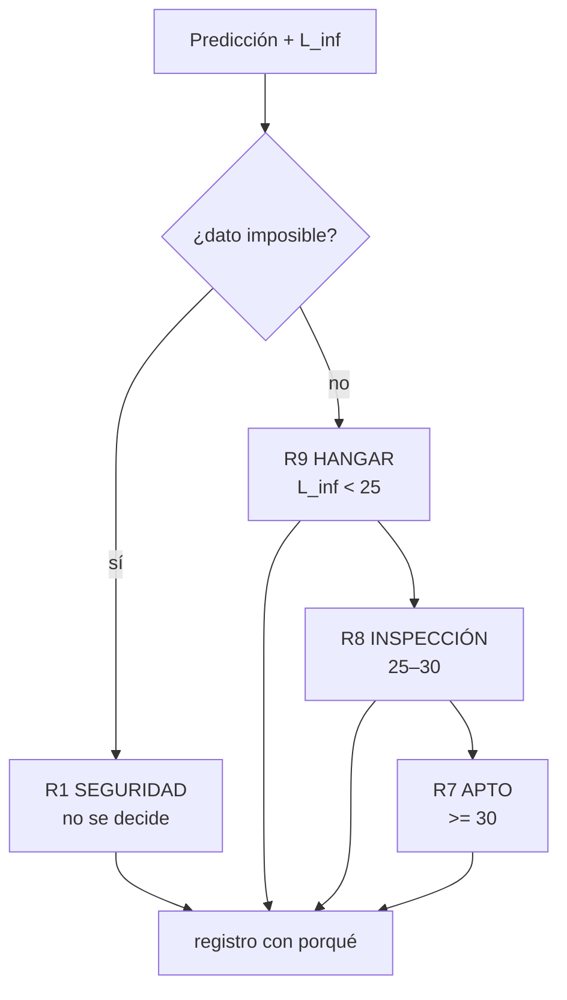

# Esquema — Las seis reglas

> Nota de repaso rápido. Teoría completa: [[91-mia-seis-reglas]]

## La idea en una frase
> La predicción no decide: decide una regla con prioridad, porqué y una de seguridad que manda.

## Las piezas
| Regla | Prioridad | Efecto |
|---|---|---|
| R1 seguridad | 10 | dato inválido → no se decide |
| R9 hangar | 3 | `L_inf < 25` |
| R8 inspección | 2 | 25 ≤ `L_inf` < 30 |
| R7 apto | 1 | `L_inf ≥ 30` |

## El flujo

Fuente: [[visuals/decision-reglas]]

## Sí / No
- ✅ seis reglas, ni una de adorno.
- ❌ `L_inf` no es una probabilidad.
- ❌ R2b no demuestra monotonía: corrige una tendencia.

## Flashcards #flashcards
- ¿Qué prioridad tiene la regla de seguridad? :: 10, la máxima.
- ¿Qué umbrales separan los estados? :: 25 hangar, 25–30 inspección, 30 apto.

## Estado
- [ ] En curso
