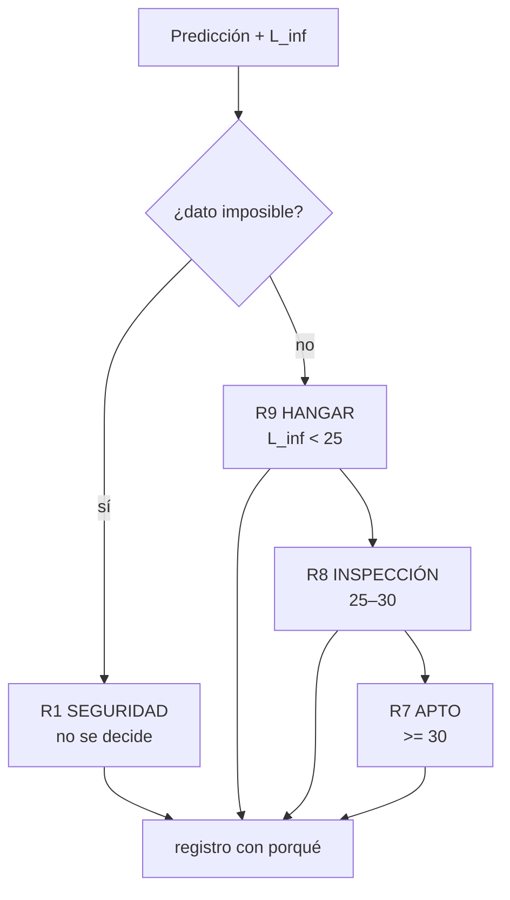

# MIA · Las seis reglas

> [!abstract] En una frase
> La predicción no decide: decide una regla que se puede leer en voz alta. Seis reglas, con
> prioridad, con porqué y una de seguridad que manda sobre todas.

## El mecanismo

Fuente: [[visuals/decision-reglas]]

## Qué digo

«Hay seis reglas y se aplican por rondas: en cada pasada gana la de mayor prioridad que se cumpla
y solo se aplica una. La de seguridad vale 10 y manda sobre todo: si el dato es imposible —un
sensor fuera de rango, una ventana incompleta— no se decide nada, tenga el riesgo que tenga.
Después vienen hangar (3), inspección (2) y apto (1). Cada regla lleva su porqué escrito, y la
traza se guarda con la decisión.»

## La tabla

| Regla | Prioridad | Qué hace |
|---|---|---|
| `R1_SEGURIDAD` | 10 | Dato inválido → no se decide |
| `R9_HANGAR` | 3 | `L_inf < 25` → derivar a hangar |
| `R8_INSPECCION` | 2 | `25 ≤ L_inf < 30` → inspección programada |
| `R7_APTO` | 1 | `L_inf ≥ 30` → sigue en servicio |
| `R2b` | 2 | Corrige tendencia no creciente con isotónica causal |
| `R6_BANDA` | — | Recalibra sobre el punto ya corregido |

## Por qué se dice así

- MIA-2 vale el 30 % de MIA y exige 6 reglas con prioridad, decisión y regla de seguridad. Están
  exactamente las seis: ni una de adorno.
- La seguridad va primero porque el error caro no es predecir mal, es decidir sobre un dato roto.

## Evidencia

- `src/mia/reglas.py` — tuplas `(nombre, condición, efecto, prioridad, porque)`.
- `src/mia/motor.py` — rondas y traza (`decision`, `usadas`, `porque`).
- Umbrales conformales documentados en `ADR-008`.

## Pregunta probable

**«¿Por qué el umbral es 25 y 30?»**
→ «Salen de la calibración de la banda, no de una intuición: 30 es donde el límite inferior deja
margen suficiente para seguir en servicio; 25 es donde ya no lo hay. Están en el ADR y en la
cabecera de `reglas.py`.»

## Lo que NO digo

- No digo que `L_inf` sea una probabilidad: es un límite inferior de la banda.
- No digo «R2b demuestra que el desgaste es monótono»: corrige una tendencia que no sube.
- No digo que las reglas estén aprendidas: son políticas escritas y auditables.

## Di esto en el tribunal

> «Seis reglas con prioridad y porqué; la de seguridad manda: si el dato es imposible, no se
> decide, y la traza se guarda con la decisión.»

## Flashcards #flashcards

- ¿Cuántas reglas hay y qué prioridad tiene la de seguridad? :: seis, y la de seguridad tiene prioridad 10.
- ¿Qué umbrales separan los tres estados? :: `L_inf` < 25 hangar, 25–30 inspección, ≥ 30 apto.
- ¿Qué hace R2b? :: corrige con isotónica causal una tendencia de desgaste que no sube.
