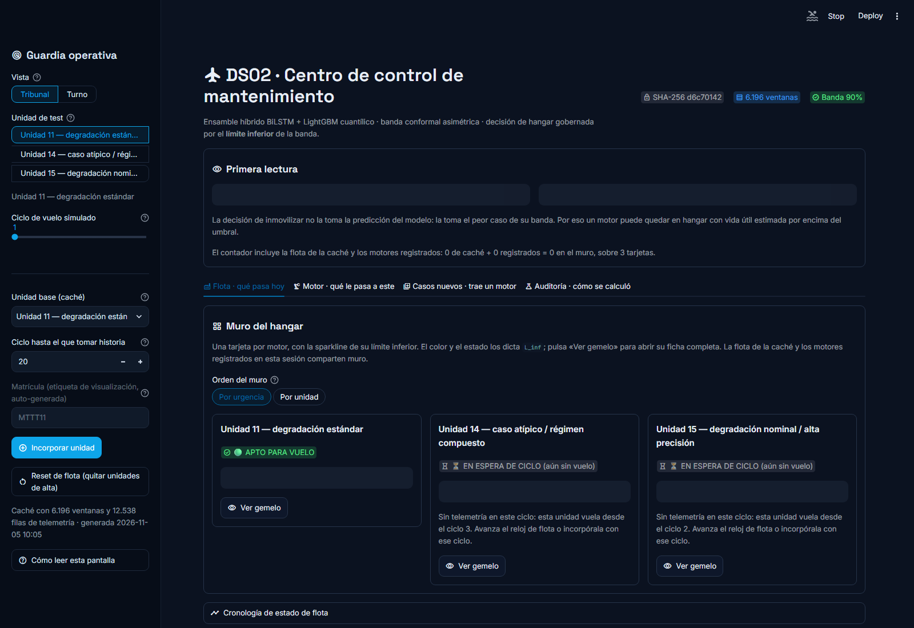
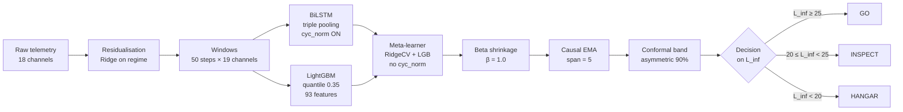
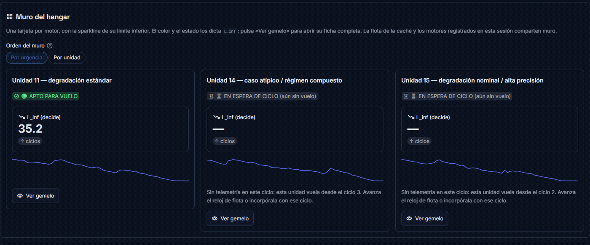
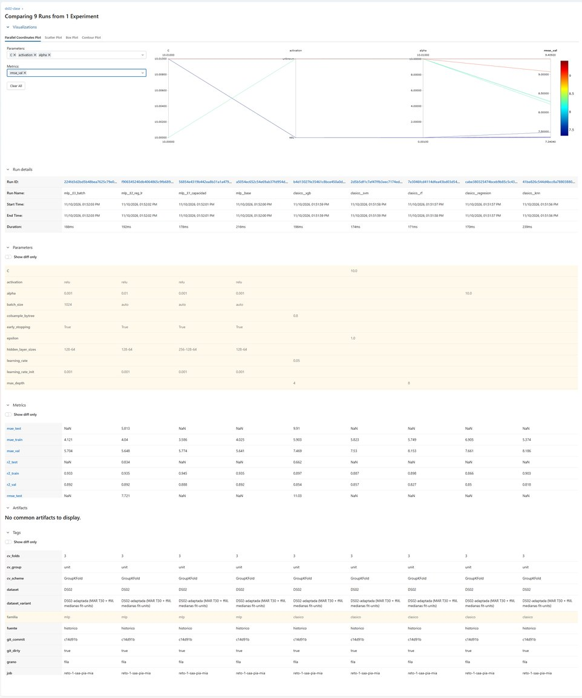
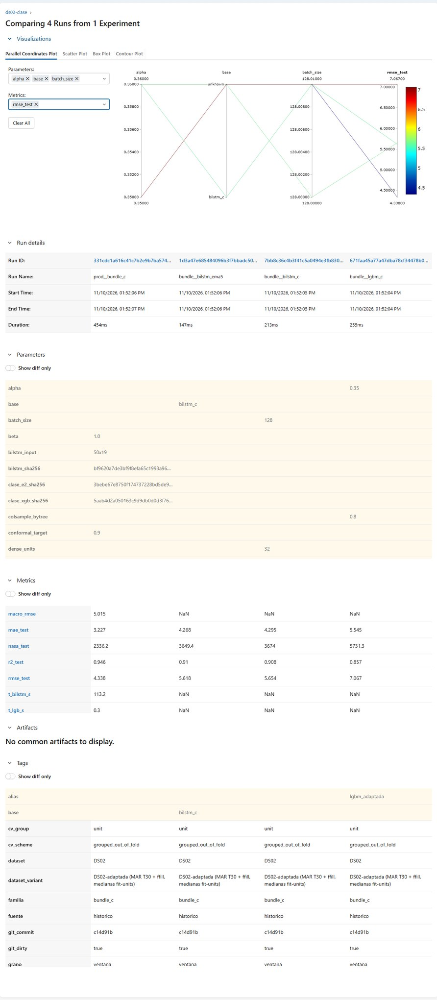
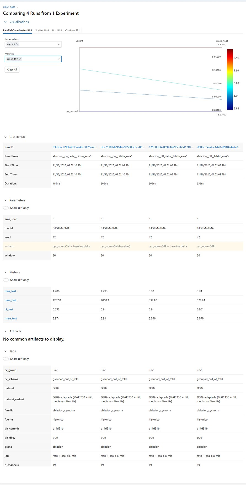

# N-CMAPSS DS02 — RUL and hangar decision

> **English** | [Español](README.md)

> **Reto 1 delivery (SAA + PIA + MIA).** The class track lives in `src/clase/`
> (code), `notebooks/01–07` (narrative), `data/processed/` (MAR-null dataset +
> `fase_vuelo`) and `resultados/` (metrics and figures). Production app:
> `app/entrypoints/dashboard_ds02.py`; the rubric entrypoint,
> `app/entrypoints/streamlit_app.py`, only delegates to it.
>
> **In 30 seconds:** 65,173 DS02 telemetry rows, 9 engines and a frozen bundle C
> that predicts RUL and turns it into GO / INSPECT / HANGAR. Manifest metrics:
> **RMSE 4.338 · MAE 3.227 · R² 0.9461 · NASA 2336.2** (seed 42, 6,196 test
> windows). Full Spanish README: [`README.md`](README.md).



*DS02 control centre: ensemble SHA-256 `d6c70142…`, 6,196 windows and a 90 %
conformal band. The app serves the frozen bundle C.*

## Quick facts

| Question | Answer |
|---|---|
| What does it predict? | RUL (remaining cycles) for each DS02 engine. |
| How is it turned into a decision? | 8 rules in `src/mia/reglas.py` (2 correction + 6 decision), each with priority, rationale and action; R1 is the safety rule at priority 10. |
| What is deployed? | Hybrid C: BiLSTM + quantile LightGBM + RidgeCV/LightGBM meta-learner, `beta = 1.0`, causal EMA 5 and an asymmetric conformal band. |
| Metrics? | RMSE 4.338 · MAE 3.227 · R² 0.9461 · NASA 2336.2 (seed 42, manifest). |
| Evidence? | `models/ds02_manifest.json`, `resultados/`, `mlruns/` (17 curated runs) and `notebooks/01–07`. |
| How to start? | `uvicorn app.services.api:app` and `streamlit run app/entrypoints/dashboard_ds02.py`. |

```bash
uvicorn app.services.api:app --host 127.0.0.1 --port 8000
streamlit run app/entrypoints/dashboard_ds02.py --server.address 127.0.0.1 --server.port 8501

# Rubric entrypoint: delegates to the production app
streamlit run app/entrypoints/streamlit_app.py --server.address 127.0.0.1 --server.port 8501
```

## Rubric → evidence

| Block | What is required | Where to look |
|---|---|---|
| **SAA** | EDA, 5 classical models, MLP experiments, ablation, comparison and SHAP | `notebooks/01`–`03`, `resultados/comparativa.csv`, `resultados/mlp_comparativa.csv`, `resultados/ablacion_cycnorm.csv`, `resultados/shap_importancia.csv` |
| **PIA** | README, structure, sklearn pipeline, MLflow, Streamlit app | This file, `src/clase/`, `mlruns/`, `app/entrypoints/dashboard_ds02.py` |
| **MIA** | Business case, rules, n8n and individual question | Business section below, `src/mia/reglas.py`, `n8n/flujo.json`, [`docs/defensa/mapa-rubrica.md`](docs/defensa/mapa-rubrica.md) |

> The rubric names example paths (`src/reglas.py`, `src/utils.py`,
> `app/streamlit_app.py`, `notebooks/01_eda.ipynb`). The repo keeps the same
> function under canonical paths and **does not reintroduce facades**; the full
> route map is [`docs/defensa/mapa-rubrica.md`](docs/defensa/mapa-rubrica.md).
> Cell-level map: [`docs/defensa/mapa-nb01-nb07.md`](docs/defensa/mapa-nb01-nb07.md).

## Business problem

An MRO shop with a DS02 fleet loses about **USD 10,000–15,000 per hour** of
aircraft-on-ground (AOG) time (Boeing range, Medium credibility; see
`costes_reales_aeronauticos.md` §1). A timely inspection costs a fraction of
that. Today the hangar decision depends on expert judgement without a number.

**Goal:** predict each engine's RUL so the shop lead can choose **GO / INSPECT /
HANGAR**, with the prediction converted into a decision by rules and, when
authorised, into an automatic action through n8n.

**Type of AI.** Weak AI: it only predicts DS02 RUL from its telemetry and does not
transfer to other domains. Supervised **regression** (continuous RUL) with labels
and ground-truth metrics (RMSE/MAE/R²). Stack: scikit-learn (5 classical models +
MLP + pipeline), XGBoost, LightGBM, Streamlit, SHAP, MLflow and n8n.

## Data

65,173 downsampled rows (STRIDE 100), **9 engines**; train = dev units
2/5/10/18/20/16 (52,635 rows), test = units 11/14/15 (12,538 rows, single read).
The processed dataset is regenerated under `data/processed/`; the raw HDF5 is
under `data/raw/`.

- **Features:** 18 physical channels (`alt`, `Mach`, `TRA`, `T2`, `T24`, `T30`,
  `T48`, `T50`, `P15`, `P2`, `P21`, `P24`, `Ps30`, `P40`, `P50`, `Nf`, `Nc`,
  `Wf`) plus `fase_vuelo` in the class track. The deployed bundle C uses 93
  residualised tabular features and 19 window channels.
- **Target:** `RUL` (0–88 cycles).
- **Quality:** 0 duplicate functional rows; 1,185 T30 nulls (~1.8 %), MAR with a
  physical pattern (sensor dropout at high cruise), imputed by causal ffill per
  unit + training median. The split is **by engine**, never by row.
- `unit` is the group key (never a predictor); `split_origen` is traceability;
  `fase_vuelo` is used by the class track but not by the deployed bundle.

## Architecture



Channel 19 is `cyc_norm = cycle/100`; LightGBM sees 93 residualised tabular
features. The meta-learner only sees `[p_lstm, p_lgb]` (2 columns), so `cyc_norm`
cannot become a stacking shortcut.

## Results

### Deployed bundle C (seed 42)

| Model | RMSE | MAE | R² | NASA score | Windows |
|---|---:|---:|---:|---:|---:|
| **Hybrid-C + EMA5** | **4.338** | **3.227** | **0.9461** | **2336.2** | 6,196 |

Source: `models/ds02_manifest.json` (`metrics.reference_row`). This is the frozen
artifact served by the app, not a multiseed mean.

**Per engine (the global score hides the spread):**

| Unit | RMSE | Windows |
|---|---:|---:|
| U11 | 3.6328 | 3,293 |
| U14 | 8.5761 | 760 |
| U15 | 2.8371 | 2,143 |
| **Global** | **4.338** | **6,196** |
| **Macro** (1/3 per engine) | **5.0153** | — |

U14 carries most of the error; it is small in the global average but is the real
worst case. That is why global and macro RMSE are both reported.

### Multiseed stability

| Seed | RMSE | NASA score | Source |
|---|---:|---:|---|
| 42 | 4.338 | 2336.2 | manifest (deployed bundle) |
| 7 | 4.371 | 2363.3 | versioned `resultados/bundle_c_multiseed.csv` |
| 123 | 4.291 | 2305.9 | versioned `resultados/bundle_c_multiseed.csv` |
| **Mean ± std** | **4.333 ± 0.040** | **2335.1 ± 28.7** | [42, 7, 123] |

The mean is computed from the **versioned CSV**; re-running seeds can move it. The
historical **4.324 ± 0.107 / 2341.0 ± 54.1** comes from the previous CSV
(`72035c3`) and must not be cited as current. The
means printed in NB06 (4.322 ± 0.064) and NB05 (4.330 ± 0.053) are historical and
not regenerable and must not be cited as current. The same applies to 4.301,
4.289, 4.344 and 4.368: those are historical bundles.

### Class track

| Grain | Model | Test RMSE | MAE | R² | NASA |
|---|---|---:|---:|---:|---:|
| row | XGB (best classical by val) | 11.034 | 9.9098 | 0.6616 | — |
| row | MLP E2 (best MLP by val) | 7.7211 | 5.8132 | 0.8343 | — |
| window | adapted LGBM | 7.067 | 5.545 | 0.8570 | 5731.3 |
| window | BiLSTM-C | 5.654 | 4.295 | 0.9084 | 3674.0 |
| window | BiLSTM-C + EMA5 | 5.618 | 4.268 | 0.9096 | 3649.4 |
| window | **Hybrid-C + EMA5** | **4.338** | **3.227** | **0.9461** | **2336.2** |

**Do not compare grains:** row = one reading (12,538 test rows); window = 50
readings (6,196 windows). Only intra-grain comparisons are valid. Test was read
once per family; model selection used `rmse_val`.

<details>
<summary>Historical bundles A/B (not current)</summary>

| Bundle | Model | RMSE | MAE | R² | NASA |
|---|---|---:|---:|---:|---:|
| B v4.1.0 | Hybrid stacking + EMA5 | 4.301 ± 0.068 | 3.181 ± 0.021 | 0.9470 ± 0.0017 | 2315.6 ± 20.0 |
| A 2026-10-21 | Hybrid stacking + EMA5 | 4.289 ± 0.018 | 3.183 ± 0.017 | 0.9475 ± 0.0004 | 2297.5 ± 17.4 |

Kept for comparison only. The current bundle is **C (4.338)**.

</details>

### Error cost

DS02 does not publish hours per cycle: the cycles→hours conversion is a
**declared assumption**, not a measurement.

| Item | Formula | Value |
|---|---|---:|
| AOG cost (external source, Medium credibility) | Boeing range | USD 10,000–15,000/h |
| Flight hours per cycle | assumption | 1–2 h |
| Cost per cycle of error | h/cycle × AOG | USD 10,000–30,000 |
| Bundle C error | manifest RMSE | 4.338 cycles |
| Cost if all error becomes AOG | RMSE × cost/cycle | ≈ USD 43,000–130,000 |
| Worst unit (U14) | 8.5761 × cost/cycle | ≈ USD 86,000–257,000 |

With `hangar` 25 and `apto` 30 cycles (`src/mia/reglas.py`), an RMSE of 4.338 is
≈17 % of the hangar threshold. The detailed source is local and **not versioned**:
it is declared as an assumption, not a measurement.

### `cyc_norm` ablation

Test units 11/14/15, seed 42, same protocol. Full grid:
[`resultados/ablacion_cycnorm.csv`](resultados/ablacion_cycnorm.csv).

| Variant | LGBM | BiLSTM | BiLSTM + EMA5 |
|---|---:|---:|---:|
| cyc_norm OFF | **6.297** | 5.946 | **5.878** |
| cyc_norm OFF + baseline delta | 8.765 | 5.939 | 5.896 |
| cyc_norm ON (baseline) | 7.067 | 5.939 | 5.910 |
| cyc_norm ON + baseline delta | 8.547 | 5.985 | 5.974 |

In the sequential model all four variants sit in 5.878–5.974 (a 0.10 spread): the
clock does not change the result. In LGBM it does: enabling it costs +0.77 RMSE
and adding the baseline delta +2.47, so both stay out of the tabular model.
Conclusion: `cyc_norm` remains channel 19 of the BiLSTM and does not enter LGBM or
the meta-learner.

## Decision and automation

Rules live in **`src/mia/reglas.py`**: 8 rules (2 correction + 6 decision), each
with `id`, `priority`, `why` and `action`. **R1** is the safety rule at priority
10: an impossible-data alert cancels the decision (`SIN_DECISION`) and records the
reason; no GO is ever returned without evidence. The gate is in
`src/mia/motor.py`.

`n8n/flujo.json` has **20 nodes** (13 functional + 7 notes) and a `Switch` with **four** connected branches:

| Branch | Action |
|---|---|
| GO | Log the decision + Telegram alert. |
| INSPECT | Google Sheets + Telegram alert for the next stop. |
| HANGAR | Postgres `ds02_decisiones` → Calendar → Gmail → Telegram. |
| FALLBACK | Unrecognised decision: error Set + Telegram alert, no action. |

The versioned JSON is **inactive by design** (`active: false`). Running it needs
credentials and can produce real effects (email, calendar, Postgres). No secrets
are included.

## App and SHAP

`app/entrypoints/dashboard_ds02.py` is the production app: RUL, conformal band,
decision, bundle SHA and a SHAP section. The rubric entrypoint,
`app/entrypoints/streamlit_app.py`, only delegates to it.



*Real app capture: as the simulated flight cycle advances, the lower band limit
(`L_inf`) crosses the 25/20 thresholds and each card moves from APTO PARA VUELO
to INSPECCIÓN PROGRAMADA and DERIVACIÓN A HANGAR (AOG).*

- **Global:** top-10 features by `mean |SHAP|` for the selected engine.
- **Local:** waterfall explanation for one prediction.
- SHAP explains the tabular component (LightGBM, 93 features), **not** the BiLSTM
  or the stacking; it describes the model, not the engine.

Evidence: [`docs/assets/shap_importancia.png`](docs/assets/shap_importancia.png),
`resultados/shap_bundle_C/` and `resultados/mlp_shap_E2/`.

## MLflow

Tracking lives in `mlruns/` (text file store, no server or SQLite). The
**versioned** store has **17 curated runs**: 9 row, 4 window and 4 ablation. Live
notebook work writes to `mlruns-live/`, which is git-ignored: re-running a notebook
can never dirty the delivery.

```bash
python scripts/operativo/backfill_mlflow.py --check   # 17 runs, store + export, no artifacts
python scripts/operativo/backfill_mlflow.py --write   # regenerate the 17 runs (idempotent)
MLFLOW_ALLOW_FILE_STORE=true mlflow ui --backend-store-uri ./mlruns
```

The block is bash syntax. On PowerShell 7:

```powershell
$env:MLFLOW_ALLOW_FILE_STORE = "true"
.venv\Scripts\python.exe -m mlflow ui --backend-store-uri ./mlruns
```

`MLFLOW_ALLOW_FILE_STORE=true` is not optional: MLflow 3.18 leaves the file
store in maintenance mode and refuses to start without that variable. Use the
`.venv` python, not the `mlflow` on PATH, so the store is not mixed with the
system Python.

`--check` is not decorative: it queries the experiment with `ViewType.ALL` and
**fails** when a `live__*` run or a tombstone (`lifecycle_stage: deleted`) shows
up. Store purity is an executable invariant, not a README promise.

### Three grains, three questions

| Grain | Runs | What it compares |
|---|---:|---|
| `fila` | 9 | one reading = one model (5 classical + 4 MLP), GroupKFold by engine |
| `ventana` | 4 | 50 readings per prediction: LGBM, BiLSTM, BiLSTM+EMA5 and the deployed bundle |
| `ablacion` | 4 | the same model with `cyc_norm` ON/OFF × baseline delta |

Grains never mix: row RMSE and window RMSE do not measure the same thing, and the
store states it with the `grano` tag. Ablation runs are isolated by
`familia=ablacion_cycnorm`.

<p align="center">
  
</p>

### Window grain compared inside MLflow

The four bundle runs (LGBM, BiLSTM, BiLSTM+EMA5 and the deployed hybrid) share one
experiment and compare on `rmse_test`: 7.067 / 5.654 / 5.618 / 4.338.

<p align="center">
  
</p>

### Ablation compared inside MLflow

| `cyc_norm` variant | Test RMSE |
|---|---:|
| OFF | **5.878** |
| OFF + baseline delta | 5.896 |
| ON (baseline) | 5.910 |
| ON + delta | 5.974 |

It was measured in `nb03` (test 11/14/15, seed 42) and registered **without
retraining**: four comparable runs inside the tool, not a lone notebook figure.
The full 4×3 grid lives in `resultados/ablacion_cycnorm.csv`.

<p align="center">
  
</p>

### Why the store is plain text

Each run keeps params, metrics and tags —including `git_commit`, `git_dirty` and
the dataset SHA— so it stays auditable years later. There are no binaries: models
live in `models/` and are identified by SHA, and `mlruns/**/artifacts/` is
deliberately empty so the store is reviewable in a diff.

Exported comparison:
[`docs/evidencia/mlflow/comparativa.csv`](docs/evidencia/mlflow/comparativa.csv).
All screenshots live in `docs/evidencia/mlflow/`:

| Screenshot | What it shows |
|---|---|
| [`compare_fila.jpg`](docs/evidencia/mlflow/compare_fila.jpg) | **Compare** view of 9 models, plotted by `rmse_val` |
| [`compare_ventana.jpg`](docs/evidencia/mlflow/compare_ventana.jpg) | Compare view of the 4 window runs, by `rmse_test` (LGBM, BiLSTM, BiLSTM+EMA5, bundle C) |
| [`compare_ablacion.jpg`](docs/evidencia/mlflow/compare_ablacion.jpg) | Compare view of the 4 `cyc_norm` runs, by `rmse_test` |

Each Compare view is filtered by `tags.grano` and carries the parallel
coordinates chart plus the parameters, metrics and tags tables side by side, so
what the reviewer sees is what the CSV summarises. Row grain compares on
`rmse_val` on purpose: the row test set is read once per family (XGB and MLP-E2),
and those two readings are what the CSV publishes.

If you would rather ask than look at the UI, the `mlflow mcp run` MCP exposes
`search_experiments`, `list_runs` and `describe_run` over this same store.

<details>
<summary>17 run keys</summary>

**Row — 9 runs (GroupKFold by engine):** `clasico__knn`, `clasico__regresion`,
`clasico__rf`, `clasico__svm`, `clasico__xgb`, `mlp__base`, `mlp__E1_capacidad`,
`mlp__E2_reg_lr`, `mlp__E3_batch`.

**Window — 4 runs (grouped OOF; 6,196 test windows):** `bundle__lgbm_c`,
`bundle__bilstm_c`, `bundle__bilstm_ema5`, `prod__bundle_c`.

**Ablation — 4 runs:** `ablacion__off__bilstm_ema5`,
`ablacion__off_delta__bilstm_ema5`, `ablacion__on__bilstm_ema5`,
`ablacion__on_delta__bilstm_ema5`.

Row test is read once per family: XGB 11.034 and MLP-E2 7.7211 are published
readings; selection used `rmse_val`. Window has no comparable `rmse_val`; the
manifest test is the reference.

</details>

## How to run

```bash
python -m venv .venv
.venv/Scripts/activate        # Windows; POSIX: source .venv/bin/activate
pip install -r requirements.txt
pip install -e .
```

`pip install -e .` is required: notebooks and the app import `ds02_rul` and
`src.clase` as installed packages. In VS Code, open the **repo folder (`nasa/`)**
as the workspace root.

```bash
# API
uvicorn app.services.api:app --host 127.0.0.1 --port 8000

# Production app
streamlit run app/entrypoints/dashboard_ds02.py

# Rubric entrypoint (delegates)
streamlit run app/entrypoints/streamlit_app.py

# Tests
python -m pytest tests/ -q

# Class track
python -m src.clase.train_clasicos
python -m src.clase.train_mlp
python -m src.clase.shap_clase
python -m src.clase.shap_clase_e2

# Multiseed stability (no retraining: uses the versioned CSV)
python scripts/operativo/evaluate_bundle_stability.py --desde-csv

# MLflow
python scripts/operativo/backfill_mlflow.py --check
MLFLOW_ALLOW_FILE_STORE=true mlflow ui --backend-store-uri ./mlruns
```

The MLflow command is bash syntax; on PowerShell 7 use
`$env:MLFLOW_ALLOW_FILE_STORE = "true"; .venv\Scripts\python.exe -m mlflow ui --backend-store-uri ./mlruns`
(see the MLflow section).

## Project structure

```text
app/
  entrypoints/streamlit_app.py   rubric entrypoint (delegates)
  entrypoints/dashboard_ds02.py  production app (bundle C + SHAP)
  lib/                           data, inference, rules
  services/                      API
  ui/                            tabs
src/
  clase/                         class track (dataset, pipeline, 5 models, MLP, SHAP)
  ds02_rul/                      bundle C: bundle_c, puente_c, ensemble, stacking, conformal
  mia/                           rules and decision engine (MIA-2)
  n8n.py                         payload client/builder (MIA-3)
notebooks/                       01–07, with outputs and sequence README
models/                          bundle C + manifest + class joblibs
n8n/flujo.json                   versioned flow (20 nodes, 4 branches, inactive)
mlruns/                          17 curated runs; live__* not versioned
data/raw/                        original HDF5
data/processed/                  processed parquet (git-ignored, regenerable)
resultados/                      CSV, PNG and evidence tables
docs/                            assets, MLflow evidence, defence and maps
tests/                           contract, architecture, app and pipeline tests
archive/                         archived bundle B
scripts/operativo/               MLflow backfill, stability, gate and prediction
```

**Bundle C artifacts** (full hashes in `models/ds02_manifest.json`):

| Artifact | SHA-256 (prefix) |
|---|---|
| `ensemble.joblib` | `d6c70142…` |
| `bilstm_ds02.keras` | `bf9620a7…` |
| `scaler.joblib` | `acccfab3…` |
| `ds02_manifest.json` | `6089457c…` |

## Limitations and decisions

- **TensorFlow on CPU is not bit-for-bit deterministic.** Re-training can change
  the number; the **manifest** is the source of truth for the installed bundle.
- **Multiseed:** 4.333 ± 0.040 (NASA 2335.1 ± 28.7) comes from the versioned CSV
  (42/7/123). The previous 4.324 ± 0.107 / 2341.0 ± 54.1 is historical (`72035c3`).
  NB05/NB06 printed other means at the time and are kept as non-regenerable history. If
  `resultados/bundle_c_multiseed.csv` was regenerated locally, the working copy may
  differ from `HEAD`; the README follows the versioned copy.
- **AOG cost:** USD 10,000–15,000/h is an external, Medium-credibility source;
  hours per cycle are an assumption. It is not presented as a measurement.
- **n8n:** the JSON is inactive by design. Running it needs credentials and may
  send email, create calendar events or write to Postgres.
- **Facades:** `src/reglas.py` and `src/utils.py` are not reintroduced; the
  architecture test forbids them and the map explains the canonical path.
- **Grains:** row (12,538) and window (6,196) are never mixed; each league has its
  own champion.
- **Processed data:** `data/processed/` is git-ignored and regenerated from the
  HDF5 with the documented pipeline.

## Documentation and defence

- Rubric→path map: [`docs/defensa/mapa-rubrica.md`](docs/defensa/mapa-rubrica.md)
- Notebook cell map: [`docs/defensa/mapa-nb01-nb07.md`](docs/defensa/mapa-nb01-nb07.md)
- Class track: [`src/clase/README.md`](src/clase/README.md)
- Notebook sequence: [`notebooks/README.md`](notebooks/README.md)
- MLflow evidence: [`docs/evidencia/mlflow/comparativa.csv`](docs/evidencia/mlflow/comparativa.csv)
- Rubric: `docClase/Reto1_SAA_PIA_MIA_2026-27_v5.pdf`
- AOG cost: `costes_reales_aeronauticos.md` §1 (local, not versioned)

## Authorship

N-CMAPSS DS02 project · IA and Big Data course 2026-27 · delivery branch
`refactor/estructura-ds02-clase-2026-11-10`.
