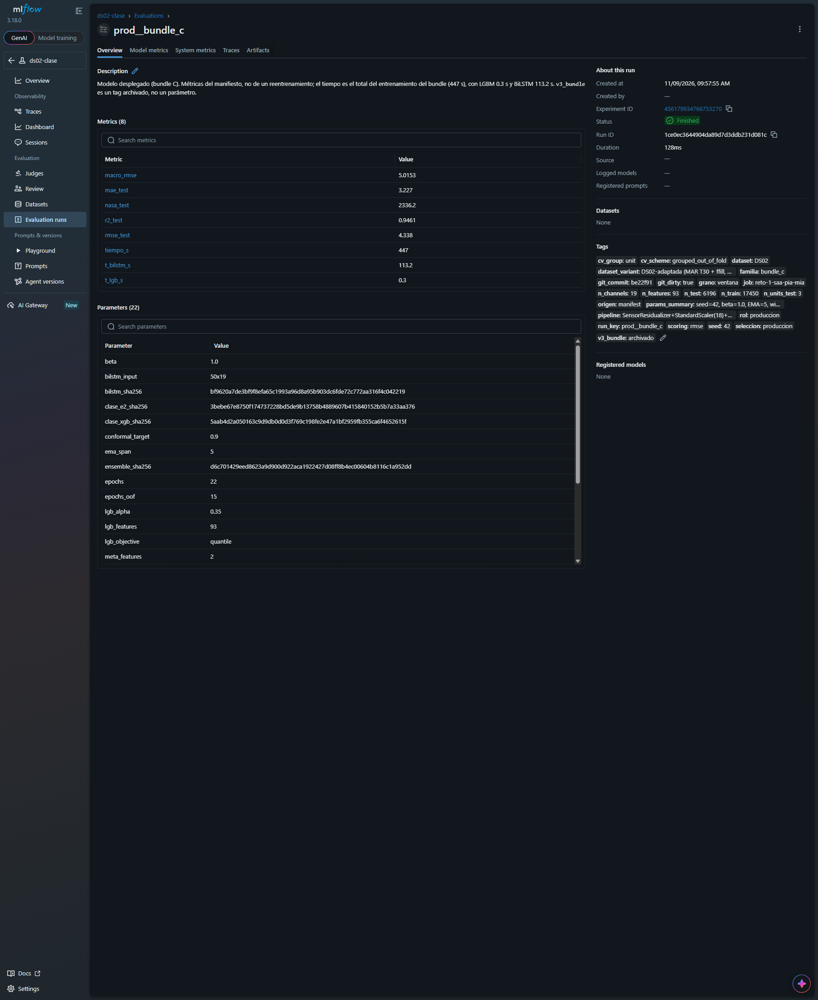

# N-CMAPSS DS02 — Remaining Useful Life

> **English** | [Español](README.md)

> **Entrega de clase (Reto 1 SAA + PIA + MIA):** el track académico vive en
> `src/clase/` (código), `notebooks/01–07` (relato), `data/processed/`
> (dataset con nulos MAR + `fase_vuelo`) y `resultados/` (métricas y figuras).
> Punto de entrada: [`src/clase/README.md`](src/clase/README.md) (6 apartados),
> app desplegada: `streamlit run app/entrypoints/dashboard_ds02.py` (bundle C + SHAP).
> Lo de abajo es el sistema desplegado (bundle C congelado, RMSE 4.338).

Predicting remaining useful life on the N-CMAPSS DS02 turbofan dataset, packaged
so that it **loads, serves and is honest about what it measures**.

A BiLSTM over ordered windows and a quantile LightGBM over residualised tabular
features are reconciled by a learned meta-learner, shrunk towards the champion by
a factor `beta`, and smoothed with a causal per-unit EMA.


*DS02 control centre: ensemble SHA-256 `d6c70142…`, 6,196 windows and a 90 % band. The app serves the frozen bundle C.*

```bash
uvicorn app.services.api:app --host 127.0.0.1 --port 8000    # http://localhost:8000/docs
streamlit run app/entrypoints/streamlit_app.py --server.address 127.0.0.1 --server.port 8501
```

---

## Data

65,173 downsampled rows (STRIDE 100), 9 engines, train = dev (52,635, units 2/5/10/18/20/16), test = units 11/14/15 (12,538, single read). See `src/clase/README.md` for the full field table.

| Column | Removed from | Why | Bulk | Evidence (path:line) |
|---|---|---|---|---|
| `unit` | `X` / `FEATURE_COLS` (not a predictor) | It is the split and GroupKFold group, not a physical reading: using it would leak by engine. | 65,173 rows, 9 engines (52,635 train with 6 units, 12,538 test with 3 units 11/14/15) | `src/clase/pipeline_clase.py:7`, `src/clase/pipeline_clase.py:22-24`, `src/clase/dataset_clase.py:201-209` |
| `RUL` | `X` (kept as `y`) | It is the supervised target: predicting it while using it as input would leak. | 65,173 rows, range 0–88 cycles | `src/clase/dataset_clase.py:59` |
| `split_origen` | `X_train` / `X_test` (kept in `train.parquet`/`test.parquet`) | Traceability only (train/test), not physics nor a predictor. | 65,173 rows (52,635 `train` + 12,538 `test`) | `src/clase/dataset_clase.py:60` |
| `fase_vuelo` | Deployed bundle C (93 features) — **not** from the class track | The class track uses it (19 numeric + 1 OneHot categorical); the bundle-C contract (93) is residualised/windowed without that categorical. | 65,173 rows, 3 categories (Descenso 28,999 / Ascenso 18,595 / Crucero 17,579) | `src/clase/pipeline_clase.py:23-24`, `src/clase/ventanas_adaptadas.py:6` |

No dataset field is discarded. `unit` never enters as a predictor (it is the split group) and `RUL` is the target; `fase_vuelo` is the new class-track categorical and the deployed bundle does not use it (93 features without it).

## Results — test units 11 / 14 / 15, 6 196 windows, mean ± std over seeds [42, 7, 123]

### Baseline v4.1.0 (historical bundle B — kept for comparison, not current; current is bundle C 4.338 below)

| Model | RMSE | MAE | R² | NASA score |
| --- | --- | --- | --- | --- |
| LightGBM quantile 0.35 (standalone) | 7.098 ± 0.034 | 5.572 ± 0.034 | 0.8557 ± 0.0014 | 5772.5 ± 50.1 |
| BiLSTM triple pooling (standalone) | 6.152 ± 0.576 | 4.745 ± 0.332 | 0.8910 ± 0.0205 | 4308.0 ± 595.8 |
| **Hybrid stacking + causal EMA5** | **4.301 ± 0.068** | **3.181 ± 0.021** | **0.9470 ± 0.0017** | **2315.6 ± 20.0** |

The NASA score is a **sum** of asymmetric exponentials, not a mean, so it scales
with the number of scored windows and is only comparable between models evaluated
on these same rows.

**Read the standard deviations before the means.** The BiLSTM swings ±0.58 RMSE
across seeds; the hybrid is stable to ±0.068. The hybrid's spread is now *real*
rather than an artefact: with the cycle counter removed from the meta-learner the
stacking layer actually depends on the two base models, so it inherits their
variance instead of reading a counter (see the ablation section below).

### Revision 2026-10-21 (historical bundle B — not current)

Same models, same protocol. The additions are two metrics, not extra accuracy.

| Model | RMSE | MAE | R² | NASA score |
| --- | --- | --- | --- | --- |
| LightGBM quantile 0.35 (standalone) | 7.098 ± 0.034 | 5.572 ± 0.034 | 0.8557 ± 0.0014 | 5772.5 ± 50.1 |
| BiLSTM triple pooling (standalone) | 6.337 ± 0.811 | 4.872 ± 0.756 | 0.8837 ± 0.0305 | 4509.9 ± 1051.1 |
| **Hybrid stacking + causal EMA5** | **4.344 ± 0.075** | **3.209 ± 0.058** | **0.9459 ± 0.0019** | **2338.2 ± 49.1** |

### Current — bundle C (deployed and frozen: what `models/` + `app/cache/` serve)

| Model | RMSE | MAE | R² | NASA score |
| --- | --- | --- | --- | --- |
| **Hybrid stacking + causal EMA5 (imputed base, deployed)** | **4.338** | **3.227** | **0.9461** | **2336.2** |

Deployed (bundle C): RMSE 4.338 · MAE 3.227 · R² 0.9461 · NASA 2336.2 (seed 42,
imputed base MAR T30 + ffill); multiseed variability **4.324+-0.107 RMSE / 2341.0+-54.1 NASA** over [42, 7, 123] (mean of `resultados/bundle_c_multiseed.csv` + manifest; the old 4.368 from `resultados/comparativa_c_multisemilla.csv` is obsolete and must not be cited). The printed NB06 (4.322+-0.064) and NB05 (4.330+-0.053) means are historical and not regenerable.

TensorFlow on CPU is not bit-for-bit deterministic between runs, so prose figures
and printed tables can differ by ±0.1. The authoritative numbers are the ones
written in `models/ds02_manifest.json`.

**Macro-RMSE, which the weighted figure hides.** Deployed bundle per engine:
11 → 3.6328, 14 → 8.5761, 15 → 2.8371. Unweighted mean **5.0153**, against a
window-weighted **4.3382**. The gap of +0.6
is the cost of engine 14 having both the worst error and the fewest windows (760 of
6 196, yet 43.7 % of the squared error). The fleet average is kinder than what a
randomly chosen engine suffers.

**One thing was tried and reverted in this revision.** Moving the tabular objective
to the median (`alpha=0.50`) won on every dev out-of-fold metric — branch 9.11 →
8.18 RMSE, hybrid 13.15 → 12.09, NASA −14.6 % — and then lost on the confirmatory
test read: at a fixed BiLSTM it costs the branch 7.11 → 9.12 and the hybrid
4.236 → 4.588. `alpha=0.35` stands. The full record is `ADR-007`; the lesson is
recorded there because it constrains every future change: **the dev gate can settle
structural questions but cannot arbitrate the mix of regimes on this dataset.**

**Prediction band (split conformal).** Target 90 %, realised **100 %** with a mean
width of **26.41 cycles** — 26.92 / 26.03 / 25.75 per engine, and no truth outside
the bound on either side. It is calibrated on the out-of-fold residuals of all six
development engines, which come from weaker fold models than the shipped ones, so
the band is **conservative by construction: a bound, not a decision-grade
interval**. Recalibrating it on unit 16 to attack that width was measured and
rejected: the interval collapses to **3.35 cycles at 31.4 % coverage** (41.4 %
below, 27.2 % above), because the meta-learner is fitted on unit 16 and unit 16
holds no row above 62 cycles, so no quantile fitted there can cover high life.
`predict_interval()` returns `(point, lower, upper)`; `predict()` is unchanged.

---

## MLflow — 17 historic runs (PIA-4)

Tracking lives in `mlruns/` (text file store, no server, no SQLite) and is rebuilt from the measured CSVs:

```bash
python scripts/operativo/backfill_mlflow.py --write   # 17 historic runs; idempotent by run_key
python scripts/operativo/backfill_mlflow.py --check   # store + export, zero artifacts
MLFLOW_ALLOW_FILE_STORE=true mlflow ui --backend-store-uri ./mlruns
```

MLflow 3.18 requires `MLFLOW_ALLOW_FILE_STORE=true` for the filesystem backend; the script and the test set it. The API-exported comparison is [`docs/evidencia/mlflow/comparativa.csv`](docs/evidencia/mlflow/comparativa.csv). **The three grains are not mixed**: 9 row runs (one reading), 4 window runs (50 readings) and 4 ablation runs of `cyc_norm` (2×2 grid over BiLSTM+EMA5).

### Row grain — 9 runs (GroupKFold by engine)

| run_key | Model | RMSE val | RMSE test | Time (s) | Selection |
| --- | --- | ---: | ---: | ---: | --- |
| `clasico__knn` | KNN | 9.4092 | — | 9.1 | — |
| `clasico__regresion` | Ridge | 8.2762 | — | 3.5 | — |
| `clasico__rf` | Random Forest | 9.0704 | — | 79.6 | — |
| `clasico__svm` | SVR | 8.2927 | — | 2.7 | — |
| `clasico__xgb` | XGBoost | 8.2173 | 11.034 | 7.2 | `mejor_clasico` |
| `mlp__base` | MLP base | 7.358 | — | 27.5 | — |
| `mlp__E1_capacidad` | MLP E1 | 7.4808 | — | 70.7 | — |
| `mlp__E2_reg_lr` | MLP E2 | 7.3404 | 7.7211 | 33.3 | `mejor_mlp,campeon_fila` |
| `mlp__E3_batch` | MLP E3 | 7.3554 | — | 38.6 | — |

The row test is read **once and only for the selected model**: XGB 11.034 and MLP-E2 7.7211. It is not used for selection.

### Window grain — 4 runs (grouped out-of-fold; test 6,196 windows, units 11/14/15)

| run_key | Model | RMSE val | RMSE test | Time (s) | Role |
| --- | --- | ---: | ---: | ---: | --- |
| `bundle__lgbm_c` | LightGBM-C (quantile 0.35) | — | 7.067 | 0.3 | component / alias `lgbm_adaptada` |
| `bundle__bilstm_c` | BiLSTM-C | — | 5.654 | 113.2 | component |
| `bundle__bilstm_ema5` | BiLSTM-C + EMA5 | — | 5.618 | — (not timed) | variant |
| `prod__bundle_c` | Hybrid-C + EMA5 (bundle C) | — | 4.338 | 447 | production |

No comparable `rmse_val` exists for the window grain: the protocol is grouped OOF and the reference is the manifest test. Production: MAE 3.227 · R² 0.9461 · NASA 2336.2; `beta=1.0`, EMA 5, window 50, 93 LGBM features, 18 scaler features and the four manifest SHAs. `v3_bundle=archivado` is a tag, not a parameter.

### `cyc_norm` ablation — 4 runs (2×2 over BiLSTM+EMA5)

The four variants are registered **on the same model** (BiLSTM+EMA5, the best in all four) so the MLflow comparison isolates the `cyc_norm` factor and the baseline delta. Protocol: test 11/14/15, seed 42, the same session as the rest of the table; nothing is retrained.

| run_key | Variant | RMSE test | MAE | R² | NASA score |
| --- | --- | ---: | ---: | ---: | ---: |
| `ablacion__off__bilstm_ema5` | cyc_norm OFF | 5.878 | 3.740 | 0.9010 | 3281.4 |
| `ablacion__off_delta__bilstm_ema5` | OFF + baseline delta | 5.896 | 3.830 | 0.9004 | 3393.8 |
| `ablacion__on__bilstm_ema5` | ON (baseline) | 5.910 | 4.793 | 0.9000 | 4060.3 |
| `ablacion__on_delta__bilstm_ema5` | ON + baseline delta | 5.974 | 4.706 | 0.8978 | 4257.8 |

The full 4×3 grid (three models per variant) is in [`resultados/ablacion_cycnorm.csv`](resultados/ablacion_cycnorm.csv) and in the [cyc_norm ablation](#cyc_norm-ablation) section. In MLflow the 4 sequential-model cells are registered; the rest is filtered by `familia=ablacion_cycnorm`.

### MLflow captures


*9 row runs; `rmse_test` only appears for XGB and MLP-E2 because the test was read once.*


*4 window runs; EMA5 has no time because it was not timed.*



*`prod__bundle_c`: 4.338 / 3.227 / 0.9461 / 2336.2 and the four SHAs.*

---

## What the ablation actually found

The previous revision claimed that dropping the cycle counter costs
`LGBM → 13.349` and `hybrid → ~7.8`. Both numbers were quoted from different
designs and neither was measured on this pipeline. Measured here:

### Base models (seed 42)

| Variant | LGBM RMSE | BiLSTM RMSE | BiLSTM + EMA5 RMSE |
| --- | --- | --- | --- |
| `cyc_norm` ON (baseline) | 7.113 | 5.419 | 5.386 |
| `cyc_norm` OFF | **6.297** | 6.513 | 6.477 |
| `cyc_norm` OFF + baseline delta | 8.667 | 5.998 | 5.955 |
| `cyc_norm` ON + baseline delta | 8.578 | 5.980 | 5.955 |

Removing the counter from the **base models** costs the BiLSTM **+1.094 RMSE** —
three orders of magnitude less than the 13.349 that had been asserted, and it
*improves* LightGBM by 0.82. The counter is a genuinely valuable input for the
BiLSTM, which is why the fix removes it from the stacking layer only.

### Where the cycle counter really acts (seed 42, `scripts/auditoria/ablate_meta_cycle.py`)

With `beta = 1.0` the final prediction **is** the meta-learner output, and the
meta-learner *as shipped until this revision* put all of its weight on the clock:

```
ridge coef [p_lstm, p_lgb, cyc_norm] = [0.0019, 0.0124, -98.4065]
lgb_meta feature importances          = [0, 0, 720]
```

| Configuration | RMSE | MAE | NASA | meta uses |
| --- | --- | --- | --- | --- |
| cycle available everywhere (previous revision) | 5.522 | 4.795 | 3435.3 | 100 % clock |
| cycle removed from every component | 5.568 | **3.742** | **3233.3** | p_lstm 0.34, p_lgb 0.69 |
| OLS on cycle alone | 14.327 | 13.148 | 20267.6 | — |
| constant | 20.022 | 17.059 | 48840.3 | — |

Four conclusions, all measured:

1. The 5.52 was **not** produced by the clock — a linear model on cycle alone
   scores 14.33. The base models do the work.
2. But when the clock was *available*, the learner preferred it and discarded both
   base models. That is why the hybrid's seed-to-seed variance was 0.001: it was
   not aggregating two noisy learners, it was reading a counter.
3. Removing the clock from the stacking layer — while keeping it in both base
   models, where it is a legitimate input — is the fix, and it is the
   configuration the shipped bundle uses (RMSE 4.338;
   multiseed variability 4.324+-0.107) against
   the previous 5.523 ± 0.001, with the meta-learner splitting its weight between the two
   branches instead of betting everything on one counter.
4. Removing it from *every* component instead (5.568) is a different experiment:
   it also re-trains the base models without the clock, which costs the BiLSTM
   more than the stacking layer gains.

The shipped artifact carries the clock in both base models and **not** in the
meta-learner. `models/ablation_meta_cycle.json` and `scripts/auditoria/ablate_meta_cycle.py`
make the alternative reproducible.

---

## Leakage and calibration

| Property | Before | Now |
| --- | --- | --- |
| Rows behind `scaler`, `poly_w`, the 14 residual ridges | 52 635 (all six dev units, holdout included) | **44 982 (fit units only)** |
| `beta` selection | meta-learners fitted and scored on the same unit-16 rows | grouped **out-of-fold**, 3 folds, transforms refitted per fold |
| Fold `beta` values | single value `1.00` | `[1.00, 1.00, 0.00]` — median 1.00, IQR 0.50 |
| Meta-learning sample | 2 535 unit-16 windows (unchanged) | pooling the 14 915 out-of-fold windows of the five fit engines was **measured and rejected** — it learns a level prior that does not transfer |
| Prediction band | none | split conformal on out-of-fold residuals, asymmetric per predicted-RUL bin |
| Headline metric | window-weighted RMSE only | window-weighted **and** macro-RMSE, both in the manifest |
| Multi-seed | none | 3 seeds, mean ± std |
| Ingestion | silent FD001 fallback to the same artifact path | raises; names the paths it probed |

The fold vector is reported in full because a median alone would hide that one of
three folds selected `beta = 0` — i.e. that fold saw no value in the meta-learner.

---

## Seed stability (C)

| Model | RMSE | NASA score | Seeds |
|---|---|---|---|
| C-mean (current CSV, test windows) | **4.324+-0.107** | **2341.0+-54.1** | 42, 7, 123 |
| C-mean (NB06 printed) — historical | 4.322+-0.064 | 2342.3+-43.4 | 42, 7, 123, not regenerable |
| C-mean (NB05 printed, OOF) — historical | 4.330+-0.053 | 2343.2+-24.1 | 42, 7, 123, not regenerable |

Seed 42 is the shipped bundle (`models/ds02_manifest.json`); seeds 7 and 123 are
retrained under the same protocol by `scripts/operativo/evaluate_bundle_stability.py`. The ± is
the noise floor every difference should be read against: two means closer than that
± are a tie.

**Evidence:** `resultados/bundle_c_multiseed.csv`, `resultados/comparativa_bundle_c.csv`,
`scripts/operativo/evaluate_bundle_stability.py`, `notebooks/06_evaluacion_produccion_comparativa.ipynb`.


---

## Deployability

The first artifact could not be loaded by the repository's own interpreter:

```
AttributeError: Can't get attribute 'HybridStackingEnsemble' on <module '__main__'>
ValueError: bad marshal data (unknown type code)     # even with the shim
```

| Fix | Evidence |
| --- | --- |
| Classes moved to `src/ds02_rul` | `joblib.load` succeeds in a clean 3.12 process |
| Bare `Lambda` → registered `LastStepPooling` | no `Lambda` in the graph; `.keras` round-trip exact |
| Weights migrated from the 3.10 artifact, no retraining | max abs difference **0.000e+00** |
| Graph persisted natively, not pickled in the bundle | `models/bilstm_ds02.keras`, 1.9 MB |
| Manifest with shape, partition, seed, env, fingerprint | `models/ds02_manifest.json` |
| Save-path guard | refuses a bundle whose scaler is not 18-channel / `n_op != 4` |

### Artifacts

| File | Contents |
| --- | --- |
| `models/bilstm_ds02.keras` | native Keras graph, 154 253 params, `(None, 50, 19)` |
| `models/ensemble.joblib` | `ds02_rul.HybridStackingEnsemble` — LightGBM, meta-learners, residualizer, scalers, `beta`, `ema_span` |
| `models/scaler.joblib` | 18-channel `StandardScaler`, DS02 fingerprint `[21930.0, 0.6249, 68.613, 475.0123]` |
| `models/ds02_manifest.json` | provenance, including `meta_features: 2` and the artifact SHA-256 |
| `models/ablation_meta_cycle.json` | the cycle-counter measurement above |
| `models/legacy/` | weights and reference predictions extracted from the original artifact |

---

## Interfaces

```bash
python scripts/operativo/predict_ds02.py --unit 11 --window 0        # RUL 60.27 ciclos
python scripts/operativo/predict_ds02.py --unit 11 --all --json      # full trajectory
uvicorn app.services.api:app --port 8000                            # POST /predict, GET /health
python scripts/build/build_ui_cache.py                           # once: app/cache for the DSS
streamlit run app/entrypoints/dashboard_ds02.py                        # fleet hangar + conformal band
```

The DSS reads `app/cache/` only — no HDF5, no TensorFlow at render time — and
triages maintenance on the conformal lower bound (`docs/decisions/ADR-008-…`).

Its four tabs are *Flota · qué pasa hoy*, *Motor · qué le pasa a este*,
*Casos nuevos · trae un motor* and *Auditoría · cómo se calculó*. The third one,
*Casos nuevos*, scores a unit you bring: an example window,
a grid you can paste into, or a CSV with `cycle` plus the 18 channels in dataset
order (`alt, Mach, TRA, T2, T24 … Wf`). A window is **50 downsampled rows**
(`STRIDE = 100`), not 50 consecutive records. The bundle loads on the first
submit, never at page render, and nothing is written.

Nothing in that tab is a bare acronym: every channel carries its physical
meaning as a tooltip and in a glossary expander, with the observed DS02 range
measured from `app/cache/ds02_rows.parquet`. A value outside that range (with a
5 % margin) is **flagged, not rejected** — the model can score it, but the
result would be outside the training domain — and a blank, correctly shaped 50×19
CSV template is downloadable so nobody has to reconstruct the header by hand.
The sidebar expander *Cómo leer esta pantalla* defines RUL, `L_inf`, the 90 % band,
the three states and the window contract.

```python
from ds02_rul.persistence import load_ensemble
ensemble = load_ensemble("models/ensemble.joblib")
rul = ensemble.predict(raw_windows, cycles, units)   # (n, 50, 18) -> (n,)
```

`units` is warned about if omitted: without it the EMA smooths across engines.

---

## Rules layer — opt-in correction (src/mia/)

Two passes over an existing prediction: **correction** (R2b, R6) then
**decision** (R1, R7, R8, R9). It is post-processing — no retraining, no refit,
nothing written under `models/`.

| Rule | Pass | Priority | Effect |
| --- | --- | --- | --- |
| `R2b_ISOTONICO_CAUSAL` | correction | 2 | corrected point: extremum of the causal prefix fit |
| `R6_BANDA` | correction | 1 | band recalibrated over the corrected point |
| `R1_SEGURIDAD` | decision | 10 | `SIN_DECISION` when the datum is impossible |
| `R9_HANGAR` | decision | 3 | `L_inf < 25` → `HANGAR` |
| `R8_INSPECCION` | decision | 2 | `25 <= L_inf < 30` → `INSPECCION` |
| `R7_APTO` | decision | 1 | `L_inf >= 30` → `APTO` |

**The toggle is off by default.** Off is the cached reading, the one that
reproduces `models/ds02_manifest.json` (RMSE 4.338 / MAE 3.227 / R² 0.9461 /
NASA 2336.2 over the 6 196 windows). On shows the corrected point and the
recalibrated band; the raw values stay in `pred_enviada`, `lower_enviada` and
`upper_enviada`, so both readings remain available.

**R2b is an isotonic fit, not a monotonicity rule**
([ADR-009](docs/decisions/ADR-009-r2b-is-an-isotonic-fit-not-a-monotonicity-rule.md)).
The prefix fit is non-increasing; the returned series can rise, by up to
**+1.328848** cycles. Forcing strict monotonicity collapses the rule to R2:
10.737 / 21053.0 OOF against 9.623 / 18713.9 for R2b.

The calibration is frozen: **14 915** pure OOF rows (units 2, 5, 10, 18, 20;
unit 16 excluded as in-sample), coverage **0.9012** OOF and **1.0000** on the
test panel, with the point inside its band on all 6 196 windows.

Re-check it — the figures are recomputed from `_p1_oof_cache.npz`, not quoted:

```bash
python scripts/auditoria/freeze_rules_evidence.py
```

It prints the monotonicity table and exits non-zero on drift; the measurement is
written up in [`docs/informes/informe-2026-10-21-reglas-oof.md` §13](docs/informes/informe-2026-10-21-reglas-oof.md).

---

## Reproduce```bash
python -m pip install -r requirements.txt && pip install -e .

# data/processed/ is not tracked: expected inputs and the 01 -> 07 order live in
# docs/plans/regeneracion-notebooks-2026-11-11.md

# gates and suite
python scripts/auditoria/freeze_rules_evidence.py --check
python -m pytest tests -q

# the seven notebooks are the deliverable: execute them in order
jupyter nbconvert --to notebook --execute notebooks/01_eda_y_contexto.ipynb --inplace
# ... 02 -> 07, same order

MLFLOW_ALLOW_FILE_STORE=true mlflow ui --backend-store-uri ./mlruns
```

The notebooks are **hand-written deliverables**, not build outputs;
`scripts/build/build_07_shap_c_notebook.py` only regenerates notebook 07 when its
SHAP section changes.

`pyproject.toml` pins `testpaths = ["tests"]` so a bare `pytest` only collects the
real suite; `scripts/` holds probes whose names can match pytest's default globs
(and some run work at import time). Run it with `python -m pytest tests -q`; the
count is not written here because it changes with every change.

---

## Layout

```
src/ds02_rul/          importable pipeline (pooling, residualizer, ensemble, stacking, persistence)
scripts/               builder, migration, ablation, CLI, probes
app/                   FastAPI service, Streamlit dashboards, live-evaluation seam
tests/                 pytest suite: artifact contract, DSS, rules layer
openspec/              SDD: deployed spec, change proposal, tasks
mlruns/                text-only MLflow store (17 curated runs + live; no artifacts)
docs/evidencia/mlflow/ API-exported comparison CSV + MLflow captures
docs/                  spec, decisions/ (ADR-001…009), informes/ (measurements), plans/
models/                artifacts + manifest + ablation results
02_DS02_ensemble_RUL.ipynb   executed notebook (generated, frozen reference — do not re-execute; use notebooks/ds02_ensemble/01→02→03 for presentation)
```

The measurements behind every claim above live in
[`docs/informes/`](docs/informes/README.md), one document per question, indexed by
date with a table of old→new names for anything still citing the pre-2026-10-22
root filenames.

---

## File conventions (read this before touching the tree)

- **Canonical artifacts live in `models/`.** `ensemble.joblib` / `scaler.joblib`
  in the repo root are bit-identical leftovers, ignored by git; never load them
  by purpose — the contract is `models/ensemble.joblib` + `models/bilstm_ds02.keras`.
- **Legacy, do not run as the challenge.** `notebook_nasa_fd001.ipynb` (C-MAPSS
  FD001) and `app/dashboard.py` (loads the 2.3 GB HDF5 + Keras at render) are
  superseded by `notebooks/ds02_ensemble/01→02→03` and `app/entrypoints/dashboard_ds02.py`.
- **14915 vs 17450, both correct.** The R6 band in src/mia/calibracion_banda.json
  is calibrated on 14 915 pure out-of-fold rows (fit units 2/5/10/18/20, unit 16
  excluded); the shipped split-conformal band in the manifest on 17 450 dev rows.
  Different bands, different uses — see `docs/informes/informe-2026-10-21-reglas-oof.md`.

---

## Honest limitations

- `beta` is selected on seed 42 only; the metric spread is reported across three
  seeds but the `beta` estimate is not.
- The meta-learner is fitted on a single holdout unit (16). Pooling the five fit
  engines' out-of-fold vector was tried in 2026-10-21 and made things worse, not
  better: predictions on unit 16 averaged 39.9 against a true 31.5, and test RMSE
  rose from 4.04 to 10.17 as `beta` went 0 → 1, because the dev engines outlive
  the test engines. Recorded in `docs/informes/informe-2026-10-21-motor16-vs-oof.md`.
- The prediction band over-covers (100 % against a 90 % target, ~26.4 cycles
  wide). Its calibration rows come from fold models that are weaker than the
  shipped ones. It is a conservative bound, not a sharp interval, and the obvious
  fix — calibrating on unit 16 — collapses to 31 % coverage (see the band section).
- The `beta` fold vector still shows one of three folds selecting 0, so the
  shrinkage is poorly determined at the top of its range.
- The BiLSTM is compute-bound on CPU (~165 s per fit) and its seed variance
  (±0.67 RMSE) is larger than most differences the pipeline is asked to resolve.
- No container image is shipped: Docker is deliberately out of scope for this
  project, which runs from the virtualenv.
- `STRIDE = 100` means a 50-row window spans **0.44 flight cycles**, not 50
  cycles. The name elsewhere in the code overstates the horizon.
