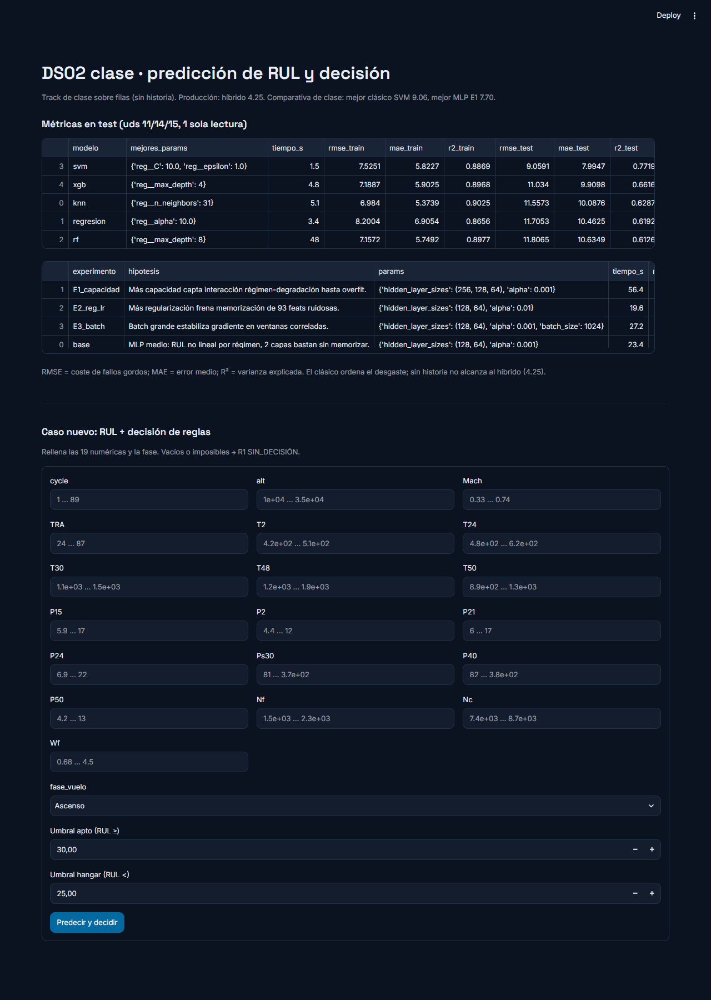
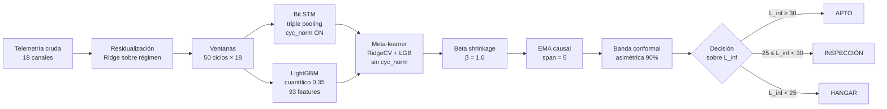
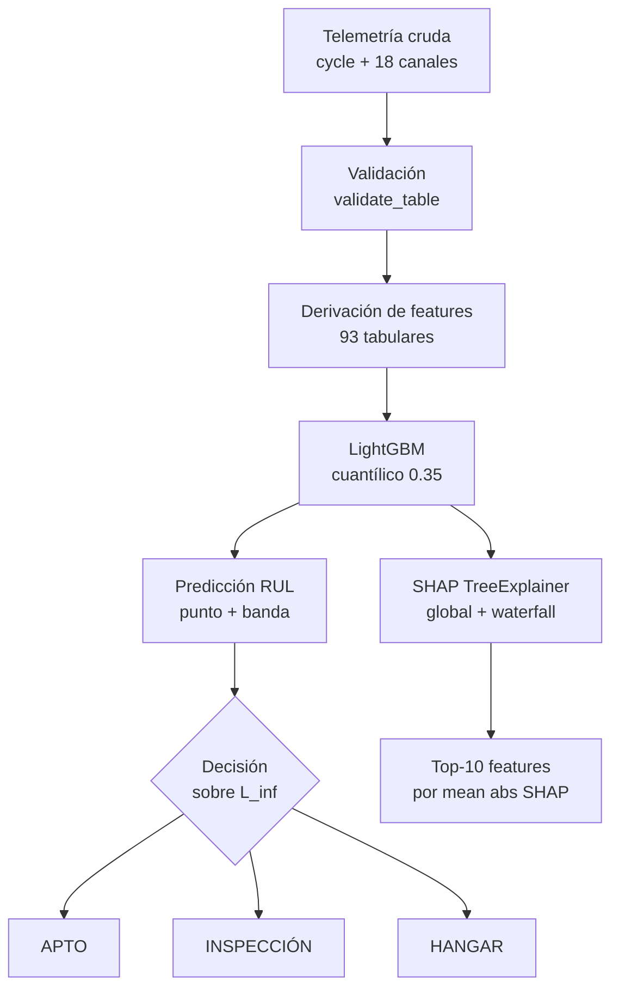

# N-CMAPSS DS02 — Vida útil restante (RUL)

> **Español** | [English](README.en.md)

> **Entrega de clase (Reto 1 SAA + PIA + MIA):** el track académico vive en
> `track_clase/` (código), `notebooks/01–05` (relato), `data/processed/`
> (dataset con nulos MAR + `fase_vuelo`) y `resultados/` (métricas y figuras).
> Punto de entrada: [`track_clase/README.md`](track_clase/README.md) (6 apartados),
> app de producción: `streamlit run app/dashboard_ds02.py` (bundle B + SHAP).
> Lo de abajo es el sistema en producción (bundle B congelado, RMSE 4.251).



*Captura real de la app Streamlit del track académico (métricas en test + caso nuevo con decisión de reglas).*

## La necesidad de negocio

Taller MRO con flota DS02: un motor parado en pista (AOG) cuesta del orden de 50 k€/día (estimación sectorial); una inspección a tiempo cuesta una fracción. Hoy la decisión de hangar depende de juicio experto sin número.

**Objetivo:** predecir la RUL de cada motor para que el jefe de taller decida APTO / INSPECCIÓN / HANGAR, con la predicción convertida en decisión por reglas (`mia/`, 6 con prioridad + seguridad R1) y, más adelante, en acción automática vía n8n. Evitar una sola parada no planificada al año paga el sistema. Detalle académico: [`track_clase/README.md`](track_clase/README.md).

Predicción de vida útil restante en el dataset turbofán N-CMAPSS DS02, empaquetado
para que **cargue, sirva y sea honesto sobre lo que mide**.

Un BiLSTM sobre ventanas ordenadas y un LightGBM cuantílico sobre features
tabulares residualizadas se reconcilian por un meta-learner aprendido, encogido
hacia el campeón por un factor `beta`, y suavizado con una EMA causal por motor.

```
docker compose up --build      # http://localhost:8000/docs y http://localhost:8501
```

---

## Arquitectura del híbrido



## Resultados — unidades de test 11 / 14 / 15, 6 196 ventanas, media ± std sobre semillas [42, 7, 123]

### Baseline v4.1.0 (histórico — se conserva para comparación)

| Modelo | RMSE | MAE | R² | NASA score |
| --- | --- | --- | --- | --- |
| LightGBM cuantílico 0.35 (standalone) | 7.098 ± 0.034 | 5.572 ± 0.034 | 0.8557 ± 0.0014 | 5772.5 ± 50.1 |
| BiLSTM triple pooling (standalone) | 6.152 ± 0.576 | 4.745 ± 0.332 | 0.8910 ± 0.0205 | 4308.0 ± 595.8 |
| **Hybrid stacking + EMA causal 5** | **4.301 ± 0.068** | **3.181 ± 0.021** | **0.9470 ± 0.0017** | **2315.6 ± 20.0** |

El NASA score es una **suma** de exponenciales asimétricas, no una media, así que
escala con el número de ventanas puntuadas y solo es comparable entre modelos
evaluados sobre las mismas filas.

**Lee las desviaciones estándar antes que las medias.** El BiLSTM oscila ±0.58 RMSE
entre semillas; el híbrido es estable a ±0.068. La dispersión del híbrido es ahora
*real* y no un artefacto: con el contador de ciclo eliminado del meta-learner, la
capa de stacking depende realmente de los dos modelos base, así que hereda su
varianza en lugar de leer un contador (ver la sección de ablación abajo).

### Revisión 2026-10-21 (histórico)

Mismos modelos, mismo protocolo. Las adiciones son dos métricas, no precisión extra.

| Modelo | RMSE | MAE | R² | NASA score |
| --- | --- | --- | --- | --- |
| LightGBM cuantílico 0.35 (standalone) | 7.098 ± 0.034 | 5.572 ± 0.034 | 0.8557 ± 0.0014 | 5772.5 ± 50.1 |
| BiLSTM triple pooling (standalone) | 6.337 ± 0.811 | 4.872 ± 0.756 | 0.8837 ± 0.0305 | 4509.9 ± 1051.1 |
| **Hybrid stacking + EMA causal 5** | **4.289 ± 0.018** | **3.183 ± 0.017** | **0.9475 ± 0.0004** | **2297.5 ± 17.4** |

### Bundle B (producción, congelado)

| Modelo | RMSE | MAE | R² | NASA score |
| --- | --- | --- | --- | --- |
| **Hybrid stacking + EMA causal 5** | **4.251** | **3.183** | **0.9482** | **2305.1** |

Producción: RMSE 4.251 · MAE 3.183 · R² 0.9482 · NASA 2305.1 (semilla 42, sin nulos).

### Track de clase (bundle C, experimental)

| Modelo | RMSE | MAE | R² | NASA score |
| --- | --- | --- | --- | --- |
| MLP E2 (mejor MLP, elegido por val) | 7.72 | 5.81 | 0.83 | — |
| XGB (mejor clásico, elegido por val) | 11.03 | 9.91 | 0.66 | — |
| Híbrido-C (con nulos) | 4.338 | 3.227 | 0.9461 | 2336.2 |

El bundle C (con nulos inyectados) no supera al bundle B (4.251). El modelo de
producción sigue siendo bundle B.

---

## Experimento de robustez (3 vías)

Para decidir si el modelo de producción debe ser B (limpio) o C (con nulos), se evaluó B sobre datos con nulos imputados:

| Modelo | RMSE | MAE | R² | NASA | Escenario |
|---|---|---|---|---|---|
| B-bajo-dropout | **4.247** | 3.165 | 0.9483 | 2290.0 | B (limpio) + datos con nulos imputados |
| B-limpio (congelado) | 4.251 | 3.183 | 0.9482 | 2305.1 | B (limpio) + datos limpios |
| C-media (3 semillas) | 4.314 | — | — | 2339.1 | C (reentrenado) + datos con nulos |

**Conclusión:** B sobre datos con nulos (4.247) es indistinguible de B sobre datos limpios (4.251). El ffill repara los huecos aislados del MAR T30, así que B es **insensible a este régimen**. No hace falta reentrenar: B sigue en producción. C (4.314) no supera la puerta D11.

**Evidencia:** `resultados/comparativa_b_dropout.csv`, `track_clase/evaluar_b_en_adaptada.py`, `tests/test_clase_b_robusto.py`, `notebooks/05_ensemble_adaptado.ipynb`.

*Nota sobre casillas vacías: NASA solo se calcula en grano ventana (pipeline `evaluate_predictions`); en grano fila la comparativa oficial es RMSE/MAE/R². La fila C-media agrega los titulares RMSE/NASA de las 3 semillas; su re-derivación completa con media±std queda pendiente y no afecta a la puerta D11.*

---



---

El dashboard de producción (`app/dashboard_ds02.py`) incluye una sección de SHAP
(TreeExplainer exacto sobre el LightGBM del híbrido):

- **Global:** top-10 features por mean |SHAP| para el motor seleccionado.
- **Local:** waterfall plot para explicar por qué el modelo predice ese RUL.

Las features más importantes son `xs_mean_T50`, `xs_mean_T48`, `xs_last10_T50`,
`cyc_norm`. SHAP explica el componente tabular del híbrido (LightGBM, 93 features
derivadas), no el BiLSTM ni el stacking.

---

## Arquitectura

- **BiLSTM** (triple pooling, canal 19 = cyc_norm) → predicción secuencial.
- **LightGBM** cuantílico 0.35 (93 features tabulares) → predicción tabular.
- **Meta-learner** (RidgeCV + LightGBM) sobre `[p_lstm, p_lgb]` (sin cyc_norm).
- **Beta shrinkage** (β = 1.0) + **EMA causal** (span = 5).
- **Banda conformal** asimétrica por bins de RUL predicha (90%).

---

## Ablación de cyc_norm

| Configuración | BiLSTM RMSE | Meta RMSE |
| --- | --- | --- |
| cyc_norm ON (BiLSTM) + OFF (meta) | 5.419 | 4.251 |
| cyc_norm OFF (BiLSTM) + OFF (meta) | 6.513 | — |

Conclusión: cyc_norm se mantiene en el BiLSTM (canal 19) y se elimina del
meta-learner para evitar fuga del contador.

---

## Cómo ejecutar

```bash
# App de producción (bundle B + SHAP)
streamlit run app/dashboard_ds02.py

# Tests
python -m pytest tests/ -q

# Track de clase
python -m track_clase.train_clasicos
python -m track_clase.train_mlp
python -m track_clase.shap_clase
```

---

## Estructura del proyecto

```
app/                    dashboard_ds02.py (producción), ui_shap.py (SHAP), ...
src/ds02_rul/           data, features, model, pipeline, stacking, metrics, ...
models/                 ensemble.joblib, bilstm_ds02.keras, ds02_manifest.json
track_clase/            track académico (dataset, pipeline, 5 modelos, MLP, SHAP)
notebooks/              01_eda ... 05_ensemble (con outputs)
tests/                  tests de clase + tests de app
data/processed/         parquet (ignorado en git, regenerable)
resultados/             gráficas y CSVs (ignorado en git, regenerable)
```

---

## Documentación adicional

- README en inglés: [README.md](README.md)
- Track de clase: [track_clase/README.md](track_clase/README.md)
- Rúbrica: `docClase/Reto1_SAA_PIA_MIA_2026-27_v4.pdf`
- Planificación: `docs/pendiente/planificacion-clase-5notebooks.md`

---

## Autoría

Proyecto N-CMAPSS DS02 · rama `clase-experimental` · change openspec `2026-11-02-clase-track` · Curso IA y Big Data 2026-27