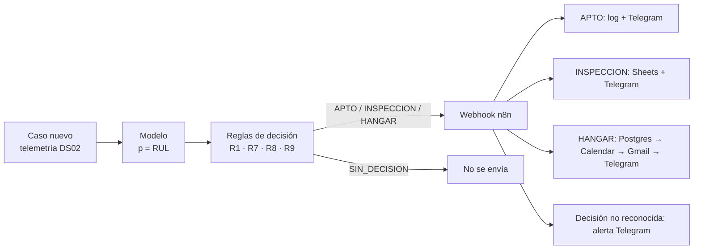
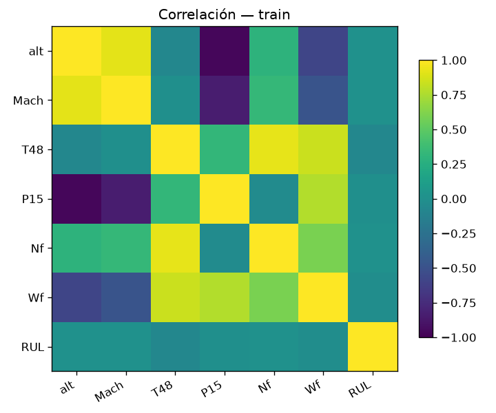
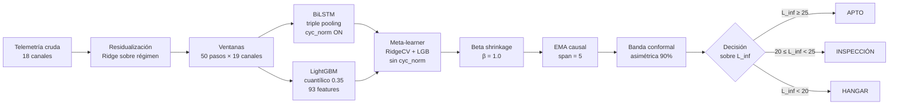
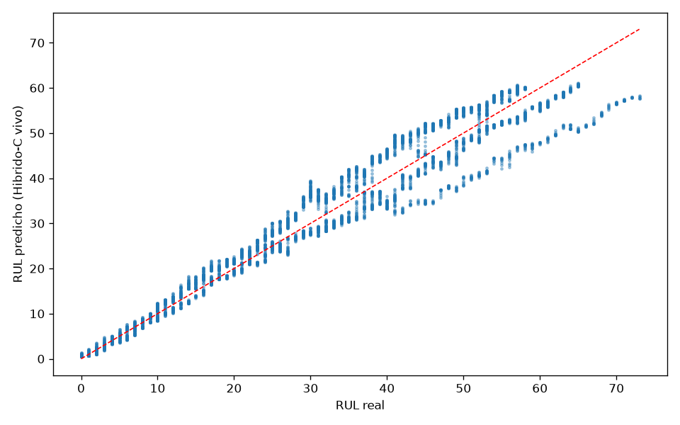
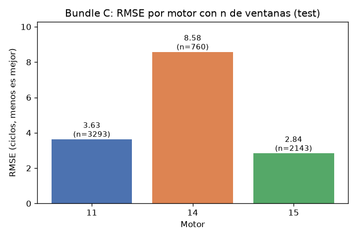
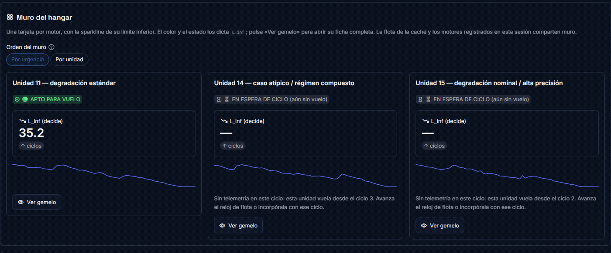
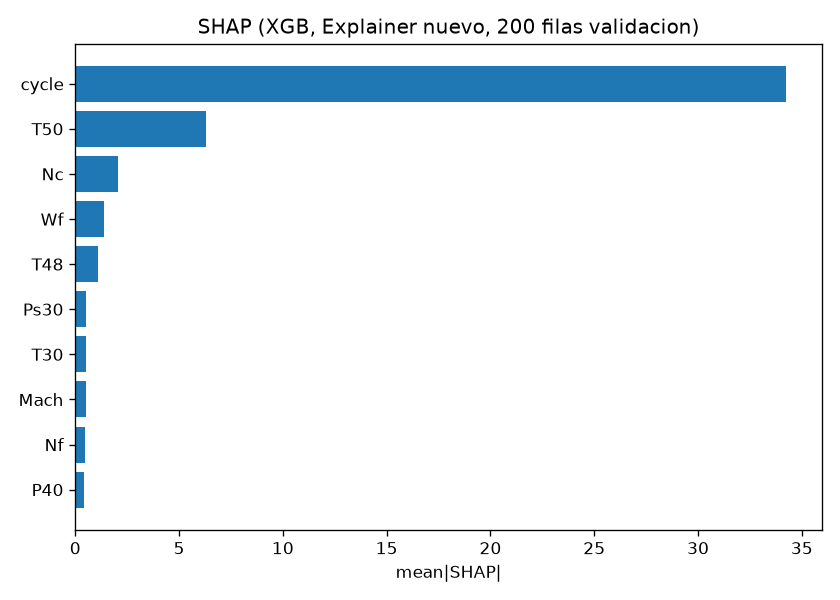
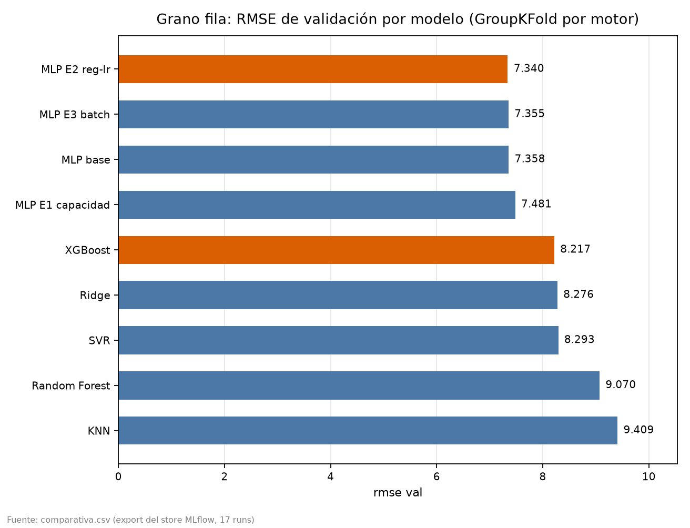
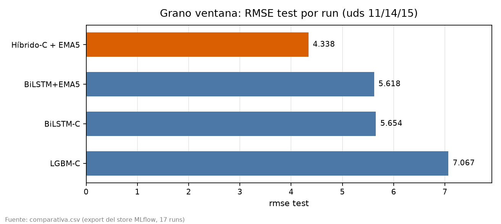
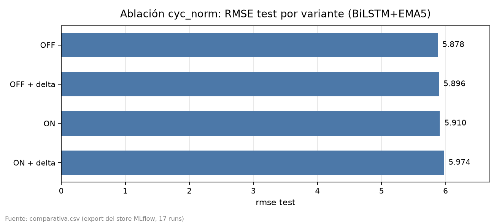

# N-CMAPSS DS02: RUL y decisión de hangar

<p align="center">
  <a href="README.md"></a>
  <a href="README.en.md"></a>
</p>

Sistema completo para estimar la vida útil restante (RUL) de motores turbofán DS02 desde su telemetría y convertirla en una decisión de mantenimiento: **APTO**, **INSPECCIÓN** o **HANGAR**. Incluye el modelo, la app, la API y la evidencia para reproducirlo.

**En cifras:** 65.173 filas de telemetría, 9 motores y un bundle C congelado. Métricas del manifiesto: **RMSE 4.338 · MAE 3.227 · R² 0.9461 · NASA 2336.2** (seed 42, 6.196 ventanas de test).


*Centro de control DS02: SHA-256 `d6c70142…` del ensemble, 6.196 ventanas y banda
conformal del 90 %. La app sirve el bundle C congelado; la captura está versionada
en `docs/assets/dashboard_ds02.png`.*

## Índice

- [Resumen](#resumen)
- [Por dónde empezar](#por-dónde-empezar)
- [Problema y objetivo](#problema-y-objetivo)
- [Datos](#datos)
- [Arquitectura](#arquitectura)
- [Resultados](#resultados)
- [Decisión y automatización](#decisión-y-automatización)
- [App y SHAP](#app-y-shap)
- [MLflow](#mlflow)
- [Cómo ejecutar](#cómo-ejecutar)
- [Estructura del proyecto](#estructura-del-proyecto)
- [Limitaciones y decisiones](#limitaciones-y-decisiones)
- [Documentación](#documentación)
- [Autoría](#autoría)

## Resumen

| Pregunta | Respuesta |
|---|---|
| ¿Qué predice? | RUL (ciclos restantes) de cada motor DS02. |
| ¿Cómo lo convierte en decisión? | 8 reglas en `src/mia/reglas.py` (2 de corrección + 6 de decisión), con prioridad, porqué y seguridad R1 (prioridad 10). |
| ¿Qué modelo se despliega? | Híbrido C: BiLSTM + LightGBM cuantílico + meta RidgeCV/LightGBM, `beta = 1.0`, EMA causal 5 y banda conformal asimétrica. |
| ¿Qué métricas tiene? | RMSE 4.338 · MAE 3.227 · R² 0.9461 · NASA 2336.2 (seed 42, manifiesto). |
| ¿Dónde está la evidencia? | `models/ds02_manifest.json`, `resultados/`, `mlruns/` (17 runs curados) y `notebooks/01–07`. |
| ¿Cómo se arranca? | `uvicorn app.services.api:app` y `streamlit run app/entrypoints/dashboard_ds02.py`. |
| ¿Qué falta o es supuesto? | El coste AOG es un rango externo; la variabilidad multisemilla depende del CSV versionado. El flujo n8n está desplegado y activo en local (§n8n). |

<p align="center">
  <a href="docs/evidencia/video/pipeline.mp4"></a>
</p>

<p align="center"><em>Resumen animado del pipeline (13 s, silencio) · <a href="docs/evidencia/video/pipeline.mp4">vídeo original en calidad completa</a>.</em></p>

```bash
# API local
uvicorn app.services.api:app --host 127.0.0.1 --port 8000

# App de producción (bundle C + SHAP)
streamlit run app/entrypoints/dashboard_ds02.py --server.address 127.0.0.1 --server.port 8501

# Alias de arranque: delega en la app anterior
streamlit run app/entrypoints/streamlit_app.py --server.address 127.0.0.1 --server.port 8501

# MLflow UI: los 17 runs en http://127.0.0.1:5000
# (el flag es obligatorio: MLflow 3.x deja el file store en maintenance mode)
export MLFLOW_ALLOW_FILE_STORE=true
mlflow ui --backend-store-uri ./mlruns

# MLflow server en :5001 (el que espera el MCP mlflow); para la UI no hace falta
export MLFLOW_ALLOW_FILE_STORE=true
mlflow server --backend-store-uri ./mlruns --host 127.0.0.1 --port 5001
```

El bloque es sintaxis de bash. En Windows, el apartado
[Arranque rápido en cmd](#arranque-rápido-en-cmd-windows) da las mismas órdenes
listas para pegar en `cmd.exe`.

## Por dónde empezar

| Si quieres... | Mira... |
|---|---|
| Ver el producto | `app/entrypoints/dashboard_ds02.py` y la captura de arriba |
| Entender el modelo | [Arquitectura](#arquitectura) y [Resultados](#resultados) |
| Reproducirlo | [Cómo ejecutar](#cómo-ejecutar) y `tests/` |
| Revisar la evidencia | `models/ds02_manifest.json`, `resultados/` y `mlruns/` |

## Problema y objetivo

Taller MRO con flota DS02: un motor parado en pista (AOG) cuesta del orden de
**10.000–15.000 USD/h** (rango Boeing, credibilidad Media; ver
`costes_reales_aeronauticos.md` §1). Una inspección a tiempo cuesta una fracción.
Hoy esa decisión depende del criterio del jefe de taller, sin una cifra que la respalde.

**Objetivo:** predecir la RUL de cada motor para que el jefe de taller decida
**APTO / INSPECCIÓN / HANGAR**, con la predicción convertida en decisión por
reglas y, cuando se autorice, en acción automática vía n8n. Evitar una sola
parada no planificada al año paga el sistema.

## Qué hemos construido

El sistema estima la RUL de cada motor a partir de su telemetría y la convierte en **APTO / INSPECCIÓN / HANGAR** mediante reglas. Cuando se autoriza, esas reglas disparan una acción automática.

**Tipo de IA.** Es una IA débil: solo predice la RUL de DS02 con lo aprendido de su telemetría y no transfiere a otros dominios. La comparación con una **IA fuerte** (una AGI capaz de razonar en cualquier dominio, que aquí no existe) sirve para acotar el alcance: al no prometer nada fuera de DS02, el sistema es barato, rápido y auditable. Es aprendizaje **supervisado** de **regresión**, con etiqueta y métricas contra la verdad (RMSE/MAE/R²). No es aprendizaje **no supervisado**: sin etiqueta no habría forma de medirlo así.

Herramientas: scikit-learn (5 clásicos + MLP + pipeline), XGBoost, LightGBM, Streamlit, SHAP y MLflow. n8n está implementado en `src/n8n.py` + `n8n/flujo.json`.



## Datos

65.173 filas downsampleadas (STRIDE 100), **9 motores**; train = dev (52.635,
uds 2/5/10/18/20/16), test = uds 11/14/15 (12.538, una sola lectura). El dataset
procesado vive en `data/processed/` y se regenera; el HDF5 original está en
`data/raw/`.

| Campo | Qué significa | Tipo | Nulos antes | Nulos después |
|---|---|---|---|---|
| `unit` | Motor (grupo, no predictor) | numérica | 0% | 0% |
| `cycle` | Ciclo de vuelo | numérica | 0% | 0% |
| `alt, Mach, TRA, T2` | Régimen de vuelo | numéricas | 0% | 0% |
| `T24` | Temp. salida LPC (°R) | numérica | 0% | 0% |
| `T30` | Temp. salida HPC (°R), sonda con dropout | numérica | ~1,8% MAR (crucero alto) | 0% tras ffill + mediana |
| `T48` | Temp. salida HPT (°R) | numérica | 0% | 0% |
| `T50` | Temp. salida LPT (°R) | numérica | 0% | 0% |
| `P15` | Presión sangrado (psia) | numérica | 0% | 0% |
| `P2` | Presión entrada fan (psia) | numérica | 0% | 0% |
| `P21` | Presión salida LPC (psia) | numérica | 0% | 0% |
| `P24` | Presión salida HPC (psia) | numérica | 0% | 0% |
| `Ps30` | Presión estática HPC (psia) | numérica | 0% | 0% |
| `P40` | Presión total HPT (psia) | numérica | 0% | 0% |
| `P50` | Presión total LPT (psia) | numérica | 0% | 0% |
| `Nf` | RPM del fan | numérica | 0% | 0% |
| `Nc` | RPM del núcleo | numérica | 0% | 0% |
| `Wf` | Caudal combustible (pps) | numérica | 0% | 0% |
| `fase_vuelo` | Ascenso/Crucero/Descenso (nueva, de alt/Mach) | categórica | 0% | 0% |
| `RUL` | **Objetivo:** ciclos restantes | numérica | 0% (nunca se inyecta) | 0% |

Calidad: 0 duplicados funcionales; Mach en [0,33; 0,74], alt en [10k, 35k]
(el 30k/0,8 teórico no existe en DS02: 0 filas). Los **1.185 nulos** de T30 son
MAR con patrón físico (dropout de sonda en crucero alto) y se imputan con ffill
causal por unidad + mediana de train (solo el primer NaN). El split es **por
motor**, nunca por fila.

Campos fuera del predictor:

| Campo | Sale de | Por qué | Evidencia |
|---|---|---|---|
| `unit` | `X` / `FEATURE_COLS` | Es el grupo del split y de GroupKFold; usarlo permitiría fuga por motor. | `src/clase/pipeline_clase.py:7,22-24` |
| `RUL` | `X` (queda como `y`) | Es el objetivo supervisado. | `src/clase/dataset_clase.py:59` |
| `split_origen` | `X_train` / `X_test` | Solo trazabilidad train/test. | `src/clase/dataset_clase.py:60` |
| `fase_vuelo` | Bundle C (93 features) | Los modelos base la usan (OneHot); el bundle desplegado es residualizado y ventanado sin categórica. | `src/clase/pipeline_clase.py:23-24`, `src/clase/ventanas_adaptadas.py:6` |

Lo que vimos en el EDA. Dos gráficos que explican decisiones del modelo; el resto (barras por fase, boxplot de T48, dispersión alt/Mach y residuo por fase) está en `notebooks/01_eda_y_contexto.ipynb`.


*Qué veo:* la RUL de train va de 0 a 88 ciclos (media 37,33; mediana 36) y el **26,5 % de las filas está por debajo de 20 ciclos**. *Qué concluyo:* la distribución es asimétrica y la alarma se juega en la cola baja, así que el error se mide en ciclos (RMSE/MAE), no en aciertos.



*Qué veo:* ninguna variable instantánea explica la RUL (|r| ≤ 0,07), pero las entradas están fuertemente correlacionadas entre sí (alt–P15 −0,96; T48–Nf 0,93). *Qué concluyo:* una fila no basta; el modelo necesita historia y tendencia, de ahí las ventanas, el BiLSTM y la validación por motor.

## Arquitectura



El **canal 19** es `cyc_norm = cycle/100`; el LightGBM recibe 93 features
tabulares residualizadas. El meta-learner solo ve `[p_lstm, p_lgb]` (2 columnas);
`cyc_norm` se queda abajo para no convertirse en un atajo del stacking.

## Resultados

### Bundle C, modelo desplegado (seed 42)

| Modelo | RMSE | MAE | R² | NASA score | Ventanas |
|---|---:|---:|---:|---:|---:|
| **Híbrido-C + EMA5** | **4.338** | **3.227** | **0.9461** | **2336.2** | 6.196 |

Fuente: `models/ds02_manifest.json` (`metrics.reference_row`). La cifra sale de la fila congelada del artefacto que sirve la app, no de una media multisemilla.



El gráfico dibuja esa misma fila del manifiesto; el modelo no se reejecutó.

Por motor, porque el global esconde el reparto:

| Unidad | RMSE | Ventanas |
|---|---:|---:|
| U11 | 3.6328 | 3.293 |
| U14 | 8.5761 | 760 |
| U15 | 2.8371 | 2.143 |
| **Global** | **4.338** | **6.196** |
| **Macro** (1/3 por motor) | **5.0153** | — |

U14 concentra el error: pesa poco en el global pero es el peor caso real. Por eso
se publican global y macro, y la tabla final separa granos.



### Estabilidad multisemilla

| Semilla | RMSE | NASA score | Origen |
|---|---:|---:|---|
| 42 | 4.338 | 2336.2 | manifiesto (bundle desplegado) |
| 7 | 4.371 | 2363.3 | `resultados/bundle_c_multiseed.csv` versionado |
| 123 | 4.291 | 2305.9 | `resultados/bundle_c_multiseed.csv` versionado |
| **Media ± std** | **4.333 ± 0.040** | **2335.1 ± 28.7** | [42, 7, 123] |

La media se calcula sobre el **CSV versionado**; una reejecución de semillas puede
moverla. La cifra histórica **4.324 ± 0.107 / 2341.0 ± 54.1** sale del CSV anterior
(`72035c3`) y no debe citarse como la vigente. Las medias impresas en NB06 (4.322 ± 0.064) y NB05 (4.330 ± 0.053) son
**histórico no regenerable** y no deben citarse como la cifra vigente. Tampoco
deben citarse como actuales 4.301, 4.289, 4.344 ni 4.368: son bundles históricos.

### Modelos base

| Grano | Modelo | RMSE test | MAE | R² | NASA | Tiempo (s) |
|---|---|---:|---:|---:|---:|---:|
| fila | XGB (mejor clásico por val) | 11.034 | 9.9098 | 0.6616 | — | 7,2 |
| fila | MLP E2 (mejor MLP por val) | 7.7211 | 5.8132 | 0.8343 | — | 33,3 |
| ventana | LGBM adaptada | 7.067 | 5.545 | 0.8570 | 5731.3 | 0,4 |
| ventana | BiLSTM-C | 5.654 | 4.295 | 0.9084 | 3674.0 | — |
| ventana | BiLSTM-C + EMA5 | 5.618 | 4.268 | 0.9096 | 3649.4 | — |
| ventana | **Híbrido-C + EMA5** | **4.338** | **3.227** | **0.9461** | **2336.2** | 447 (total) |

Los tiempos de los modelos base salen de `resultados/tabla_final_clase.csv`; el bundle C registra 447 s totales de entrenamiento en `models/ds02_manifest.json`.

Los granos no se mezclan: fila es una lectura (12.538 filas de test) y ventana son 50 lecturas (6.196 ventanas). Solo tiene sentido comparar dentro del mismo grano. El test se leyó una vez por familia y la elección se hizo por `rmse_val`.

<details>
<summary>Histórico de bundles A/B (no vigente)</summary>

| Bundle | Modelo | RMSE | MAE | R² | NASA |
|---|---|---:|---:|---:|---:|
| B v4.1.0 | Hybrid stacking + EMA5 | 4.301 ± 0.068 | 3.181 ± 0.021 | 0.9470 ± 0.0017 | 2315.6 ± 20.0 |
| A 2026-10-21 | Hybrid stacking + EMA5 | 4.289 ± 0.018 | 3.183 ± 0.017 | 0.9475 ± 0.0004 | 2297.5 ± 17.4 |

Se conservan solo como comparación. El bundle vigente es **C (4.338)**.

</details>

### Coste del error

El DS02 no publica horas por ciclo. La conversión de ciclos a horas es un **supuesto declarado**, no una medición.

| Concepto | Fórmula | Valor |
|---|---|---:|
| Coste AOG (fuente externa, credibilidad Media) | rango Boeing | 10.000–15.000 USD/h |
| Horas por ciclo de vuelo | supuesto | 1–2 h |
| Coste por ciclo de error | h/ciclo × AOG | 10.000–30.000 USD |
| Error del bundle C | RMSE del manifiesto | 4.338 ciclos |
| Coste si todo el error cae en AOG | RMSE × coste/ciclo | ≈ 43.000–130.000 USD |
| Peor unidad (U14) | 8.5761 × coste/ciclo | ≈ 86.000–257.000 USD |

Con umbrales `hangar` 20 y `apto` 25 ciclos (ADR-013; `app/lib/_constantes.py`;
`src/mia/reglas.py` documenta los mismos 25/20), un RMSE de 4.338 es ≈21,7% del
umbral de hangar. La fuente detallada es local y **no está
versionada**: se declara como supuesto, no como medición.

### Ablación de `cyc_norm`

Test 11/14/15, semilla 42, mismo protocolo. La tabla completa está en
[`resultados/ablacion_cycnorm.csv`](resultados/ablacion_cycnorm.csv).

| Variante | LGBM | BiLSTM | BiLSTM + EMA5 |
|---|---:|---:|---:|
| cyc_norm OFF | **6.297** | 5.946 | **5.878** |
| cyc_norm OFF + baseline delta | 8.765 | 5.939 | 5.896 |
| cyc_norm ON (baseline) | 7.067 | 5.939 | 5.910 |
| cyc_norm ON + baseline delta | 8.547 | 5.985 | 5.974 |

En el secuencial las cuatro variantes caen en 5,878–5,974 (0,10 de horquilla): el
reloj no cambia el resultado. En LGBM sí: activarlo cuesta +0,77 RMSE y añadir el
baseline delta +2,47. Conclusión: `cyc_norm` se mantiene como **canal 19 del BiLSTM
y feature 1/93 del LightGBM** en el artefacto congelado (`lgb_n_features: 93`, ver
`ensemble.py`), y **no entra en el meta** (`meta_features: 2`). Retirarlo del árbol
es una mejora medida y pendiente de reentrenar, no un cambio ya aplicado.

## Decisión y automatización

Las reglas viven en **`src/mia/reglas.py`**: 8 reglas (2 de corrección + 6 de
decisión), cada una con `id`, `prioridad`, `porque` y `accion`. **R1** es la regla
de seguridad con prioridad 10: si hay una alerta de dato imposible, se anula la
decisión (`SIN_DECISION`) y se deja el motivo; nunca se devuelve un APTO sin
evidencia. El gate que las aplica está en `src/mia/motor.py`.

`n8n/flujo.json` contiene **13 nodos**, todos funcionales (1 webhook, 1 `Switch`,
3 `Set`, 1 Sheets, 1 Postgres, 1 Calendar, 1 Gmail y 4 Telegram), y un `Switch`
con **cuatro** salidas conectadas:

| Rama | Acción |
|---|---|
| APTO | Log de la decisión + aviso Telegram. |
| INSPECCION | Google Sheets + aviso Telegram para la próxima parada. |
| HANGAR | Postgres `ds02_decisiones` → Calendar → Gmail → Telegram. |
| FALLBACK | Decisión no reconocida: Set de error + alerta Telegram, sin acción. |

El JSON versionado está **inactivo por diseño** (`active: false`); ejecutarlo
requiere credenciales y puede producir efectos reales (correo, calendario,
Postgres). No se incluyen secretos.

## App y SHAP

`app/entrypoints/dashboard_ds02.py` es la app de producción: muestra RUL, banda conformal, decisión, SHA del bundle y una sección de SHAP. El alias `app/entrypoints/streamlit_app.py` mantiene una entrada alternativa y delega en ella.



*Captura real de la app: al avanzar el «Ciclo de vuelo simulado», el límite
inferior de la banda (`L_inf`) cruza los umbrales 25/20 y cada tarjeta pasa de
APTO PARA VUELO a INSPECCIÓN PROGRAMADA y a DERIVACIÓN A HANGAR (AOG).*

- **Global:** top-10 features por `mean |SHAP|` para el motor seleccionado.
- **Local:** waterfall para explicar una predicción concreta.
- SHAP explica el componente tabular (LightGBM, 93 features), **no** el BiLSTM ni
  el stacking; describe el modelo, no el motor.



Evidencia completa en `resultados/shap_bundle_C/` y `resultados/mlp_shap_E2/`.

## MLflow

El tracking vive en `mlruns/` (file store de texto, sin servidor ni SQLite). El
store **versionado** tiene **17 runs curados**: 9 de fila, 4 de ventana y 4 de la
ablación. El trabajo vivo de los notebooks escribe en `mlruns-live/`, que está
git-ignored: re-ejecutar un cuaderno no puede ensuciar la entrega.

```bash
python scripts/operativo/backfill_mlflow.py --check   # 17 runs, store + export, sin artefactos
python scripts/operativo/backfill_mlflow.py --write   # regenerar los 17 runs (idempotente)
MLFLOW_ALLOW_FILE_STORE=true mlflow ui --backend-store-uri ./mlruns
```

El bloque es sintaxis de bash. En PowerShell 7:

```powershell
$env:MLFLOW_ALLOW_FILE_STORE = "true"
.venv\Scripts\python.exe -m mlflow ui --backend-store-uri ./mlruns
```

MLflow 3.18 deja el file store en maintenance mode y no arranca sin `MLFLOW_ALLOW_FILE_STORE=true`. Usa el python del
`.venv`, no el `mlflow` del PATH, para no mezclar el store con el Python de
sistema.

`--check` recorre el experimento con `ViewType.ALL` y **falla** si aparece un run `live__*` o un tombstone (`lifecycle_stage: deleted`). La pureza del store se comprueba, no se promete.

### Tres granos, tres preguntas

| Grano | Runs | Qué compara |
|---|---:|---|
| `fila` | 9 | una lectura = un modelo (5 clásicos + 4 MLP), GroupKFold por motor |
| `ventana` | 4 | 50 lecturas por predicción: LGBM, BiLSTM, BiLSTM+EMA5 y el bundle desplegado |
| `ablacion` | 4 | el mismo modelo con `cyc_norm` ON/OFF × baseline delta |

Los granos no se mezclan: el RMSE de fila y el de ventana no miden lo mismo, y el
store lo declara con el tag `grano`. La ablación se aísla con
`familia=ablacion_cycnorm`.

Grano fila (validación out-of-fold, GroupKFold por motor):

| Modelo | RMSE val | MAE val | R² val | Tiempo (s) |
|---|---:|---:|---:|---:|
| Ridge | 8.2762 | 7.6611 | 0.8502 | 3,5 |
| KNN | 9.4092 | 8.1856 | 0.8181 | 9,1 |
| Random Forest | 9.0704 | 8.1534 | 0.8270 | 79,6 |
| SVR | 8.2927 | 7.5299 | 0.8565 | 2,7 |
| XGBoost | **8.2173** | 7.4688 | 0.8543 | 7,2 |
| MLP base | 7.3580 | 5.6405 | 0.8918 | 27,5 |
| MLP E1 capacidad | 7.4808 | 5.7735 | 0.8882 | 70,7 |
| MLP E2 reg-lr | **7.3404** | 5.6481 | **0.8924** | 33,3 |
| MLP E3 batch | 7.3554 | 5.7035 | 0.8919 | 38,6 |

La selección es por validación; solo los elegidos tienen test (XGB 11.034 y MLP E2 7.7211).

Los resúmenes (Figuras 1, 3 y 5) se generan con `scripts/operativo/figuras_mlflow.py` desde el export de MLflow; las capturas (Figuras 2, 4 y 6) son la evidencia dentro de la herramienta.

<p align="center">
  
</p>

<p align="center"><em>Figura 1 · Resumen del grano fila (RMSE val; naranja = elegido).</em></p>

<p align="center">
  <a href="docs/evidencia/mlflow/compare_fila.jpg"></a>
</p>

<p align="center"><em>Figura 2 · Evidencia: Compare del grano fila en MLflow (clic para tamaño completo).</em></p>

### El grano ventana se compara dentro de MLflow

Los cuatro runs del bundle (LGBM, BiLSTM, BiLSTM+EMA5 y el híbrido desplegado)
comparten experimento y se comparan por `rmse_test`: 7.067 / 5.654 / 5.618 / 4.338.

<p align="center">
  
</p>

<p align="center"><em>Figura 3 · Resumen del grano ventana (RMSE test; naranja = bundle desplegado).</em></p>

<p align="center">
  <a href="docs/evidencia/mlflow/compare_ventana.jpg"></a>
</p>

<p align="center"><em>Figura 4 · Evidencia: Compare del grano ventana en MLflow.</em></p>

### La ablación se compara dentro de MLflow

| Variante (`cyc_norm`) | RMSE test |
|---|---:|
| OFF | **5.878** |
| OFF + baseline delta | 5.896 |
| ON (baseline) | 5.910 |
| ON + delta | 5.974 |

Se midió en `nb03` (test 11/14/15, semilla 42) y se registró **sin reentrenar**:
son cuatro runs comparables dentro de la herramienta, no una figura aislada del notebook. El grid 4×3 completo está en `resultados/ablacion_cycnorm.csv`.

<p align="center">
  
</p>

<p align="center"><em>Figura 5 · Resumen de la ablación `cyc_norm` (RMSE test).</em></p>

<p align="center">
  <a href="docs/evidencia/mlflow/compare_ablacion.jpg"></a>
</p>

<p align="center"><em>Figura 6 · Evidencia: ablación `cyc_norm` comparada en MLflow.</em></p>

### Por qué el store es de texto

Cada run guarda params, métricas y tags (incluidos `git_commit`, `git_dirty` y el SHA del dataset), así que se puede auditar años después. No hay binarios: los
modelos viven en `models/` y se identifican por SHA, y `mlruns/**/artifacts/`
queda vacío a propósito para que el store sea revisable en un diff.

La comparativa exportada es
[`docs/evidencia/mlflow/comparativa.csv`](docs/evidencia/mlflow/comparativa.csv).
Las capturas están todas en `docs/evidencia/mlflow/`:

| Captura | Qué enseña |
|---|---|
| [`compare_fila.jpg`](docs/evidencia/mlflow/compare_fila.jpg) | vista **Compare** de 9 modelos, graficados por `rmse_val` |
| [`compare_ventana.jpg`](docs/evidencia/mlflow/compare_ventana.jpg) | vista Compare de 4 runs de ventana, por `rmse_test` (LGBM, BiLSTM, BiLSTM+EMA5, bundle C) |
| [`compare_ablacion.jpg`](docs/evidencia/mlflow/compare_ablacion.jpg) | vista Compare de los 4 runs de `cyc_norm`, por `rmse_test` |

Cada Compare se filtra por `tags.grano` y trae el gráfico de coordenadas
paralelas más las tablas de parámetros, métricas y tags lado a lado, así que la
comparación que ve el tribunal es la misma que resume el CSV. El grano `fila` se
compara por `rmse_val` a propósito: el test de fila se lee una sola vez por
familia (XGB y MLP-E2), y esas dos lecturas son las que publica el CSV.

Si preferís preguntar en vez de mirar la UI, el MCP `mlflow mcp run` expone
`search_experiments`, `list_runs` y `describe_run` sobre este mismo store.

<details>
<summary>Ver los 17 run_key</summary>

Fila, 9 runs (GroupKFold por motor): `clasico__knn`, `clasico__regresion`,
`clasico__rf`, `clasico__svm`, `clasico__xgb`, `mlp__base`, `mlp__E1_capacidad`,
`mlp__E2_reg_lr`, `mlp__E3_batch`.

Ventana, 4 runs (OOF agrupado; test 6.196): `bundle__lgbm_c`,
`bundle__bilstm_c`, `bundle__bilstm_ema5`, `prod__bundle_c`.

Ablación, 4 runs: `ablacion__off__bilstm_ema5`,
`ablacion__off_delta__bilstm_ema5`, `ablacion__on__bilstm_ema5`,
`ablacion__on_delta__bilstm_ema5`.

El test de fila se lee una sola vez por familia: XGB 11.034 y MLP-E2 7.7211 son
lecturas publicadas; la elección se hizo por `rmse_val`. En ventana no hay
`rmse_val` comparable: la referencia es el test del manifiesto.

</details>

## Cómo ejecutar

### Puesta en marcha

Requiere Python 3.12. Desde la raíz del repo:

```bash
python -m venv .venv
.venv/Scripts/activate        # Windows; POSIX: source .venv/bin/activate
pip install -r requirements.txt
pip install -e .
```

`pip install -e .` es necesario: notebooks y app importan `ds02_rul` y
`src.clase` como paquetes instalados. En VS Code, abre **la carpeta del repo
(`nasa/`) como raíz del workspace**, no una carpeta padre.

### Comandos

```bash
# API local
uvicorn app.services.api:app --host 127.0.0.1 --port 8000

# App de producción (bundle C + SHAP)
streamlit run app/entrypoints/dashboard_ds02.py

# Alias de arranque (delega)
streamlit run app/entrypoints/streamlit_app.py

# Tests
python -m pytest tests/ -q

# Modelos base
python -m src.clase.train_clasicos
python -m src.clase.train_mlp
python -m src.clase.shap_clase
python -m src.clase.shap_clase_e2

# Estabilidad multisemilla (sin reentrenar: usa el CSV versionado)
python scripts/operativo/evaluate_bundle_stability.py --desde-csv

# MLflow
python scripts/operativo/backfill_mlflow.py --check
MLFLOW_ALLOW_FILE_STORE=true mlflow ui --backend-store-uri ./mlruns
```

El comando de MLflow es sintaxis de bash; en PowerShell 7 usa
`$env:MLFLOW_ALLOW_FILE_STORE = "true"; .venv\Scripts\python.exe -m mlflow ui --backend-store-uri ./mlruns`
(ver la sección MLflow).

## Estructura del proyecto

```text
app/
  entrypoints/streamlit_app.py   alias de arranque (delega)
  entrypoints/dashboard_ds02.py  app de producción (bundle C + SHAP)
  lib/                           datos, inferencia, reglas
  services/                      API
  ui/                            pestañas
src/
  clase/                         modelos base (dataset, pipeline, 5 clásicos, MLP, SHAP)
  ds02_rul/                      bundle C: bundle_c, puente_c, ensemble, stacking, conformal
  mia/                           reglas y motor de decisión
  n8n.py                         cliente y construcción del payload
notebooks/                       01–07, con outputs y README de secuencia
models/                          bundle C + manifiesto + joblibs de modelos base
n8n/flujo.json                   copia versionada del flujo (13 nodos); el desplegado está activo
mlruns/                          17 runs curados; live__* no versionados
data/raw/                        HDF5 original
data/processed/                  parquet procesados (ignorado en git, regenerable)
resultados/                      CSV, PNG y tablas de evidencia
docs/                            assets, evidencia, presentación y PDF
tests/                           tests de contrato, arquitectura, app y pipeline
scripts/operativo/               backfill MLflow, estabilidad, gate y predicción
```

**Artefactos del bundle C** (hashes completos en
[`models/ds02_manifest.json`](models/ds02_manifest.json)):

| Artefacto | SHA-256 (prefijo) |
|---|---|
| `ensemble.joblib` | `d6c70142…` |
| `bilstm_ds02.keras` | `bf9620a7…` |
| `scaler.joblib` | `acccfab3…` |
| `ds02_manifest.json` | `6089457c…` |

## Limitaciones y decisiones

- **TensorFlow en CPU no es determinista bit a bit.** Una reejecución del
  entrenamiento puede dar otra cifra; el **manifiesto** es la fuente de verdad del
  bundle instalado.
- **Multisemilla:** la media 4.333 ± 0.040 (NASA 2335.1 ± 28.7) se calcula con el
  CSV versionado (42/7/123). La cifra 4.324 ± 0.107 / 2341.0 ± 54.1 es del CSV
  anterior (`72035c3`) y queda como histórica. NB05/NB06 imprimieron otras medias en su momento y se conservan como
  histórico no regenerable. Si `resultados/bundle_c_multiseed.csv` se regeneró en
  local, la copia de trabajo puede no coincidir con `HEAD`; la tabla sigue la copia
  versionada.
- **Coste AOG:** el rango 10.000–15.000 USD/h es una fuente externa de credibilidad
  Media; las horas por ciclo son un supuesto. No se presenta como medición.
- **n8n:** el flujo desplegado está **activo** en la instancia local; `n8n/flujo.json`
  es la copia versionada, inactiva. Ejecutarlo requiere credenciales y puede
  enviar correo, crear calendario o escribir en Postgres.
- **Fachadas:** no se reintroducen `src/reglas.py` ni `src/utils.py`; el test de
  arquitectura lo prohíbe y el mapa explica la ruta canónica.
- **Granos:** fila (12.538) y ventana (6.196) no se mezclan; cada liga elige su
  campeón.
- **Datos:** `data/processed/` viaja por Git LFS (30 MB); el HDF5 crudo
  (`data/raw/N-CMAPSS_DS02-006.h5`, 2,28 GiB, SHA-256
  `47971a68b239ecb756833218a95d68ded6eb7e63ee84e86671c8b188de1ca765`) no está
  en git. Regenerar: `python -m src.clase.dataset_clase` (y `--fast-check`) y
  `python scripts/build/build_ui_cache.py`; el SHA de cada parquet vive en
  `data/processed/dataset_manifest.json`.

## Documentación

- Presentación: [`docs/presentacion/DS02-presentacion.pdf`](docs/presentacion/DS02-presentacion.pdf)
- Modelos base: [`src/clase/README.md`](src/clase/README.md)
- Secuencia de notebooks: [`notebooks/README.md`](notebooks/README.md)
- Evidencia MLflow: [`docs/evidencia/mlflow/comparativa.csv`](docs/evidencia/mlflow/comparativa.csv)
- Coste AOG: `costes_reales_aeronauticos.md` §1 (local, no versionado)

## Autoría

Proyecto de portafolio sobre N-CMAPSS DS02 · [@mikelrh-dev](https://github.com/mikelrh-dev)

## Arranque rápido en cmd (Windows)

Órdenes listas para pegar en `cmd.exe`, desde la carpeta del repo. Activar el
venv es lo que hace que `streamlit` y `mlflow` sean los del `.venv`: sin
activar, el `streamlit` del PATH es el de Python 3.10 y el `mlflow` el de
Anaconda.

```cmd
cd /d C:\ruta\al\repo\nasa
.venv\Scripts\activate

:: App de producción (bundle C + SHAP) -> http://127.0.0.1:8501
streamlit run app/entrypoints/dashboard_ds02.py --server.address 127.0.0.1 --server.port 8501

:: MLflow UI con los 17 runs -> http://127.0.0.1:5000
set MLFLOW_ALLOW_FILE_STORE=true
.venv\Scripts\python.exe -m mlflow ui --backend-store-uri ./mlruns

:: MLflow server en :5001 (el que espera el MCP mlflow); para la UI no hace falta
set MLFLOW_ALLOW_FILE_STORE=true
.venv\Scripts\python.exe -m mlflow server --backend-store-uri ./mlruns --host 127.0.0.1 --port 5001
```

`MLFLOW_ALLOW_FILE_STORE=true` es obligatorio: MLflow 3.18 deja el file store
en maintenance mode y no arranca sin él. Por eso MLflow se invoca como
`.venv\Scripts\python.exe -m mlflow ...` y no con el `mlflow` del PATH.

## Arrancar la app y MLflow (sin instalar nada)

Si el venv y las dependencias ya están, no hace falta reinstalar. Hacen falta
**dos consolas de `cmd.exe`**, porque Streamlit y MLflow son servidores que no
devuelven el prompt.

### Consola 1 de 2 · Streamlit

```cmd
cd /d C:\Users\mikel\Desktop\Pruebas\nasa
.venv\Scripts\activate
streamlit run app/entrypoints/dashboard_ds02.py --server.address 127.0.0.1 --server.port 8501
```

Abre http://127.0.0.1:8501 y deja esa consola abierta.

### Consola 2 de 2 · MLflow

```cmd
cd /d C:\Users\mikel\Desktop\Pruebas\nasa
.venv\Scripts\activate
set MLFLOW_ALLOW_FILE_STORE=true
.venv\Scripts\python.exe -m mlflow ui --backend-store-uri ./mlruns
```

Abre http://127.0.0.1:5000 y deja esa consola abierta.

Para parar cualquiera de los dos servicios, pulsa `Ctrl+C` en su consola. Si solo
quieres uno, arranca solo esa consola: no hace falta lo otro.

La tercera posibilidad, el `mlflow server` de :5001 que usa el MCP mlflow, es
opcional y solo si lo necesitas: iría en su propia consola con el mismo
`set MLFLOW_ALLOW_FILE_STORE=true` y
`.venv\Scripts\python.exe -m mlflow server --backend-store-uri ./mlruns --host 127.0.0.1 --port 5001`.
