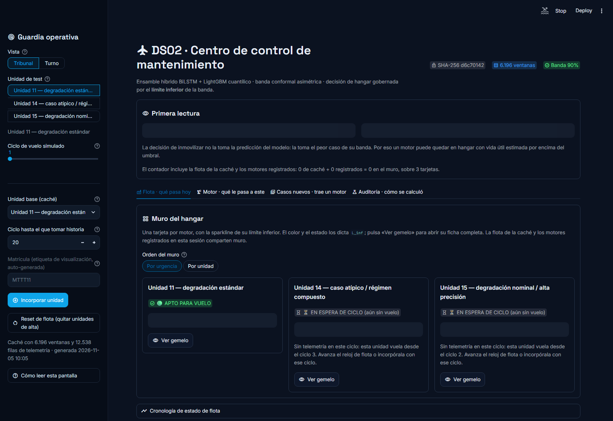
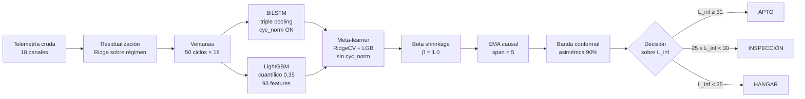
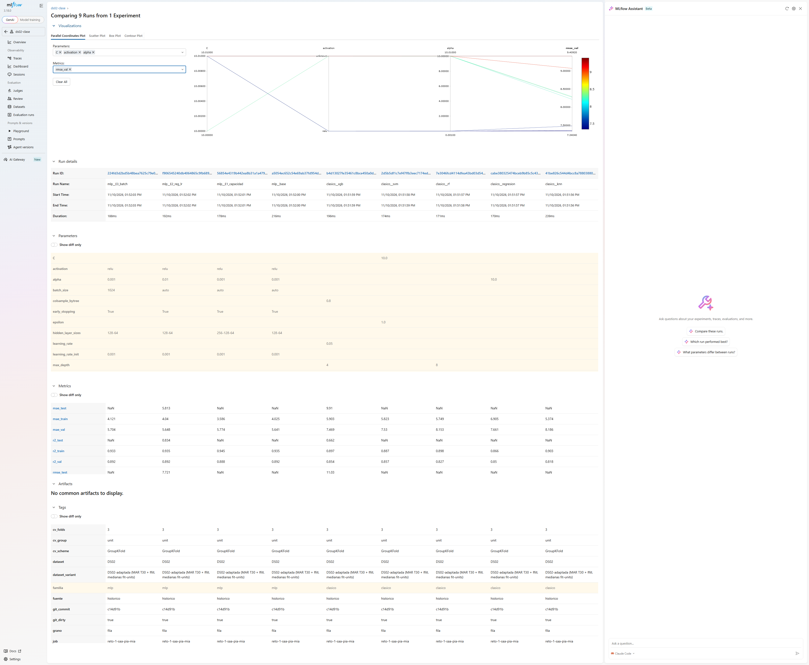
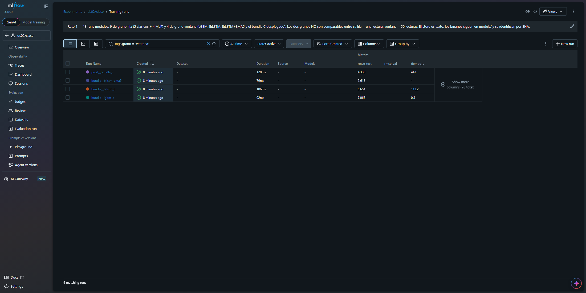
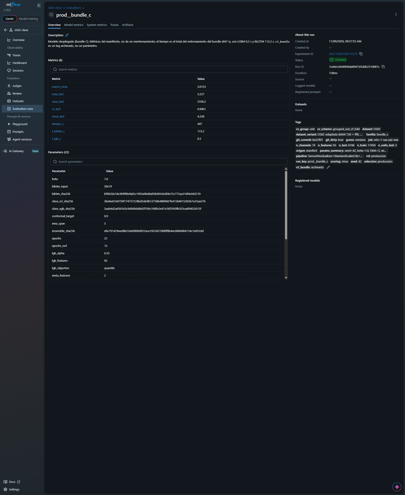
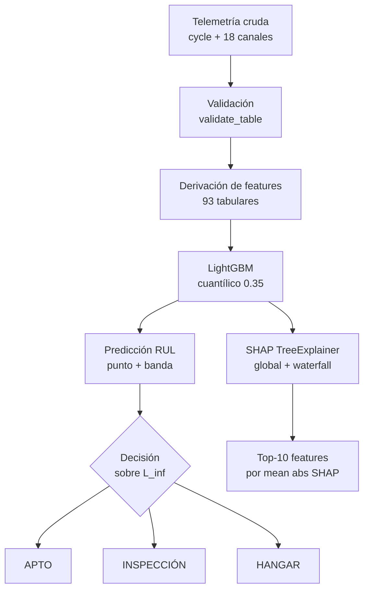

# N-CMAPSS DS02 — Vida útil restante (RUL)

> **Español** | [English](README.en.md)

> **Entrega de clase (Reto 1 SAA + PIA + MIA):** el track académico vive en
> `src/clase/` (código), `notebooks/01–07` (relato), `data/processed/`
> (dataset con nulos MAR + `fase_vuelo`) y `resultados/` (métricas y figuras).
> Punto de entrada: [`src/clase/README.md`](src/clase/README.md) (6 apartados),
> app de producción: `streamlit run app/entrypoints/dashboard_ds02.py` (bundle C + SHAP); el
> entry-point que pide la rúbrica, `app/entrypoints/streamlit_app.py`, solo la delega.
> Lo de abajo es el sistema desplegado (bundle C congelado, RMSE 4.338).


*RMSE del bundle C desglosado por motor (test 11/14/15).*



*Centro de control DS02: SHA-256 `d6c70142…` del ensemble, 6.196 ventanas y banda 90 %. La app sirve el bundle C congelado; la captura está versionada en `docs/assets/dashboard_ds02.png`.*


## La necesidad de negocio

Taller MRO con flota DS02: un motor parado en pista (AOG) cuesta del orden de 10.000–15.000 USD/h (rango Boeing, credibilidad Media; ver `costes_reales_aeronauticos.md` §1); una inspección a tiempo cuesta una fracción. Hoy la decisión de hangar depende de juicio experto sin número.

**Objetivo:** predecir la RUL de cada motor para que el jefe de taller decida APTO / INSPECCIÓN / HANGAR, con la predicción convertida en decisión por reglas (`src/mia/`, 6 con prioridad + seguridad R1) y, más adelante, en acción automática vía n8n. Evitar una sola parada no planificada al año paga el sistema. Detalle académico: [`src/clase/README.md`](src/clase/README.md).

## Qué hemos construido

**Tipo de IA.** Es una IA débil: solo predice RUL de DS02 con lo aprendido de su telemetría; no sabría fijar precios ni atender llamadas. Frente a una IA fuerte (AGI capaz de razonar en cualquier dominio, inexistente aquí), la nuestra no transfiere nada fuera de DS02 — y por eso es barata, rápida y auditable. Aprendizaje **supervisado** (cada fila lleva su RUL real) de **regresión** (valor continuo, no clase); se diferencia del no supervisado en que hay etiqueta y métrica contra verdad (RMSE/MAE/R²). Herramientas: scikit-learn (5 clásicos + MLP + pipeline), XGBoost (uno de los 5), LightGBM (componente del híbrido), Streamlit (app de producción), SHAP (TreeExplainer sobre el LightGBM del bundle C; PermutationExplainer sobre el MLP E2 en el track de clase), MLflow (17 runs históricos curados: 9 fila + 4 ventana + 4 ablación; PIA-4).

Predicción de vida útil restante en el dataset turbofán N-CMAPSS DS02, empaquetado
para que **cargue, sirva y sea honesto sobre lo que mide**.

Un BiLSTM sobre ventanas ordenadas y un LightGBM cuantílico sobre features
tabulares residualizadas se reconcilian por un meta-learner aprendido, encogido
hacia el campeón por un factor `beta`, y suavizado con una EMA causal por motor.

```bash
uvicorn app.services.api:app --host 127.0.0.1 --port 8000    # http://localhost:8000/docs
streamlit run app/entrypoints/streamlit_app.py --server.address 127.0.0.1 --server.port 8501
```

---

## Los datos

65.173 filas downsampleadas (STRIDE 100), 9 motores, train = dev (52.635, uds 2/5/10/18/20/16), test = uds 11/14/15 (12.538, una sola lectura). Detalle en `src/clase/README.md` y `notebooks/01_eda_y_contexto.ipynb`.

| Campo | Qué significa | Tipo | Nulos antes | Nulos después |
|---|---|---|---|---|
| `unit` | Motor (grupo, no predictor) | numérica | 0% | 0% |
| `cycle` | Ciclo de vuelo | numérica | 0% | 0% |
| `alt, Mach, TRA, T2` | Régimen de vuelo | numéricas | 0% | 0% |
| `T24` | Temp. salida LPC (°R) | numérica | 0% | 0% |
| `T30` | Temp. salida HPC (°R), sonda con dropout | numérica | ~1.8% MAR (crucero alto) | 0% tras ffill+mediana |
| `T48` | Temp. salida HPT (°R) | numérica | 0% | 0% |
| `T50` | Temp. salida LPT (°R) | numérica | 0% | 0% |
| `P15` | Presión sangrado (psia) | numérica | 0% | 0% |
| `P2` | Presión entrada fan (psia) | numérica | 0% | 0% |
| `P21` | Presión salida LPC (psia) | numérica | 0% | 0% |
| `P24` | Presión salida HPC (psia) | numérica | 0% | 0% |
| `Ps30` | Presión estática HPC (psia) | numérica | 0% | 0% |
| `P40` | Presión total HPT (psia) | numérica | 0% | 0% |
| `P50` | Presión total LPT (psia) | numérica | 0% | 0% |
| `Nf` | RPM del fan | numérica | 0% | 0% |
| `Nc` | RPM del núcleo | numérica | 0% | 0% |
| `Wf` | Caudal combustible (pps) | numérica | 0% | 0% |
| `fase_vuelo` | Ascenso/Crucero/Descenso (nueva, de alt/Mach) | categórica | 0% | 0% |
| `RUL` | **Objetivo:** ciclos restantes | numérica | 0% (nunca se inyecta) | 0% |

**Calidad:** 0 duplicados funcionales; Mach en [0.33,0.74], alt en [10k,35k] (el 30k/0.8 teórico no existe en DS02: 0 filas, por eso los umbrales MAR son 27k/0.68). Nulos MAR con patrón físico (dropout de T30 en crucero alto) → imputación ffill causal por unidad + mediana de train (solo primer NaN). Split por motor, nunca por fila.

**Campos quitados (qué sale del modelo, por qué y grueso).**

| Campo | Sale de | Por qué | Grueso | Evidencia (path:línea) |
|---|---|---|---|---|
| `unit` | `X` / `FEATURE_COLS` (no es predictor) | Es el grupo del split por motor y de GroupKFold, no una lectura física: meterla permitiría fuga por motor. | 65.173 filas, 9 motores (52.635 train con 6 uds, 12.538 test con 3 uds 11/14/15) | `src/clase/pipeline_clase.py:7`, `src/clase/pipeline_clase.py:22-24`, `src/clase/dataset_clase.py:201-209` |
| `RUL` | `X` (queda como `y`) | Es el objetivo supervisado: predecirlo usándolo como entrada sería fuga. | 65.173 filas, rango 0–88 ciclos | `src/clase/dataset_clase.py:59` |
| `split_origen` | `X_train` / `X_test` (queda en `train.parquet`/`test.parquet`) | Solo trazabilidad train/test, no física ni predictor. | 65.173 filas (52.635 `train` + 12.538 `test`) | `src/clase/dataset_clase.py:60` |
| `fase_vuelo` | Bundle desplegado C (93 features) — **no** del track de clase | El track de clase sí la usa (19 numéricas + 1 categórica OneHot); el contrato 93 del bundle C es residualizado/ventanado sin categórica. | 65.173 filas, 3 categorías (Descenso 28.999 / Ascenso 18.595 / Crucero 17.579) | `src/clase/pipeline_clase.py:23-24`, `src/clase/ventanas_adaptadas.py:6` |

El modelo no usa como predictores los campos que la tabla de campos quitados indica: `unit` (es el grupo del split, no una lectura física) y `RUL` (es el objetivo). `fase_vuelo` es la categórica nueva del track de clase y el bundle desplegado no la usa (93 features sin ella).

## Arquitectura del híbrido



## Resultados — unidades de test 11 / 14 / 15, 6 196 ventanas, media ± std sobre semillas [42, 7, 123]

### Baseline v4.1.0 (histórico — se conserva para comparación)

| Modelo | RMSE | MAE | R² | NASA score |
| --- | --- | --- | --- | --- |
| LightGBM cuantílico 0.35 (standalone) | 7.098 ± 0.034 | 5.572 ± 0.034 | 0.8557 ± 0.0014 | 5772.5 ± 50.1 |
| BiLSTM triple pooling (standalone) | 6.152 ± 0.576 | 4.745 ± 0.332 | 0.8910 ± 0.0205 | 4308.0 ± 595.8 |
| **Hybrid stacking + EMA causal 5** | **4.301 ± 0.068** | **3.181 ± 0.021** | **0.9470 ± 0.0017** | **2315.6 ± 20.0** |

El NASA score es una **suma** de exponenciales asimétricas, no una media, así que
escala con el número de ventanas puntuadas y solo es comparable entre modelos
evaluados sobre las mismas filas.

**Lee las desviaciones estándar antes que las medias.** El BiLSTM oscila ±0.58 RMSE
entre semillas; el híbrido es estable a ±0.068. La dispersión del híbrido es ahora
*real* y no un artefacto: con el contador de ciclo eliminado del meta-learner, la
capa de stacking depende realmente de los dos modelos base, así que hereda su
varianza en lugar de leer un contador (ver la sección de ablación abajo).

> [!warning] **FILA HISTÓRICA A 4.289 NO VIGENTE — vigente C 4.338** (bundle C, `models/ds02_manifest.json`). No citar 4.289 en defensa.

### Revisión 2026-10-21 (histórico — bundle A obsoleto, no vigente)

Mismos modelos, mismo protocolo. Las adiciones son dos métricas, no precisión extra. (histórico, no vigente — vigente C 4.338).

| Modelo | RMSE | MAE | R² | NASA score |
| --- | --- | --- | --- | --- |
| LightGBM cuantílico 0.35 (standalone) | 7.098 ± 0.034 | 5.572 ± 0.034 | 0.8557 ± 0.0014 | 5772.5 ± 50.1 |
| BiLSTM triple pooling (standalone) | 6.337 ± 0.811 | 4.872 ± 0.756 | 0.8837 ± 0.0305 | 4509.9 ± 1051.1 |
| **Hybrid stacking + EMA causal 5 (histórico A, no vigente)** | **4.289 ± 0.018** | **3.183 ± 0.017** | **0.9475 ± 0.0004** | **2297.5 ± 17.4** |

### Bundle C (desplegado, congelado — vigente)

| Modelo | RMSE | MAE | R² | NASA score |
| --- | --- | --- | --- | --- |
| **Hybrid stacking + EMA causal 5 (base imputada)** | **4.338** | **3.227** | **0.9461** | **2336.2** |

Desplegado (bundle C): RMSE 4.338 · MAE 3.227 · R² 0.9461 · NASA 2336.2 (semilla 42, base adaptada MAR T30 + ffill); variabilidad multisemilla **4.324 ± 0.107 / NASA 2341.0 ± 54.1** sobre [42, 7, 123] (media de `resultados/bundle_c_multiseed.csv` + manifiesto; la antigua 4.368 de `resultados/comparativa_c_multisemilla.csv` queda obsoleta y no debe citarse). Las medias impresas en NB06 (4.322+-0.064) y NB05 (4.330+-0.053) son histórico no regenerable.
**Macro-RMSE por motor (el número que esconde la media):** 5.0153 — U11 3.6328 ·
U14 8.5761 · U15 2.8371. El error no está repartido: la unidad 14 concentra el fallo.

### Coste del error

El error del bundle C no es abstracto: se traduce en decisiones de taller. La tabla no
inventa una cifra única — deja la conversión ciclos→horas como **supuesto declarado**,
porque el DS02 no la publica.

| Concepto | Fórmula | Valor |
| --- | --- | --- |
| Coste AOG (fuente externa, credibilidad Media) | rango Boeing | 10.000–15.000 USD/h |
| Horas por ciclo de vuelo | **supuesto**, no medido en el DS02 | 1–2 h |
| Coste por ciclo de error | h/ciclo × AOG | 10.000–30.000 USD |
| Error del bundle C | RMSE test del manifiesto | 4.338 ciclos |
| Coste si todo el error cae en AOG, motor medio | RMSE × coste/ciclo | ≈ 43.000–130.000 USD |
| Peor unidad (U14) | 8.5761 × coste/ciclo | ≈ 86.000–257.000 USD |
| Inspección preventiva | una parada programada | una fracción del AOG |

Lectura honesta: con umbrales `hangar` 25 y `apto` 30 ciclos (`src/mia/reglas.py`,
ADR-008), un RMSE de 4.338 es ≈17 % del umbral de hangar; el error se convierte en
dinero solo si se traduce en AOG. La fuente detallada (`costes_reales_aeronauticos.md`
§1) es local y **no está versionada**: el rango se declara como supuesto, no como
medición, y cada fila admite recalcularse cambiando `h/ciclo`.


### Track de clase (modelos de la asignatura)

| Modelo | RMSE | MAE | R² | NASA score |
| --- | --- | --- | --- | --- |
| MLP E2 (mejor MLP, elegido por val) | 7.72 | 5.81 | 0.83 | — |
| XGB (mejor clásico, elegido por val) | 11.03 | 9.91 | 0.66 | — |
| Híbrido-C = modelo desplegado | 4.338 | 3.227 | 0.9461 | 2336.2 |

**Ojo con los granos:** MLP E2 (7.72) y XGB (11.03) se miden en grano fila (ventana deslizante de 22 features); el Híbrido-C (4.338) en grano ventana (50 ciclos × 19 canales + 93 features tabulares). No son comparables directamente; la comparación válida es intra-grano (LGBM 7.067 → BiLSTM 5.654 → Híbrido-C 4.338).

El híbrido de clase **es** el modelo desplegado: mismo `run_seed`, mismo contrato de 93 features y sin `fase_vuelo`, entrenado sobre la base con nulos MAR tratados (patrón físico + ffill causal con medianas de fit-units).

## MLflow — 17 runs históricos (PIA-4)

El tracking vive en `mlruns/` (file store de texto, sin servidor ni SQLite) y se regenera desde los CSV medidos:

```bash
python scripts/operativo/backfill_mlflow.py --write   # 17 runs históricos; idempotente por run_key
python scripts/operativo/backfill_mlflow.py --check   # store + export, 0 artefactos
MLFLOW_ALLOW_FILE_STORE=true mlflow ui --backend-store-uri ./mlruns
```

MLflow 3.18 exige `MLFLOW_ALLOW_FILE_STORE=true` para el backend de ficheros; el script y el test lo activan. La comparativa exportada por la API es [`docs/evidencia/mlflow/comparativa.csv`](docs/evidencia/mlflow/comparativa.csv). El store commiteado tiene exactamente 17 runs activas y ninguna `live__*`: **los granos no se mezclan** — 9 runs de fila (una lectura), 4 de ventana (50 lecturas) y 4 de la ablación de `cyc_norm`.

### Grano fila — 9 runs (GroupKFold por motor)

| run_key | Modelo | RMSE val | RMSE test | Tiempo (s) | Selección |
| --- | --- | ---: | ---: | ---: | --- |
| `clasico__knn` | KNN | 9.4092 | — | 9.1 | — |
| `clasico__regresion` | Ridge | 8.2762 | — | 3.5 | — |
| `clasico__rf` | Random Forest | 9.0704 | — | 79.6 | — |
| `clasico__svm` | SVR | 8.2927 | — | 2.7 | — |
| `clasico__xgb` | XGBoost | 8.2173 | 11.034 | 7.2 | `mejor_clasico` |
| `mlp__base` | MLP base | 7.358 | — | 27.5 | — |
| `mlp__E1_capacidad` | MLP E1 | 7.4808 | — | 70.7 | — |
| `mlp__E2_reg_lr` | MLP E2 | 7.3404 | 7.7211 | 33.3 | `mejor_mlp,campeon_fila` |
| `mlp__E3_batch` | MLP E3 | 7.3554 | — | 38.6 | — |

El test de fila se lee **una sola vez por familia y nunca para seleccionar**: XGB 11.034 y MLP-E2 7.7211 son lecturas de test publicadas; la elección se hizo por `rmse_val`.

### Grano ventana — 4 runs (grouped out-of-fold; test 6.196 ventanas, uds 11/14/15)

| run_key | Modelo | RMSE val | RMSE test | Tiempo (s) | Rol |
| --- | --- | ---: | ---: | ---: | --- |
| `bundle__lgbm_c` | LightGBM-C (cuantil 0.35) | — | 7.067 | 0.3 | componente / alias `lgbm_adaptada` |
| `bundle__bilstm_c` | BiLSTM-C | — | 5.654 | 113.2 | componente |
| `bundle__bilstm_ema5` | BiLSTM-C + EMA5 | — | 5.618 | — (no cronometrado) | variante |
| `prod__bundle_c` | Híbrido-C + EMA5 (bundle C) | — | 4.338 | 447 | producción |

No hay `rmse_val` de ventana comparable: el protocolo es OOF agrupado y la referencia es el test del manifiesto. Producción: MAE 3.227 · R² 0.9461 · NASA 2336.2; `beta=1.0`, EMA 5, ventana 50, 93 features LGBM, 18 scaler y los cuatro SHA del manifiesto. `v3_bundle=archivado` es un tag, no un parámetro.

### Ablación de `cyc_norm` — 4 runs (2×2 sobre BiLSTM+EMA5)

Las cuatro variantes de la ablación se registran **sobre el mismo modelo** (BiLSTM+EMA5, el mejor en las cuatro) para que la comparación de MLflow aísle solo el factor `cyc_norm` y el baseline delta. Protocolo: test 11/14/15, semilla 42, la misma sesión de `nb03` que el resto de la tabla; no se reentrena nada.

| run_key | Variante | RMSE test | MAE | R² | NASA score |
| --- | --- | ---: | ---: | ---: | ---: |
| `ablacion__off__bilstm_ema5` | cyc_norm OFF | 5.878 | 3.740 | 0.9010 | 3281.4 |
| `ablacion__off_delta__bilstm_ema5` | OFF + baseline delta | 5.896 | 3.830 | 0.9004 | 3393.8 |
| `ablacion__on__bilstm_ema5` | ON (baseline) | 5.910 | 4.793 | 0.9000 | 4060.3 |
| `ablacion__on_delta__bilstm_ema5` | ON + baseline delta | 5.974 | 4.706 | 0.8978 | 4257.8 |

El grid 4×3 completo (tres modelos por variante) está en [`resultados/ablacion_cycnorm.csv`](resultados/ablacion_cycnorm.csv) y en la sección [Ablación de cyc_norm](#ablación-de-cyc_norm). En MLflow se registran las 4 celdas del modelo secuencial; el resto se filtra por `familia=ablacion_cycnorm`.

### Capturas MLflow



*9 runs de fila; `rmse_test` solo aparece en XGB y MLP-E2 porque el test se leyó una vez.*



*4 runs de ventana; el tiempo de EMA5 queda vacío porque no se cronometró.*



*`prod__bundle_c`: 4.338 / 3.227 / 0.9461 / 2336.2 y los cuatro SHA.*

---

## Estabilidad entre semillas (C)

| Modelo | RMSE | NASA score | Semillas |
|---|---|---|---|
| C-media (CSV vigente, ventana test 6196) | **4.324+-0.107** | **2341.0+-54.1** | 42, 7, 123 |
| C-media (NB06 impresa, ventana) — histórico | 4.322+-0.064 | 2342.3+-43.4 | 42, 7, 123, no regenerable |
| C-media (NB05 impresa, OOF) — histórico | 4.330+-0.053 | 2343.2+-24.1 | 42, 7, 123, no regenerable |

La semilla 42 es la del bundle desplegado (`models/ds02_manifest.json`); 7 y 123 se
reentrenan con el mismo protocolo en `scripts/operativo/evaluate_bundle_stability.py`. El ± es
la cota de ruido con la que se leen las diferencias: dos medias separadas menos que
ese ± son empate.

**Evidencia:** `resultados/comparativa_c_multisemilla.csv` (la tabla de las tres semillas),
`resultados/bundle_c_multiseed.csv`, `resultados/comparativa_bundle_c.csv`,
`scripts/operativo/evaluate_bundle_stability.py`, `notebooks/06_evaluacion_produccion_comparativa.ipynb`.

*Nota sobre casillas vacías: NASA solo se calcula en grano ventana (pipeline
`evaluate_predictions`); en grano fila la comparativa oficial es RMSE/MAE/R².*


---



---

El dashboard de producción (`app/entrypoints/dashboard_ds02.py`) incluye una sección de SHAP
(TreeExplainer exacto sobre el LightGBM del híbrido):

- **Global:** top-10 features por mean |SHAP| para el motor seleccionado.
- **Local:** waterfall plot para explicar por qué el modelo predice ese RUL.

Las features más importantes son `xs_mean_T50`, `xs_mean_T48`, `xs_last10_T50`,
`cyc_norm`. SHAP explica el componente tabular del híbrido (LightGBM, 93 features
derivadas), no el BiLSTM ni el stacking.

En el **track de clase** (SAA-9 de 7 a 10) el SHAP es sobre el **MLP E2**
(`E2_reg_lr`, elegido por rmse_val), no sobre el XGB: PermutationExplainer con
masker Independent, fondo de 200 filas de train fold-0 y budget 2·n+1
(`resultados/mlp_shap_E2/`, `src/clase/shap_clase_e2.py`). El XGB conserva su
SHAP TreeExplainer intacto (`resultados/shap_importancia.*`).

---

## Arquitectura

- **BiLSTM** (triple pooling, canal 19 = cyc_norm) → predicción secuencial.
- **LightGBM** cuantílico 0.35 (93 features tabulares) → predicción tabular.
- **Meta-learner** (RidgeCV + LightGBM) sobre `[p_lstm, p_lgb]` (sin cyc_norm).
- **Beta shrinkage** (β = 1.0) + **EMA causal** (span = 5).
- **Banda conformal** asimétrica por bins de RUL predicha (90%).

---

## Ablación de cyc_norm

Medida sobre test 11/14/15 (semilla 42) en `notebooks/03_feature_engineering_secuencial.ipynb`. RMSE por variante y modelo; las cuatro variantes se registran en MLflow sobre el BiLSTM+EMA5 (`ablacion__*`).

| Variante | LGBM | BiLSTM | BiLSTM+EMA5 |
| --- | ---: | ---: | ---: |
| cyc_norm OFF | **6.297** | 5.946 | **5.878** |
| cyc_norm OFF + baseline delta | 8.765 | 5.939 | 5.896 |
| cyc_norm ON (baseline) | 7.067 | 5.939 | 5.910 |
| cyc_norm ON + baseline delta | 8.547 | 5.985 | 5.974 |

Lectura: en el secuencial las cuatro variantes caen en 5,878–5,974 (0,10 de horquilla), así que `cyc_norm` no cambia el resultado. En el LGBM sí: activarlo cuesta +0,77 RMSE y añadir el baseline delta +2,47, así que ambos se quedan fuera del modelo tabular.

Conclusión: `cyc_norm` se mantiene como canal 19 del BiLSTM (no cuesta) y no entra en el LGBM ni en el meta-learner (cuesta). Fuente completa de las 12 celdas: [`resultados/ablacion_cycnorm.csv`](resultados/ablacion_cycnorm.csv).

---

## Cómo ejecutar

### Puesta en marcha (una vez por PC)

Requiere Python 3.12. Desde la raiz del repo:

```bash
python -m venv .venv
.venv/Scripts/activate        # Windows;  POSIX: source .venv/bin/activate
pip install -r requirements.txt
pip install -e .              # expone clase/, ds02_rul/ y src/mia/ como paquetes
```

`pip install -e .` no es opcional: notebooks y app importan `ds02_rul` y
`src.clase` como paquetes instalados, no como ficheros sueltos. Sin ese paso
el notebook arranca pero muere en el primer `import`.

En VS Code, abre **la carpeta del repo (`nasa/`) como raiz del workspace**, no
una carpeta padre. La resolucion de los imports con prefijo `src.` sale de
`[tool.pyright]` en `pyproject.toml` y de `python.analysis.extraPaths` en
`.vscode/settings.json`; con otra carpeta abierta el editor los subraya aunque
el notebook corra perfectamente.

### Comandos

```bash
# App de producción (bundle C + SHAP)
streamlit run app/entrypoints/dashboard_ds02.py

# Tests
python -m pytest tests/ -q

# Track de clase
python -m src.clase.train_clasicos
python -m src.clase.train_mlp
python -m src.clase.shap_clase
python scripts/operativo/evaluate_bundle_stability.py
python scripts/operativo/backfill_mlflow.py --check
MLFLOW_ALLOW_FILE_STORE=true mlflow ui --backend-store-uri ./mlruns
```

---

## Estructura del proyecto

```
app/entrypoints/         streamlit_app.py (rúbrica, delega) y dashboard_ds02.py (producción)
app/                     lib/ (datos, inferencia, reglas), ui/ (pestañas), services/ (API)
src/utils.py            fachada rúbrica (re-exporta pipeline_clase + métricas)
src/reglas.py           fachada rúbrica sobre src.mia/ (6+ reglas, prioridad, seguridad)
src/n8n.py              envío de la decisión a n8n (MIA-3)
src/ds02_rul/           data, features, model, pipeline, stacking, metrics, ...
mlruns/                 store MLflow de texto (17 runs curados + live; sin artefactos)
docs/evidencia/mlflow/  comparativa.csv + capturas de MLflow
models/mejor_modelo.joblib  alias del mejor clasico (copia de mejor_modelo_clase.joblib, XGB)
models/                 bundle desplegado (C): ensemble.joblib, bilstm_ds02.keras,
                        scaler.joblib, ds02_manifest.json
archive/                punto de restauración del bundle B (4 artefactos)
src/clase/            track académico (dataset, pipeline, 5 modelos, MLP, SHAP)
src/ds02_rul/         bundle C: bundle_c.py, puente_c.py, ensemble, stacking, conformal, ...
scripts/              evaluate_bundle_stability.py, build_ui_cache.py, backfill_mlflow.py
notebooks/              01_eda ... 07_shap_c (con outputs)
tests/                  tests de clase + tests de app
data/processed/         parquet (ignorado en git, regenerable)
resultados/             gráficas y CSVs (ignorado en git, regenerable)
```

---

## Documentación adicional

- README en inglés: [README.en.md](README.en.md)
- Track de clase: [src/clase/README.md](src/clase/README.md)
- Rúbrica: `docClase/Reto1_SAA_PIA_MIA_2026-27_v5.pdf`
- Planificación: `docs/pendiente/planificacion-clase-5notebooks.md`
- MLflow: [`docs/evidencia/mlflow/comparativa.csv`](docs/evidencia/mlflow/comparativa.csv) y capturas en `docs/evidencia/mlflow/`

---

## Autoría

Proyecto N-CMAPSS DS02 · rama `mlflow-pia4` · changes openspec `2026-11-02-clase-track` + `2026-11-04-adopcion-bundle-c` · Curso IA y Big Data 2026-27