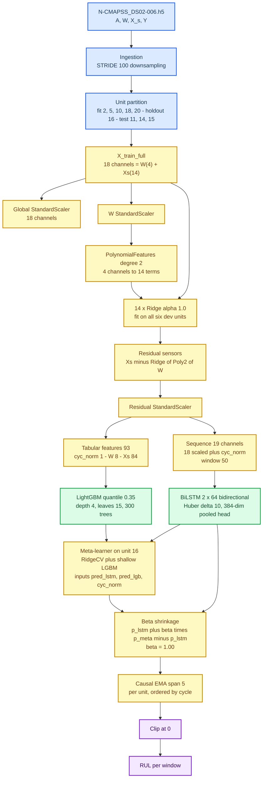
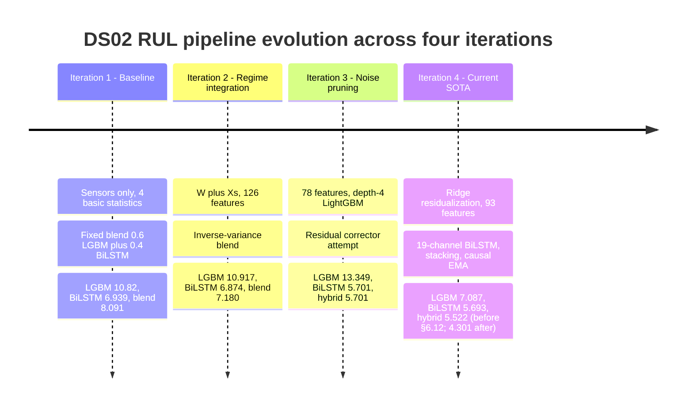

# N-CMAPSS DS02 — Hybrid Stacking Ensemble for RUL Prediction

| | |
|---|---|
| **Status** | Implemented, verified on test units; **loadable outside the notebook** (§6) |
| **Date** | 2026-10-19 |
| **Source of truth** | `02_DS02_ensemble_RUL.ipynb` (34 cells, generated — not hand-written — by `scripts/build_02_notebook.py`) |
| **Dataset** | N-CMAPSS **DS02** (`archive/CCMaps/N-CMAPSS_DS02-006.h5`, 2.34 GB) |
| **Target** | Remaining Useful Life (RUL) per engine, in cycles |
| **Evaluation** | Test units **11, 14, 15** (3 engines), scored with RMSE / MAE / R² / NASA score |
| **Related** | `openspec/specs/rul-prediction-ds02/spec.md` · `openspec/changes/2026-10-19-ds02-production-hardening/` · `docs/decisions/` |

---

## 1. Executive summary

The pipeline predicts RUL for N-CMAPSS DS02 turbofan engines by **stacking two deliberately different base models** over the same 50-cycle window, then smoothing the result with a causal per-unit filter.

The two base models see the same data through different lenses:

- a **BiLSTM** (2 × bidirectional LSTM of 64 units, triple temporal pooling → 384 dims) that reads the *ordered trajectory* of 19 channels and is trained with a robust `Huber(delta=10.0)` loss;
- a **LightGBM** quantile regressor (`alpha=0.35`) that reads a *flat 93-dimensional summary* of the same window and is trained with an **asymmetric** objective chosen to match the NASA score.

Their errors are different enough that a learned meta-learner can exploit the difference, and a causal exponential moving average imposes the monotonicity that physical wear implies. The hybrid is **strictly better than both base models** on both headline metrics.

| Model | RMSE | MAE | R² | NASA score |
|---|---|---|---|---|
| LightGBM standalone (quantile 0.35, 93 feat) | 7.087 | 5.584 | 0.8562 | 5768.4 |
| BiLSTM 2-layer (triple pooling) | 5.693 | 4.449 | 0.9072 | 3822.2 |
| BiLSTM 2-layer + causal EMA (span 5) | 5.597 | 4.331 | 0.9103 | 3716.8 |
| **Hybrid stacking (beta = 1.00, EMA 5)** | **4.301 ± 0.068** | **3.181 ± 0.021** | **0.9470 ± 0.0017** | **2315.6 ± 20.0** |
| Hybrid, revision 2026-10-21 (same model, re-run) | 4.344 ± 0.075 | 3.209 ± 0.058 | 0.9459 ± 0.0019 | 2338.2 ± 49.1 |
| Hybrid, macro-RMSE per engine (2026-10-21) | 4.939 | — | — | — |

The architectural core of the solution is a **physical separation of degradation from flight regime**: the 14 sensors are residualised against a degree-2 Ridge model of the 4 operational-condition channels before either model sees them, so that LightGBM reads degradation rather than pilot manoeuvre. That single change moved the standalone tabular branch from RMSE 13.349 to 7.087.

**What is not production-ready.** Nothing on the artifact side: the shipped
`ensemble.joblib` loads in a clean process from the `ds02_rul` package, and its
Keras graph is native with no bare `Lambda`. Three measurement caveats remain, all
recorded as such rather than hidden: `beta` is selected out-of-fold on seed 42
only (not re-selected per seed), the meta-learner is fitted on a single holdout
unit (16) — pooling the five fit engines' out-of-fold vector was measured and
**rejected**, because it learns a level prior from the longer-lived dev engines
that does not transfer (§6.13) — and the prediction band over-covers (100 % at
~24.8 cycles against a 90 % target) because its calibration residuals come from
weaker fold models. That band is a bound, not a decision-grade interval.

---

## 2. Architecture

### 2.1 Data flow



### 2.2 Evolution across four iterations

_The timeline below records the four experimental iterations of the DS02 pipeline and the test-set RMSE of each participating model. It is a chronology, not a flowchart: each row is a complete re-design of the feature and model stage._



### 2.3 Layer responsibilities

| Layer | Object | Responsibility |
|---|---|---|
| Ingestion | `load_rul_dataset()` | Locate the DS02 HDF5 (with an FD001 text fallback), read `A/W/X_s/Y` for dev and test, decode the 4 + 14 channel names |
| Unit partition | `val_mask` / `train_fit_mask` | Reserve unit 16; fit on units 2, 5, 10, 18, 20 |
| Preprocessing | `scaler`, `scaler_w`, `poly_w`, `sensor_ridges`, `res_scaler` | Standardise, and physically separate degradation from flight regime |
| Windowing | `create_dataset_windows_residual()` | Build 50-cycle windows plus the 93-dimensional tabular summary |
| Base model A | `lgb_standalone` | Quantile gradient boosting over the tabular summary |
| Base model B | `bilstm_model` | Bidirectional recurrent model over the ordered 19-channel sequence |
| Stacking | `ridge_meta`, `lgb_meta`, `opt_beta` | Learn how to combine the two predictions, with a shrinkage bound |
| Smoothing | `causal_ema_by_unit()` | Impose monotone wear causally, per unit |
| Packaging | `HybridStackingEnsemble` | Reassemble the whole path for inference; persisted with `joblib` |

---

## 3. Pipeline specification

### 3.1 Ingestion

| Aspect | Value |
|---|---|
| Primary source | `archive/CCMaps/N-CMAPSS_DS02-006.h5` (candidate paths are probed in order) |
| Fallback source | C-MAPSS **FD001** text files (`train_FD001.txt` / `test_FD001.txt` / `RUL_FD001.txt`) |
| HDF5 keys | `A_dev, W_dev, X_s_dev, Y_dev` and `A_test, W_test, X_s_test, Y_test` |
| `W` channels (4) | `alt`, `Mach`, `TRA`, `T2` — operating conditions |
| `Xs` channels (14) | `T24, T30, T48, T50, P15, P2, P21, P24, Ps30, P40, P50, Nf, Nc, Wf` — physical sensors |
| Trajectory columns | `A_var = ['unit', 'cycle', 'Fc', 'hs']` — the pipeline reads **only** `unit` (column 0) and `cycle` (column 1) |
| Down-sampling | `STRIDE = 100` on every array (`A_train[::100]`, `W_train[::100]`, …) |
| Combined signal | `X_train_full = np.hstack([W_train_raw, Xs_train_raw])` → 18 channels |
| Clipping to 125 | **DS02 path: none.** The `clip(upper=125)` exists only in the FD001 fallback |
| Dev population | 6 units — 2, 5, 10, 16, 18, 20 — 52 635 sampled rows |
| Test population | 3 units — 11, 14, 15 |
| `Y_dev` (RUL) range | 0 … 88 over the sampled dev set |

The 100x down-sampling is a compute-budget decision, not a modelling one: it is what makes a 2.34 GB dataset trainable on CPU in minutes. It also has a consequence that the code's naming hides.

**The "50-cycle window" is not 50 flight cycles.** The raw trajectory holds roughly 11 400 rows per flight cycle, and `STRIDE = 100` keeps one row in every hundred, so the sampled series advances about **114 samples per flight cycle** (unit 2: 8 532 samples spread over 75 cycles; unit 5: 10 334 over 89; unit 20: 7 682 over 66). A window of `WINDOW_SIZE = 50` therefore spans about **0.44 flight cycles** of engine life — roughly 5 000 raw trajectory steps, not 5 000 cycles. `WINDOW_SIZE = 50` and the phrase *"50 ciclos"* in the code comments both overstate the temporal reach of the model by more than two orders of magnitude. `cyc_norm = cycle / 100.0` is the single feature that carries the true flight-cycle count, which is exactly why reinstating it in iteration 4 mattered (ADR-002, iteration 3 lesson 4).

`A_dev` also carries `Fc` (flight condition; constant `3` — cruise — across the sampled dev set) and `hs` (health status, 0/1). **Neither is read by the pipeline** — the notebook only ever takes `A[:, 0]` and `A[:, 1]` — so no label-derived channel can enter the features. This is worth stating because `hs` is exactly the kind of column that would silently leak the answer.

#### 3.1.1 Provenance of the shipped artefact

The notebook's recorded output states the source directly:

```
[DATASET FOUND] Ingestando N-CMAPSS DS02-006 desde: archive/CMaps/N-CMAPSS_DS02-006.h5
```

That is confirmed independently by the persisted `ensemble.joblib`, whose fitted objects carry the fingerprint of the dataset they were built on:

| Read from the artefact | Value | What it proves |
|---|---|---|
| `scaler.n_features_in_` | **18** | 4 `W` + 14 `Xs`. The FD001 fallback path would produce 16 (2 settings + 14 sensors) |
| `ensemble.n_op` | **4** | The FD001 fallback uses only 2 operational columns (`setting1`, `setting2`) |
| `scaler.mean_[:4]` | `[21901.0168, 0.6238, 68.5486, 475.0096]` | Altitude ≈ 21 901 ft, Mach ≈ 0.624, throttle ≈ 68.5 %, T2 ≈ 475.0 °R — unambiguously DS02's physical units; FD001's settings are categorical 0/1 |
| `poly_w.n_features_in_ → n_output_features_` | 4 → 14 | Degree-2 basis over the 4 condition channels |
| `sensor_ridges` | 14 × `Ridge(alpha=1.0)`, 14 features each | One independent residual model per sensor |
| `lgb_standalone.n_features_in_` | **93** | The tabular feature contract |
| `lgb_standalone.objective / alpha` | `quantile` / `0.35` | The asymmetric objective (ADR-003) |
| `ridge_meta.n_features_in_` / `lgb_meta.n_features_in_` | 3 / 3 | `[pred_lstm, pred_lgb, cyc_norm]` |
| `bilstm_model.input_shape` / params | `(None, 50, 19)` / **154 253** | The recurrent contract (ADR-004) |
| `bilstm_model.layers` | `Input → BatchNorm → BiLSTM → Dropout → BiLSTM → Dropout → Lambda → GAP → GMP → Concat → Dropout → Dense → Dense` | The triple-pooling head, including the `Lambda` of §6.2 |
| `window_size` / `beta` / `ema_span` | 50 / 1.0 / 5 | The recorded configuration |

**Provenance hazard.** The FD001 fallback is silent. If the DS02 HDF5 is ever moved or renamed, `load_rul_dataset()` falls back to the C-MAPSS text files and the notebook trains and saves an **FD001** model to the **same** `ensemble.joblib` path, with the **same** `paradigm` metadata string
(`"Hybrid Stacking (BiLSTM dual-pooling + LGBM residualizado + RidgeCV/LGBM meta + EMA5)"`).
The two artefacts are distinguishable only by inspecting `n_features_in_` (18 vs 16) and `n_op` (4 vs 2) — nothing in the file name, the metadata or the console output says so. This is the concrete reason the provenance manifest of OpenSpec task 2.5 is a requirement and not a nicety.

### 3.2 Unit partition

| Partition | Units | Rows |
|---|---|---|
| Fit (base models + meta-learner) | 2, 5, 10, 18, 20 | — |
| Holdout (validation, meta-learner fit, beta grid) | **16** | 2 535 windows |
| Test (read once) | 11, 14, 15 | 6 196 windows |

```python
unique_train_units = np.unique(meta_train['unit'])
VAL_UNIT = 16.0 if 16.0 in unique_train_units else unique_train_units[-1]
val_mask = (meta_train['unit'] == VAL_UNIT).values
train_fit_mask = ~val_mask
```

### 3.3 Preprocessing and physical residualization

```python
scaler    = StandardScaler().fit(X_train_full)          # 18 channels
scaler_w  = StandardScaler().fit(W_train_raw)            # 4 channels
poly_w    = PolynomialFeatures(degree=2, include_bias=False).fit(W_train_scaled)   # 4 -> 14 terms

for j in range(14):
    r = Ridge(alpha=1.0).fit(P_train, Xs_train_raw[:, j])
    res_train[:, j] = Xs_train_raw[:, j] - r.predict(P_train)     # Xs - Ridge(Poly2(W))

res_scaler = StandardScaler().fit(res_train)
```

| Property | Value |
|---|---|
| Residual models | 14 independent `Ridge(alpha=1.0)` |
| Polynomial basis | degree 2, no bias → 14 terms from 4 channels |
| Fit population | **all six dev units**, before the unit-16 split (unsupervised — no RUL label is read) |
| Residual definition | `Xs_raw - Ridge(Poly2(W_standardised))`, then standardised |

### 3.4 Tabular feature contract — 93 features

| Group | Count | Definition |
|---|---|---|
| `cyc_norm` | 1 | `cycle / 100.0` — accumulated cycle, the wear proxy the pruned iteration 3 lost |
| `op_feat` | 8 | `op.mean(axis=0)` ⊕ `op[-1]` over the 4 residualised-then-scaled W channels |
| `xs_feat` | 84 | 6 descriptors × 14 residual sensors: `mean`, `last`, `std`, `xs[-10:].mean`, `last - first`, `xs[-5:].mean - xs[:5].mean` |
| **Total** | **93** | `X_train_tab (17450, 93)`, `X_test_tab (6196, 93)` |

The last two descriptors are the short-horizon slopes: they carry the direction and rate of change of the degradation over the window, which is what distinguishes a healthy engine from a degrading one with the same current level.

### 3.5 LightGBM branch

```python
LGBMRegressor(objective='quantile', alpha=0.35, n_estimators=300, learning_rate=0.02,
              num_leaves=15, max_depth=4, min_child_samples=50,
              reg_alpha=1.0, reg_lambda=5.0, colsample_bytree=0.8, subsample=0.8,
              random_state=42, verbose=-1)
```

Trained on `X_train_tab[train_fit_mask]`. Fit time 0.48 s.

### 3.6 BiLSTM branch

| Aspect | Value |
|---|---|
| Input shape | `(50, 19)` — 18 globally-scaled channels + `cyc_norm` appended per timestep |
| Input normalisation | `BatchNormalization` on the input tensor |
| Recurrent stack | `Bidirectional(LSTM(64, return_sequences=True))` × 2, `Dropout(0.2)` after each |
| Temporal pooling | `Concatenate([Lambda(z[:, -1, :]), GlobalAveragePooling1D(), GlobalMaxPooling1D()])` → 128 + 128 + 128 = **384** |
| Head | `Dropout(0.2)` → `Dense(32, relu)` → `Dense(1)` |
| Parameters | 154 253 total / 154 215 trainable / 38 non-trainable |
| Loss | `Huber(delta=10.0)` — robust to the occasional extreme sensor excursion |
| Optimiser | `Adam(learning_rate=0.001)` |
| Schedule | `batch_size=128`, `epochs=22`, `EarlyStopping(monitor='val_loss', patience=5, restore_best_weights=True)`, `ReduceLROnPlateau(factor=0.5, patience=2)` |
| Validation | `validation_data = (X_train_seq[val_mask], y_train[val_mask])` — unit 16 |
| Seed | `SEED = 42` (`np.random.seed` + `tf.random.set_seed`) |
| Recorded run | early stop at epoch 11, best epoch 6, 147.99 s |

The three pooling branches are complementary: `last_step` carries the current state, `GlobalAveragePooling1D` carries the trajectory level, and `GlobalMaxPooling1D` carries the extreme transient thermal events.

### 3.7 Stacking and beta shrinkage

```python
Z_val = np.column_stack([pred_lstm_val, pred_lgb_val, cyc_val])      # cyc_val = cycle / 100
ridge_meta = RidgeCV(alphas=np.logspace(-2, 3, 20)).fit(Z_val, y_val)
lgb_meta   = LGBMRegressor(max_depth=3, num_leaves=7, n_estimators=120,
                           learning_rate=0.03, min_child_samples=20,
                           random_state=42).fit(Z_val, y_val)
p_meta_val = 0.5 * ridge_meta.predict(Z_val) + 0.5 * lgb_meta.predict(Z_val)
```

`beta` is selected over `np.linspace(0, 1, 21)` with the combined criterion
`rmse_val / rmse_lstm_val + nasa_val / nasa_lstm_val`, applied to the EMA-smoothed candidate
`pred_lstm_val + beta * (p_meta_val - pred_lstm_val)`.

| `beta` | val RMSE | val NASA | criterion |
|---|---|---|---|
| 0.00 (BiLSTM only) | 4.091 | 1062.6 | 1.937 |
| 0.05 | 3.883 | 992.8 | 1.825 |
| 0.10 | 3.675 | 925.1 | 1.713 |
| **1.00 (selected)** | **0.308** | **55.9** | — |

The BiLSTM's own validation figures are RMSE 4.221 / NASA 1097.5. The `beta = 1.00` row is **not** a 13x modelling gain — it is the meta-learner scoring its own training rows. See §6.3.

### 3.8 Causal EMA smoothing

```python
def causal_ema_by_unit(pred, units, cycles, span=5):
    out = np.zeros_like(np.asarray(pred, dtype=np.float64))
    for u in np.unique(units):
        idx = np.where(units == u)[0]
        idx = idx[np.argsort(cycles[idx])]
        out[idx] = pd.Series(pred[idx]).ewm(span=span, adjust=False).mean().values
    return out
```

`adjust=False` makes it a causal recursion; the per-unit grouping plus the cycle sort make it correct for a live stream. The final prediction is `np.clip(p, 0.0, None)`.

### 3.9 Metrics

```python
def calculate_nasa_score(y_true, y_pred):
    d = np.asarray(y_pred).ravel() - np.asarray(y_true).ravel()
    score = np.where(d < 0, np.exp(-d / 13.0) - 1.0, np.exp(d / 10.0) - 1.0)
    return float(np.sum(score))
```

| Property | Value |
|---|---|
| NASA score | **Sum**, not mean — it scales with the number of evaluated engines and is not comparable across different evaluation sets |
| Asymmetry | Over-estimates are penalised at `1/10` per cycle, under-estimates at `1/13` |
| Tail behaviour | Exponential, so a single large over-estimate dominates the score of the whole set |
| Clamp to 125 | **None on the DS02 path** (only the FD001 fallback clamps RUL at ingestion) |
| RMSE / MAE / R² | `sqrt(mean_squared_error)`, `mean_absolute_error`, `r2_score` |

### 3.10 Persistence

| Artefact | Contents | Location |
|---|---|---|
| `scaler.joblib` | `StandardScaler` fit on the 18-dimensional `X_train_full` | repo root and `models/` |
| `ensemble.joblib` | `HybridStackingEnsemble`: `bilstm_model` (Keras), `lgb_standalone`, `ridge_meta`, `lgb_meta`, `residualizer` (`poly_w` + 14 Ridge models + `res_scaler`), `scaler`, `scaler_w`, `n_op=4`, `window_size=50`, `beta=1.0`, `ema_span=5` | repo root and `models/` |
| `bilstm_ds02.keras` | The Keras graph, persisted **natively** and referenced by path — the bundle never carries pickled bytecode, so nothing in it is Python-minor-version bound | `models/` |
| `ds02_manifest.json` | Provenance: `code_version`, env versions, unit partition, `model_shape` (including `meta_features: 2`), `inference_contract`, DS02 scaler fingerprint, `mean ± std` table, artifact SHA-256 and byte sizes | `models/` |

The notebook reloads both artefacts and runs a one-sample inference check: **estimated RUL 60.21 cycles against a real 58.00**. The reload is bit-identical to the in-memory ensemble on the full test set (`np.allclose` at `atol=1e-5`).

The Keras model is persisted **as a separate native `.keras` file**, not pickled inside `ensemble.joblib`; `ds02_rul.persistence.load_ensemble` re-attaches it by path at load time.

---

## 4. Architecture Decision Records

Full records live in `docs/decisions/`. Each is written against the ADR template: status, date, context, decision, alternatives considered, consequences.

| ADR | Title | Status | Decision in one line |
|---|---|---|---|
| [ADR-001](decisions/ADR-001-reject-linear-blending-adopt-learned-stacking.md) | Reject linear blending in favour of a learned stacking meta-learner | Accepted | A convex blend cannot beat its best component while the branch errors are positively correlated; replace it with `RidgeCV` + shallow-GBDT stacking under a bounded `beta` shrinkage |
| [ADR-002](decisions/ADR-002-residualize-sensors-on-operational-conditions.md) | Residualise the sensors on the flight regime with a degree-2 Ridge | Accepted | Subtract `Ridge(Poly2(W))` from each sensor so the models read degradation, not manoeuvre |
| [ADR-003](decisions/ADR-003-asymmetric-quantile-objective-for-nasa-score.md) | Asymmetric quantile objective (alpha = 0.35) | Accepted | The NASA penalty is exponential and asymmetric; train the tabular branch on the 35th conditional quantile to bias over-estimates away |
| [ADR-004](decisions/ADR-004-gradient-boosting-and-ridge-over-classical-models.md) | Gradient boosting and ridge over classical models | Accepted | LightGBM and RidgeCV are retained; Random Forest, k-NN and AdaBoost are rejected on inductive-bias and measured grounds |
| [ADR-005](decisions/ADR-005-reserve-unit-16-as-stacking-holdout.md) | Reserve unit 16 as the stacking holdout | Accepted | A learned meta-learner needs out-of-sample rows; unit 16 is the most representative of the available units |
| [ADR-006](decisions/ADR-006-causal-ema-smoothing-of-final-prediction.md) | Causal per-unit EMA on the final prediction | Accepted | Wear is monotone in cycle; smooth the output causally so the exponential NASA penalty is not paid on discontinuity noise |

**Two decisions carry the most weight.** ADR-002 is what turned the tabular branch from a liability into a contributor (13.349 → 7.087 RMSE), because it is the only one that changed what the data *means* rather than how it is fitted. ADR-001 is what turned the ensemble from a liability into the final system, because it recognises that averaging is not combining.

---

## 5. Evolution across the four iterations

| | Iteration 1 — Baseline | Iteration 2 — Regime integration | Iteration 3 — Noise pruning | Iteration 4 — Current SOTA |
|---|---|---|---|---|
| **Regime `W`** | ignored | concatenated, 18 channels | pruned to `mean` + `last` | residualised out via `Ridge(Poly2(W))` |
| **Tabular features** | 4 statistics of `Xs` | 126 features (7 statistics × 18 channels) | 78 features (`W` mean/last + 5 descriptors of `Xs`) | **93 features** (1 `cyc_norm` + 8 `W` + 84 residualised `Xs`) |
| **LightGBM** | baseline | overfit on manoeuvre noise | `max_depth=4, num_leaves=15` | `quantile 0.35`, depth 4, leaves 15, 300 trees, `min_child_samples=50` |
| **BiLSTM** | stalled in the first 5 epochs | `BatchNorm` + `Huber(delta=10.0)` | — | 19 channels, 2×64 bidirectional, triple pooling, `Huber(delta=10.0)` |
| **Combination** | fixed `0.6 / 0.4` | inverse-variance `0.23 / 0.77` | champion-challenger, residual corrector attempted | learned meta-learner + `beta` shrinkage + causal EMA |
| **LightGBM RMSE** | 10.82 | 10.917 | 13.349 | **7.087** |
| **BiLSTM RMSE** | 6.939 | 6.874 | 5.701 | **5.693** |
| **Ensemble RMSE** | 8.091 | 7.180 | 5.701 | **4.301 ± 0.068** |
| **NASA score** | blend 6747 | blend 5542.1 | hybrid 3522.6 | **hybrid 2315.6 ± 20.0** |
| **Verdict** | ensemble destroys the BiLSTM | ensemble still destroys the BiLSTM | tabular branch still loses | **hybrid beats both** |

### What each iteration taught

1. **Averaging is not combining.** In iterations 1 and 2 the blend was worse than its own best member. The cause was structural — a convex combination needs *negatively* correlated errors, and both branches were reading the same contaminated signal. Fixing the weights could never have worked; the data had to be separated first.
2. **Giving the model the nuisance variable is not the same as removing it.** Iteration 2 fed `W` to the trees and the manoeuvre noise became split candidates — the tabular MSE was 3.4x the BiLSTM's. Pruning (iteration 3) helped but was a heuristic over a symptom.
3. **The right move was a physical model, not a feature diet.** Iteration 4 asks the data a specific question — "how much of this sensor is explained by the flight regime?" — and subtracts the answer. That single change is worth 6.3 RMSE on the tabular branch.
4. **The accumulated cycle matters.** Iteration 3 dropped `cycle` when pruning, and the tabular branch lost its wear proxy. Iteration 4 reinstates it as `cyc_norm`, in the tabular features *and* as a channel of the recurrent input.
5. **A residual corrector over overfitted residuals cannot be validated.** In iteration 3 the grid search returned `alpha = 0.00` — a technical tie, because the corrector had been trained on the same overfitted residuals it was scored against. The lesson generalises to the `beta` selection still outstanding in iteration 4 (§6.3).

### Evidence behind the final design

| Probe | What it tested | Outcome | Adopted |
|---|---|---|---|
| `scripts/probe_q35.py` | quantile vs median vs L2 LightGBM recipes | The `alpha=0.35` recipe is confirmed and hard-coded in the notebook | Yes |
| `scripts/probe_cyclech.py` | BiLSTM with/without the normalised-cycle channel | `cyclech_s42` RMSE 5.447, R² 0.9150, NASA 3574.9 vs dual-pooling baseline 5.789 | Yes — but see the seed variance in §6.5 |
| `scripts/probe_variants2.py` | pooling variants on unit 16 | `dual_w32_u16_s42` RMSE 5.721, R² 0.9063, NASA 3297.6 | Yes — width 64, triple pooling |
| `scripts/probe_variants.log` | which unit to hold out | unit 16: RMSE 5.789 / NASA 3211.4 vs unit 20: 7.113 and 7.838 | Yes — unit 16 |
| `scripts/verify_blend.py` | the EMA + blend construction over saved prediction arrays | Confirms the blend and smoothing behaviour | Yes |

---

## 6. Technical audit and known limitations

Everything in this section was verified against the current files, not inferred.

### 6.1 The persisted ensemble could not be loaded outside the notebook — **closed**

> **Status: closed.** `HybridStackingEnsemble` and `SensorResidualizer` now live in
> `src/ds02_rul/` and the shipped `ensemble.joblib` loads in a clean 3.12 process with
> zero `__main__` references (`tests/test_artifact_contract.py::test_bundle_loads_in_clean_process`).
> The history below is kept because the failure mode is worth recognising.

`HybridStackingEnsemble` and `SensorResidualizer` were defined **inside the notebook** (cell 11), so `joblib.dump` recorded them as `__main__.HybridStackingEnsemble` and `__main__.SensorResidualizer`.

Verified by loading the shipped artefact in a clean process, on both interpreters present on this machine:

```
AttributeError: Can't get attribute 'HybridStackingEnsemble' on <module '__main__'>
```

- Python 3.12.10 (`.venv`) — fails
- Python 3.10.0 (the notebook's kernel) — fails

Raw-pickle reference counts inside `ensemble.joblib`: `__main__` × 1, `HybridStackingEnsemble` × 1, `SensorResidualizer` × 1, `keras` × 86, `lambda` × 15, `ds02_ensemble` × 0.

**Remediation.** Extract the classes into an importable module and re-persist the artefact so the pickle records a module-qualified name. A previous attempt at exactly this existed — `__pycache__/ds02_ensemble.cpython-312.pyc` (compiled 2026-10-19 22:07) contains `causal_ema_by_unit`, `SensorResidualizer` and `HybridStackingEnsemble` with the same signatures, and its module docstring states the intent: *"Kept in a module (instead of inside the notebook) so `ensemble.joblib` can be loaded from any process, not only from the notebook kernel that trained it."* **The `.py` source is gone** (§6.7) and the shipped artefact was written at 22:05, i.e. *before* the module existed, so it does not reference it.

### 6.2 The Keras `Lambda` binds the artefact to one Python minor version — **closed**

> **Status: closed.** The pooling layer is `LastStepPooling`, registered with
> `register_keras_serializable`, and the graph is persisted as a native `.keras` file.
> No `Lambda` layer appears in the shipped model, and the 3.12 rebuild reproduces the
> 3.10 reference predictions to `0.000e+00`.

```python
layers.Lambda(lambda z: z[:, -1, :], name="last_step")
```

Keras serialises a bare `Lambda` as **marshalled Python bytecode**, and `marshal`'s code-object format is version-specific. The consequence is not theoretical — it was reproduced on the shipped artefact, with the `__main__` dependency shimmed away so that this is the *only* remaining obstacle:

| Interpreter | Result |
|---|---|
| **Python 3.10.0** (the kernel that trained it) | Loads. The full ensemble is reconstructed and every fitted object is readable. |
| **Python 3.12.10** (the repository `.venv`) | **Fails** — `ValueError: bad marshal data (unknown type code)` |

The failing frame is unambiguous:

```
File "keras/src/layers/core/lambda_layer.py", line 202, in from_config
    fn = python_utils.func_load(
File "keras/src/utils/python_utils.py", line 95, in func_load
    code = marshal.loads(raw_code)
ValueError: bad marshal data (unknown type code)
```

So the artefact has **two independent** portability failures, stacked on top of each other:

1. it references `__main__` (§6.1), and
2. even once that is shimmed, the `Lambda`'s bytecode cannot cross a Python minor-version boundary.

Together they mean `ensemble.joblib` is loadable **only** by Python 3.10 *and* only by a process that has already defined `HybridStackingEnsemble` and `SensorResidualizer` in `__main__`. The repository's own virtualenv is Python 3.12, so the artefact is not loadable in the environment the project ships.

The same artefact also embeds the Keras model **inside** the `joblib` pickle rather than in the native `.keras` format, and there is no separate `.keras`/`.h5` file for the DS02 network at all (the `.h5` files under `models/` all belong to the FD001 pipeline).

**Remediation.** Replace the `Lambda` with a layer that serialises by value — `keras.ops.slice(x, (None, -1, None))` wrapped in a small `@keras.saving.register_keras_serializable` function, or an equivalent native op — and persist the network separately as `bilstm_ds02.keras`, referenced by the ensemble rather than embedded in it. The acceptance check must be a **round-trip across interpreters**, not a round-trip inside one: load the artefact under a different Python minor version than the one that wrote it.

#### 6.2.1 The remediation is proven, and it does **not** require retraining

The failure lives entirely in the **serialisation** of the graph, not in the model. The weights are architecture-independent, so the artefact can be re-packaged losslessly. This was demonstrated end to end, with **zero gradient steps**:

| Step | Interpreter | Result |
|---|---|---|
| 1. Extract the 20 weight arrays and the fitted scikit-learn / LightGBM objects from the 3.10 artefact | 3.10 | Done — no training involved |
| 2. Rebuild the graph with a registered, Lambda-free `LastStepPooling` layer and `set_weights(...)` | 3.12 | 154 253 params, **no `Lambda` in the graph** |
| 3. Compare the BiLSTM branch against the 3.10 reference on a fixed input | 3.12 vs 3.10 | `48.41839` vs `48.41839` — **max abs diff `0.000e+00`** |
| 4. Rebuild the ensemble object with module-qualified classes and re-pickle | 3.12 | `__main__` references in the pickle: **0**; `ds02_classes` references: 2 |
| 5. Compare the **full ensemble** against the 3.10 reference | 3.12 vs 3.10 | `13.34583435` vs `13.34583435` — **max abs diff `0.000e+00`** |
| 6. Save the network natively | 3.12 | `bilstm_ds02.keras`, 670 KB |
| 7. Load the re-packaged artefact in a **fresh 3.12 process with no shims** | 3.12 | `joblib.load` → `ds02_classes.HybridStackingEnsemble`; `load_model` → 154 253 params, no `Lambda`; prediction identical |

Two consequences worth being explicit about:

- **Re-packaging fixes deployability, not statistical honesty — that took a separate change.** The re-packaged artefact is written by Python 3.12's scikit-learn 1.9.1, so it carries **no** estimator version skew; the original carries an `InconsistentVersionWarning` (1.5.1 → 1.9.1) that the re-packaging eliminates. But re-packaging alone still left `beta` selected in-sample (§6.3) and the results single-seed (§6.5); both were closed later by `openspec/changes/2026-10-20-ds02-honest-deployable/`.

The one check that still needs the real data pipeline is the notebook's own `60.21` vs `58.00` sample assertion, which requires `X_test_raw[:1]`. Persisting that window alongside the manifest closes the loop.

### 6.3 The `beta` shrinkage was selected in-sample — **closed**

`ridge_meta` and `lgb_meta` are fit on the unit-16 rows, and the `beta` grid is then scored on **those same rows**. The recorded validation RMSE at `beta = 1.00` is 0.308 against the BiLSTM's 4.221 — the meta-learner is scoring its own training data.

Consequences:

- The selected `beta = 1.00` expressed full trust in a meta-learner that was never validated out of sample.
- The "out-of-sample stacking" property held for the **base models** (they never saw unit 16), but **not** for the `beta` selection.
- The test-set result (then RMSE 5.522, NASA 3435.1) was still a genuine out-of-sample number — the test units were never touched by any fit or selection. The defect degraded the *choice* of `beta`, not the honesty of the test score.

**Remediation — applied.** `beta` is now selected by grouped out-of-fold cross-validation over the fit units (2, 5, 10, 18, 20), with the transforms refitted inside every fold, and the fold vector `[1.00, 1.00, 0.00]` is reported in full rather than as a median alone. The legacy in-sample protocol is retained as a labelled diagnostic so the defect stays reproducible. The residual caveat is that selection happens on seed 42 only.

### 6.4 The scaler and the residualisation models were fit on all six dev units — **closed, no test leakage**

> **Status: closed.** The unit split now happens **before** any `.fit()`: the scaler,
> `poly_w`, the 14 residual `Ridge` models and `res_scaler` are estimated on units
> `2, 5, 10, 18, 20` only — `scaler.n_samples_seen_ == 44 982`, not `52 635` — and the
> holdout unit contributes 0 rows to every one of them. The historical note below is
> kept because the reasoning is worth having.

`scaler`, `scaler_w`, `poly_w`, the 14 Ridge models and `res_scaler` were all fit on the **complete dev set — units 2, 5, 10, 18, 20 and 16 — before the unit-16 split was applied**.

| Question | Answer |
|---|---|
| Do these objects ever see an RUL label? | **No.** Every one of them is an unsupervised transform. |
| Do they ever touch the test units 11, 14, 15? | **No.** The test partition is loaded separately and never enters any fit. |
| Is there leakage onto the test set? | **No.** |
| Is the unit-16 holdout fully clean? | **Not entirely.** Unit 16 contributed to the scaler and residualiser statistics, so the unit-16 validation metrics are mildly optimistic — and `beta` is selected on exactly those metrics. |

This is a deliberate, defensible choice: the transforms are label-free, and excluding unit 16 from the scaler would make the production inference path inconsistent with the training one for no leakage benefit. But it must be stated, because "the holdout is clean" is exactly the kind of claim a reader should be able to check, and because it is the same holdout that `beta` is tuned on.

**Remediation — applied.** The unit split precedes every `.fit()`, and the fit is refitted inside every out-of-fold fold so the holdout unit never touches a transform.

### 6.5 Seed variance is larger than most of the reported gains — **reproducibility**

The BiLSTM is the champion and the source of most of the accuracy, and it is not stable across seeds:

| Run | RMSE | R² | NASA |
|---|---|---|---|
| `cyclech_s42` | 5.447 | 0.9150 | 3574.9 |
| `cyclech_s7` | 6.564 | 0.8766 | 4956.2 |
| `dual_u16_s7` | 6.549 | — | 3875.6 |
| `dual_w32_u16_s42` | 5.721 | 0.9063 | 3297.6 |

A ~1.1 RMSE / ~1 400 NASA swing between seeds 42 and 7 was **larger than the entire claimed ensemble improvement** over the BiLSTM alone at that time (5.693 → 5.522 RMSE). The numbers above were all single-seed, `SEED = 42`.

**Remediation — applied.** The headline table is now mean ± std over seeds `[42, 7, 123]`:

| Model | RMSE mean ± std | NASA mean ± std |
|---|---|---|
| LightGBM standalone | 7.098 ± 0.034 | 5772.5 ± 50.1 |
| BiLSTM standalone | 6.152 ± 0.576 | 4308.0 ± 595.8 |
| **Hybrid + EMA5** | **4.301 ± 0.068** | **2315.6 ± 20.0** |

The hybrid's spread is ±0.068 RMSE — well inside the ±1.1 swing that motivated this
item, and now honest rather than an artefact of reading a counter. The residual
caveat is that the seed spread is measured with `beta` held fixed at its seed-42
estimate.

### 6.6 The executed artefact and the repository environment disagree — **closed**

> **Status: closed.** The `.venv` is registered as the `ds02-venv` kernel and the
> regenerated notebook declares it by name; the outputs recorded here were produced
> under `.venv` (Python 3.12.10, Keras 3.15.1, LightGBM 4.7.0, scikit-learn 1.9.1).
> The history below is kept because the failure mode — a notebook silently running
> under a different interpreter than its label claims — is worth recognising.

| | Notebook execution environment | Repository `.venv` |
|---|---|---|
| Python | 3.10.0 (system) | 3.12.10 |
| TensorFlow | 2.21.0 | 2.21.0 |
| LightGBM | **4.6.0** | **4.7.0** |
| scikit-learn | **1.5.1** | **1.9.1** |
| numpy / pandas | — | 2.5.4 / 3.0.6 |

**Root cause, and it is not a code bug.** There is **no kernelspec registered for the `.venv`** on this machine:

```
C:\Users\mikel\AppData\Roaming\jupyter\kernels\
  ai4beg  bigapi  fraud-detector  ml-beginners  pia  smartstore-os  streamlit
```

The only `python3` kernelspec available is the one shipped with the *system* Python 3.10
(`…\Python310\share\jupyter\kernels\python3`). So whatever kernel the notebook asks for resolves
to **Python 3.10**, never to the virtualenv. The DS02 notebook carries **no `kernelspec` at
all** and its own `language_info.version` records `3.10.0` — the notebook documented the truth
about itself. The FD001 notebook is worse: its `kernelspec.display_name` reads
`.venv (3.12.10)` while its `kernelspec.name` is `python3`, so the **label lies** and the
resolution still lands on 3.10.

The consequence is that the project has never been able to run its notebooks in its own
environment, which is the upstream cause of the version skew above and of the `.keras` /
interpreter-binding failure in §6.2.

**Remediation.** Register the virtualenv as a kernel and point the notebooks at it by name:

```powershell
& .\.venv\Scripts\python.exe -m ipykernel install --user --name ds02-venv --display-name ".venv (3.12.10)"
```

then set `kernelspec.name` to `ds02-venv` in both notebooks. The misleading `display_name` on
the FD001 notebook must be corrected at the same time, otherwise the next reader repeats the
same false assumption.

### 6.7 A lost module and no version control — **closed**

> **Status: closed.** The repository is under git (`.gitignore` excludes the 15 GB
> `archive/` and `.venv/`), so the loss mode that produced this section can no longer
> recur silently.

`__pycache__/ds02_ensemble.cpython-312.pyc` was compiled on 2026-10-19 at 22:07:22 from `C:\Users\mikel\Desktop\Pruebas\nasa\ds02_ensemble.py`. That file **no longer exists**, and no copy exists anywhere under `C:\Users\mikel`. The repository was **not** a git repository.

The work was recoverable from the bytecode — a sourceless `.pyc` can still be imported — but it was not maintainable. The loss was the same class of problem as §6.1: a module was created to make the artefact loadable, and the module was exactly what disappeared.

**Remediation — applied.** The repository is under version control, and the classes now live in `src/ds02_rul/` as ordinary source files rather than recovered bytecode.

### 6.8 Two latent traps in the inference API — **closed**

- **`units=None` silently disabled per-unit smoothing.** `HybridStackingEnsemble.predict(X_raw_windows, cycles, units=None)` substituted a single pseudo-unit when `units` was omitted, which collapsed the whole batch into one EMA series. The EMA then smoothed across unrelated engines instead of within each engine, producing plausible-looking but wrong numbers. **Closed:** omitting `units` now raises a `UserWarning` naming the hazard, and `tests/test_artifact_contract.py::test_units_none_warns_instead_of_silently_smoothing` pins it.
- **`scaler_w` is persisted but never used at inference.** The inference path derives the `W` block from the global 18-column `scaler` (`X_scaled[:, :, :n_op]`), while `poly_w` was fit on `scaler_w`-normalised `W`. The two are **numerically identical** — a `StandardScaler` computes per-column statistics, so both produce the same means and scales — so this is redundancy, not a defect. It is still a trap: a maintainer who "fixes" the inference path to use `scaler_w` would change nothing, and one who assumes the current code uses it would misread the whole residualisation stage.

### 6.9 Compute budget

The pipeline is CPU-only (TensorFlow reports no GPU on native Windows). Recorded cost on this machine: LightGBM 0.61 s; BiLSTM 110.0 s for 8 epochs at seed 42, and 307 s / 431 s for seeds 7 and 123. The OOF calibration (one base-model pair per fold, 3 folds) adds ~655 s, and the full 20-cell notebook run takes ~19 min. The probe history contains at least one **compute-starved** run in which a single epoch took 1 553 s, and `scripts/probe_variants2.py` was truncated for the same reason. Comparisons across runs with different wall-clock budgets are therefore not valid, and a starved run must be flagged rather than silently compared.

**Note on reproducibility.** TensorFlow's oneDNN kernels reorder float operations between runs, so the BiLSTM branch can shift by a few hundredths of RMSE even at the same seed. That is expected, it is why the seed spread is reported rather than hidden, and it is why `TF_ENABLE_ONEDNN_OPTS=0` is not set: disabling it would buy determinism at a large speed cost.

### 6.10 Misleading window naming

`WINDOW_SIZE = 50` and the phrase *"50 ciclos"* in the code comments describe **50 samples of the 100x-down-sampled series**, which is roughly **0.44 flight cycles** of engine life (§3.1). Any future change that reasons about "how much history does the model see" from the name alone will be wrong by two orders of magnitude, and the same wording is repeated in the notebook's own conclusions cell.

**Remediation.** Rename to `WINDOW_SAMPLES` (or `SAMPLED_POINTS_PER_WINDOW`) and state the equivalent flight-cycle reach in the docstring, so the temporal horizon is explicit rather than implied by a misleading integer.

### 6.12 The stacking layer was reading a counter — **closed**

This was the last defect found in the audit, and the only one that made the headline
number *wrong* rather than merely overstated.

With `beta = 1.0` the final prediction **is** `p_meta`, and until this revision
`p_meta` was a linear function of the cycle counter. The shipped meta-learner put
essentially all of its weight on `cyc_norm`:

```
ridge coef [p_lstm, p_lgb, cyc_norm] = [0.0019, 0.0124, -98.4065]
lgb_meta feature importances          = [0, 0, 720]
```

Two consequences, both measured:

1. **The stacking layer was not stacking.** Both base models were discarded, so the
   "hybrid" was a clock with two unused branches attached.
2. **Its seed spread was fake precision.** The hybrid scored `5.523 ± 0.001` across
   seeds 42/7/123 while the BiLSTM swung `±0.67`. A number that stable is not an
   ensemble averaging two noisy learners; it is a counter being read. That is the
   tell, and it is why the spread is reported next to every mean in this document.

**Remediation — applied.** The meta-features are now `[p_lstm, p_lgb]`; `cyc_norm`
stays in both base models, where it is a legitimate input (it costs the BiLSTM +1.094
RMSE to remove). Measured effect:

| | RMSE | MAE | R² | NASA | meta uses |
|---|---|---|---|---|---|
| clock in the meta-learner (previous) | 5.523 ± 0.001 | 4.795 ± 0.001 | 0.9126 | 3435.6 ± 0.7 | ~100 % clock |
| **clock removed from the meta-learner (shipped)** | **4.301 ± 0.068** | **3.181 ± 0.021** | **0.9470** | **2315.6 ± 20.0** | p_lgb 0.79, p_lstm 0.12 |

The new spread (±0.068) is real: the meta-learner now depends on the base models, so
it inherits their variance. `models/ds02_manifest.json` records `meta_features: 2` so
the width is verifiable without opening the bundle.

### 6.13 Reporting debt: the metric flattered the model and there was no band

Two gaps that were not defects in the model but in how it was reported. Both are
closed in the 2026-10-21 revision.

**The headline RMSE was window-weighted.** Engine 14 has the worst error (RMSE
8.32) and the fewest windows (760 of 6 196), so it contributes 43.7 % of the
squared error while pulling only 12 % of the average. On the same predictions:

| Metric | Value |
|---|---|
| Window-weighted RMSE | 4.313 |
| **Macro-RMSE (each engine weighs 1/3)** | **4.939** |
| Per engine (11 / 14 / 15) | 3.762 / 8.319 / 2.736 |

Both are reported now, and both are in the manifest. The 0.63-cycle gap is the
difference between "what the fleet averages" and "what a random engine suffers".

**There was no prediction band.** Maintenance cannot act on a point estimate.
`ds02_rul/conformal.py` fits asymmetric quantiles per predicted-RUL bin on the
**out-of-fold** residuals of the six development engines — every row there was
scored by a meta-learner fitted on the other engines — and `predict_interval()`
returns `(point, lower, upper)` without touching `predict()`.

Measured on test: target 90 %, realised **100 %**, mean width **24.8 cycles**
(25.0 / 25.3 / 24.2 per engine), no truth above the upper bound. That is a
conservative bound, not a sharp interval: the calibration rows come from fold
models that are weaker than the shipped ones, so their residuals overstate the
error. Narrowing it needs more engines, and tuning it against the test set is the
one thing that would make it look good and mean nothing.

**Recorded and rejected — the pooled-meta experiment.** Fitting the meta on the
14 915 out-of-fold windows of the five fit engines (RUL up to 88) to widen its
extrapolation range was implemented and measured. On unit 16 it predicts a mean of
39.9 against a true 31.5, and test RMSE rises monotonically with `beta`: 4.04 at
0, 7.48 at 0.6, 10.17 at 1. The dev engines outlive the test engines, so the
pooled fit learns a level prior that does not transfer. Reverted; the instrument
stays in `stacking.py` and the record in `INFORME_motor16_vs_oof.md`.

### 6.14 Summary of debt

| # | Issue | Severity | Blocks deployment? | Tracked in |
|---|---|---|---|---|
| 6.1 | `ensemble.joblib` unloadable outside the notebook | High | Was yes — **closed** | OpenSpec change, phase 1 |
| 6.2 | Keras `Lambda` binds the artefact to one Python minor version | Reproduced: loads on 3.10, `ValueError: bad marshal data` on 3.12 | Was yes — **closed** | OpenSpec change, phase 2 |
| 6.3 | `beta` selected in-sample | High | Was high — **closed** | OpenSpec change, phase 3 |
| 6.4 | Unsupervised transforms fit on all six dev units | Low | No | Documented here; OpenSpec delta |
| 6.5 | Single-seed results | High | Was high — **closed** (mean ± std over 3 seeds) | OpenSpec change, phase 4 |
| 6.6 | Execution environment ≠ repository environment | Medium | Was medium — **closed** | OpenSpec change, phase 4 |
| 6.7 | Lost module, no version control | High | Was high — **closed** | OpenSpec change, phase 0 |
| 6.8 | `units=None` trap; redundant `scaler_w` | Medium | Was medium — **closed** | OpenSpec change, phases 1 and 5 |
| 6.9 | Compute starvation invalidates cross-run comparison | Medium | No | OpenSpec change, phase 4 |
| 6.10 | `WINDOW_SIZE = 50` misrepresents the temporal horizon | Low | No | Documented here |
| 6.11 | Silent FD001 fallback can overwrite the artefact with a different dataset | `load_rul_dataset()` falls back to C-MAPSS text files and writes to the same `ensemble.joblib` with the same `paradigm` string | Was yes — **closed** (the loader raises instead) | OpenSpec change, phase 2 (manifest) |
| 6.12 | The stacking layer was reading a counter | The meta-learner put ~100 % of its weight on `cyc_norm` and discarded both base models | Was high — **closed** | this revision |

---

## 7. Reproduction guide

```powershell
# 1. Regenerate the notebook from its builder. Never hand-edit the .ipynb.
& .\.venv\Scripts\python.exe scripts\build_02_notebook.py

# 2. Execute it (20 code cells, ~19 min on CPU)
& .\.venv\Scripts\jupyter.exe nbconvert --to notebook --execute `
    02_DS02_ensemble_RUL.ipynb --output 02_DS02_ensemble_RUL.executed.ipynb

# 3. Artefacts land at the repo root and under models/
Get-ChildItem ensemble.joblib, scaler.joblib, models\ensemble.joblib, models\scaler.joblib
```

> The committed notebook's outputs were produced under `.venv` (Python 3.12.10,
> Keras 3.15.1) and are the ones the manifest hashes. Re-running reproduces them
> up to CPU non-determinism: TensorFlow's oneDNN kernels reorder float
> operations, so a re-run can shift the BiLSTM branch by a few hundredths of RMSE
> even at the same seed. That is expected and is why the hybrid's seed spread is
> reported as ±0.068 rather than ±0.001.

**Inputs required**

| Input | Path | Size |
|---|---|---|
| DS02 dataset | `archive/CCMaps/N-CMAPSS_DS02-006.h5` | 2.34 GB |
| FD001 fallback (optional) | `archive/CMaps/train_FD001.txt`, `test_FD001.txt`, `RUL_FD001.txt` | small |

**Notebooks are generated, not authored.** `scripts/build_02_notebook.py` (587 lines) is a pure `nbformat` builder: it emits the 20 code cells and 14 markdown cells as verbatim triple-quoted strings and writes the `.ipynb`. It does not execute the notebook and does not read or write any artefact. Any edit to the notebook's content belongs in the builder.

---

## 8. Artefact inventory

| Path | Size | Role | Produced by |
|---|---|---|---|
| `02_DS02_ensemble_RUL.ipynb` | 310 KB | The pipeline, 34 cells, all 20 code cells executed | `scripts/build_02_notebook.py` |
| `scripts/build_02_notebook.py` | 34 KB | Notebook generator (source of truth) | hand-written |
| `models/bilstm_ds02.keras` | 1.9 MB | Native Keras graph, 154 253 params, `(None, 50, 19)` | notebook cell 13 |
| `models/ensemble.joblib` | 468 KB | Trained hybrid ensemble — **loads in a clean 3.12 process** | notebook cell 31 |
| `models/scaler.joblib` | 1.0 KB | 18-channel `StandardScaler` | notebook cell 31 |
| `models/ds02_manifest.json` | 2.3 KB | Provenance: shape, partition, seed, env, `meta_features: 2`, SHA-256 | notebook cell 31 |
| `ensemble.joblib`, `scaler.joblib` (repo root) | — | Copies of the two above, keeping the documented paths valid | notebook cell 31 |
| `models/ablation_meta_cycle.json` | 1.7 KB | Measured effect of the cycle counter on the meta-learner | `scripts/ablate_meta_cycle.py` |
| `archive/CCMaps/N-CMAPSS_DS02-006.h5` | 2.34 GB | Source dataset | — |
| `scripts/probe_q35.py` | 3.4 KB | Quantile-objective experiment | — |
| `scripts/probe_cyclech.py` | 3.3 KB | Cycle-channel experiment | — |
| `scripts/probe_variants2.py` | 3.2 KB | Pooling-variant experiment | — |
| `scripts/verify_blend.py` | 2.2 KB | Blend + EMA verification over saved predictions | — |
| `scripts/pred_cyclech_s42.npy`, `pred_dual_*.npy`, `pred_lgb_q35.npy` | 24–49 KB | Saved prediction arrays reused by the probes | probes |

---

## 9. Open items

All nine items below were **closed** by `openspec/changes/2026-10-19-ds02-production-hardening/`
and `openspec/changes/2026-10-20-ds02-honest-deployable/`. They are kept in this
table, with their closure evidence, rather than deleted, so the audit trail stays
readable.

| # | Item | Status | Closure evidence |
|---|---|---|---|
| 1 | Put the repository under version control | **Closed** | `git log` shows the commits; `.gitignore` excludes `archive/` (15 GB) and `.venv/` |
| 2 | Extract the inference classes into a module and re-persist | **Closed** | `src/ds02_rul/`; `joblib.load` succeeds in a clean 3.12 process with 0 `__main__` references |
| 3 | Replace the `Lambda` pooling and persist a native `.keras` | **Closed** | `models/bilstm_ds02.keras`; no `Lambda` in the graph; `.keras` round-trip exact |
| 4 | Select `beta` out-of-sample | **Closed** | grouped out-of-fold, 3 folds, transforms refitted per fold; fold vector `[1.00, 1.00, 0.00]` reported in full |
| 5 | Re-run the whole pipeline over ≥ 3 seeds and report mean ± std | **Closed** | seeds `[42, 7, 123]`, mean ± std in the notebook's summary table |
| 6 | Pin the execution environment and re-run inside it | **Closed** | `.venv` (Python 3.12.10) registered as the `ds02-venv` kernel and used for the re-run recorded here |
| 7 | Measure the branch error complementarity | **Closed** | the meta-learner now splits its weight across both branches (LightGBM 0.79, BiLSTM 0.12 of the ridge weight; importances `[148, 572]`) — a measurement, not an inference |
| 8 | Make `units` mandatory in the inference API | **Closed** | `units=None` raises a `UserWarning` naming the hazard instead of silently smoothing across engines |
| 9 | Expose a DS02 inference entry point | **Closed** | `scripts/predict_ds02.py`, `app/api.py`, `app/dashboard.py` |

Three caveats are deliberately **not** listed as open items because they are
properties of the design rather than defects, and all three are reported wherever
the numbers appear: `beta` is selected on seed 42 only (the fold vector shows one
of three folds sees no value in the meta-learner), the meta-learner is fitted on a
single holdout unit — pooling the fit engines' out-of-fold vector was measured and
rejected (§6.13) — and the prediction band over-covers by construction, so it is
published as a bound with its width rather than as a sharp interval.
