# Design: DS02 Production Hardening

**Change:** `2026-10-19-ds02-production-hardening`
**Status:** Proposed
**Date:** 2026-10-19

---

## Context

The DS02 hybrid stacking pipeline is accurate but not deployable. Four independent defects
block turning `ensemble.joblib` into something a service could load:

- The pickle's class references point at `__main__`, because `SensorResidualizer` and
  `HybridStackingEnsemble` are defined inside the notebook.
- The Keras graph contains `Lambda(lambda z: z[:, -1, :])`, a bare lambda that cannot be
  reconstructed by name.
- `beta` is selected on the same unit-16 rows that fitted the meta-learners, so the
  "out-of-sample" property holds for the base models but not for the selection itself.
- Nothing records the provenance of a run, and single-seed numbers are reported as if stable
  despite seed variance (seed 42: RMSE 5.447; seed 7: RMSE 6.564).

The constraint that shapes every decision below: **the learned numbers must not move**. The
recorded test rows (hybrid RMSE 5.522 / NASA 3435.1) are the baseline that proves the
relocation was verbatim. Any change that alters them is a modelling experiment wearing a
refactor's clothes.

## Architecture

The deployable inference path must be loadable and callable outside the notebook. Everything
before `RUL prediction` is deterministic arithmetic; only the two base models and the
meta-learner carry learned parameters.

```mermaid
flowchart LR
    accTitle: DS02 Deployable Inference Path
    accDescr: End-to-end DS02 inference from HDF5 or CSV input through windowing, physical sensor residualization, a BiLSTM and a LightGBM base model, a meta-learner, beta shrinkage and causal EMA smoothing to a final RUL prediction

    ingest_input([📥 DS02 HDF5 or CSV])
    extract_windows[🔧 Extract 50-cycle windows]

    subgraph prep ["⚙️ Feature preparation"]
        scale_18[⚙️ Scale 18 channels]
        residualize[🔧 Residualize sensors]
        tabular_desc[📊 Build 93 tabular features]
    end

    subgraph models ["🧠 Base models"]
        bilstm[🧠 BiLSTM dual pooling]
        lgbm[📊 LightGBM quantile 0.35]
    end

    meta_learner[🔗 Meta-learner Ridge plus LGBM]
    beta_shrink[⚙️ Beta shrinkage]
    ema_smooth[🔄 Causal EMA span 5]
    rul_output([🎯 RUL prediction])

    ingest_input --> extract_windows --> scale_18
    scale_18 --> residualize --> tabular_desc
    residualize --> bilstm
    tabular_desc --> lgbm
    bilstm --> meta_learner
    lgbm --> meta_learner
    tabular_desc -->|cyc_norm| meta_learner
    meta_learner --> beta_shrink --> ema_smooth --> rul_output

    classDef input_style fill:#ede9fe,stroke:#7c3aed,stroke-width:2px,color:#3b0764
    classDef process_style fill:#dbeafe,stroke:#2563eb,stroke-width:2px,color:#1e3a5f
    classDef model_style fill:#fef9c3,stroke:#ca8a04,stroke-width:2px,color:#713f12
    classDef success_style fill:#dcfce7,stroke:#16a34a,stroke-width:2px,color:#14532d

    class ingest_input input_style
    class extract_windows,scale_18,residualize,tabular_desc,meta_learner,beta_shrink,ema_smooth process_style
    class bilstm,lgbm model_style
    class rul_output success_style
```

The path is unchanged from today. What this change moves is the **boundary** of the artifact:
everything from `Scale 18 channels` onward becomes reachable through an importable package
rather than through the notebook's module namespace.

## Decision

### Decision 1: Extract into a package, not a single module

`src/ds02_rul/` with one module per concern, rather than a single `ds02_rul.py`.

**Rationale:** the four verbs the pipeline needs — residualize, predict, smooth, score — have
no shared state and different dependency footprints. `metrics.py` and `smoothing.py` need only
numpy and pandas; `ensemble.py` needs TensorFlow and LightGBM. Splitting them lets the beta
harness and the multi-seed harness import the light modules without paying the TensorFlow import
cost, which matters when the harness runs six fold fits in a loop.

### Decision 2: Serialize the last step as a `Layer`, not a `Lambda`

A custom `LastStepPooling(tf.keras.layers.Layer)` with `call`, `get_config` and
`from_config`, replacing `Lambda(lambda z: z[:, -1, :], name="last_step")`.

**Rationale:** `Lambda` with a bare Python function serializes by reference to the function
object. Under the legacy save path it is pickled as bytecode; under the native `.keras` path a
function is resolved by name and a lambda has no name, so reconstruction fails or depends on
implementation details. A `Layer` subclass with `get_config` is reconstructed from a plain
config dict by a registered class path — the same mechanism every built-in layer uses.

### Decision 3: Native `.keras` instead of a joblib-embedded graph

Persist the Keras sub-model standalone as `models/bilstm_ds02.keras`, keeping the sklearn and
LightGBM objects in the `joblib` bundle.

**Rationale:** three persistence formats are in play and only one should own the graph. A
`joblib` pickle of a Keras model couples the graph to the `joblib`/pickle protocol, so a
TensorFlow upgrade breaks the whole bundle rather than one file. The native `.keras` format has
its own version header, is inspectable as a zip, and is TensorFlow's own supported path.
Keeping the estimators in `joblib` is right: those are pickle-native objects and a `.keras`
file cannot hold them.

### Decision 4: Grouped **out-of-fold** beta selection, two passes

Fit base models once per held-out unit (six fits), then fit the meta-learners for scoring unit
`u` on the other units' out-of-fold base predictions.

**Rationale:** the defect is not that one unit was used, it is that the **meta-learner saw the
scored rows**. Fixing the number of folds without fixing that would just spread the same bias
across six units. The two-pass structure buys genuine out-of-fold selection at a cost of six
base fits instead of one, and it deliberately avoids inner-fold refitting — the meta-learner is
a 3-feature `RidgeCV` and a depth-3 LightGBM, so the cheap fix is in Phase B, not Phase A.

### Decision 5: Aggregate beta by median and report the spread

`beta_hat = median(folds)` plus `min`, `max` and the IQR of the per-fold selections.

**Rationale:** a single cross-validated point estimate hides bimodality. With six folds the
distribution is small enough to report in full, and a bimodal result (some units voting 0,
others voting 1) is the single most informative outcome available — it would say the
meta-learner helps for some regimes and hurts for others, which no median can express. Reporting
the spread costs nothing and makes that visible.

### Decision 6: Multi-seed harness with an explicit compute-budget guard

Default seeds `[42, 7, 2024]`, mean ± std per metric, and a per-epoch wall-clock budget
(`EPOCH_BUDGET_S = 135`, ten times the recorded mean of `147.99 s / 11 epochs ≈ 13.45 s/epoch`).

**Rationale:** the seed-dependence evidence is not anecdotal — 5.447 versus 6.564 on the same
unit. And a starved run is worse than a missing one: one probe epoch took 1553 s, so a
comparison against a better-funded run silently measures the machine, not the model. Flagging
and excluding starved runs converts an invisible confound into a reported number.

### Decision 7: A separate DS02 entry point

`scripts/predict_ds02.py`, distinct from `scripts/predict.py`.

**Rationale:** `scripts/predict.py` serves the FD001 v3 bundle. It assumes a windowed
feature-engineering pipeline (`v3_core.add_health_features`), an 80 % quantile interval, an
alarm policy and a PSI drift reference. Folding DS02 into it would mean one CLI with two
incompatible feature contracts — exactly the coupling that makes a tool unusable. A separate
entry point keeps each contract legible and leaves the FD001 path untouched.

### Decision 8: Manifest with a data fingerprint

`models/ds02_manifest.json` recording format version, code version, seed, unit partition, data
fingerprint and metrics.

**Rationale:** the number 5.522 is currently unreproducible without reading the notebook. A
fingerprint over the ingested shapes and per-unit boundary rows is enough to detect the failure
mode that actually matters — ingestion silently returning a different number of windows — and
cheap enough to always compute.

### Decision 9: Keep the notebook as the reference implementation

Until the module reproduces all four recorded rows to `1e-6` on RMSE, the notebook remains the
authority and the module is verified *against* it.

**Rationale:** the notebook is the artifact that actually produced the state of the art. Making
the module authoritative first, then discovering a numeric drift, would leave the project with
two disagreeing implementations and no arbiter. Verification direction matters: the new thing
proves itself against the old thing, not the reverse.

### Decision 10: Document the preprocessing leakage; do not fix it here

`scaler`, `scaler_w`, `poly_w`, the 14 `sensor_ridges` and `res_scaler` are fit on all six
train units, unit 16 included. This is recorded as a known limitation and left alone.

**Rationale:** the *scaling and residualization statistics* for unit 16 leak into unit 16's
features. This is a real, if mild, issue — and fixing it changes the learned numbers, which
would make this hardening change indistinguishable from a new experiment and destroy the
`1e-6` acceptance criterion that proves the relocation was verbatim. It is documented so the
next modelling change can own it with its own before/after numbers. Note that the guarantee
against the **test** units `[11, 14, 15]` is unaffected: they come from `A_test` and never
touch any fitting call.

## Alternatives Considered

### Keep the notebook as the only artifact

- **Pros:** zero work; no risk of numeric drift; the notebook is genuinely self-contained.
- **Cons:** no loadable artifact, so no deployment path at all; `__main__` coupling remains;
  reproducibility depends on a human reading 17 cells.
- **Rejected:** the entire point of the change is a loadable artifact.

### Make the pickle load by injecting a `__main__` shim

Register the classes into `sys.modules['__main__']` before `joblib.load`, or ship a stub module
whose name matches what the pickle recorded.

- **Pros:** no code moves; a few lines of loader code; the artifact file itself is untouched.
- **Cons:** every consumer must remember to import the shim *first*, which is a latent
  ordering bug; the artifact stays dependent on a naming accident; it cannot be documented as a
  contract because the contract is "call this before that, or else".
- **Rejected:** it relocates the fragility from the artifact to every call site.

### Pooling alternative A — `GlobalAveragePooling1D` over a 1-step slice

Take `x[:, -1:, :]` as a sequence of length 1 and apply a standard pooling layer.

- **Pros:** uses only built-in layers; nothing custom to serialize.
- **Cons:** changes the graph — an extra reshape plus a pooling op whose config must be
  threaded through, and it obscures intent: "average over a length-1 axis" is a roundabout
  spelling of "last timestep".
- **Rejected:** correct but semantically misleading; the graph should say what it does.

### Pooling alternative B — `tf.keras.ops.slice` inside a custom layer

- **Pros:** expressive; keeps the slice explicit.
- **Cons:** the ops API surface moves faster than the layers API, so the layer's compatibility
  window narrows for no gain over a plain slice on a tensor.
- **Rejected:** no benefit here; the input to this layer is a dense tensor, not a ragged one.

### Pooling alternative C — custom `Layer` with an explicit slice (chosen)

- **Pros:** one line of logic, a stable `get_config`, reconstructs by registered class path,
  and reads exactly as what it is.
- **Cons:** introduces a custom class into the model graph, so the class must remain importable
  forever.
- **Selected:** the cost — one class to keep importable — is the same cost the bundle already
  pays for `HybridStackingEnsemble`.

### Fixed `beta = 1.0` instead of grid selection

- **Pros:** simpler; `1.00` is what the current grid picks anyway.
- **Cons:** it would hardcode the output of a biased selection as though it were a decision,
  and would make the ensemble unable to fall back to the BiLSTM when the meta-learner does not
  help.
- **Rejected:** the honest grid may well select something other than 1.00 once the meta-learner
  stops seeing its own training rows; that is the finding worth having.

### Single-seed reporting with a stated caveat

- **Pros:** cheapest; one training run.
- **Cons:** the caveat is already written in the deployed spec and has not prevented the
  single number from being read as *the* number.
- **Rejected:** a caveat is not a protocol. Three seeds turn an unquantifiable risk into a
  measured standard deviation.

## Risks / Trade-offs

| Risk | Trade-off taken | Mitigation |
| --- | --- | --- |
| Six base-model fits instead of one | ~6× the training wall clock for the beta selection | Base fits are independent and the harness is resumable per fold; the compute-budget guard stops a starved fold from corrupting the aggregate |
| Honest beta selection changes the reported number | The recorded 5.522 / 3435.1 may not survive | The old result is retained as the recorded baseline; a changed beta is reported as a finding, not a regression |
| Custom `Layer` must stay importable forever | A permanent API surface commitment | It lives in the same package the bundle already requires; covered by the import-isolation test |
| `.keras` round-trip perturbs the graph | Silent numeric drift | Assert prediction equality on a fixed window before and after the format switch (AC-2) |
| Splitting persistence across `.keras` and `joblib` | Two formats and two load paths | `persistence.py` owns both and exposes single `save_ensemble` / `load_ensemble` calls |
| Median beta hides a bimodal fold distribution | Simplicity of aggregation | The spread (min, max, IQR) and the full fold vector are mandatory output |
| Preprocessing leakage remains | Documented rather than fixed | Explicitly recorded in the deployed spec's known limitations and assigned to a future modelling change |

## Migration Plan

Phased, with the notebook authoritative throughout Phases 1–4.

| Phase | Work | Exit condition | Authority |
| --- | --- | --- | --- |
| 0 | Freeze the baseline: copy `ensemble.joblib` and `scaler.joblib` aside, record the four metric rows | Baseline artifacts and metrics are archived | Notebook |
| 1 | Extract `src/ds02_rul/` — move classes and functions verbatim, add `__init__` exports | Module reproduces all four recorded rows to `1e-6` on RMSE | Notebook |
| 2 | Persistence: `LastStepPooling`, native `.keras`, manifest | AC-1, AC-2, AC-3, AC-8 pass; inference parity with Phase 0 | Module + notebook |
| 3 | Grouped out-of-fold beta selection | AC-4, AC-5 pass; beta and spread reported; legacy protocol retained as a diagnostic | Module |
| 4 | Multi-seed harness with budget guard | AC-6 passes; starved runs flagged and counted | Module |
| 5 | `scripts/predict_ds02.py` entry point | AC-7 passes; `scripts/predict.py` byte-identical | Module |
| 6 | Documentation: update the deployed spec, regenerate the notebook from the builder | Deployed spec reflects the module as the source of truth | Module |

Rollback at any phase: restore the archived baseline artifacts and delete the new files. No
phase mutates the FD001 pipeline, the datasets, or any existing script.

## Open Questions

1. **Does honest beta selection still select 1.00?** If the median lands at 0, the hybrid's
   claim to beat the BiLSTM was an artifact of the in-sample meta fit — which is a result worth
   publishing either way, but it changes what the deployed spec should claim.
2. **How many seeds is enough?** Three gives a standard deviation with almost no power. Five
   would be defensible but multiplies the wall clock; the harness should take the seed list as
   a parameter so the answer is a budget decision, not a code change.
3. **Should the base-model folds be cached?** The six base fits are the dominant cost and are
   deterministic per seed. Persisting out-of-fold predictions keyed by data fingerprint would
   make re-running the selection nearly free.
4. **Should the data fingerprint hash the data or the windows?** Hashing raw ingested shapes is
   cheap; hashing window content is stronger but costs a full pass. The failure mode being
   detected — a changed window count — is caught by either.
5. **Is `src/` the right location?** The project currently has no package layout and everything
   lives at the root or under `scripts/`. Introducing `src/` sets a convention; the alternative
   is `ds02_rul/` at the root.
6. **Does the manifest need a signature?** It detects accidental drift. It does not defend
   against tampering, and probably should not try.

---

## See also

- [Proposal](proposal.md)
- [Change specification](spec.md)
- [Capability delta](specs/rul-prediction-ds02/spec.md)
- [Tasks](tasks.md)
- [Deployed spec](../../specs/rul-prediction-ds02/spec.md)
