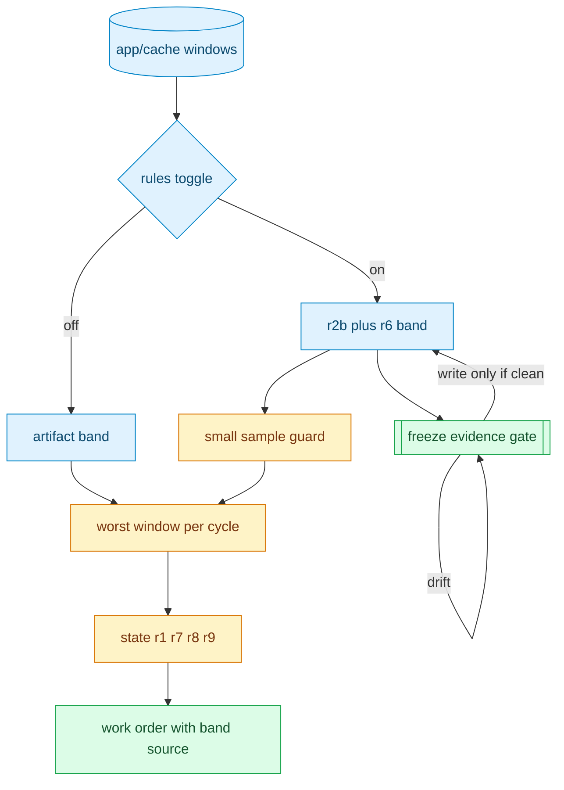

# Design: audit fixes without retraining

## Context

The band the dashboard shows comes from two different places depending on the
toggle, and three of the surfaces that read it do so through different functions
(`unit_curve`, `fleet_snapshot`, `first_alarm_cycle`). The audit's high-severity
items are all consequences of that: the numbers move because the *reader* moved,
not because the data did.

## Decisions

### D1 — The band source is declared, not silently unified

**Decision.** Each surface states which calibration governs its numbers, and
every work order records it in a `banda` field. The artifact band stays the
contract of the raw reading; the R6 band stays the band of the corrected
reading.

**Why.** `app/cache` reproduces `models/ds02_manifest.json` byte for byte, and
`test_el_tablero_sigue_entregando_las_mismas_metricas_crudas` protects that.
Replacing the raw band with the recalibrated one would silently move the frozen
contract. Declaring the source removes the ambiguity an operator actually
suffers ("why does the same unit read differently here?").

**Rejected.** (a) Applying R6 in every path — breaks the frozen contract;
(b) baking the R6 quantiles into `ensemble.joblib` — a new artifact, and the
audit's own evidence chain (`sha256` in the manifest) would stop matching.

### D2 — One aggregation criterion: the worst window of the cycle

**Decision.** State, alarm and order all read the minimum `lower` of the cycle;
the chart keeps drawing the mean and labels it as such.

**Why.** The decision is what grounds an aircraft. If the alarm used the mean
while the state used the minimum, the panel could show "hangar" at a cycle where
its own alarm had not fired yet. Using the decision statistic for both makes the
lead-time claim comparable with the decision, at the cost of an earlier alarm —
the conservative direction.

**Rejected.** (a) Mean everywhere — makes the alarm later and can contradict the
state; (b) two numbers on screen — one more thing to explain with no gain.

### D3 — A small-sample bin may only widen the band

**Decision.** In `mia.reglas.banda_recalibrada_vector`, a bin with fewer than
500 rows takes `min(q_low, global_q_low)` and `max(q_high, global_q_high)`.

**Why.** The `[75, ∞)` bin has 419 rows and `q_high = -15.3651`; with
`upper = max(point + q_high, point)` the interval collapses to one side and the
upper bound drops 19.8 cycles when a point crosses 75. Taking the more
conservative of the two quantiles restores a two-sided band and cannot reduce
coverage, so `empirical_coverage == 1.0` and the 90 % regression stay valid.

**Rejected.** (a) Merging `[75, ∞)` into `[50, 75)` — changes the calibration for
every point above 50 and forces a re-freeze plus a new evidence chain;
(b) refitting the bins in `conformal.fit_conformal` — the shipped manifest was
produced by that fit, so the artifact's provenance would stop reproducing.

### D4 — The gate refuses to write when the figures drifted

**Decision.** `failures = _compare(...)` is evaluated before `_write_frozen`, and
a drift returns `EXIT_DRIFT` with the JSON untouched.

**Why.** A gate that repairs the file it is validating turns a failed check into
a passing one on the second run. Reproduced on a temporary copy: `exit 4` and a
modified file.

### D5 — The live order is decided by the motor

**Decision.** `live_work_order` calls `mia.motor` through
`ui_rules.traza_decision` and serialises `regla_decision` and the motive.

**Why.** The badge and the downloadable document must not be produced by two
different implementations of the same policy. The download button is currently
gated on `state == AOG`, so the divergence is latent rather than active — which
is exactly why it is cheap to close now.

## Known limitations

- The raw and corrected bands still differ by up to 2.76 cycles on the lower
  side; the surface now says which one it is showing, but a single band remains
  an open product decision.
- The work order cannot prove the calibration was not edited after emission; it
  names the source file, not a hash of it.
- No new coverage measurement: D3 only widens an existing interval, and the
  documented 90 % figure is untouched.
