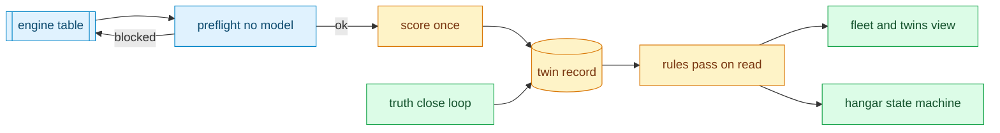

# Design: engine passport, twin registry and hangar lifecycle

## Context

The dashboard computes everything from `app/cache` and recomputes the policy on
every rerun. A unit scored from the live tab is a local variable inside one
branch of one tab: it has no identity, no history, and no way into the fleet.
The new layer separates three things that today are one: **what the model
produced** (stored), **what the policy says about it** (derived), and **what the
organisation did about it** (the hangar record).

## Decisions

### D1 — The twin is a JSON-ready dict, not a dataclass

**Decision.** `app/twin.py` builds plain dicts with lists of records.

**Why.** The same object is stored in `st.session_state`, exported as JSON and
asserted in tests without a serializer. A dataclass would add a conversion step
at every boundary and buy nothing: the shape is small and stable.

**Rejected.** A `Twin` dataclass plus `asdict()` — more ceremony, same result.

### D2 — Store the model output; derive the policy on read

**Decision.** The twin stores `(cycle, pred, lower, upper, start_row)` plus the
band source and the thresholds in force at scoring. The state is recomputed with
`mia.motor` on every render.

**Why.** Moving a threshold must be instant and must not require re-scoring; the
model output does not depend on the threshold. The one thing that must not move
is the decision that opened a hangar record, so that decision is copied into the
event with its thresholds and lower bound (D5).

**Rejected.** Storing the decision per window: it would freeze the policy at
ingest, and the first slider move would make the twin disagree with the fleet
without anyone knowing which one is current.

### D3 — Pre-flight is model-free and gates scoring

**Decision.** `ui_inference.preflight(table)` runs validation, window counting and
envelope checks only, and the dashboard refuses to call `score_table` when it
fails. The panel renders the rows, the window count and the fingerprint before
the button is pressed.

**Why.** Today a malformed CSV costs a TensorFlow load and a wait before the
error appears. In a live demonstration the failure is public and avoidable.

**Rejected.** (a) Validating after scoring and showing the error — the cost is the
problem, not the message. (b) Disabling the three submit buttons — the three
input paths (example, editor, upload) each own a form and the editor's table only
exists inside its form, so disabling would mean restructuring all three for the
same guarantee the pre-flight already gives.

### D4 — Twins are a separate table, not rows in `fleet_snapshot`

**Decision.** The fleet table keeps its integer `unit` column; twins appear in
their own table below it, with their string id.

**Why.** `fleet_snapshot` is typed on integers and consumed by charts and by the
work order. Injecting string ids would either break those consumers or force a
union type through the whole data layer for a presentation-oriented feature.

**Rejected.** Adding `unit_label` to the snapshot: the id would then be a string
in a frame whose other consumers assume numeric units.

### D5 — The hangar is a pure state machine outside `mia/`

**Decision.** `app/hangar.py` holds states, allowed transitions and the frozen
entry decision as pure functions. `mia/` keeps deciding *whether* a unit is
grounded; the hangar records *what happened next*.

**Why.** `mia/` is the audited rule engine whose figures the gate reproduces.
Operational bookkeeping in that package would put unmeasured policy next to
measured policy.

### D6 — Truth is one reported point per twin

**Decision.** A twin accepts one `{rul_real, cycle}` pair; coverage and error are
computed against the band at the nearest stored cycle, and aggregated across
twins.

**Why.** The live path has no ground truth; when a workshop reports the real RUL
it is a point, not a series. One point per twin is enough to accumulate a
coverage figure and honest enough not to pretend to a curve.

## Known limitations

- Session-only persistence: closing the tab drops the registry. Export exists,
  import does not.
- Engine ids are user-typed; two engines can share one unless the user changes
  it (duplicates are rejected, not merged).
- The hangar does not model capacity, spare parts or cost.
- Truth metrics are manual and therefore sparse; they show the method, not a
  validated accuracy.
