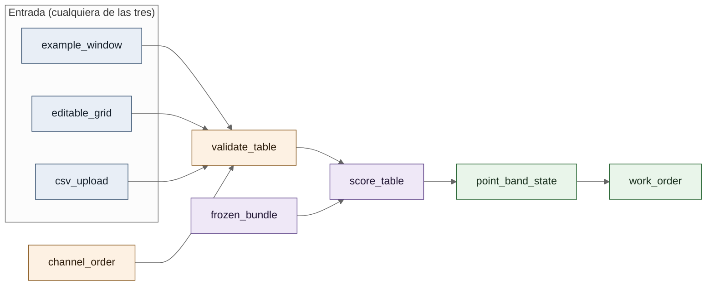

# Design: evaluate an aircraft the user brings

**Change:** `2026-10-21-ds02-live-eval`
**Status:** Implemented
**Spec:** [spec.md](spec.md) · [proposal](proposal.md)

---

## Flow

## Decision: three inputs, one pipeline

The three paths exist because they answer different moments of use:

| Path | Moment | Cost to the user |
| --- | --- | --- |
| Example | "show me what this does" — first paint, demo | zero |
| Editable grid | a few rows to fix, or a block pasted from a spreadsheet | one paste |
| CSV | a full recording exported from another tool | one upload |

They converge on `validate_table()` and then `score_table()`, so there is one
place where the contract lives and one place where the model is called. A
divergence between paths would be a bug by construction.

**Rejected alternative: a "fill in the sensors" form with 18 inputs.** A window
is 900 numbers; typing them is not a user-friendly flow, it is data entry, and
it would push users to enter one row and expect a prediction — which the model
cannot honour, since it needs 50 downsampled rows of history.

## Decision: the sampling recipe is part of the contract

The model consumes 50 rows taken every 100th recorded row (`STRIDE = 100`), not
50 one-second samples and not 50 cycles. A user who pastes 50 consecutive 1 Hz
readings gives the model a window covering about one minute of flight, and the
prediction is meaningless even though every column is numerically valid.

No validator can detect that from the numbers alone, so the UI states the recipe,
shows the example's source unit and cycles, and lets the reader check it against
the cache. This is a documentation decision made structural: the contract panel
is part of the tab, not a footnote in a README.

## Decision: scoring behind a submit button

The tab body renders on every rerun (tabs always execute), so an unguarded model
load would put TensorFlow back into startup and undo the 1.4 s cold start. The
grid lives inside `st.form`, which batches edits and only reruns on submit; the
score itself runs only after `form_submit_button` returns True. The model is held
by `@st.cache_resource`, so the first score pays the load and later ones do not.

**Rejected alternative: precompute on every render.** It would re-run the BiLSTM
on each slider move elsewhere in the app.

## Decision: the live unit gets a negative identifier

The bundle's EMA smoothing is per unit. A live evaluation uses `unit = -1.0`, a
value no DS02 unit can take, so a user's window can never be smoothed together
with a cached engine — even if the same `st.session_state` outlives several
evaluations.

## Decision: no accuracy claim for user data

There is no ground truth for a user's aircraft. The tab therefore shows the point
estimate, the band and the triage state, and states that no RMSE/MAE can be
attached to it. The conformal band is still reported because it was calibrated on
out-of-fold rows of the development engines, so it is a conservative bound for
the same representation — but not a promise about a different fleet.

## Known limitations

1. **A live window is not a diagnosis.** The model was fitted on six engines;
   a different platform or sampling rate is outside the representation, and the
   UI says so rather than hiding it behind a number.
2. **The life-length prior still applies.** Any unit living longer than ~63
   cycles inherits the under-prediction measured in
   `INFORME_p0_p1_prior_de_vida.md`; the lower bound absorbs part of it.
3. **The example is a real test window.** It is lifted from
   `app/cache/ds02_rows.parquet`, so it demonstrates the flow but is not
   independent evidence of generalisation.
4. **One window at a time.** Scoring is over the rows provided; there is no
   streaming/append loop, and history must be re-submitted to update a curve.
