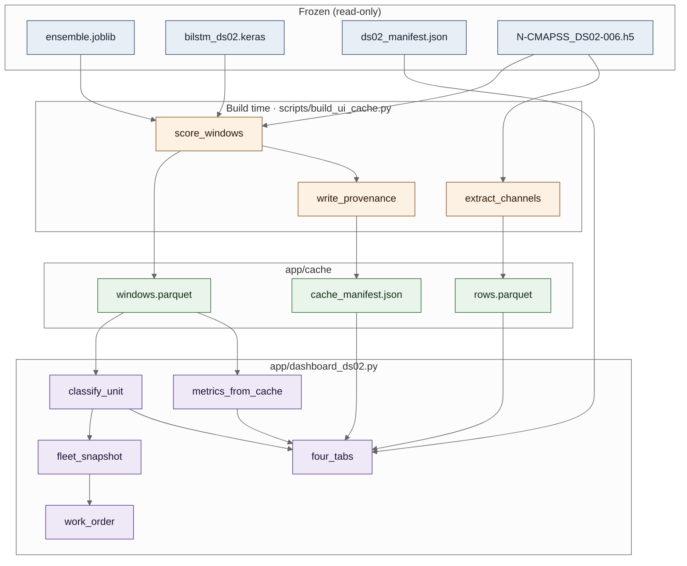

# Design: DS02 maintenance decision-support surface

**Change:** `2026-10-21-ds02-streamlit-dss`
**Status:** Implemented
**Spec:** [spec.md](spec.md) · [proposal](proposal.md)

---

## Shape of the surface

Four tabs over one cached frame, one sidebar clock.

## Decision: triage on the lower bound, thresholds re-based

The original plan classified `L_inf >= 50` as airworthy. That state is
unreachable: the band's largest lower bound on this split is ≈ 36, because the
point estimate saturates near 60.6 and the `[50, 75)` bin subtracts 24.47. A rule
whose green light can never turn on is not a decision rule, it is decoration.

The measured lower bounds at cycle 1 are 35.7 (unit 11), 33.0 (unit 14) and 35.8
(unit 15). The AOG crossing at `L_inf < 25` happens at cycles 26, 29 and 26
against true RUL < 25 at cycles 35, 52 and 43 — that is 9, 23 and 17 cycles
ahead of the truth, with true RUL of 33, 47 and 41 at the moment of grounding.
The thresholds `30 / 25` therefore sit inside the band's actual range and preserve
the property that matters: the alarm is conservative.

That conservatism is a cost, not a free win: on unit 14 the aircraft is grounded
while 47 cycles of life remain. The lead time is largest exactly on the engine
with the worst bias (−5.14), so the band pays for the model's weakest unit by
grounding it earliest. The UI prints the lead time and the true RUL at the alarm
next to the decision, so the trade-off is visible instead of hidden — and the
thresholds are adjustable in the sidebar if a fleet wants availability instead.

**Alternatives rejected:**

| Alternative | Why not |
| --- | --- |
| Keep `50 / 25`, classify on the point estimate | Abandons the risk discipline the conformal band exists for; the point estimate is the number with the +3.03 / −5.19 bias. |
| Recalibrate the band so `L_inf` reaches 50 | Would require refitting the conformal quantiles — a model change, forbidden here, and it would narrow the band on the test set. |
| Third state as a fraction of predicted RUL | Depends on the biased point estimate; a unit biased low would turn amber for the wrong reason. |

The thresholds are exposed as controls, so a defender can show the trade-off live
rather than defend one number. Recorded in
[ADR-008](../../../docs/decisions/ADR-008-conformal-lower-bound-triage.md).

## Decision: metrics are recomputed, the manifest is quoted

Two metric families exist in this repository and they do not agree exactly:

| Source | unit 11 | unit 14 | unit 15 |
| --- | --- | --- | --- |
| `docs/informes/informe-2026-10-20-ejecucion-cuaderno.md` (notebook, seed 42) | 3.724 | 8.044 | 2.882 |
| `ds02_manifest.json` (`macro_rmse.per_unit_rmse`) | 3.7728 | 8.175 | 2.760`*` |
| `app/cache` (live, from the shipped bundle) | recomputed each build | recomputed | recomputed |

Any hardcoded table would be a third claim about the same rows. Instead the UI
computes everything from the cache it is drawing, and shows the manifest in a
separate, labelled card. When the two disagree, the disagreement is visible and
attributable to regeneration drift — which is information, not noise.

`*` The manifest values are the frozen run's; the UI does not assert them.

## Decision: cache in `app/cache/`, not `models/`

`models/` is immutable by repository rule and by the plan's own golden rule. The
cache is a UI artefact: it lives with the UI, is regenerable
(`python scripts/build_ui_cache.py`), and carries its own provenance file so a
reader can tell which bundle produced it.

The cache is Parquet, not CSV: 6 196 windows and 12 538 telemetry rows round-trip
in milliseconds and keep their dtypes. Total size is about 2 MB (202 KB of
windows, 1.9 MB of telemetry), so it can be committed and the presentation laptop
needs no HDF5.

## Decision: no TensorFlow at render time

`app/ui_data_loader.py` imports pandas and streamlit only. Importing the bundle
pulls in Keras and TensorFlow (~8 s and ~500 MB resident here). The UI never
needs the graph: the scored windows are already in the cache. This is what makes
the app usable in a lecture room and what makes the headless render test fast.

`scripts/build_ui_cache.py` is the only place that imports the ensemble, and it
runs once, offline.

## Decision: theme in config, tokens shared with Plotly

The look is a locked dark "mission control" surface configured in
`.streamlit/config.toml`: base, accent, fonts (Inter + Space Grotesk),
radii, padding, dataframe chrome and both 10-color chart palettes. No CSS is
injected — native theming survives Streamlit upgrades and covers widgets, tables
and the sidebar at once.

Plotly does not read the theme's palette, so the figures receive the same tokens
as an explicit layout (`INK`, `MUTED`, `GRID`, `SURFACE`, `STATE_COLORS`) and
`theme=None`, which keeps the chart surface transparent over the card instead of
fighting Streamlit's own styling. The state colors are the only semantic palette:
green/amber/red for airworthy/preventive/AOG, gray for no data — the same colors
in the badge, the table rows, the timeline and the alarm marker.

**Alternatives rejected:** CSS overrides for cards and colors (forbidden by the
project's Streamlit guidance, brittle across releases); a light theme (the demo
is projected in a dark room and the calibrated band reads better on navy); Plotly's
`theme="streamlit"` alone (it does not carry the semantic state colors).

## Performance measured, not assumed

Importing the bundle costs ~8 s and ~500 MB; the cache path costs 1.4 s for the
first run and 0.24 s for a full rerun after moving the slider. That is why the
tabs do not need fragments or `st.skeleton`: six Plotly figures over ~200 points
are cheaper than the machinery to defer them. If the cache ever grows past a few
tens of thousands of rows, the fix is a fragment per tab, not a lighter model.

## Aggregation: windows for metrics, cycles for the eye

Metrics are computed at the scored-window level, because that is the level the
manifest and the reports use; mixing levels would produce numbers nobody can
cross-check. Curves are aggregated per cycle (mean of the windows ending on that
cycle) because a chart with 56 points per cycle is unreadable and the slider is
expressed in cycles.

Ground truth is one value per cycle, so it reindexes cleanly onto that grid.

## Known limitations

1. **The band is conservative.** Realised cycle-level coverage is 1.000 on all
   three engines against a 0.90 target. It is a safety bound, not a sharp
   interval, and the UI says so.
2. **Six engines inform the band's width.** Per-bin quantiles on a dev split of
   six engines cannot be precise; the `[75, ∞)` bin's upper quantile is negative,
   so that bin's band is one-sided.
3. **Unit 14's density is real but not causal.** 20.6 rows/cycle against ≈ 112
   for the fit engines is a measurement; the P0 control showed it does not move
   the bias, and the panel reports both.
4. **The slider compares absolute cycles across engines with different lives.**
   That is the operationally meaningful comparison (a fleet flies the same
   calendar), but unit 11 stops at 59 and is clamped, not extrapolated.
