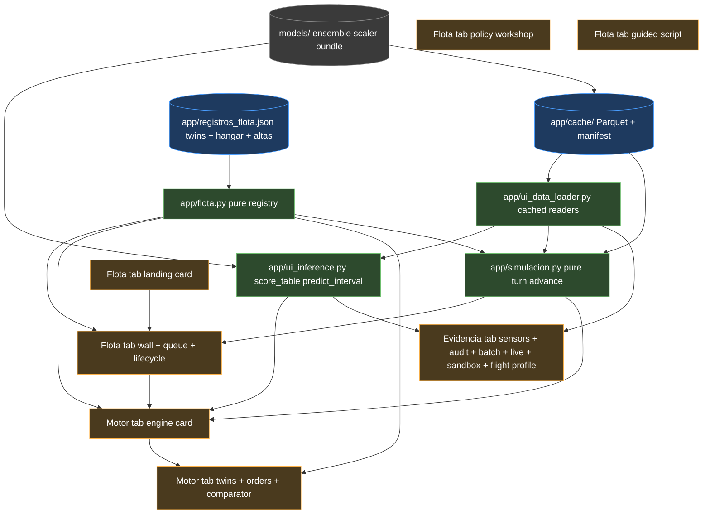

# Design: DS02 task-first UX (Streamlit)

**Change:** `2026-10-24-ds02-task-first-ux`
**Status:** Proposed
**Capability:** `ds02-dss-ui`

---

## 1. Technical Approach

The redesign keeps the inference, the cache and the frozen model untouched and
changes only how the surface is organised, named and advanced. It is delivered
in six commits, each with its own verification gate:

1. **Identity** — `app/flota.py` becomes the single source of engine names.
2. **Simulator** — `app/simulacion.py` advances the shared clock and gates by
   state, reading the cache.
3. **Entry** — a landing card, a demo seed and a guided script.
4. **Information architecture** — three task tabs (Flota, Motor, Evidencia).
5. **Noise** — metric relocation and the duplicate template.
6. **Verification** — suite, guards and the jury walkthrough.

The design deliberately reuses existing code (`hangar.py`, `twin.py`,
`ui_alta.py`, `ui_rules.py`, `ui_inference.py`) rather than rewriting it: each
old tab becomes a section of a new tab, moved and re-keyed.

**Streamlit minimisation.** The repository already separates pure modules from
the view: `twin.py` (262 lines), `hangar.py` (161), `ui_alta.py` (147),
`ui_rules.py` (165) and `ui_batch.py` (166) import no Streamlit, and the two
loaders carry exactly one `st.*` call each, for caching. Measured today: 34 pure
functions across the loaders, and in `app/dashboard_ds02.py` only 4 of 12
module-level functions are pure (three Plotly helpers and `_etiqueta_unidad`).
So the coupling is already concentrated in the view, which is where it belongs.
**This change adds logic only to pure modules**: `app/flota.py` and
`app/simulacion.py` import no Streamlit, so the turn-advance loop is testable
without a server and the dashboard only renders it. That is the difference
between twenty tests and two.

## 2. Architecture



accTitle: DS02 task-first UX architecture
accDescr: Frozen model and cache feed the pure inference layer; the cache feeds the new pure simulator; the new motor registry feeds all four views; three task tabs (Flota, Motor, Evidencia) consume them. No new runtime dependencies and no writes to models or cache.

### 2.1 The registry layer (`app/flota.py`)

A pure module with no Streamlit import, following the existing convention of
`twin.py`, `hangar.py` and `ui_alta.py`. It is the only writer of the `altas`
key in `app/registros_flota.json`.

| Function | Signature | Purpose |
| --- | --- | --- |
| `etiqueta` | `(clave, registro=None) -> str` | Human label for a key; cache keys delegate to `L.UNIT_LABELS`. |
| `clave_de` | `(unidad_float, registro=None) -> str` | Float unit to registry key; degrades to `f"U{int(u)}"`. |
| `unidad_de` | `(clave, registro=None) -> float` | Registry key to float unit. |
| `normalizar_matricula` | `(texto) -> str` | Reuses `T.normalizar_id`; raises `ValueError` below 3 chars. |
| `registrar_alta` | `(registro, matricula, unidad_cache, ciclo) -> registro` | Adds an alta with a fresh, never-reused id and creates its twin. |
| `quitar_alta` | `(registro, matricula) -> registro` | Removes an alta; ids are not recycled. |
| `serializar` / `cargar` | `(registro) / (ruta) -> dict` | JSON persistence. |

The id counter is `max(existing alta ids) + 1` with prefix `-1000`, so removing
and re-adding an alta cannot collide. `registrar_alta` calls `ventanas_de_alta`
and `T.make_twin` so the alta appears in "Gemelos registrados" with a saved
series; it does not call the model.

### 2.2 The simulator (`app/simulacion.py`)

Pure, no Streamlit, reads the cache. Four functions:

| Function | Purpose |
| --- | --- |
| `avanzar(frame, retenidos, n)` | Advance `n` cycles for every engine not in `retenidos`. |
| `retenidos_por_umbral(frame, umbrales)` | Engines whose `L_inf` has crossed the AOG threshold. |
| `ciclos_hasta_fallo(frame, umbrales)` | Cycles until `L_inf` crosses, per engine, read from the cache. |
| `reiniciar_vida(registro, clave)` | Replay the recorded life from the first scored cycle. |

The fleet clock stays a single value in `session_state` (`cycle`,
`app/dashboard_ds02.py:942`). Engines carry a **held mark**, not a clock of their
own: the clock advances once and each engine decides whether it advances with it.

### 2.3 Tab layout

```
Flota
  - landing card (decision rule, fleet state, primary action)
  - advance control (N cycles, gates held engines)
  - guided script (4 steps, then release)
  - wall (cards keyed by registry key)
  - maintenance queue (AOG filter on the register)
  - fleet lifecycle register (all engines, state column)
  - policy workshop (what-if thresholds)

Motor
  - engine card: gauge, trajectory + conformal band, decision + rule trace,
    sensor radiography summary, lifecycle record, saved twin series
  - registered twins
  - work orders
  - comparator (overlay trajectories)

Evidencia
  - sensors (radiography, grouped selector)
  - audit (engine 14 honesty panel)
  - batch / live evaluation
  - stress sandbox
  - flight profile (alt vs Mach, both real channels)
  - provenance and contract (SHAs, frozen manifest, step density note)
```

The "El taller" policy workshop moves into Flota because it is a decision aid,
not evidence. The stress sandbox and the batch scorer move into Evidencia
because they are exploration tools, not the daily triage surface.

### 2.4 Navigation

A wall card click resolves the engine through `flota.clave_de(unit)` and sets the
selected key in session state, then switches to the Motor tab with that key.
Because the key is now stable, the selection survives a reload for persisted
engines (cache and alta) and degrades gracefully for a session twin.

## 3. Architecture Decisions

### D1 — Registry as a layer above `frame["unit"]`, not a rename

**Choice**: `frame["unit"]` stays a float; the registry is a naming layer on top.
**Alternatives considered**: renaming `unit` to a string id, which would touch
every groupby and break the cached parquet contract.
**Rationale**: the causal EMA, the grouping and `unit_curve` all depend on the
float. A naming layer changes no computation and degrades gracefully
(`clave_de` falls back to `f"U{int(u)}"`).

### D2 — Matricula as the alta key, not a synthetic id

**Choice**: the normalised matricula is the alta's registry key.
**Alternatives considered**: a generated synthetic id, rejected in the Hermes
plan R6 because it adds something to remember.
**Rationale**: the operator recognises the matricula; it is what the hangar must
show. It is unique by construction once normalised.

### D3 — Extend `hangar.py`, do not add a parallel `estado_operativo`

**Choice**: the existing five-state machine
(`EN_SERVICIO → INSPECCION | AOG → TALLER → BANCO → EN_SERVICIO`) gains a reset
transition. Engines carry a held mark, not a lifecycle state of their own.
**Alternatives considered**: a parallel `estado_operativo` with four values
(`volando`, `aog_pendiente`, `en_taller`, `reparado`).
**Rationale**: two state machines for the same engine can disagree, and then the
app says two different things about one motor. `hangar.py` already answers "what
happened to it afterwards"; the held mark answers only "is it allowed to
advance".

### D4 — Advance the shared clock, do not give each engine a clock

**Choice**: one fleet clock advances; held engines skip the advance.
**Alternatives considered**: a per-engine clock (`ciclo_actual` in the registry).
**Rationale**: `docs/plans/plan-gemelo-digital-hangar.md` §7 R5 already rejected
a per-engine slider: the shared clock is deliberate, it is what the work orders
and `hangar.py` use, and it clamps short units instead of extrapolating them.

### D5 — Read the cache, do not re-score

**Choice**: the simulator reads `pred`, `lower` and `upper` from `app/cache/`.
Zero model calls.
**Alternatives considered**: re-scoring the corresponding window with the frozen
bundle on every turn.
**Rationale**: measured. Scoring U14's last window in isolation gives
`pred = 0,6692` while the cache holds `0,8654` — a 0,1963 cycle difference. The
point estimate is EMA-smoothed causally (`ensemble.py:158`,
`causal_ema_by_unit(..., span=5)`), so an isolated window starts the EMA cold;
and the cache is built at `step=2` while live scoring uses `step=1`. Re-scoring
would make the wall and the twin disagree about the same engine, which is the
traceability this project sells. It also costs a TensorFlow load per turn.

### D6 — The reset is a replay, not a repair

**Choice**: the reset returns the engine to the first scored cycle and the
interface labels it as replaying the recorded life.
**Alternatives considered**: labelling it "repaired" and returning to service.
**Rationale**: the cache holds the same degradation data for cycles 1…N. A
"repaired" engine that fails at exactly the same cycle is a replay, and a
technical jury sees it in two seconds. Honesty is the project's main asset (G7).

### D7 — Three task tabs, not five internal-layer tabs

**Choice**: Flota, Motor, Evidencia.
**Alternatives considered**: keeping five tabs and adding a landing screen,
which fixes the first ten seconds but leaves the operator navigating a museum of
model layers; and a demo/operation mode switch, which adds a decision the user
must make when the problem is already "I do not understand what this does".
**Rationale**: each tab answers one question, and the five old tabs were
descriptions of the model's layers, not of the operator's tasks.

### D8 — SHA demoted to provenance

**Choice**: both SHAs live in a "Provenance and contract" expander.
**Alternatives considered**: using the SHA as the engine name.
**Rationale**: measured — the same engine in two windows gives two SHAs, and two
engines with identical data give the same SHA. It is a window fingerprint.

### D9 — No geographic map; Flight Profile instead

**Choice**: an `alt` vs `Mach` chart in Evidencia.
**Alternatives considered**: an interactive geographic map.
**Rationale**: measured — the dataset's 18 channels are `alt, Mach, TRA, T2`
plus fourteen sensors; there is no latitude, longitude or position channel. A map
would invent routes and break the honest-protocol premise. `alt` and `Mach` are
real channels, so the Flight Profile is honest and cheap.

### D10 — Progressive disclosure inside Evidencia

**Choice**: one `st.expander` per subsection.
**Alternatives considered**: hiding advanced content behind a toggle that
persists.
**Rationale**: simpler, needs no state, and matches the existing pattern
(`st.expander` is already used 12 times).

## 4. Known Limitations

1. **Cache density.** The cache is built with `step=2` and live scoring uses
   `step=1`. They will not match bit-for-bit. Documented, not reconciled.
2. **Widget counts.** Phase 4 moves a large amount of code; several
   `test_ux_round3` / `test_dss_ui` count assertions will move. They are
   updated in the same commit with an explicit list.
3. **The demo seed fires in every test.** `tests/conftest.py:24` deletes
   `app/registros_flota.json` before each test, so the registry is empty in
   every test and the seed runs in every test. Seven files read the widget tree
   and are in scope.
4. **No multivariate OOD guard.** The sandbox still exposes a single T48
   slider. A combination that is channel-wise in range but physically
   impossible is not flagged. Out of scope.
5. **No edit on the engine card.** The card is read-only; annotating a twin is
   an open question, not part of this change.
6. **The wall does not scale to large fleets.** Measured: 50 altas produce 53
   cards and 17 rows. Mitigation: the wall orders by state (reds first) and the
   rest lives in the register table.

## 5. File Plan

| Phase | Files | Notes |
| --- | --- | --- |
| 0 | `app/flota.py` (new), `app/ui_alta.py`, `app/twin.py`, `app/dashboard_ds02.py`, `tests/test_flota.py` (new), `tests/test_ui_alta.py` | Registry, persistence, non-reusing ids, twin creation, the three missing tests. |
| 1 | `app/simulacion.py` (new), `app/hangar.py`, `tests/test_simulacion.py` (new) | Turn advance, held engines, replay, cache-only. |
| 2 | `app/dashboard_ds02.py`, `docker-compose.yml`, `tests/test_ux_round3.py` | Landing, seed, script, entrypoint fix, toast fix. |
| 3 | `app/dashboard_ds02.py`, `tests/test_dss_ui.py`, `tests/test_ui_rules.py`, `tests/test_dss_interaction.py` | Three tabs, re-keyed navigation, metric relocation. |
| 4 | `app/dashboard_ds02.py`, `app/ui_data_loader.py`, `tests/test_live_eval.py` | Metric relocation, SHA provenance, duplicate template. |
| 5 | none | Verification only. |

No file under `models/`, `src/ds02_rul/`, `mia/`, `app/cache/` or
`app/dashboard.py` is modified.

## 6. Test Impact

- New: `tests/test_flota.py`, `tests/test_simulacion.py`.
- New in Phase 0 (the three missing today):
  - alta with free unit+cycle enters the fleet and creates a twin;
  - alta with a cycle that has no scored windows shows an error and does not
    crash;
  - the downloaded template is the one the validator accepts.
- Updated in the same commit, with reason stated:
  - `tests/test_dss_ui.py:252-256` (tab count 5 -> 3, labels).
  - `tests/test_ui_rules.py:109, 197` (tab count).
  - `tests/test_dss_interaction.py:211` ("El taller" label; workshop moves to Flota).
  - `tests/test_ui_alta.py:43-70` (source of `unit_id`).
  - Widget-count tests in the seven files in scope for the seed.
- Unchanged (guards): `test_airworthy_state_is_reachable_on_this_band`,
  `test_metrics_are_recomputed_from_the_cache`,
  `test_reading_the_ui_leaves_the_frozen_artifacts_untouched`,
  `test_app_renders_headless_without_exception`,
  `test_every_chart_and_grid_has_an_accessible_name`,
  `test_no_css_is_injected_into_the_app`,
  `test_the_cycle_slider_drives_the_grounded_kpi`.

## 7. Open Questions

1. Should the guided script restore the initial state when it finishes?
2. Is the engine card read-only, or may the jury annotate a note on the twin?
3. Does the new Motor tab replace the RUL tab or coexist? (Design assumes
   coexistence.)
