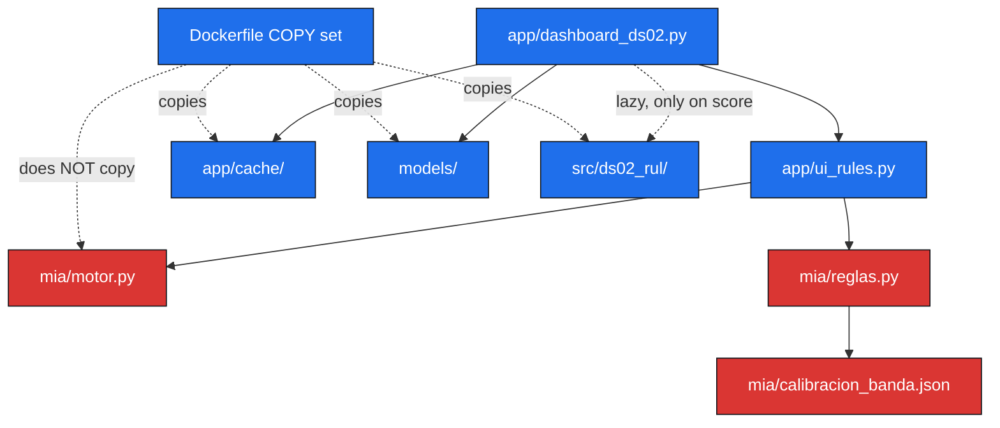
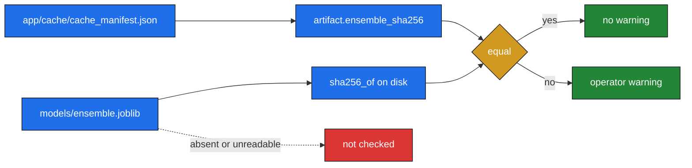

# Design: DS02 pre-defense hardening

**Change:** `2026-10-26-ds02-pre-defense-hardening`
**Status:** Proposed
**Capabilities:** `ds02-dss-ui`, `ds02-live-evaluation`

---

## 1. What breaks, and where

Four defects, one diagram each. Every claim below was measured on 2026-10-26; the
command is in the task that carries it.

### 1.1 The image is missing a directory the entrypoint imports



The build succeeds because `mia/` is only needed at import time, not at build
time. That is why a green `docker compose build` is not evidence.

### 1.2 The reported window is a row position, not the deciding window

`vista_resultado` selects the deciding window on `app/twin.py:133` and then
reports `len(frame) - 1` on line 137. The two expressions coincide only when the
deciding window happens to be the last row of the series.

For a twin built from cached windows (`step=2`) the last cycle holds many
windows, so the expressions diverge. Measured:

```
U11 ciclo 22 · 1219 rows in the series · 44 windows in the last cycle
  reported 1218   deciding position 1177   start_row 2354   2354 // 2 = 1177
U14 ciclo 29 · 286 rows · 10 windows in the last cycle
  reported 285    deciding position 285
```

`start_row // step` reproduces the deciding position exactly in both cases, which
confirms the position within the saved series is the value that identifies the
window.

### 1.3 An infinite value is a valid input

`validate_table` (`app/ui_inference.py:318-340`) coerces every required column to
numeric and then rejects `isna()`. `isna()` is false for `±inf`, so both pass.
Verified:

```
validate_table ACEPTA +inf
validate_table ACEPTA -inf
```

The consequence is not a wrong number for one window. The causal EMA is a
recurrence over the unit's windows (`smoothing.py:36`), so a single `inf` in the
input contaminates the point estimate of every later window of that unit, and the
UI paints it as finite.

### 1.4 The seal is displayed but never checked



## 2. Decisions and the alternatives rejected

### D1 — Ship `mia/` by copying it into the image

**Decision.** Add `COPY mia/ ./mia/` to `Dockerfile`. Nothing else changes.

**Alternatives rejected.**

- *Make `mia/` an installable package* (move it under `src/` and add it to
  `[tool.setuptools.packages.find]`). This is the structurally better fix and it
  removes the `sys.path.insert` in `app/ui_rules.py:31`. Rejected for this change:
  it moves a directory the rules layer's own docstring calls a standalone
  post-processing package, it changes the import mechanism every module relies
  on, and it needs a re-run of the whole suite for a one-line deployment fix. It
  is recorded as debt.
- *Install `mia/` with a `pip install ./mia` step.* Requires a `pyproject.toml`
  inside `mia/`; same objection, more files.

**Evidence.** The built tree without `mia/` raises
`ModuleNotFoundError: No module named 'motor'` at `app/ui_rules.py:33`; the same
tree with `mia/` copied imports the dashboard cleanly.

### D2 — Report the position within the saved series

**Decision.** `vista_resultado` returns the index label of the deciding row of
the frame it builds from `twin["serie"]` (`peor.name`), and the point of use says
the number is a position in the saved series.

**Alternatives rejected.**

- *Store the dataset window index in the twin.* `make_twin` would have to compute
  it at creation time from the source's `step`, which the twin does not carry.
  Rejected: it changes the persisted twin schema, so every twin already saved in
  `app/registros_flota.json` would need a migration, and the value would still be
  a dataset index that means nothing for a live-evaluation twin.
- *Keep `len(frame) - 1` and only fix the label.* Rejected: the number would then
  be honest about being wrong, which is worse than fixing it.
- *Return the `start_row` instead.* Rejected: `start_row` is a row offset into the
  unit's telemetry, not a window identifier, and it is already carried separately
  by the same record.

**Evidence.** `start_row // step` equals the deciding position in both measured
cases (2354 // 2 = 1177; U14's last row is the deciding one, so both expressions
agree at 285). The value is well defined for every origin because
`twin["serie"]` is a plain list of window records.

### D3 — Reject non-finite values in the validator

**Decision.** Add an infinity check to the same loop that already rejects NaN,
naming the column and the row.

**Alternatives rejected.**

- *Report it as a plausibility warning, non-blocking.* The surface already has a
  non-blocking out-of-domain note (`ui_inference.plausibility_warnings`), and an
  argument could be made for symmetry. Rejected: that note is for finite values
  outside the training range, which the model can consume. An `inf` is not
  consumable — it propagates through the EMA to every later window — and the
  existing validator already rejects NaN in the same pass. Two different
  severities for the same kind of broken cell would be the confusing outcome.
- *Let `preflight` catch it.* `preflight` calls `validate_table` and returns its
  error, so a rejection in the validator is already visible before the model
  loads. Adding a second check in `preflight` would be a second validator.

**Evidence.** `validate_table` accepts `+inf` and `-inf` today; the message
format is the one already used for NaN at `app/ui_inference.py:336-339`.

### D4 — Warn only on mismatch, in the sidebar

**Decision.** A pure helper in `app/ui_data_loader.py` compares the recorded hash
with the on-disk hash and returns a dict; the surface paints a warning in the
sidebar only when the check ran and the two differ. Any unreadable input returns
"not checked" instead of raising.

**Alternatives rejected.**

- *Raise on mismatch.* Rejected: a stale cache is not a reason to deny the
  surface. The figures are still real predictions of a real bundle; the operator
  needs to know the seal does not match, not to be locked out.
- *Put the warning in the audit/provenance expander.* Rejected: the expander is
  progressive disclosure, and a provenance mismatch is the one thing that must
  not be hidden behind a click.
- *Verify the hash inside `scripts/build_ui_cache.py` only.* Rejected: that
  catches a bad build, not a bundle replaced after the cache was built. The
  failure this closes happens at render time.
- *Hash the Parquet files too.* Rejected for this change: the cache manifest
  records only the artifact hash, so a Parquet check would have nothing to
  compare against without extending the manifest schema.

**Evidence.** `app/cache/cache_manifest.json:35` records
`ensemble_sha256`; `app/dashboard_ds02.py` displays it at lines 596, 737, 994 and
2540 and never compares it. The helper stays in `ui_data_loader` so the module
keeps importing only pandas, streamlit and the standard library — no TensorFlow.

## 3. Known limitations and the evidence behind each

1. **The image is still not built in this environment.** The Dockerfile fix is
   verified against a copy of the tree the Dockerfile produces, not against a
   real `docker build`. Evidence: the import chain fails and succeeds exactly as
   the COPY set predicts. A real build is the remaining step and it needs Docker
   on the machine.
2. **The hash check cannot detect a cache rebuilt from a different bundle whose
   hash was also rewritten into the manifest.** It compares the manifest against
   the artifact, so a manifest edited to match a new bundle passes. Detecting
   that needs the cache builder to sign its own output, which is out of scope.
3. **The window fix does not recover the dataset window index for twins saved
   before the change.** Those twins keep a position in their own series, which is
   what the fix reports; the label says so. No persisted data is rewritten.
4. **The stride wording fix touches the defense document, not the model.** The
   README already stated the correct number (`README.md`, final limitation); the
   defense document contradicted it. The fix aligns the document to the README,
   and the README is not changed.
5. **The deployed `ds02-dss-ui` spec still says five tabs.** Corrected in this
   change's MODIFIED block. The repository has no `openspec/changes/archive/`
   directory and no OpenSpec CLI, so the deployed spec is merged by hand at
   archive time; until then the delta is the record.

## 4. What this change must not do

- No file under `models/`, `src/ds02_rul/`, `app/cache/` or
  `02_DS02_ensemble_RUL.ipynb` is modified, and no weight is retrained.
- No rule, threshold or calibration in `mia/` is modified; `mia/` is only copied
  into the image.
- No metric shown on any screen changes value. The triage state, the band and
  the NASA score are untouched.
- No widget is added to the green path, so no widget-count assertion moves.
