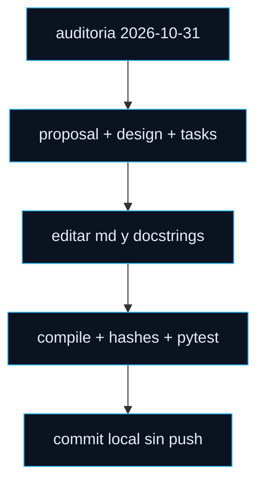

# Design: sincronización documental bundle B

## Decisiones

1. **Una fila vigente, resto histórico.** El README conserva las tres revisiones
   (son la evidencia del no-determinismo TF) pero cada tabla lleva su etiqueta de
   revisión y una sola fila dice "vigente (lo que sirve `models/` + `app/cache/`)".
   Alternativa rechazada: borrar las tablas viejas (destruiría la trazabilidad de
   4.301 → 4.344 → 4.251).
2. **Ningún `.ipynb` se edita.** El cartel de legado del notebook FD001 vive en
   el README y en este change, no en el JSON del notebook (convención: los
   `.ipynb` son salida de `scripts/build_*.py`).
3. **Docstrings, no código.** `metrics.py` y `dashboard.py` solo cambian
   comentarios/docstring; la suite los cubre igual que antes.
4. **Commit local, sin push.** Convención de `AGENT.md` (vigente en su apartado
   de convenciones, que se conserva).

## Diagrama

## Limitaciones conocidas

- `docker build` no verificable aquí (sin daemon); queda registrado, no fingido.
- Los conteos de celdas antiguos en specs (`17 cells`) no se tocan: fuera de las
  8 incidencias, no se expande alcance.
