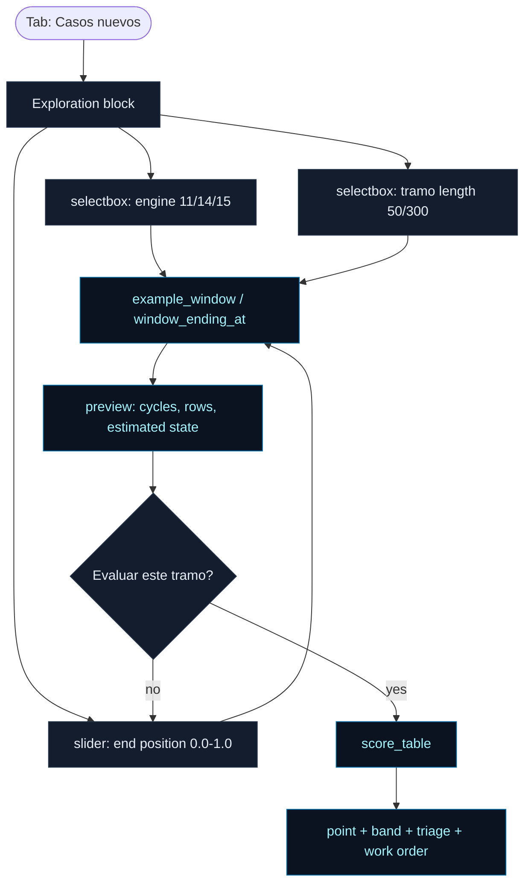

# Design: interactive "explore by cycle"

**Change:** `2026-10-31-ds02-explorar-por-ciclo`

## Approach

Add a self-contained block inside the live-evaluation tab. It reuses existing
helpers (`example_window`, `window_ending_at`, `score_table`, `DEMO_ROWS`,
`channel_order`) and keeps the slider tick to a cheap Parquet read. Scoring
happens only on an explicit button, storing the result in `session_state`.

## Flow

## Decisions

- **Control type**: `st.slider` for position (continuous, familiar) plus an
  optional length selectbox. Alternative (number input for end cycle) rejected:
  less visual, worse for demos.
- **Scoring trigger**: explicit button. Alternative (score on tick) rejected:
  2-3 s per tick makes the slider unusable and risks a first-tick TF import.
- **State display**: computed, not promised. Alternative (label positions as
  Sano/Medio/Crítico) rejected: a mismatch would break demo credibility.
- **Placement**: after presets, before the editable-grid path. Alternative
  (separate tab) rejected: fragments the live-eval flow.

## Affected areas

| Area | Impact | Description |
|------|--------|-------------|
| `app/dashboard_ds02.py` | Modified | new exploration block |
| `tests/test_live_eval.py` | Modified | 2-3 new AppTest cases |

## Limitations

- The preview state is an estimate over the generated tramo; it is not a
  second model call.
- `window_ending_at` reads the cached Parquet; if the cache is stale the
  preview is stale (covered by the existing artifact-hash check).
- No new module is introduced, so no shadowing risk with `mia/`.
