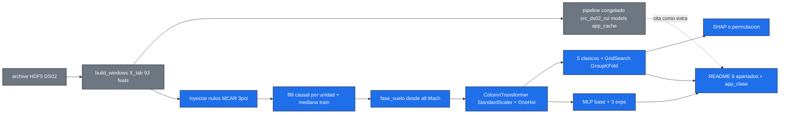

# Design: Track de clase DS02

**Change:** `2026-11-02-clase-track`
**Status:** Proposed
**Capacidad:** `clase-track` (nueva)

---

## 1. Mapa del cambio

## 2. Decisiones

### D1 — `clase/` separado, congelado intocable
Todo lo nuevo vive en `clase/`, `notebooks/01|02|03`, `data/processed/`, `resultados/`. `src/ds02_rul/`, `models/`, `mia/` (lógica), `app/cache/` solo lectura. Alternativa rechazada: meter los clásicos en `src/ds02_rul/` — contaminaría el contrato del artefacto y obligaría a re-verificar `freeze_rules_evidence`.

### D2 — Nulos MAR ~2% solo en T30 en crucero alto, auditados
`inyectar_nulos_mar(sensor=T30, alt>27k, Mach>0.68, tasa_elegible=0.10 ~= 2.1% global, seed=7)`: dropout de sonda por altitud (el 30k/0.8 teórico no existe en DS02: Mach máx 0.74, 0 elegibles). Mask guardada, auditoría con tasa global/en elegibles, 100% en crucero alto, rachas por unidad y conteo >3 seguidos (R1). Test de robustez AC 20-170 en Fase 2 (degradación <5% RMSE). Alternativas rechazadas: MCAR 3% en 14 sensores (rompe demasiadas ventanas del BiLSTM, relato débil); `SimpleImputer(mean)` global (rompe causalidad); `dropna` (sesga).

### D3 — Imputación ffill causal + mediana de train
`sort(cycle) → groupby(unit).ffill() → fillna(mediana_train)`. La mediana se calcula SOLO en train. Justificación negocio: "último valor conocido del motor". Test: ningún estadístico de test entra en train.

### D4 — `fase_vuelo` solo de régimen
`alt<10k Ascenso; alt>30k y 0.7<Mach<0.85 Crucero; resto Descenso (+ caída >2000ft en 3 ciclos → Descenso)`. No usa sensores ni RUL. Ablación con/sin en la tabla; si no aporta se declara y se deja fuera del mejor modelo (también puntúa SAA 5).

### D5 — Split por unidad, GroupKFold
Train/test por `unit` (no aleatorio por ventana: fugaría). `GroupKFold(3, groups=unit)` en GridSearch. Alternativa rechazada: `KFold` aleatorio — ventanas del mismo motor en train y val inflan R².

### D6 — Grids mínimos + tiempos
Ridge/KNN/RF/XGB/SVR con 2-3 valores por hiperparámetro (ver tasks). SVM sobre submuestra estratificada por unidad si >10min. La tabla pide tiempo por modelo aunque sea alto.

### D7 — MLP con hipótesis, no barrido ciego
Base `(128,64), alpha=1e-3, lr=1e-3, early_stopping` + E1 capacidad / E2 reg-lr / E3 batch. Cada experimento lleva hipótesis falsable en el notebook.

### D8 — SHAP con fallback
`shap` sobre 200 filas preprocesadas; si no corre, `permutation_importance` + bar-plot. Ambos responden "qué variables pesan más" (SAA 9-técnico).

### D9 — README y app reutilizan, no duplican
README sigue `README_ejemplo_CV.md` (6 apartados + Mermaid + €). App clase importa `validate_table`, `observed_envelope`, `mia/motor` — no reimplementa validación ni reglas. Sin `POST` a n8n en este change (techo PIA 5 = 7, declarado).

## 3. Lo que este change NO hace

- Sin `mlruns/`, sin `MLFLOW_TRACKING_URI`, sin capturas MLflow (techo formal SAA 9 = 7, PIA 4 = 0).
- Sin webhook n8n real (techo PIA 5 = 7, MIA 3 = 0). `flujo.json` placeholder + `src/n8n.py` stub.
- Sin SMOTE (regresión; se declara).
- Sin tocar `Dockerfile`, `docker-compose.yml`, `pyproject.toml` (requirements ya correcto).

## 4. Limitaciones conocidas

1. La inyección es simulada: el 10 de SAA 5 depende de criterio humano (ver proposal Riesgo 1).
2. `fase_vuelo` es redundante con `alt`/`Mach` numéricos; su valor es pedagógico + permite el `OneHot` que exige PIA 3.
3. Los clásicos corren sobre `X_tab` agregada (93 feats), no sobre secuencias: no compiten con el híbrido en RMSE absoluto y no deben compararse ventana a ventana con él.

### D10 — Bundle C: la adaptada entra por arriba del pipeline honesto
La base MAR-imputada se re-imputa con medianas SOLO de fit-units y se ventanea con `fit_preprocessing`/`build_windows` sin cambios (contrato 93 intacto, sin `fase_vuelo`). Alternativa rechazada: construir C sobre el parquet de clase tal cual — hereda medianas de dev-completo (fuga vs holdout 16) y rompe la comparabilidad con B.

### D11 — Versionado y puerta de adopción de bundle C
C vive en `clase/models/` con manifest propio (nunca en `models/`). Puerta pre-registrada: adoptar (re-freeze caché + banda + reglas + ADR) solo si `RMSE_C ≤ 4.25 − spread-seeds` Y `NASA_C ≤ NASA_B` en las mismas 6.196 ventanas test, 3 seeds (42/7/123). Si no, C queda como experimento y B sigue en producción.

### D12 — Dos tablas, dos granos, sin ranking mixto
Tabla SAA (grano fila: 5 + MLP, mismo dataset) y tabla producción (grano ventana: B vs C). Comparar RMSE fila vs ventana en un ranking único queda prohibido en los notebooks.
