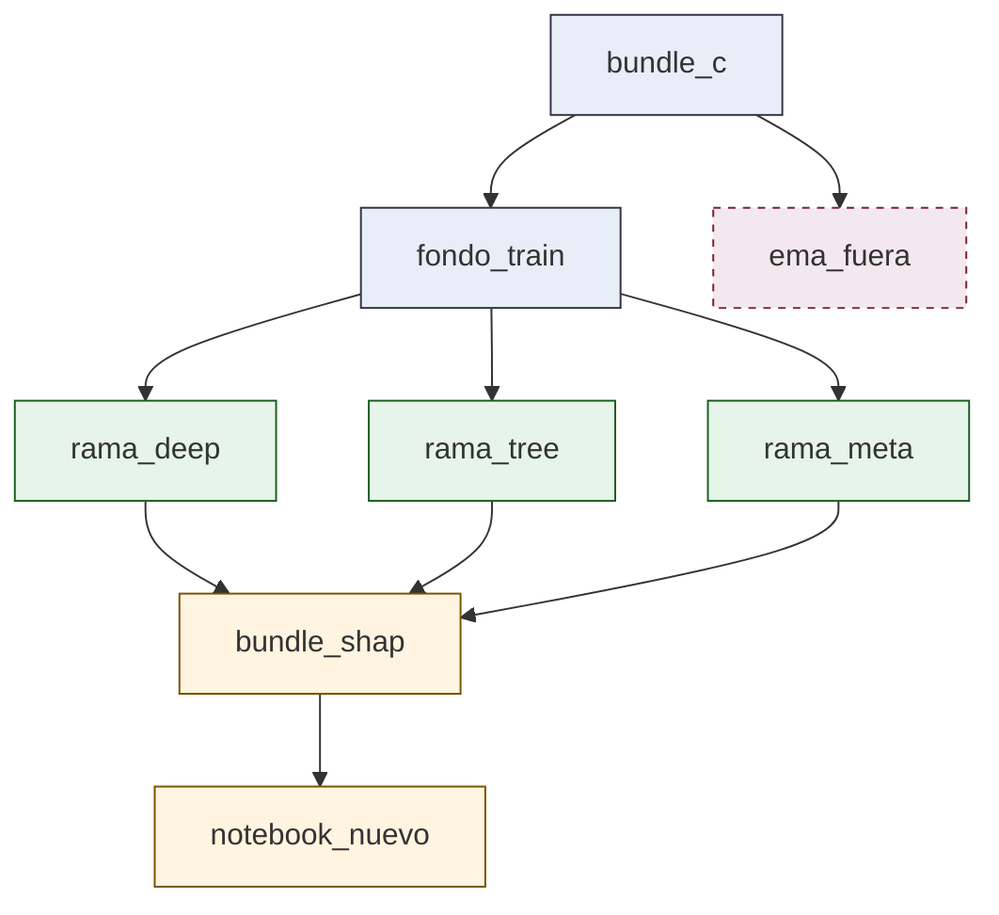

# Design: SHAP-C por ramas y arreglos de auditoría

## Technical Approach

Explicar el bundle C (`models/`, manifest `4.338`, seed 42) por ramas —BiLSTM, LightGBM y meta— sin reentrenar ni tocar modelos ni NB01-06. Nuevo módulo `src/ds02_rul/shap_c.py` con `ejecutar_shap_c`, patrón `src/clase/shap_clase_e2.py` (fondo solo train fold-0, validación de aditividad, `metadata.json`). Notebook nuevo y fino generado por `scripts/build_07_shap_c_notebook.py` (nbformat, nunca edición manual). Arreglos P0 en orden: docs → drift → seguridad → deps/CI → guard joblib → SHAP-C → builder → tests. Cubre SHAPC-*-01, DOC-C-01, CACHE-DRIFT-01, SEC-*-01, DEP-CI-01 y los 2 MODIFIED.

## Architecture Decisions

| # | Decisión | Alternativas rechazadas | Por qué |
|---|---|---|---|
| D1 | Tres ramas separadas (Deep/Tree/Permutation) | SHAP sobre el ensemble completo | TreeExplainer no cubre stacking/EMA; por ramas cada explainer es válido y auditable |
| D2 | BiLSTM: `DeepExplainer`, 19 canales de entrada (18 scaler + `cyc_norm`), fondo train fold-0 | Fondo con test [11,14,15]; GradientExplainer | Fondo solo train evita fuga; DeepSHAP cubre la red diferenciable |
| D3 | LGBM: `TreeExplainer` interventional, 93 feats reutilizando `ensemble._tabular` | Re-derivar features a mano; kernel SHAP | Mismo preproceso que entrenamiento (aditividad); exacto en árbol y barato |
| D4 | Meta: `PermutationExplainer` sobre `Z=[p_lstm,p_lgb]` (2D), sin `cyc_norm` | Incluir `cyc_norm` como 3ª columna | El meta no debe explicar por el contador de ciclos |
| D5 | EMA fuera de SHAP-C | Explicar la salida con EMA | EMA suaviza entre motores; no es atribuible por SHAP |
| D6 | `ejecutar_shap_c` + builder de notebook, patrón `shap_clase_e2` | Notebook a mano; notebook existente | Repo prohíbe editar notebooks; builder = nbformat regenerable |

## Data Flow



## File Changes

| File | Action | Description |
|---|---|---|
| `src/ds02_rul/shap_c.py` | Create | `ejecutar_shap_c` + 3 ramas + aditividad |
| `scripts/build_07_shap_c_notebook.py` | Create | Builder nbformat del notebook nuevo |
| `notebooks/07_shap_c_bundle_c.ipynb` | Create | Notebook fino (solo vía builder) |
| `tests/test_shap_c.py` | Create | Formas, aditividad, no-causal |
| `docs/rul-spec.md`, `docs/ADR-011.md` | Modify | C vigente `4.338`, `R6=C`, multisemilla histórica |
| `app/cache/cache_manifest.json`, `_p1_oof_cache.npz` | Modify | `manifest_sha256`, freeze, evidencia versionada |
| `app/api.py`, `Dockerfile`, `docker-compose.yml`, Streamlit | Modify | `compare_digest`, `/health`, rate-limit, bind `127.0.0.1` |
| `pyproject.toml`, `.github/workflows/ci.yml` | Modify/Create | Deps pineadas; CI `pytest` |
| `src/clase/`, `scripts/` | Modify | Guard `joblib.load` sin checksum válido |

## Interfaces / Contracts

```python
def ejecutar_shap_c(
    n_filas: int = 200, n_fondo: int = 200, seed: int = 42,
    out_dir: str = "resultados/shap_bundle_C", verbose: bool = True,
) -> dict: ...
```

Salidas: `resultados/shap_bundle_C/{shap_bilstm,shap_lgbm,shap_meta}.csv`, PNG por rama, `metadata.json` (explainer, masker, fondo, `n_features`, `base_value`, `aditividad_max_error`, versiones). Tolerancias: Tree/Permutation `rtol=1e-5, atol=1e-6`; DeepSHAP `<1e-2` declarado (aproximación). NASA: suma de exponenciales asimétricos, sin clamp 125 (SHAPC-DATA-01).

## Testing Strategy

| Layer | What to Test | Approach |
|---|---|---|
| Unit | Formas `(50,19)`, `(93,)`, 2D; aditividad por rama; nombres no `f0..` | `pytest`, `tmp_path` |
| Integration | Fondo train fold-0 sin test; bundle read-only; notebook vía builder | Reuso fixtures existentes |
| E2E | Ninguna | Fuera de CI: DeepSHAP offline |

## Known Limitations

- DeepSHAP es aproximado: error `<1e-2`, no exacto. Evidencia: skill SHAP exige verificar base+suma contra la salida del modelo; DeepExplainer no garantiza eficiencia exacta.
- Agregación a 19 canales pierde detalle temporal intra-ventana.
- TreeSHAP explica solo la rama LGBM, no el ensemble; el meta explica 2 salidas, no features crudas.
- Sin causalidad: SHAP describe asociaciones del modelo, no mecanismos del motor.
- TF en CPU no determinista: mitigación `PYTHONHASHSEED`, semillas TF, hilos=1; DeepSHAP offline, fuera de CI.

## Riesgos y orden

Riesgos: coste CPU/TF (Med, offline + hilos=1); preproceso distinto rompe aditividad (Med, reutilizar `_tabular` + assert base+suma); drift silencioso (Low, `manifest_sha256` + freeze). Orden: docs → drift → seguridad → deps/CI → guard joblib → `shap_c` → builder → tests (gate `python -m pytest tests -q` por fase y final).

## Threat Matrix

N/A — no routing, shell, subprocess, VCS/PR automation, executable-file classification, or process-integration boundary.

## Migration / Rollout

No migration required. Revert por commit sin push; `models/` y NB01-06 fuera del diff.

## Open Questions

- [x] Resuelta 2026-11-05 (padre): spec enmendada a `1e-2` para la rama DeepSHAP (error declarado en metadata); TreeSHAP/Permutation quedan en `1e-5`.

