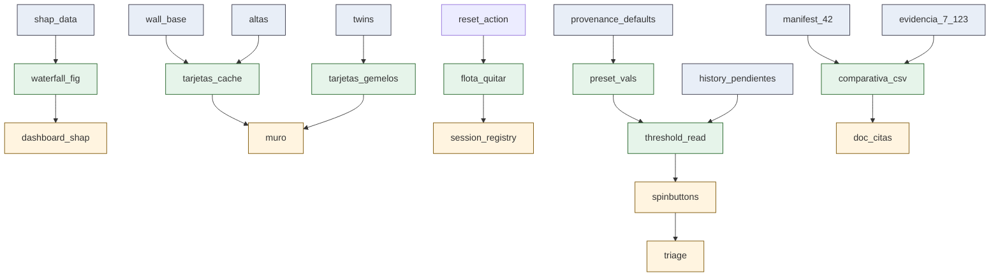

# Design: App fixes 1 — SHAP waterfall, fleet reset, preset restore, multiseed

## Technical Approach

Four disjoint fixes, one change: F1 scalar `totals` in the Plotly waterfall (SHAPC-WF-01); F2 make Reset symmetric with Incorporar by deleting alta+twin+hangar in the pure `flota` helper and wiring the dashboard handler to persist all three; F3 resync `session_state` to the preset values on preset change before the early threshold read so `value=` is never stale and story step 4 (35/20) cannot stick to Normal; F4 regenerate the CSV from measured evidence (`--desde-csv`, no retrain) and fix citations only. Strict TDD RED→GREEN per fix.

## Architecture Decisions

| # | Decision | Alternatives rejected | Why |
|---|---|---|---|
| D1 | `totals=float(base)` scalar, `measure` stays `relative`, no extra bar | Drop `totals`; add `total` bar + `measure`; switch to `shap_waterfall_png` (matplotlib) | Minimal diff, no new dependency; Plotly validates scalar (evidence: `ValueError` on list). Dropping loses the base anchor; a `total` bar needs `sum(contribs)+base` bookkeeping for no user gain. |
| D2 | Extend `flota.quitar_alta(registro, mat)` to also remove `twins[mat]`/`hangar[mat]` (normalized); dashboard Reset passes full `_registro()` and writes back all three | Dashboard-only slice without `flota` change; hide twin card without deleting; delete whole session registry | `flota` is the pure layer already tested without Streamlit; the twin/hangar keys are the matricula, so one helper fixes AppTest and unit tests. Hiding leaves disk state stale; wiping the registry would delete unrelated twins. |
| D3 | Track `_preset_prev`; on change, overwrite `th_apto_{preset}`/`th_aog_{preset}` with `_preset_vals` before the `_umbrales_pendientes` consume and the line-588 read | Separate history keys never touching preset keys; `st.selectbox(on_change=…)` callback; keep manual edits per preset | Single early sync fixes both stories (return-to-Normal and history contamination) and survives `value=`-ignored semantics. Separate keys need a new pending-override read path; callbacks add a second writer. Manual-edit preservation is dropped by design (see Limitations). |
| D4 | Regenerate via `python -m src.clase.evaluar_c_multisemilla --desde-csv` (43+--desde-csv already in tree, 3 rows, 4.368) then edit 5 doc citations only | Retrain seeds 7/123; hand-edit the CSV; re-edit notebook outputs | Retrain costs hours and TF CPU is non-deterministic (manifest would drift); hand-edit breaks provenance; notebook outputs are historical and out of scope. Seed 42 from the manifest is the source of truth. |

## Data Flow



## File Changes

| File | Action | Description |
|---|---|---|
| `app/ui_shap.py` | Modify | `totals=[float(base)]` → `totals=float(base)` (1 line) |
| `app/flota.py` | Modify | `quitar_alta` also drops twin+hangar for the matricula |
| `app/dashboard_ds02.py` | Modify | Reset handler uses full registry; preset-change sync before line 584 |
| `app/ui_modulos/_tab_flota.py` | Modify (if needed) | No widget change if dashboard sync suffices; document |
| `tests/test_app_fixes1.py` (new) or `tests/test_flota.py` | Create/Modify | RED→GREEN: waterfall, 3→5→3, Prudente→Normal, CSV/manifest row |
| `resultados/comparativa_c_multisemilla.csv` | Regenerate (gitignored) | Via `--desde-csv` |
| `README.md`, `AGENT.md`, `README.en.md`, ADR-011, `LEARNING_LOG.md` | Modify | Citations 4.368±0.053 only |

## Interfaces / Contracts

```python
def flota.quitar_alta(registro: dict, matricula: str) -> dict: ...
# registro: {"altas": {...}, "twins": {...}, "hangar": {...}}
# returns same shape with the matricula removed from all three sections

def ui_shap.shap_waterfall_fig(unit: int, max_display: int = 12, solver_sha: str = "", rows_sha: str = ""): ...
# go.Waterfall(totals=float(base), measure=["relative"] * n, x=feats, y=contribs)
```

## Testing Strategy

| Layer | What to Test | Approach |
|---|---|---|
| Unit | Waterfall builds, scalar totals, flota count, preset sync, CSV row-42 | `pytest --only` per file; `plotly` validation, pure `flota`, `session_state` via AppTest |
| Integration | Incorporar→Reset→reload wall 3→5→3; Prudente→Normal spinbuttons | AppTest with `conftest` session isolation; no `docs`, no retrain |
| Gate | Full suite | `.venv/Scripts/python scripts/verify_gate.py` + `--only` scopes |

## Known Limitations

- Preset resync discards manual per-preset edits on every preset change (evidence: `value=` is ignored once the key exists, so preserving edits plus restoring defaults needs a shadow store; D3 trades this for deterministic restore).
- SHAP waterfall shows contributions only, no final total bar (evidence: D1; the matplotlib PNG path remains available but is not wired).
- Multiseed NB05 OOF 4.330±0.053 is kept as historical OOF, not overwritten to 4.368 (evidence: `README.md` already labels it OOF; only NB06 window-test mean is homogenized).
- Extracted `go.Waterfall(totals=[…])` raises at construction (evidence: direct venv probe), so the RED test needs no bundle or cache.

## Threat Matrix

N/A — no routing, shell, subprocess, VCS/PR automation, executable-file classification, or process-integration boundary.

## Migration / Rollout

No migration required. Revert by commit without push; `models/`, notebooks and cache stay byte-identical.

## Open Questions

- None blocking; the manual-edit trade-off (D3) is accepted for this change.
