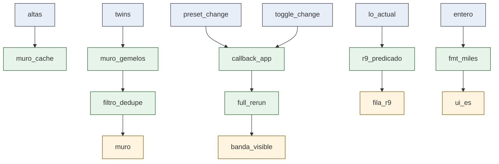

# Design: App fixes 2 — wall dedupe, preset refresh, R9 visibility, thousands format

## Technical Approach

Five disjoint UI fixes, one change: F1 filter twins already in `_altas()` inside `_tarjetas_gemelos` (wall 3→4→3, no `frame_con_altas`/`quitar_alta` change); F2 `on_change` callbacks on the Taller select/toggle calling `st.rerun(scope="app")` so module-level `banda_en_uso`/`correccion_en_uso` recompute in the same pass while `@st.fragment` is kept; F3 evaluate `si_R9_HANGAR` separately for the Motor row (view-only, `src/mia/motor.py` untouched); F4 single `fmt_miles` helper swapped at all Spanish `f"{n:,}"` sites; F5 absorbed by F2, label shortened only if the click still fails. Strict TDD RED→GREEN per fix.

## Architecture Decisions

| # | Decision | Alternatives rejected | Why |
|---|---|---|---|
| D1 | F1: in `_tarjetas_gemelos`, `skip if gemelo_id in {a["matricula"] for a in _altas()}` (~5 lines); Gemelos registrados table untouched; MODIFIED spec 425 same name | Stop creating the twin on Incorporar; delete twin from session on alta; filter in `frame_con_altas` | Alta must stay in `frame_con_altas` (snapshot/order/hangar) and Reset already deletes alta+twin+hangar. Filtering at card-build is the only point that removes the double wall card without losing the registro. |
| D2 | F2: `on_change=_rerun_app` (unless needed on number_input) where `_rerun_app` calls `st.rerun(scope="app")`; keep `@st.fragment`; no grid pagination change | Remove `@st.fragment`; `st.rerun()` fragment-local; dashboard-only preset resync (app-fixes-1, already present) | The fragment re-executes with frozen dashboard arguments (`:1142-1156`), so `banda_en_uso` stays stale. Fragment-local rerun cannot fix it; removing the fragment breaks wall pagination. Full-scope rerun from the callback fixes stale in one run. |
| D3 | F3: in `_tab_motor`, `r9 = R.si_R9_HANGAR({"limite_inferior": _lo_g, "alertas_datos": [], "umbrales": umbrales})` and render `R9 evaluada: Sí/No` with mandatory `evaluada, no dispara` when false | Modify `motor()` to return all evaluated rules; reuse `traza_decision()["porque"]` only; show catalog like Flota | `motor()` returns only `usadas` (winner), never the non-triggered set. Changing the engine touches a frozen decision path; the trace likewise lists only the winner. A separate predicate call is view-only and matches the Flota catalog semantics. Empty `alertas` keeps R1 from masking R9 on valid cache rows. |
| D4 | F4: `fmt_miles(n)` in `ui_data_loader.py` as `f"{n:,}".replace(",",".")`; swap ~18 sites to `fmt_miles(...)`; update `test_live_eval.py:79-80` to dot | `locale`/`format(..., "d")` with es-ES; per-site `.replace` without helper | A global locale affects every format spec and is untestable; per-site replaces scatter the rule. One helper is the single point of truth and the AppTest can assert `6.196` once. |

## Data Flow



## File Changes

| File | Action | Description |
|---|---|---|
| `app/dashboard_ds02.py` | Modify | F1 twin filter in `_tarjetas_gemelos`; F4 `fmt_miles` at 245,247,757,758,930,944,1750,1751,1756 |
| `app/ui_modulos/_tab_flota.py` | Modify | F2 callbacks + F5 label if needed; F4 at 532 |
| `app/ui_modulos/_tab_motor.py` | Modify | F3 R9 row after `Regla que decide` |
| `app/ui_data_loader.py` | Modify | F4 `fmt_miles` definition |
| `app/ui_modulos/_tab_auditoria.py`, `ui_batch.py`, `ui_inference.py` | Modify | F4 swap to `fmt_miles` |
| `tests/test_app_fixes1.py` | Modify | F1 `_wall` 5→4, disjoint-label asserts |
| `tests/test_app_fixes2.py` (new), `tests/test_live_eval.py` | Create/Modify | RED→GREEN: preset/toggle, R9, `fmt_miles` |
| `openspec/specs/ds02-dss-ui/spec.md:425` | Modify at archive | Same requirement name, 3→4→3 (MODIFIED) |

`app/flota.py`, `src/mia/motor.py`, `src/mia/reglas.py`, `models/*`, notebooks, `app/cache/**` untouched.

## Interfaces / Contracts

```python
def fmt_miles(n: int | float) -> str: ...
# f"{int(n):,}".replace(",","."); fmt_miles(6196) == "6.196"

def _rerun_app() -> None: ...
# st.rerun(scope="app")
```

## Testing Strategy

| Layer | What to Test | Approach |
|---|---|---|
| Unit | `fmt_miles`, `si_R9_HANGAR` 35.2 vs 20, `_wall` disjoint | `pytest --only` per file; pure functions |
| Integration | Incorporar→Reset wall 3→4→3; `preset.set_value`+toggle one run with band updated | AppTest with `conftest` session isolation; no retrain |
| Gate | Full suite | `.venv/Scripts/python scripts/verify_gate.py` + `--only` scopes |

## Known Limitations

- Full rerun restarts the whole dashboard, so heavy cached frames recompute visually but `frame_cache` stays ttl=3600 (evidence: `dashboard_ds02.py:800-808` hot path unchanged).
- R9 row evaluates with `alertas_datos=[]` (evidence: cache rows are valid; `alertas_de_ventana` in `ui_rules.py` returns `[]` on the cache, so R1 masking does not apply here).
- `fmt_miles` truncates floats to int (evidence: call sites are counts; no decimal format was replaced).

## Threat Matrix

N/A — no routing, shell, subprocess, VCS/PR automation, executable-file classification, or process-integration boundary.

## Migration / Rollout

No migration required. Revert by commit without push; `models/`, notebooks and cache stay byte-identical.

## Open Questions

- None blocking; F5 label shortening is conditional on the AppTest click evidence.
