# Design: Flujo n8n mínimo MIA-3

**Change:** `2026-11-06-ds02-n8n-decision`

---

## Architecture

```mermaid
flowchart LR
    accTitle: Flujo de decisión en vivo hacia n8n
    accDescr: La pestaña Casos decide con decision_en_vivo, construye el payload desde la traza, lo envía una vez por fingerprint al webhook de n8n, y el Switch reparte las acciones según la decisión.
    classDef app fill:#141d2e,stroke:#38bdf8,color:#e8eef7
    classDef n8n fill:#1a2a1a,stroke:#34d399,color:#e8eef7
    classDef ext fill:#2a1a1a,stroke:#f59e0b,color:#e8eef7
    casos_tab[app/dashboard_ds02.py pestaña Casos]:::app
    decision_vivo[["decision_en_vivo app/ui_rules.py"]]:::app
    payload_fn[["payload_desde_traza app/ui_n8n.py"]]:::app
    enviar_fn[["enviar_decision src/n8n.py urllib"]]:::app
    dedupe[(dedupe por fingerprint st.session_state)]:::app
    webhook[n8n webhook POST ds02/decision]:::n8n
    switch_n8n{{n8n Switch por decision}}:::n8n
    apto_set[Set log]:::n8n
    sheets[Google Sheets append]:::n8n
    postgres[Postgres insert]:::ext
    calendar[Google Calendar]:::ext
    gmail[Gmail]:::ext
    casos_tab --> decision_vivo
    decision_vivo --> payload_fn
    payload_fn --> dedupe
    dedupe -->|HANGAR o INSPECCION| enviar_fn
    dedupe -->|APTO solo log local sin POST| casos_tab
    enviar_fn --> webhook
    webhook --> switch_n8n
    switch_n8n -->|APTO| apto_set
    switch_n8n -->|INSPECCION| sheets
    switch_n8n -->|HANGAR| postgres
    postgres --> calendar
    calendar --> gmail
```

Secuencia (app → webhook → switch → acciones): `decision_en_vivo` produce traza; `payload_desde_traza` la convierte en JSON sin re-clasificar; el dedupe por fingerprint decide si se envía; `enviar_decision` hace POST con `urllib` (timeout 5 s); el webhook de n8n alimenta el Switch; cada rama ejecuta su acción distinta.

## Decisions

### D1. `urllib` stdlib frente a `requests`

**Decisión:** POST con `urllib.request` stdlib, timeout 5 s.
**Porqué:** `requests` no está en `requirements.txt`; añadirlo por un único POST añade una dependencia de red al entorno congelado del bundle. `urllib` basta para un POST JSON con timeout.
**Alternativa rechazada:** añadir `requests` a `requirements.txt` — rechazada: dependencia nueva por un único uso, y el task prohíbe usarla o añadirla.

### D2. Reutilizar la traza de `decision_en_vivo` frente a re-clasificar

**Decisión:** `payload_desde_traza` lee `decision`, `usadas`, `porque` y `alertas` de la traza ya producida por `decision_en_vivo`; `motivo = " · ".join(porque)`.
**Porqué:** la traza ya aplica el motor oficial con la invalidez real de la banda; re-clasificar con `L.classify` duplicaría la lógica y podría divergir (umbrales, borde de banda).
**Alternativa rechazada:** re-clasificar con `L.classify` en el payload — rechazada: prohibida por el alcance y fuente de divergencia UI/motor.

### D3. `/decide` en la API, rechazado

**Decisión:** no se crea endpoint `/decide` en `app/api.py`.
**Porqué:** `/predict` no aplica reglas; un `/decide` separado decidiría fuera del motor oficial y duplicaría la única vía de decisión (la pestaña Casos).
**Alternativa rechazada:** endpoint `/decide` en la API — rechazada: `/predict` no aplica reglas y la decisión pertenecería a dos sitios.

### D4. Watcher autónomo, rechazado

**Decisión:** sin watcher en segundo plano que vigile la flota.
**Porqué:** introduce una superficie de fallo nueva (proceso, polling, credenciales, reintentos) fuera del alcance MIA-3 mínimo; el punto de llamada es la evaluación en vivo que el usuario ya dispara.
**Alternativa rechazada:** watcher autónomo — rechazada: superficie de fallo desproporcionada para el reto; tampoco Telegram.

### D5. APTO: log local sin POST

**Decisión:** HANGAR e INSPECCION notifican por POST; APTO solo deja log local (`_log`) sin POST; SIN_DECISION no hace nada.
**Porqué:** APTO es el estado normal de la flota; notificarlo por webhook en cada evaluación inundaría n8n de tráfico sin acción. El log local conserva la trazabilidad.
**Alternativa rechazada:** POST también para APTO — rechazada: ruido sin acción asociada (la rama APTO del Switch solo hace Set log).

### D6. Ubicación del payload: `app/ui_n8n.py`, no `app/motor.py`

**Decisión:** función nueva en `app/ui_n8n.py` con nombre específico.
**Porqué:** `mia/motor.py` es el motor de reglas y `app/ui_rules.py` hace `import motor as M` con `app/` y `mia/` en `sys.path`; un `app/motor.py` genérico lo sombrearía y rompería la suite completa (pitfall 3 del loop SDD).
**Alternativa rechazada:** `app/motor.py` o cualquier nombre genérico — rechazada: sombreado de `mia/motor.py`.

### D7. `n8n/flujo.json` a mano si no se puede exportar, con credenciales solo en la instancia

**Decisión:** si el n8n local (corre en `:5678`) no permite exportar el flujo, se escribe el JSON en formato de exportación de n8n a mano y se verifica con `json.load`. El JSON referencia credenciales por nombre/ID, nunca valores.
**Porqué:** el repo solo guarda el flujo; las credenciales (Gmail/Calendar/Sheets/Postgres, ya guardadas en la instancia local) no pertenecen al repo.
**Alternativa rechazada:** inventar valores de credenciales en el JSON — rechazada: no hay valores que inventar y sería un secreto en git.

## Known limitations (con evidencia)

1. **El dedupe vive en `st.session_state`:** dura lo que dure la sesión de Streamlit; reiniciar la app re-envía un fingerprint ya enviado en una sesión anterior. Evidencia: `st.session_state` es por sesión; no hay persistencia entre sesiones en este change.
2. **APTO no llega a n8n:** la rama APTO del Switch existe en el flujo, pero la app no hace POST para APTO (log local). Evidencia: decisión D5; si se quiere APTO en n8n, hay que cambiar el punto de llamada.
3. **`motivo` es la unión de `porque`:** no existe un campo `motivo` separado en la traza del motor (`M.motor` devuelve solo `decision/usadas/porque`); se compone como en `decidir_ventanas` (`" · ".join`). Evidencia: `src/mia/motor.py` retorna `{"decision","usadas","porque"}`.
4. **El flujo se verifica como JSON, no ejecutándose:** sin acceso garantizado a la instancia local de n8n, `n8n/flujo.json` se valida con `json.load` y por inspección de nodos/conexiones, no con una ejecución real del workflow. Evidencia: formato de exportación de n8n; las credenciales viven fuera del repo.

## Files

- `app/ui_n8n.py` (nuevo): `payload_desde_traza`.
- `src/n8n.py`: `enviar_decision` real con `urllib`.
- `app/dashboard_ds02.py`: punto de llamada único tras `decision_en_vivo` en la pestaña Casos (sin tocar `score_table`, `decidir_ventanas`, `live_work_order`).
- `n8n/flujo.json`: workflow real (sustituye el placeholder).
- `tests/test_n8n_decision.py` (nuevo): RED tests de payload exacto, `enviar_decision` con `urllib` mockeado, dedupe y flujo JSON válido.
