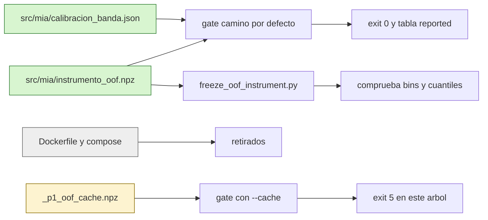

# Design: qué verifica el gate y con qué instrumento

**Change:** `2026-11-07-banda-instrumento-y-auditoria`
**Capability:** `ds02-rules-engine`, `ds02-dss-ui`

## Flujo

## Decisiones

### D1 — Instrumento npz versionado, no el joblib

`nb2_selection.joblib` no se puede versionar de forma útil: es un joblib de objetos
ajustados, git-ignored, y reajustarlo mueve la banda. El npz guarda las cuatro columnas
que la decisión necesita (`units`, `cycles`, `y`, `pred_ema`) en 115 225 B.

**Alternativas rechazadas:** versionar el joblib (opaco y re-ajustable); reajustar la banda
en cada ejecución (el artefacto bajo test cambiaría); dejar el gate rojo documentado (un
gate que se espera rojo no es un gate).

### D2 — La tabla OOF es `reported`, no `asserted`

La tabla de §13 se midió sobre la caché del 2026-10-26, que git ignora y que el instrumento
no puede reconstruir. En el camino por defecto se imprime marcada `reported`; compararla
como contrato sería exigir una cifra que nadie puede reproducir.

**Alternativa rechazada:** re-registrar los valores medidos hoy (`rmse 10.90` frente a
`9.491`) — republicaría una cifra y obligaría a tocar §13, ADR-009 y la spec de reglas por
un desajuste que no dice nada de la banda.

### D3 — El camino por defecto es el instrumento; `--cache` es explícito

Un comando sin flags debe poder ejecutarse en un clon. El refit no es determinista en CPU,
así que su sitio es un flag de desarrollo, y su exit 5 es la declaración honesta de que no
reproduce la tabla de ayer.

### D4 — El orden de la derivación es una medición, no una preferencia

`oof_calib` → puras (2/5/10/18/20) 44 737 → cada 3.ª fila por unidad en orden de ciclo =
14 915 → EMA5 recomputado sobre `pred_meta`. Suavizar **antes** de reducir da bins
`[5139, 6145, 3084, 547]` y `q_low -4.2639` en el bin 0; reducir y **después** suavizar da
`[5125, 6094, 3135, 561]` y `-4.3621`, que es lo que el JSON registra. Solo la segunda
reproduce la banda a sus 4 decimales.

### D5 — Docker se retira

Sin build verificado nunca, sin `USER` no-root y sin uso previsto. Ningún test lee
`Dockerfile` ni `docker-compose.yml` (verificado con `grep`), así que la retirada no puede
romper la suite; solo hay que limpiar los docstrings que los citan y las dos filas del
framework de auditoría.

## Limitaciones conocidas

1. **El instrumento prueba la correspondencia, no la idoneidad.** Que la banda sea los
   cuantiles de esas 14 915 filas no prueba que sean las filas correctas; eso lo sostienen
   la derivación (unidades, tamaño, bins exactos) y `procedencia` en el JSON.
2. **La no-determinación del refit no se arregla: se acota.** El camino `--cache` la expone
   en vez de esconderla.
3. **El bin de cola está sobre-cubierto** (0,9533 con 561 filas): es un hecho medido, no un
   defecto que corregir aquí.
4. **`app/cache/` no se regenera.** Su sello apunta al mismo manifiesto, así que sigue
   válido; regenerarla es otro trabajo y movería las 6 196 ventanas.
