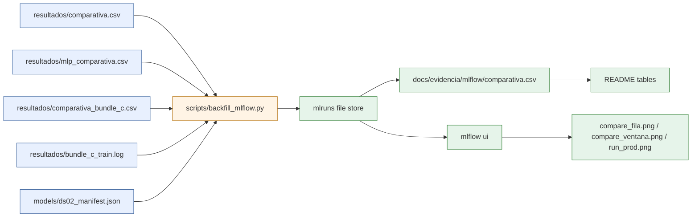

# Design: MLflow tracking for the class track and bundle C

**Change:** `2026-11-09-mlflow-pia4`
**Capability:** `rul-prediction-ds02`
**Date:** 2026-11-09

---

## Context

The class track already produced five classical models and four MLPs in
`resultados/comparativa.csv` and `resultados/mlp_comparativa.csv`. The deployed
bundle C already produced three components and one hybrid in
`resultados/comparativa_bundle_c.csv`, with real wall-clock times in
`resultados/bundle_c_train.log` (`LGBM 0.3 s | BiLSTM 113.2 s`, total 447 s).
The manifest holds the production parameters, the four model SHAs and the
official metrics.

None of that is in MLflow. The rubric asks for all models with hyperparameters
and metrics, plus a comparison and a capture. The change therefore records
existing measurements; it does not retrain.

## Architecture

## Decisions

### D1 — Text-only file store, not a server or SQLite

Thirteen runs fit in a file store; `mlruns/` is text (`meta.yaml`, `params/`,
`metrics/`, `tags/`), so a clone can read the run IDs without a process. A
tracking server or SQLite adds a service and a binary database for no rubric
gain. `mlruns/**/artifacts/` and `mlruns/.trash/` are git-ignored.

### D2 — Thirteen runs, not ten

The ten-run plan records the nine class models and the hybrid, but leaves the
deployed bundle as a black box. The four window-grain runs make “all models”
literal and expose the cascade: LGBM 7.067 → BiLSTM 5.654 → EMA5 5.618 →
hybrid 4.338. The components have real parameters; the multiseed rows do not,
so they stay in their CSV.

### D3 — Two grains, two comparison captures

Row-grain metrics (12 538 rows) and window-grain metrics (6 196 windows) are not
comparable. The `grano` tag separates them; the README has two tables and the
evidence has two captures. A single table mixing 7.3404 and 4.338 would be a
false comparison.

### D4 — Idempotency by `run_key`, delete + recreate

MLflow parameters are immutable after a run is created. `--write` searches for
active runs with the same `run_key`; if found, it deletes them and creates the
run again from the CSV. This is deterministic and avoids duplicate metric steps.
`--check` asserts exactly 17 active runs, one per key, with no duplicates.
Re-running `--write` never creates an 18th run.

### D5 — No model binaries, registry, autolog or signature

The rubric asks for tracking and comparison, not serving. `log_model` would write
binaries, duplicate `models/` and require a registry/backend; `autolog` would
retrain and move figures. The four SHAs are logged as parameters, which gives
traceability without a binary. This is a declared trade-off, not an omission.

### D6 — Export from the API, not a hand-written CSV

`--write` exports `docs/evidencia/mlflow/comparativa.csv` from
`MlflowClient.search_runs`. The README table is built from that file, so the
“table taken from MLflow” requirement is literal. The CSV carries `run_id` and
one row per run.

### D7 — No notebook instrumentation

The notebooks are evidence, not loggers. Adding `mlflow.start_run` to a notebook
would create a new run on every execution and could duplicate the 17 runs. The
backfill is the only writer; the test asserts 17. Re-executing notebooks cannot
duplicate the store.

### D8 — Time is measured or absent, never invented

`tiempo_s` is logged for the 9 row runs and for `bundle__lgbm_c` (0.3 s) and
`bundle__bilstm_c` (113.2 s). `bundle__bilstm_ema5` was not timed, so its time is
absent, not zero. The production run logs `tiempo_s=447` plus `t_lgb_s=0.3` and
`t_bilstm_s=113.2`; the total is explicitly a total, not a component time.

## Risks

| Risk | Likelihood | Mitigation |
| --- | --- | --- |
| A run without params reads as level 7 | Low | Every run has measured params; multiseed and table rows are excluded |
| Mixing grains in one table | Medium | `grano` tag, two README tables, two captures |
| `run_id` orphans in a clone | High if the store is not versioned | Store versioned; test reads it from disk |
| `--write` duplicates runs | Medium if naive | `run_key` search + delete + recreate; `--check` asserts 17 |
| A surface still says “MLflow fuera” | Medium | Grep gate in phase 6 and in the final report |
| Re-running a notebook duplicates runs | Low | No notebook imports MLflow; only the backfill writes |
| `uv lock` moves a pinned version | Low | `pip check` + explicit version assertions; rollback is removing one line |

## Known limitations

- `bundle__lgbm_c` and the adapted LGBM have identical metrics; they are one run
  with `alias=lgbm_adaptada`, not two.
- `bundle__bilstm_ema5` has no measured training time; the table shows `—`.
- The production run is backfilled from the manifest, not a live training run.
  Its metrics are the shipped `reference_row`, not a new measurement.
- A `--write` recreates runs, so `run_id` values can change; the CSV is regenerated
  and the README does not cite raw run IDs (the CSV does).
- The store is text but not a substitute for `models/`: the artifacts remain the
  contract.

## Alternatives rejected

- **Retrain to log live**: TensorFlow is not bit-for-bit deterministic; it would
  move the 4.338 and break `test_cache_drift`.
- **20 or 17 runs with multiseed**: the multiseed rows have only a seed, not
  hyperparameters; they are evidence of variance, not of model configuration.
- **`mlflow server` / SQLite**: one more process and a binary DB for 17 runs.
- **`log_model` / registry**: binaries and backend, no rubric gain.
- **Export to `resultados/`**: git-ignored; it would not survive a clone.
- **One combined comparison capture**: would mix grains and assert comparability
  that does not exist.
