# Design: Novel n8n action — HTTP call to the project's own API

**Change:** `2026-11-10-n8n-accion-propia`
**Capability:** `ds02-n8n-decision`
**Date:** 2026-11-10

## Technical Approach

The audit caps MIA-3 at 7 because every action in `n8n/flujo.json` is one of
the four class actions. The fix is one new action that is not in that set and
is executable locally: the HANGAR branch calls back into the project's own
FastAPI service.

`app/api.py` gains `POST /n8n-decision`, a token-guarded write route that
appends to `app/registros_n8n.json`. The token is the same `N8N_WEBHOOK_TOKEN`
the app already sends in `X-DS02-Token` (`src/n8n.py:28`), so the secret
stays out of the repo. Idempotency is a `fingerprint` check before the append,
which makes an n8n retry harmless and gives the audit its "idempotencia"
evidence.

`n8n/flujo.json` gains one `n8n-nodes-base.httpRequest` node after Gmail on
the HANGAR branch. The rest of the flow is untouched.

```mermaid
flowchart LR
    accTitle: Novel own-API action on the HANGAR branch
    accDescr: The n8n HANGAR branch calls back into the project FastAPI service, which authenticates the token, checks the fingerprint and appends the decision to a local log.
    webhook[n8n webhook ds02/decision] --> switch{{Switch por decision}}
    switch -->|HANGAR| postgres[HANGAR Postgres insert]
    postgres --> calendar[HANGAR Google Calendar]
    calendar --> gmail[HANGAR Gmail]
    gmail --> api_node[HANGAR API propia httpRequest]
    api_node -->|POST /n8n-decision + X-DS02-Token| endpoint[[app/api.py POST /n8n-decision]]
    endpoint --> auth{hmac.compare_digest token}
    auth -->|no| reject401[401]
    auth -->|si| dedupe{fingerprint ya en el log}
    dedupe -->|si| reject_dup[200 recorded false]
    dedupe -->|no| append[append en app/registros_n8n.json]
    append --> ok[200 recorded true]
    classDef n8n_node fill:#1a2a1a,stroke:#34d399,color:#e8eef7
    classDef api_node fill:#141d2e,stroke:#38bdf8,color:#e8eef7
    classDef store_node fill:#2a1a1a,stroke:#f59e0b,color:#e8eef7
    class webhook,switch,postgres,calendar,gmail,api_node n8n_node
    class endpoint,auth,dedupe,reject401,reject_dup,ok api_node
    class append store_node
```



## Architecture Decisions

### Decision: Own API endpoint instead of a new external service

**Choice:** `POST /n8n-decision` in the existing `app/api.py`.
**Alternatives considered:** Telegram/Slack webhooks (external, needs
secrets and network), a new microservice (another process for one write), a
n8n `write-file` node (n8n-host local, not project-owned evidence).
**Rationale:** it is the only action that lives in the project, is executable
in local with no new dependency, and records evidence a jury can open.

### Decision: Idempotency by `fingerprint`, checked before append

**Choice:** read the log, skip the append when the `fingerprint` is present,
answer `recorded: false`.
**Alternatives considered:** dedupe in n8n (the flow would need a lookup
branch per action), dedupe by timestamp (collisions on retry).
**Rationale:** the fingerprint is already in the payload (`app/ui_n8n.py:48`)
and is stable per case, so a retry is detectable without extra state.

### Decision: 503 when `N8N_WEBHOOK_TOKEN` is unset

**Choice:** the endpoint answers 503 with a clear message instead of failing
at import.
**Alternatives considered:** fail at startup (breaks `/health`, `/predict`,
the whole suite and the dashboard), allow unauthenticated writes (a write
endpoint without a secret is worse than no endpoint).
**Rationale:** the contract must degrade visibly and must not take the
artifact API down.

### Decision: The new node is not throttled

**Choice:** `/n8n-decision` is authenticated by token and therefore outside
the 10/min per-IP limiter, which stays on `/predict` and `/units`.
**Alternatives considered:** apply the limiter to every write (a burst of
HANGAR decisions would be throttled and silently lost).
**Rationale:** the limiter exists to protect scoring; a decision log write is
cheap and its loss is visible in the flow execution.

### Decision: The app is not modified

**Choice:** keep the single `enviar_decision(` call site in
`app/dashboard_ds02.py`; the new endpoint is called by n8n, not by the app.
**Alternatives considered:** make the app POST to `/n8n-decision` too (a
second write path, double notification).
**Rationale:** the audit's gap is the *action set* of the flow, not the app
call path; `tests/test_app_ux_bundle.py:105` asserts exactly one call site.

## Data Flow

1. n8n webhook `ds02/decision` → Switch → HANGAR branch.
2. Postgres insert → Calendar event → Gmail (unchanged).
3. New: HTTP Request POST `http://localhost:8000/n8n-decision` with
   `X-DS02-Token`.
4. `app/api.py` compares the token with `hmac.compare_digest`, validates
   `decision`, checks the `fingerprint`, appends
   `{decision, fingerprint, artefacto_sha256, unidad, ts}` to
   `app/registros_n8n.json`.

## File Changes

| File | Action | Description |
|------|--------|-------------|
| `app/api.py` | Modify | `N8NDecisionRequest` / `N8NDecisionResponse`, `_N8N_TOKEN`, `_load_n8n_registros`, `_append_n8n_registro`, `POST /n8n-decision` |
| `n8n/flujo.json` | Modify | Node `HANGAR API propia` (`n8n-nodes-base.httpRequest`) + connection from `HANGAR Gmail` |
| `tests/test_n8n_propia.py` | Create | Five endpoint tests + one flow test |
| `docs/defensa/guiones-15min.md` | Modify | One line naming the novel action |
| `src/clase/README.md` | Modify | One line naming the novel action |
| `.gitignore` | Modify | Ignore `app/registros_n8n.json` (per-machine state) |

## Interfaces / Contracts

```python
class N8NDecisionRequest(BaseModel):
    decision: str                 # APTO | INSPECCION | HANGAR
    fingerprint: str
    artefacto_sha256: str
    unidad: int | None = None
    token: str

class N8NDecisionResponse(BaseModel):
    ok: bool
    recorded: bool

# POST /n8n-decision
# 200 {"ok": true, "recorded": true}   # first time
# 200 {"ok": true, "recorded": false}  # duplicate fingerprint
# 400 {"detail": "..."}                # decision not in the set
# 401 {"detail": "..."}                # missing/invalid token
# 503 {"detail": "..."}                # N8N_WEBHOOK_TOKEN unset
```

Record shape in `app/registros_n8n.json`:

```json
{"decision": "HANGAR", "fingerprint": "fp1",
 "artefacto_sha256": "abc...", "unidad": 14,
 "ts": "2026-11-10T10:00:00+00:00"}
```

## Testing Strategy

| Layer | What to Test | Approach |
|-------|-------------|----------|
| Unit | Endpoint contract | FastAPI `TestClient` with `monkeypatch` env + `tmp_path` log |
| Integration | Flow importability | `json.load` of `n8n/flujo.json`, node/connection inspection |
| Regression | Existing n8n/API tests | `pytest tests/test_n8n_propia.py tests/test_n8n_decision.py tests/test_n8n_apto_post.py tests/test_security_api.py -q` |

## Threat Matrix

N/A — no routing, shell, subprocess, VCS/PR automation, executable-file
classification, or process-integration boundary is introduced. The new code
is an HTTP route plus a JSON append; the only network hop is the n8n node
already configured in the flow.

## Migration / Rollout

No migration required. `app/registros_n8n.json` starts empty; a missing or
corrupt file is treated as empty and recreated on the first valid write.

## Known Limitations

- The log is per-machine (`app/registros_n8n.json`), not a shared store; the
  idempotency window is the life of that file.
- The endpoint is not rate-limited, so a compromised token could write
  without bound; the token is the only guard, as in `src/n8n.py`.
- The flow is validated as JSON, not executed against the live instance;
  the instance is the user's, and the repo only ships the flow.

## Open Questions

- [ ] None.
