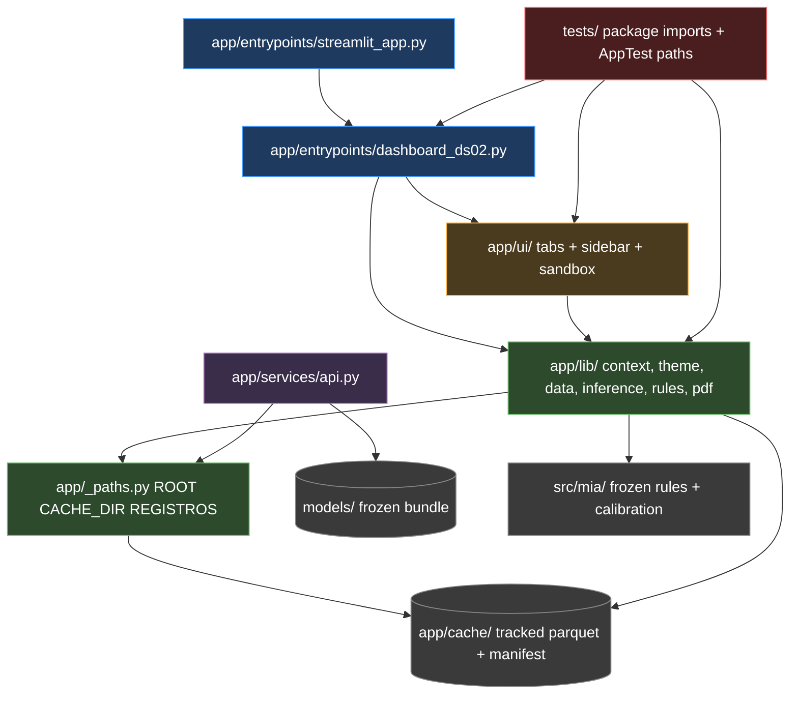

# Design: app/ readability restructure

**Change:** `2026-11-11-app-reestructuracion-legibilidad`
**Status:** Proposed
**Capability:** `ds02-dss-ui`
**Date:** 2026-11-11

---

## Context

`app/` holds 25 Python modules and 8 401 LOC. The 2026-11-04 split already
extracted the tabs into `app/ui_modulos/`, but the tree still uses flat imports,
nine in-module `sys.path.insert` calls, duplicated design tokens and thresholds,
and dead re-exports. The restructure makes the layout match the layering the
code already implies, without changing behavior.

Verified starting state (branch `refactor/estructura-ds02-clase-2026-11-10`):

- `app/` = 25 modules, 8 401 LOC; `dashboard_ds02.py` = 946 LOC.
- Nine `sys.path.insert` calls: `api.py:51`, `dashboard_ds02.py:34,49`,
  `streamlit_app.py:31`, `ui_inference.py:408,481`, `ui_shap.py:26`,
  `ui_rules.py:31`, `_tab_motor.py:62`.
- 22 dead imported names in `dashboard_ds02.py` (8 module aliases, 13 theme
  tokens, the `_sandbox_estres` re-export); an AST scan finds no consumer.
- Theme tokens duplicated in `_tab_flota.py:89-133`, `_tab_motor.py:72-73`,
  `_tab_auditoria.py:40-42` and `_sandbox_estres.py:33-36`; `theme.py` already
  owns `SKY/AMBER/GREEN/ROSE`, `BADGE_COLOR`, `BADGE_ICON`, `chart_layout`,
  `style_axes` and `fig_deriva`.
- `_latin1` duplicated at `dashboard_ds02.py:795` and `pdf_partes.py:17`;
  `_ahora` at `hangar.py:53` and `twin.py:30`; the 30/25 thresholds hardcoded at
  `_sidebar.py:113-114`, `_sandbox_estres.py:104-105`, `ui_alta.py:89`,
  `ui_n8n.py:11` and `dashboard_helpers.py:77`, while `ui_data_loader.py:47-48`
  already owns `DEFAULT_AIRWORTHY`/`DEFAULT_AOG`.
- `ui_data_loader.py:26-28` derives `APP_DIR`/`ROOT`/`CACHE_DIR` from `__file__`;
  the same math appears in `ui_inference.py:20`, `ui_rules.py:29`, `ui_shap.py:21`,
  `api.py:57,195`, `dashboard_ds02.py:57`, `hangar.py:192` and
  `streamlit_app.py:37`.
- 83 app-internal flat import statements across 19 files; 32 `AppTest.from_file`
  call sites and 12 structural `ui_modulos` references in `tests/`.

## Architecture



## Decisions

### D1 — Phase 0 fixes the gate before any move

The gate `scripts/auditoria/freeze_rules_evidence.py:320` calls
`REGLAS.pava_causal_no_creciente`. `REGLAS` is loaded by `_import_mia()`, which
only inserts `src/mia` when it is absent from `sys.path`. When another test has
already inserted `src/mia` and a later test inserts `src` at `sys.path[0]`,
`import reglas` resolves to the 37-line shim `src/reglas.py`, which does not
export the helper. Reproduced:

```
python -m pytest tests/test_mia_reglas_directas.py tests/test_api_limites.py \
    tests/test_rules_gate.py -q
-> 5 failed, 20 passed
   AttributeError: module 'reglas' has no attribute 'pava_causal_no_creciente'
```

Isolated, `tests/test_rules_gate.py` passes 9/9; the full suite passes
`445 passed, 1 skipped`. The fix is to re-export `pava_causal_no_creciente` from
`src/reglas.py` (additive, no behavior change).

**Alternatives rejected:** making `_import_mia()` insert `src/mia` at
`sys.path[0]` unconditionally — it hides the shadowing but leaves the shim
incomplete for any other consumer; and deleting the shim — the class track
requires `src/reglas.py`.

### D2 — `_paths.py` owns every repository path

`ui_data_loader.py:26-28` computes `APP_DIR = dirname(__file__)`, so moving the
module moves the cache. The same `__file__` math exists in `ui_inference.py`,
`ui_rules.py`, `ui_shap.py`, `api.py`, `dashboard_ds02.py`, `hangar.py` and
`streamlit_app.py`. One `app/_paths.py` anchored to a repository-root constant
(`Path(__file__).resolve().parents[1]`) owns `ROOT`, `APP_DIR`, `CACHE_DIR`,
`REGISTROS_PATH`, `SESIONES_DIR`, `N8N_REGISTROS_PATH` and the secrets path.

**Alternatives rejected:** per-module `dirname(dirname(__file__))` — it is
exactly what breaks on the move; and environment variables — they would change
the deployment contract.

### D3 — One `AppCtx` cycle, no `ctx_from_dashboard`

The four tabs already receive `AppCtx`; `_sandbox_estres` still takes eight
optional parameters and falls back to `sys.modules.get("dashboard_ds02")`. It
becomes the fifth `ctx` consumer (`_tab_casos.py:943` is its only call site).
The four tabs drop their `if ctx is None` fallback and `context.py` loses
`ctx_from_dashboard()`, becoming a pure dataclass.

**Alternatives rejected:** keeping the fallback — it hides missing context and
keeps `context.py` coupled to the dashboard; and passing the eight globals —
that is the 18-29 parameter problem the split already removed.

### D4 — Package imports, one entrypoint bootstrap

Modules import each other as `app.lib.*`, `app.ui.*`, `app.services.*`. The nine
in-module `sys.path.insert` calls are removed. Streamlit inserts only the main
script directory (`streamlit/runtime/scriptrunner/exec_code.py:63`), so the
entrypoint keeps exactly one bootstrap that adds the repository root; library
modules never touch `sys.path`.

**Alternatives rejected:** keeping the flat imports with a `sys.path` hack — it
is the current fragility; and a `conftest.py`-only fix — it would leave
`streamlit run` broken.

### D5 — Delete dead code instead of relocating it

The 22 dead imported names in `dashboard_ds02.py` are deleted, not moved. The
duplicated tokens, `_latin1`, `_ahora` and thresholds are unified on their
existing owners (`theme.py`, `pdf_partes.py`, `hangar.py`, `ui_data_loader.py`).

**Alternatives rejected:** keeping re-exports "for compatibility" — no test or
module consumes them (verified by AST scan).

## Risks

| Risk | Likelihood | Mitigation |
|------|------------|------------|
| `app/cache/` moves with `ui_data_loader.py` | High | Phase 3 before Phase 4; `_paths.py` constant; hashes of the three tracked files |
| `app/registros_sesiones/` moves with `hangar.py` | High | `_paths.py` owns `SESIONES_DIR`; `tests/conftest.py` fixed paths |
| A flat import survives | Medium | grep gate for `sys.path.insert` and flat app imports |
| `AppTest.from_file` paths break | Medium | update the 32 occurrences in the same phase |
| Structural tests read `app/ui_modulos/` | Medium | update the 12 references to `app/ui/` |
| Phase 0 shadowing returns | Low | gate passes in isolation and in the full suite |

## Known limitations

- The full suite passes today (`445 passed, 1 skipped`, `.venv`, branch
  `refactor/estructura-ds02-clase-2026-11-10`), but the Phase 0 failure is
  order-dependent: it appears only when `src/mia` is inserted before `src` and
  `test_rules_gate.py` runs after both. The fix removes the shadowing.
- `ds02-rules-engine` has no deployed spec under `openspec/specs/`; the Phase 0
  fix is documented here and in `tasks.md`, not as a delta.
- `app/services/api.py` imports `src.ds02_rul`, whose `__init__` pulls Keras; the
  API service therefore requires TensorFlow. The UI package does not.
- The plan's "47 flat imports" is an estimate; an AST scan counts 83 app-internal
  flat import statements across 19 files. The rewrite covers all of them.
- Tests reference `app/cache` or `app/registros` 22 times; those paths are
  asserted by `_paths.py` and must not move.

## Alternatives rejected

- **Move files first, fix paths later:** the cache and registries would move on
  the first commit, breaking `tests/conftest.py` and the tracked cache.
- **Keep `ui_modulos/` as the UI package:** the name describes an implementation
  detail, not the layer; `app/ui/` matches `app/lib/` and `app/services/`.
- **Keep `ctx_from_dashboard()` for tests:** it reads dashboard globals through
  `sys.modules`, which is the coupling the split removed.
- **One big commit:** the phases are gated independently; a single commit would
  mix a test fix, a behavior-preserving cleanup and a structural move.
