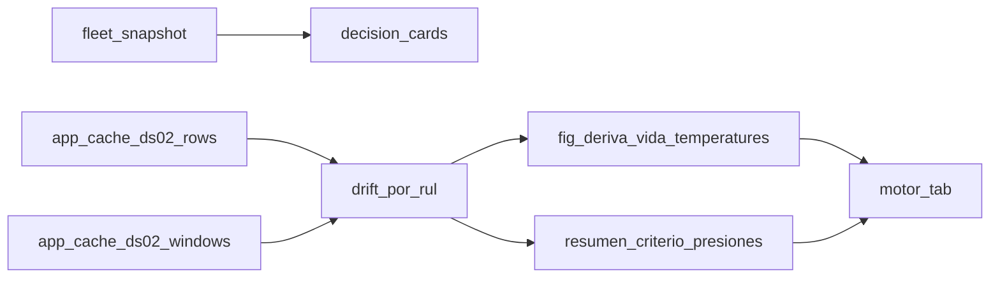

# Design: Prune the four lowest-value Motor charts

## Technical Approach

Rebuild the consolidated card around the decision (badge, three metrics, hangar lifecycle)
and reduce the radiography card to the aligned temperature figure plus two computed
sentences. Remove `fig_deriva()` and its plumbing so no dead helper survives. Everything is
source-driven: the figures that remain are built from the same aligned summary as before.

## Architecture Decisions

| Decision | Alternatives | Choice and rationale |
|---|---|---|
| What stays | keep all six / keep three | Trajectory, aligned temperature view and the decision cards. Scores 10, 8 and 8 against 2-5 for the rest, measured on the cache. |
| Pressure conclusion | disappear / text line / keep the curve | Text line built from the same summary. The finding (no channel passes the criterion, largest change 2,3 ppt, non-monotone) is evidence of diligence; the curve was not. |
| Resolution floor rule | hardcode "temperatures only" / derive from measurements | Derive: draw a group when its baseline error is smaller than its whole-life change. Makes the pruning rule auditable and self-updating with the cache. |
| `fig_deriva()` | keep unused / delete with plumbing | Delete. Grep shows `_tab_motor.py` is its only caller; keeping it would leave dead code and an `AppCtx` field nobody reads. |
| Gauge | fix its axis / delete | Delete. It duplicates the RUL p35 card and the arc is ambiguous on a 0-76 range. |
| Test updates | adjust afterwards / first | First. The tests that assert the removed surfaces become RED before the code moves, then GREEN after. |

### Data flow



## File Changes

| File | Action | Description |
|------|--------|-------------|
| `app/ui/_tab_motor.py` | Modify | drop the gauge column, both per-cycle blocks and the aligned pressure block; add the pressure note |
| `app/lib/theme.py` | Modify | delete `fig_deriva()`; add `resumen_criterio()` returning the computed sentence |
| `app/entrypoints/dashboard_ds02.py` | Modify | drop `fig_deriva` from the theme imports and the context construction |
| `app/lib/context.py` | Modify | drop the `fig_deriva` field |
| `tests/test_dss_interaction.py` | Modify | replace the gauge accessibility assertion and the per-cycle radiography assertion |
| `tests/test_radioografia_alineada.py` | Modify | keep the aligned-view contracts; add the pressure-note contract |

## Interfaces / Contracts

```python
# app/lib/theme.py
def resumen_criterio(resumen: pd.DataFrame, channels: list[str]) -> str:
    # «Ninguno de estos canales supera el criterio (...): mayor cambio X ppt, forma ...»
```

## Testing Strategy

| Layer | What to test | Approach |
|-------|--------------|----------|
| Unit | pressure note carries measured figures and monotonicity | pure function against the frozen cache |
| Contract | the Motor tab builds no gauge and no per-cycle figure | AST scan of `_tab_motor.py` |
| Integration | the app renders without exception after the prune | existing AppTest suites |
| E2E evidence | only the expected figures render at 1280 px and 560 px | Playwright capture and DOM inspection |

## Threat Matrix

N/A — no routing, shell, subprocess, VCS/PR automation, executable-file classification or
process-integration boundary is touched. The change writes no file and spawns no process.

## Known Limitations

- The aligned view keeps temperatures only, derived from the resolution-floor rule; if the
  cache changes and a pressure group becomes resolvable, the rule picks it up at render
  time but the UI wiring currently renders the temperature group explicitly.
- The rubric PIA asks for test metrics and real-vs-predicted plus a case with rules; none
  of the removed charts served those criteria.

## Migration / Rollout

No migration required. Single change, one commit, revertible by checkout.

## Open Questions

None. The product decisions were taken in the proposal round: keep the pressure conclusion
as text, delete the gauge, delete `fig_deriva()`.
