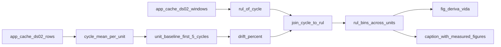

# Design: Life-aligned sensor radiography across test units

## Technical Approach

Two pure helpers plus wiring. A loader function builds the aligned frame from the frozen
cache with pandas only (no model load, no TensorFlow); a figure helper draws it with the
shared Plotly chrome; the Motor tab renders it under the existing per-cycle radiography.
The caption figures are computed from the same frame, so the text and the curve cannot
disagree.

## Architecture Decisions

| Decision | Alternatives | Choice and rationale |
|---|---|---|
| Baseline reference | first five cycles of each unit / global healthy mean / first cycle | First five cycles of each unit, identical to `fig_deriva`, so the two views share a definition and the change stays comparable to the existing chart. |
| RUL of a cycle | `min(y_true)` of the windows starting at that cycle / last window of the cycle | Minimum of the windows starting at that cycle: it is the most conservative reading of the ground truth available in `ds02_windows` and never invents a value between cycles. |
| Alignment axis | % of life / real RUL | Real RUL (user decision): it connects the view with the critical band and with the triage decision instead of an abstract percentage. |
| Aggregation | mean across units per RUL bin / one line per unit | Mean across units per RUL bin of 10 cycles. Per-unit lines would re-introduce the operational noise the aligned view exists to average out. |
| Which channels to highlight | fixed list T50/T48 / computed from the data | Computed at render time: any channel with `abs(corr(drift, RUL)) >= 0.3` on the aligned frame is highlighted. Today that selects T50 and T48; if the cache changes, the highlight follows the data instead of a stale literal. |
| Caption figures | hardcoded literals / computed | Computed from the aligned frame (first versus last RUL bin), with method and source stated. Hardcoded numbers would drift from the drawn curve the moment the cache is rebuilt. |

### Data flow



## File Changes

| File | Action | Description |
|------|--------|-------------|
| `app/lib/ui_data_loader.py` | Modify | `drift_por_rul(channels, bin_width=10)` returning the aligned long frame and a per-channel summary |
| `app/lib/theme.py` | Modify | `fig_deriva_vida(frame, summary, threshold_aog, height)` drawing the aligned curves with the shared layout and config |
| `app/ui/_tab_motor.py` | Modify | second chart and its caption under the per-cycle radiography |
| `tests/test_radioografia_alineada.py` | New | behaviour and contract tests |

## Interfaces / Contracts

```python
# app/lib/ui_data_loader.py
def drift_por_rul(
    channels: list[str], bin_width: int = 10
) -> tuple[pd.DataFrame, pd.DataFrame]:
    """Long frame: unit, cycle, rul, canal, deriva (%). Summary: per-channel first/last
    bin means, correlation with RUL, and the channels to highlight."""

# app/lib/theme.py
def fig_deriva_vida(
    frame: pd.DataFrame, summary: pd.DataFrame,
    threshold_aog: float, height: int = 280,
) -> go.Figure:
    """Mean drift per RUL bin and channel, critical band marked, shared chrome."""
```

## Testing Strategy

| Layer | What to test | Approach |
|-------|--------------|----------|
| Unit | baseline semantics and join | against the frozen cache: columns, one row per unit-cycle-channel, baseline equals the first five cycles |
| Unit | measured finding holds on this cache | T50 and T48 rise more than 0.5 ppt between first and last bin; every pressure channel moves less than 0.5 ppt |
| Unit | highlight rule | exactly the channels with `abs(corr) >= 0.3` are flagged |
| Integration | the figure carries the critical band and the highlighted series | inspect the built `go.Figure` objects and annotations |
| E2E evidence | rendering, no mode bar, no clipped text | Playwright at 1280 px and 560 px |

## Threat Matrix

N/A — no routing, shell, subprocess, VCS/PR automation, executable-file classification or
process-integration boundary is touched. The change writes no file and spawns no process.

## Known Limitations

- The effect is small by nature: about +1.5 percentage points for T50 across the whole
  life. The view makes it visible; it does not magnify it.
- Telemetry covers only the three DS02 test units (11, 14, 15), and the aligned view
  averages them; a per-unit breakdown is not offered here.
- The telemetry table is downsampled, so these are cycle-mean levels, not residualised
  signals with the operating conditions removed (documented as deferred elsewhere).

## Migration / Rollout

No migration required. Single change, one commit, revertible by checkout.

## Open Questions

None. Product decisions were taken in the proposal round: below the current view, RUL on
the X axis, selected channels with computed highlight, figures in the caption.
