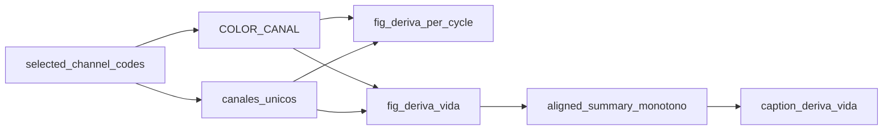

# Design: One palette per channel, duplicate collapse, honest pressure caption

## Technical Approach

Two pure helpers in `app/lib/theme.py` drive everything: a fixed colour table keyed by
channel code, and a duplicate-collapse helper. Both figures consume them, and the caption
builder reads a new `monotono` flag in the aligned summary. No module boundary moves and
no data path changes.

## Architecture Decisions

| Decision | Alternatives | Choice and rationale |
|---|---|---|
| Colour ownership | fixed table in `theme.py` / generated per figure | Fixed table. The vision inspection showed the same channel changing hue between views, which forces re-reading the legend; a table keyed by code makes identity stable by construction. |
| Duplicate handling | collapse / dim / document only | Collapse into one trace labelled `P15 · P21`. Measured correlation is 1.000 in all three units with a maximum absolute difference of 0.25 psia, so the second trace repeats information; the label keeps both codes visible. |
| Where collapse happens | figure helpers / loader | Figure helpers (`fig_deriva`, `fig_deriva_vida`) through `canales_unicos()`. The loader keeps the raw channels because the glossary and paste grid legitimately list all 18. |
| Caption when nothing drifts | qualitative claim / measured figures | Measured figures: largest bin change and monotonicity, plus the criterion. The previous wording asserted that the channels oscillate with flight conditions, a cause the aligned view does not compute; the inspection flagged the sentence contradicting the drawn arc. |
| Monotonicity evidence | eyeball / sign changes of the bin series | Sign changes between consecutive bin means. Data-driven, cheap, and it is the property the caption claims. |

### Data flow



## File Changes

| File | Action | Description |
|------|--------|-------------|
| `app/lib/theme.py` | Modify | `COLOR_CANAL`, `CANALES_DUPLICADOS`, `canales_unicos()`, duplicate collapse in both figures, caption honesty |
| `tests/test_radioografia_alineada.py` | Modify | collapse, palette uniqueness and caption contracts |

## Interfaces / Contracts

```python
# app/lib/theme.py
COLOR_CANAL: dict[str, str]          # codigo -> color, unico por canal visible
CANALES_DUPLICADOS: dict[str, str]   # P21 -> P15, P40 -> Ps30 (corr 1.000)

def canales_unicos(channels: list[str]) -> tuple[list[str], dict[str, str]]:
    # Devuelve los canales base en orden y su etiqueta con los codigos fusionados.
```

## Testing Strategy

| Layer | What to test | Approach |
|-------|--------------|----------|
| Unit | collapse keeps order and names both codes | both input orders produce `P15 · P21` |
| Unit | palette assigns a distinct colour per visible channel | uniqueness over the channel set |
| Unit | figures draw one trace per unique channel | trace count on the built `go.Figure` |
| Unit | caption states the largest bin change and monotonicity | text contains the computed figure and never the forbidden causal phrase |
| E2E evidence | same colour and single duplicate trace at both viewports | Playwright capture and DOM inspection |

## Threat Matrix

N/A — no routing, shell, subprocess, VCS/PR automation, executable-file classification or
process-integration boundary is touched. The change writes no file and spawns no process.

## Known Limitations

- The collapse rests on a measurement over the frozen cache; if the cache were rebuilt
  with different duplicate pairs, `CANALES_DUPLICADOS` would need revisiting. The label
  names both codes so the decision stays auditable.
- Colour identity applies to the two radiography views; other figures keep their own
  palettes.

## Migration / Rollout

No migration required. Single change, one commit, revertible by checkout.

## Open Questions

None. Assumed product decisions are recorded in the proposal because the question round
timed out.
