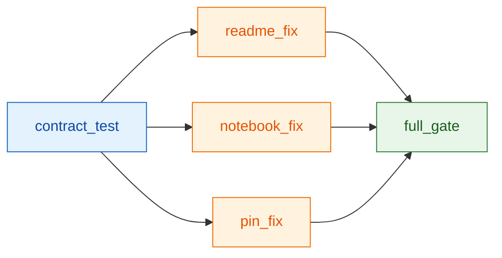

# Design: Documentation and rubric contracts (no n8n)

**Change:** `2026-11-15-rubrica-contratos-docs`
**Capability:** `rul-prediction-ds02`

## Context

The 2026-11-15 audit confirmed the model, the artifact hashes and the MLflow store
are sound, but the published documentation and one notebook drifted from the
contracts. The change closes that drift at documentation/config level only: no
retraining, no metric edits, no `models/` or `mlruns/` writes.

## Decisions

### D1 — One capability instead of a new one

Modify `rul-prediction-ds02` (multiseed requirement + new documentation-contract
requirements) rather than create `ds02-doc-contracts`.

- **Rationale:** the multiseed requirement already lives in `rul-prediction-ds02`;
  splitting documentation into a second capability would leave two specs describing
  the same published figures.
- **Rejected:** new `ds02-doc-contracts` capability (duplicate ownership);
  editing six capabilities separately (churn without benefit).

### D2 — RED-GREEN regression test in its own file

Add `tests/test_rubrica_doc_contract.py` asserting the README anchors, threshold
consistency and dependency pins.

- **Rationale:** the failures this change fixes are documentation regressions; a
  focused test keeps them from returning and satisfies `strict_tdd`.
- **Rejected:** asserting inside an existing UI test (couples docs to the app);
  prose-only review (already failed once).

### D3 — Notebook fix by copying the NB01 pattern

`notebooks/00_datos.ipynb` gets the same cell-0 header and live-log block shape as
`01_eda_y_contexto.ipynb`, with `TF_ENABLE_ONEDNN_OPTS` set before any TensorFlow
import and no later mention of the variable.

- **Rationale:** the static contract tests encode exactly that pattern; copying a
  known-good sibling is lower risk than inventing a new one.
- **Rejected:** excluding `00_datos.ipynb` from the glob (hides the notebook);
  regenerating the notebook (there is no builder for it, and it is not executed).

### D4 — Align documentation to code thresholds, never the reverse

Docs move to `25/20`; `app/lib/_constantes.py` and ADR-013 stay untouched.

- **Rationale:** ADR-013 is Accepted and the running app shows `(25 / 20)`; the
  `30/25` text is stale.
- **Rejected:** changing code defaults to match the docs (would alter decisions).

### D5 — Errata over rewriting history

`ADR-011` and older audit reports keep their original text; the vault note and the
current READMEs carry the corrected figures, and the multiseed requirement marks
`4.368` obsolete.

- **Rationale:** archived decisions are an audit trail; the sibling change
  `2026-11-12-cierre-auditoria-datos` set this precedent.
- **Rejected:** rewriting ADR-011 (destroys provenance).

## Flow

## Files

| File | Change |
|---|---|
| `README.md` | Anchors, time column, `25/20`, current multiseed, MLflow view command |
| `README.en.md` | Same thresholds and multiseed figures |
| `src/clase/README.md` | Dead paths, test count, node/branch counts |
| `MLProyectVault/50-Evidencia/e00-cifras-autoritativas.md` | Current CSV rows, coverage `0.901643`, thresholds |
| `requirements.txt`, `pyproject.toml` | Pin `pyarrow==<installed>` |
| `notebooks/00_datos.ipynb` | Cell 0 header, TF env order, live-log cell (not executed) |
| `tests/test_mlflow_live.py` | Count `7 -> 8` |
| `tests/test_rubrica_doc_contract.py` | New regression contract |

## Known Limitations

1. `data/` remains unversioned: a clean checkout cannot run the 21 tests that read
   `data/processed/*.parquet`. Evidence: `git ls-files data` returns 0; clean-tree
   suite reported 24 failed / 474 passed. Out of scope; documented in the README.
2. MLflow `meta.yaml` keeps absolute `artifact_uri` values and the empty
   `artifacts/` directories stay ignored. Evidence: `backfill_mlflow.py --check`
   passes on a clean `git archive` extraction, so they are inert without artifacts.
   Out of scope.
3. `n8n/` is not touched: flows, credentials, auth and the vault's "own action"
   claim stay with the owner. Evidence: user instruction 2026-11-15.

## Verification

- `python -m pytest tests -q` (full suite, must reach zero failures).
- `python scripts/operativo/backfill_mlflow.py --check` (must exit 0, 17 runs).
- `pytest tests/test_rubrica_doc_contract.py -q` (new contract, green).
