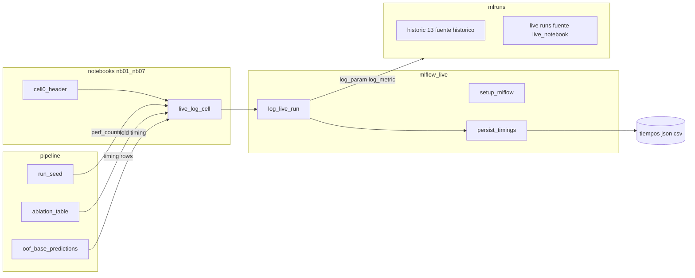

# Design: MLflow live in notebooks + timings

**Change:** `mlflow-live-notebooks`

## Decisions

1. **Single helper module** `src/ds02_rul/mlflow_live.py` (rejected: inline
   `mlflow.start_run` per notebook — 7 copies drift; helper is testable).
   `log_live_run` uses `MlflowClient.log_param`/`log_metric` directly, tags
   `fuente=live_notebook`; `clean_metric` drops NaN/inf.
2. **Notebooks patched by script** `scripts/patch_mlflow_live_notebooks.py`
   (rejected: hand-edit 7 ipynb — violates build-output rule; script is
   idempotent and re-runnable; `build_07` synced so regeneration keeps it).
3. **Backfill historic-only by tag filter** (rejected: separate experiment —
   breaks the “one table from MLflow” rubric; tag filter keeps one store).
4. **`puente_c` NaN refreshed, not removed** (rejected: returning `None`
   would break `f"{out['t_lgb']:.1f}"` consumers) — legacy NaN keys stay,
   new `timing` dict carries `None`s + `fuente=bundle_congelado`.

## Known limitations
- Notebook log cells are written but NOT executed in this change; live runs
  only appear when the user re-executes NB01–07.
- NB07 `res` shape is used defensively (params-only run if shape differs).
