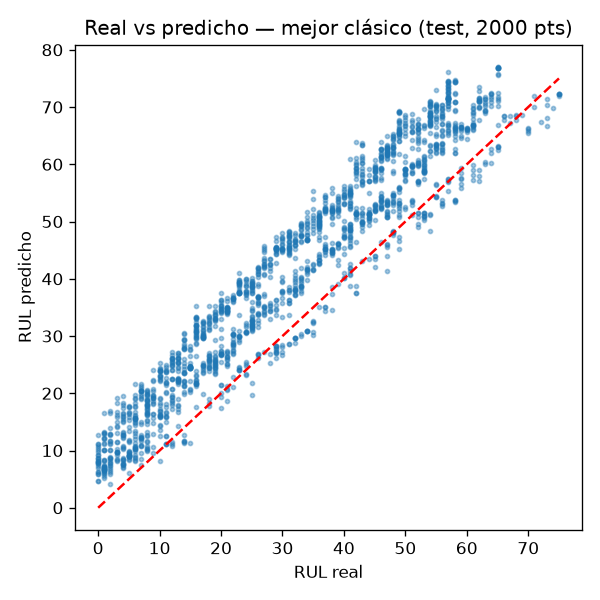
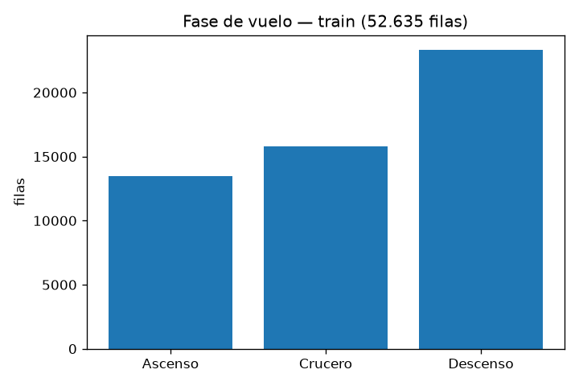
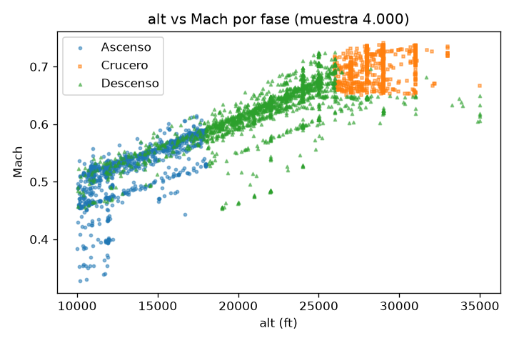
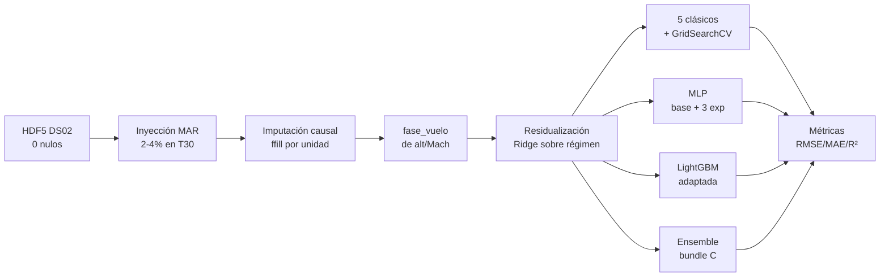
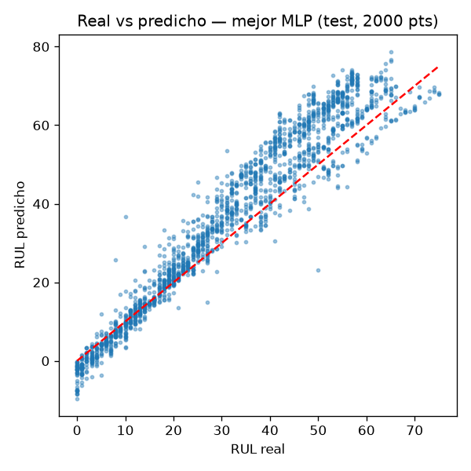
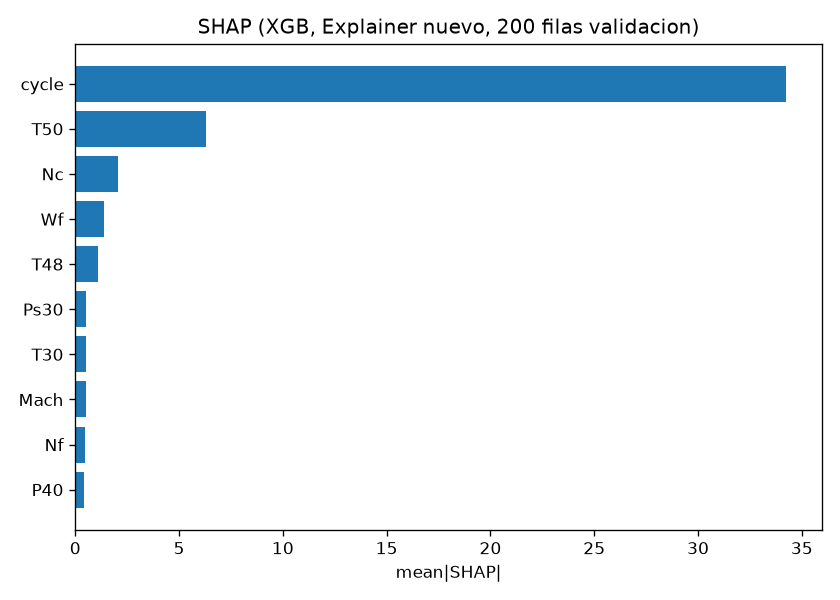
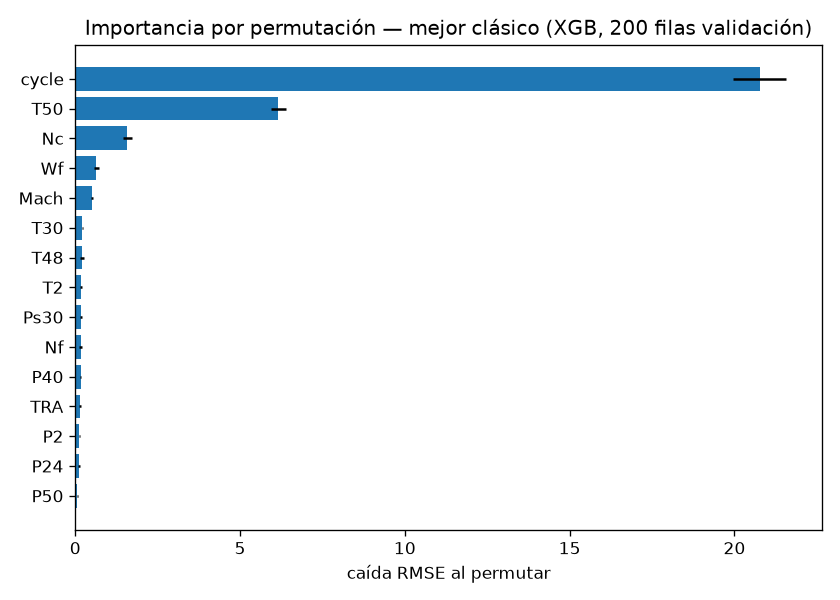

# DS02 clase · predicción de RUL y decisión de hangar

> **Español** | [English](../../README.en.md)

Sistema que estima la vida útil restante (RUL) de motores turbofán DS02 a partir de telemetría y propone APTO / INSPECCIÓN / HANGAR. **El mejor MLP de clase (E2, elegido por validación) logra RMSE 7.72 en test (val 7.34; uds 11/14/15); el híbrido desplegado (BiLSTM + LightGBM + stacking sobre la base con nulos tratados) está en 4.338 (media multiseed 4.322+-0.064 en NB06; NB05: 4.330+-0.053).**



*Real vs predicho en test (2.000 puntos) del mejor clásico elegido por validación: la fila ordena el desgaste, pero se dispersa en RUL alta. Es la evidencia didáctica de por qué el track necesita ventanas; la app de producción usa el bundle C.*

**Herramientas:** Python · pandas · matplotlib · scikit-learn · XGBoost · LightGBM · Streamlit · SHAP · MLflow (17 runs curados en `mlruns/`; PIA-4); n8n implementado en `src/n8n.py` y `n8n/flujo.json`.

---

## La necesidad de negocio

Taller MRO con flota DS02: un motor parado en pista cuesta decenas de miles de euros al día; una inspección a tiempo cuesta una fracción. Hoy la decisión de hangar depende de juicio experto sin número.

**Objetivo:** predecir la RUL de cada motor para que el jefe de taller decida APTO (sigue volando) / INSPECCIÓN (revisar en la próxima parada) / HANGAR (inmovilizar ya), con la predicción convertida en decisión por reglas y en acción automática vía n8n (flujo incluido; el JSON versionado está inactivo por diseño, pero la instancia local lo ejecutó 29 veces el 2026-11-07 con efectos reales).

| | |
|---|---|
| Tipo de problema | Regresión supervisada (RUL en ciclos; sin clases → SMOTE no aplicable) |
| Quién lo usa | Jefe de taller, que recibe la RUL + decisión por motor |
| Referencia externa | Las aerolíneas programan hangar por horas de vuelo; aquí por RUL predicha |
| Cuánto vale acertar (rango Boeing, credibilidad Media) | Un AOG imprevisto cuesta 10.000–15.000 USD/h (≈240.000–360.000 USD/día); una inspección programada cuesta una fracción. Evitar una sola parada no planificada al año (≈240.000–360.000 USD por cada AOG evitado) paga el sistema. Fuente: `costes_reales_aeronauticos.md` §1 (Boeing, citado de forma secundaria).

## Qué hemos construido


El modelo estima ciclos restantes. Las reglas (`src/mia/`, 6 con prioridad + seguridad R1) deciden sobre la estimación. n8n (MIA 3, flujo incluido; el JSON versionado está inactivo por diseño, aunque la instancia local lo ha ejecutado) lleva cada decisión a su acción (HANGAR → Postgres+Calendar+correo, INSPECCIÓN → Sheets, APTO → log).

**Tipo de IA.** Es una IA débil: solo predice RUL de DS02 con lo aprendido de su telemetría; no sabría fijar precios ni atender llamadas. Frente a una IA fuerte (AGI capaz de razonar en cualquier dominio, inexistente aquí), la nuestra no transfiere nada fuera de DS02 — y por eso es barata, rápida y auditable. Aprendizaje **supervisado** (cada fila lleva su RUL real) de **regresión** (valor continuo, no clase); se diferencia del no supervisado en que hay etiqueta y métrica contra verdad (RMSE/MAE/R²). Herramientas: scikit-learn (5 clásicos + MLP + pipeline), XGBoost (uno de los 5), LightGBM (componente del híbrido), Streamlit (app de producción con SHAP), SHAP (explicabilidad TreeExplainer), MLflow (tracking de 17 runs; PIA-4). n8n ya está incluido (`src/n8n.py` + `n8n/flujo.json`).

## Los datos

65.173 filas downsampleadas (STRIDE 100), 9 motores, train = dev (52.635, uds 2/5/10/18/20/16), test = uds 11/14/15 (12.538, una sola lectura).

| Campo | Qué significa | Tipo | Nulos antes | Nulos después |
|---|---|---|---|---|
| `unit` | Motor (grupo, no predictor) | numérica | 0% | 0% |
| `cycle` | Ciclo de vuelo | numérica | 0% | 0% |
| `alt, Mach, TRA, T2` | Régimen de vuelo | numéricas | 0% | 0% |
| `T24` | Temp. salida LPC (°R) | numérica | 0% | 0% |
| `T30` | Temp. salida HPC (°R), sonda con dropout | numérica | ~1.8% MAR (crucero alto) | 0% tras ffill+mediana |
| `T48` | Temp. salida HPT (°R) | numérica | 0% | 0% |
| `T50` | Temp. salida LPT (°R) | numérica | 0% | 0% |
| `P15` | Presión sangrado (psia) | numérica | 0% | 0% |
| `P2` | Presión entrada fan (psia) | numérica | 0% | 0% |
| `P21` | Presión salida LPC (psia) | numérica | 0% | 0% |
| `P24` | Presión salida HPC (psia) | numérica | 0% | 0% |
| `Ps30` | Presión estática HPC (psia) | numérica | 0% | 0% |
| `P40` | Presión total HPT (psia) | numérica | 0% | 0% |
| `P50` | Presión total LPT (psia) | numérica | 0% | 0% |
| `Nf` | RPM del fan | numérica | 0% | 0% |
| `Nc` | RPM del núcleo | numérica | 0% | 0% |
| `Wf` | Caudal combustible (pps) | numérica | 0% | 0% |
| `fase_vuelo` | Ascenso/Crucero/Descenso (nueva, de alt/Mach) | categórica | 0% | 0% |
| `RUL` | **Objetivo:** ciclos restantes | numérica | 0% (nunca se inyecta) | 0% |

**Calidad:** 0 duplicados funcionales; Mach en [0.33,0.74], alt en [10k,35k] (el 30k/0.8 teórico no existe en DS02: 0 filas, por eso los umbrales MAR son 27k/0.68). Nulos MAR con patrón físico (dropout de T30 en crucero alto) → imputación ffill causal por unidad + mediana de train (solo primer NaN). Split por motor, nunca por fila.

**Campos quitados (qué sale del modelo, por qué y grueso).**

| Campo | Sale de | Por qué | Grueso | Evidencia (path:línea) |
|---|---|---|---|---|
| `unit` | `X` / `FEATURE_COLS` (no es predictor) | Es el grupo del split por motor y de GroupKFold, no una lectura física: meterla permitiría fuga por motor. | 65.173 filas, 9 motores (52.635 train con 6 uds, 12.538 test con 3 uds 11/14/15) | `src/clase/pipeline_clase.py:7`, `src/clase/pipeline_clase.py:22-24`, `src/clase/dataset_clase.py:201-209` |
| `RUL` | `X` (queda como `y`) | Es el objetivo supervisado: predecirlo usándolo como entrada sería fuga. | 65.173 filas, rango 0–88 ciclos | `src/clase/dataset_clase.py:59` |
| `split_origen` | `X_train` / `X_test` (queda en `train.parquet`/`test.parquet`) | Solo trazabilidad train/test, no física ni predictor. | 65.173 filas (52.635 `train` + 12.538 `test`) | `src/clase/dataset_clase.py:60` |
| `fase_vuelo` | Bundle desplegado C (93 features) — **no** del track de clase | El track de clase sí la usa (19 numéricas + 1 categórica OneHot); el contrato 93 del bundle C es residualizado/ventanado sin categórica. | 65.173 filas, 3 categorías (Descenso 28.999 / Ascenso 18.595 / Crucero 17.579) | `src/clase/pipeline_clase.py:23-24`, `src/clase/ventanas_adaptadas.py:6` |

No se descarta ningún campo del dataset. `unit` no entra como predictor (es el grupo del split) y `RUL` es el objetivo; `fase_vuelo` es la categórica nueva del track de clase y el bundle desplegado no la usa (93 features sin ella).

**Lo más importante del EDA**

- La fase corta el plano alt-Mach en bandas coherentes (Ascenso 26% / Crucero 30% / Descenso 44%) y la RUL media difiere por fase → la categórica justifica el `OneHot` de PIA 3.
- T48 separada por fase: el sensor crudo manda régimen, no degradación → sin desacoplar, el modelo aprendería pilotaje (ADR-002).




## Pipeline de datos



---

## Resultados

**Métricas:** RMSE (castiga fallos gordos: un motor parado en pista es lo peligroso y lo caro), MAE (error medio por motor: cuántos ciclos de margen pierde el taller de media), R². Train/val por GroupKFold por motor; test una sola vez y solo del elegido.

**Clásicos (GroupKFold 3, groups=unit; elección por validación out-of-fold):**

| Modelo | RMSE val | MAE val | R² val | RMSE test | Tiempo (s) |
|---|---|---|---|---|---|
| XGBoost (mejor clásico) | 8.22 | 7.47 | 0.85 | 11.03 | 7.2 |
| Ridge | 8.28 | 7.66 | 0.85 | — | 3.5 |
| SVM | 8.29 | 7.53 | 0.86 | — | 2.7 |
| Random Forest | 9.07 | 8.15 | 0.83 | — | 79.6 |
| KNN | 9.41 | 8.19 | 0.82 | — | 9.1 |

**MLP (elegido: E2 regularización, 33 s):** base 7.36 → E1 7.48 → E2 7.34 → E3 7.36 (RMSE val). E1 memoriza train (5.23, el mejor train) y pierde en val: overfit; la regularización vence a la capacidad bruta.

**Modelo elegido del track de clase: MLP E2 (val 7.34; test 7.72 en lectura única).** No es el más rápido (XGB entrena en 7 s frente a 33 s) y se elige igualmente: RMSE manda porque un fallo gordo (motor parado) cuesta órdenes de magnitud más que segundos de CPU; a igualdad de RMSE se preferiría el más simple. Ese es el campeón **de clase**; el modelo
que entra en producción, y el que defiende el reto, es el bundle C (4.338), no E2.

**Modelo desplegado (bundle C):** híbrido BiLSTM + LightGBM + stacking + EMA sobre la base adaptada (MAR T30 + ffill con medianas de fit-units), RMSE 4.338 / NASA 2336.2 (test uds 11/14/15), media multiseed 4.322+-0.064 en NB06 (grano ventana test 6196; NB05 protocolo OOF da 4.330+-0.053). El híbrido es el "extra no visto en clase" del criterio SAA 6. El manifiesto declara la variante de datos, la partición de motores y las huellas SHA: el despliegue se audita desde el artefacto.

**Test (una lectura, solo el elegido):** MLP E2 RMSE 7.72 · MAE 5.81 · R² 0.83. Híbrido desplegado RMSE 4.338 · MAE 3.227 · R² 0.9461.

**Estabilidad entre semillas:** 42, 7 y 123 dan RMSE 4.322+-0.064 y NASA 2342.3+-43.4 en NB06 (NB05: 4.330+-0.053 / 2343.2+-24.1)
(`resultados/comparativa_c_multisemilla.csv`); la 42 es la del bundle desplegado, así que ese ± es la cota de ruido para leer cualquier diferencia. Evidencia: `resultados/bundle_c_multiseed.csv`, `resultados/comparativa_bundle_c.csv`.



**Qué pesan más (SHAP TreeExplainer exacto sobre XGB, fondo 200 train, explicadas 200 validación fold-0 —nunca test—):** cycle ≫ T50 > Nc. Describe el modelo, no el motor (no causal). Además, permutación sobre XGB (200 filas validación): cycle, T50, Nc; T30 6ª (el ffill la sostiene tras el dropout).




**SHAP del bundle C (el del modelo que se despliega):** `src/ds02_rul/shap_c.py` y
`notebooks/07_shap_c_bundle_c.ipynb` explican las tres ramas del híbrido (LightGBM,
BiLSTM y meta) sobre 200 filas de validación del fold-0, con aditividad comprobada
a ~1e-6. Es el SHAP que se defiende; el de XGB de arriba describe el track de clase.

**MLflow (PIA-4):** 17 runs en `mlruns/` (9 fila + 4 ventana + 4 ablación), export en [`docs/evidencia/mlflow/comparativa.csv`](../../docs/evidencia/mlflow/comparativa.csv) y capturas `compare_fila.png`, `compare_ventana.png` y `run_prod.png`. El store es texto, está versionado en git y no guarda binarios; los binarios siguen en `models/` y se identifican por SHA. El flujo n8n ya está incluido en `n8n/flujo.json`. La tabla comparativa sigue en `resultados/comparativa.csv` (pandas).

## Tests

~35 tests (`tests/test_clase_*.py` + `tests/test_live_eval.py` + `test_clase_c_multisemilla/test_shap_c/test_dss/test_fleet/test_hangar/test_simulacion/test_twin`). Cobertura: dataset, pipeline, clásicos, MLP, SHAP, tablas, ventanas, bundle C, agregación multiseed (suite completa en la verificación final).

## Estructura del track

```text
src/clase/            dataset_clase.py, pipeline_clase.py, train_clasicos.py, train_mlp.py, README.md
                        shap_clase.py, tabla_final.py, ventanas_adaptadas.py, train_ensemble_adaptado.py,
                        evaluar_c_multisemilla.py, puente_c.py
data/raw|processed/     HDF5 fuera de git; train_con_nulos + imputados + X/y + auditoria_nulos.json
notebooks/              01_eda_y_contexto.ipynb, 02_modelos_clasicos_y_mlp.ipynb, 03_feature_engineering_secuencial.ipynb,
                        04_arquitectura_bilstm_oof.ipynb, 05_meta_ensemble_y_conformal.ipynb,
                        06_evaluacion_produccion_comparativa.ipynb, 07_shap_c_bundle_c.ipynb
                        (todos con outputs; corresponden al `notebooks/` pedido en la spec del reto)
models/                 bundle desplegado (C): ensemble.joblib, bilstm_ds02.keras, scaler.joblib,
                        ds02_manifest.json (+ mejor_modelo_clase.joblib, el elegido de clase)
mlruns/                 store MLflow de texto (17 runs; sin artefactos)
docs/evidencia/mlflow/  comparativa.csv + capturas MLflow (comparaciones y producción)
n8n/                    flujo.json (flujo MIA 3: webhook → switch APTO/INSPECCION/HANGAR)
resultados/             eda_*.png, comparativa.csv, mlp_*.png/csv, importancia_*.png/csv, shap_*.png/csv
src/reglas.py           re-export de src.mia.reglas (6 reglas + seguridad)
src/n8n.py              cliente del webhook n8n (urllib, timeout 5 s, nunca lanza a la UI)
app/ui_shap.py          SHAP en la app de producción (TreeExplainer, global + waterfall)
app/dashboard_ds02.py   app de producción: evalúa el modelo desplegado (bundle C) en test, predice casos nuevos
                        con decisión de reglas y muestra la p (RUL) junto a la decisión (PIA-5; los modelos de clase
                        se evalúan en notebooks + test de lectura única reportado arriba)
```

## Cómo ejecutarlo

```bash
python -m src.clase.train_clasicos     # 5 modelos + comparativa.csv + joblib (~2 min)
python -m src.clase.train_mlp           # MLP base+3 + importancia (~8 min con validación OOF)
python -m src.clase.shap_clase          # SHAP TreeExplainer + PNG/CSV
python -m src.clase.evaluar_c_multisemilla  # seeds 42/7/123 -> resultados/comparativa_c_multisemilla.csv
python scripts/backfill_mlflow.py --check    # 17 runs + export; sin artefactos
streamlit run app/dashboard_ds02.py        # app de producción (bundle C + SHAP)
python -m pytest tests/test_clase_*.py tests/test_live_eval.py -q
```

`requirements.txt` pinnea todo lo importado (numpy → shap, streamlit, fpdf2…) e incluye `mlflow==3.18.0` para el store de texto (PIA-4); ningún notebook lo importa. El backfill es el único que escribe los 17 runs.

## Acción propia en n8n (MIA-3)

La rama HANGAR del flujo llama a `POST /n8n-decision` de la API del proyecto (`app/api.py`), que registra la decisión con token compartido (`hmac.compare_digest`) e idempotencia por `fingerprint`; el flujo consume la API propia, no solo servicios de terceros.

## Autoría

Track de clase sobre N-CMAPSS DS02 · rama `clase-modelo-c` · change openspec `2026-11-02-clase-track` · Curso IA y Big Data 2026-27